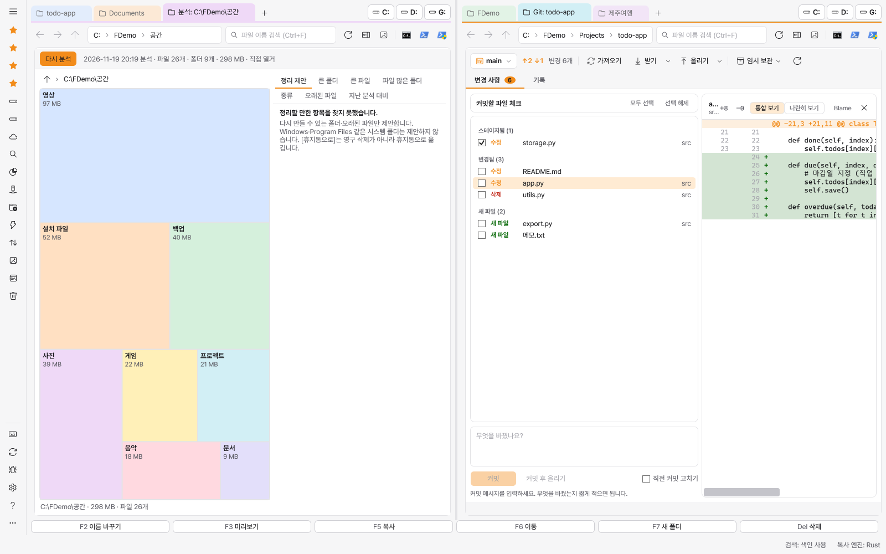

# Foldy

### A fast, smart file manager, even offline

Even easier when connected to AI

[한국어](README.md) · **English**

  

Foldy is a free, open-source dual-pane file manager for Windows 10/11. Its features are rule-based and run on your own PC, with no account and no internet needed. Connecting an AI app is optional.

*(All screenshots are real Foldy screens taken with fake sample folders. They contain no personal data. The app is being translated; screenshots are in Korean for now.)*

**[⬇ Download the latest version (MSI)](https://github.com/chadolkr/Foldy/releases/latest)** · Windows 10/11 x64 · Free and open source (GPL-3.0)

## The four things Foldy is best at

They sit at the top of the sidebar, one click away.

1. 🔎 **Find anything (Ctrl+Space anywhere)**: files, apps, Windows settings, Foldy features and quick math in one box. Name search across 2.17 million files takes about **0.003 s** (measured on a laptop), thanks to a background index of your NTFS drives. Network drives, Google Drive, USB sticks and SD cards are gathered gently in the background.
2. 📊 **Free up space**: folder analysis shows what takes up space as big boxes and picks only what is safe to delete (temporary files, build output, `node_modules`, and so on). Everything goes to the Recycle Bin, so it can be restored.
3. 🧹 **Tidy up folders**: a step-by-step helper asks *where* (desktop, Downloads, the current folder) and *how* (by type, by date, or into the four PARA boxes), then shows the result before anything moves. Nothing is deleted, and one undo puts it all back. When your desktop or Downloads holds more than 20 files, Foldy offers this in a one-line suggestion that you can dismiss for good.
4. 🗂️ **Folders from a template (Ctrl+Shift+N)**: preview and create folder structures such as PARA, Johnny.Decimal, household papers, or project phases from international standards (PMBOK, ISO/IEC/IEEE 12207 for IT projects, ISO 19650 for construction and design). Each folder says what belongs in it.

## Also in the box

- **Two panes and tabs**: drag between panes or press F5 to copy, F6 to move. A fast parallel copy engine, with two kids playing basketball while it runs.
- **Slow drives handled for you**: Foldy measures each drive and keeps heavy work off slow ones, so the window never freezes.
- **Preview (F3)**: photos, documents, code and PDFs without opening them.
- **Git**: branch and changes appear when you enter a project folder; commit, pull and push with buttons.
- **SFTP**: open a server as a tab and drag files in and out.
- **Locked notes, password-protected files and a vault** for things you want to keep private.
- **Who is using this file?**: when a copy, move or delete fails, Foldy names the program holding the file.
- **AI connection (MCP, optional)**: connect Claude Desktop, Claude Code, Codex, Gemini CLI, Cursor or VS Code with one button. Your AI can then find files, look inside folders and check folder sizes through Foldy. It is read-only, sees only what your account can see, and is off by default.
- **Automatic updates**, including behind company proxies, installed only after your running jobs finish.

## Languages

Foldy is being translated into **English, Spanish, Japanese and Simplified Chinese**, alongside Korean. You can choose the language in Settings → Appearance. Until the translation is complete, Foldy starts in Korean unless you pick another language.

## Install

Download from [Releases](https://github.com/chadolkr/Foldy/releases).

> **The only official sources are https://github.com/chadolkr/Foldy and https://chadolkr.github.io/Foldy/.** A Foldy from anywhere else may be fake. [SECURITY.md](SECURITY.md) explains how to verify a download (VirusTotal, SHA-256, build provenance) and lists every network connection Foldy makes.

| Method | File | Notes |
| --- | --- | --- |
| **MSI (recommended)** | `Foldy-<version>-x64.msi` | Double-click to install. Uninstall from Settings → Apps → Installed apps → Foldy. |
| Script | `Foldy-<version>-x64-setup.zip` | Unzip and run `Foldy 설치.cmd`. |

Installing also adds a background **index service** (FoldyIndexer, runs as SYSTEM) for instant name search; it is removed when you uninstall. It indexes the whole PC, but search results only show your own folders and shared folders.

## Why open source?

> Open source is how I got this far. Foldy is my small way of saying thank you. I hope everyone, without discrimination, finds happiness.
>
> — David CHA

That is why Foldy is released under GPL-3.0. If something bugs you or you have an idea, [open an issue](https://github.com/chadolkr/Foldy/issues) or send a pull request.

## More

- Full Korean manual: [README.md](README.md) and the in-app help (F1)
- Privacy: [PRIVACY.md](PRIVACY.md) — nothing leaves your PC except update checks and bug reports you choose to send
- Design principles: [docs/DESIGN-PRINCIPLES.md](docs/DESIGN-PRINCIPLES.md)
- License: GPL-3.0-or-later
