# Foldy


### 찾고, 옮기고, 정리하는 일을 한 창에서 빠르게.

- **검색**은 0.003초
- **느린 드라이브**는 알아서 가볍게
- **Git 상태**는 폴더에 들어가는 순간 보이고
- **폴더 분석**은 공간을 잡아먹는 폴더를 짚어 주고
- **폴더 템플릿**은 Java·Python 같은 프로젝트 구조를 버튼 한 번에

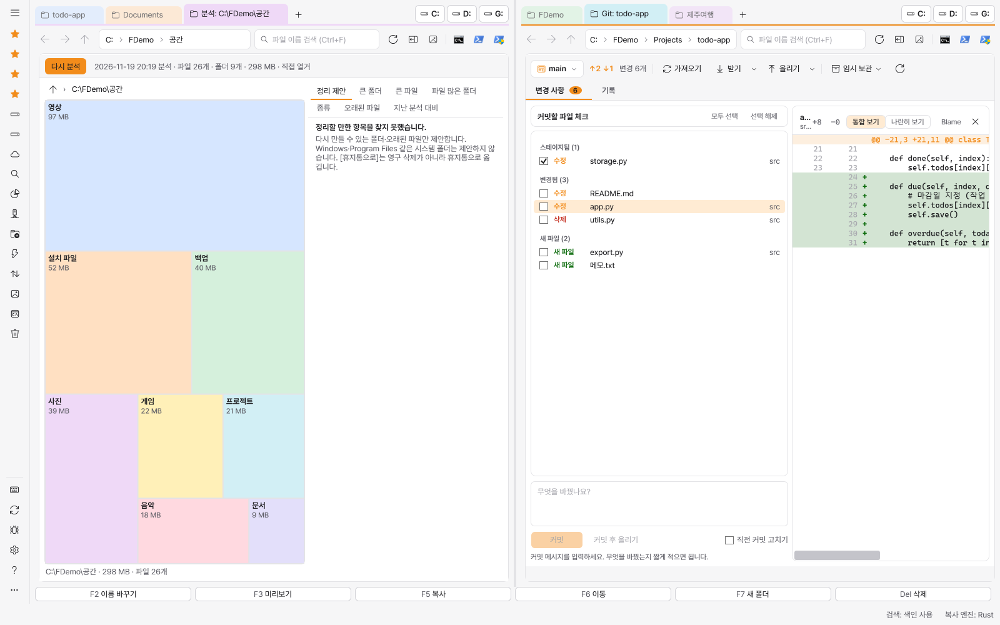

*(이 문서의 모든 화면은 가짜 샘플 폴더로 찍은 실제 Foldy 화면입니다. 개인 정보는 들어 있지 않습니다.)*

**[⬇ 최신 버전 내려받기 (MSI)](https://github.com/chadolkr/Foldy/releases/latest)** · Windows 10/11 x64 · 무료 오픈소스 (GPL-3.0)

## 이런 게 좋아요

- 🔎 **Ctrl+Space 하나로 다 찾아요.** 어느 프로그램에서든 Ctrl+Space를 누르면 파일·앱·Windows 설정·Foldy 기능·계산까지 한 칸에서. 냄새 잘 맡는 블러드하운드가 킁킁 물어 와요.
- ⚡ **치는 순간 찾아요.** 내 PC의 파일 217만 개 중에서 이름 검색이 **0.003초**. 기다릴 틈이 없어요. *(노트북 실측)*
- 🐢➡️🐇 **느린 드라이브도 알아서 척척.** 폴더를 열 때마다 속도를 재서, 회사 보안 드라이브처럼 느린 곳은 스스로 알아채요. 목록부터 바로 보여 주고 무거운 일은 뒤로 미뤄서 절대 멈추지 않아요. 설정할 것도 없어요.
- 📊 **용량 범인 한눈에.** 폴더 분석을 누르면 어떤 폴더가 공간을 잡아먹는지 큼직한 상자 그림으로 보여 주고, 지워도 되는 것(임시 파일·빌드 결과 등)까지 골라 줘요. 휴지통 용량도 보고 바로 비울 수 있어요.
- 🧊 **10만 개 폴더도 0.03초.** 아무리 큰 폴더도 눈 깜짝할 새 열려요.
- 🏀 **복사가 재밌어요.** 빠른 병렬 복사가 도는 동안 아이들이 농구해요. 다 끝나면 3점슛!
- 🪟 **두 창이 나란히.** 왼쪽에서 오른쪽으로 끌어 놓거나 F5 한 번이면 복사 끝. 탭은 색깔별로, 열어 둔 폴더는 다음에도 그대로.
- 👀 **열지 않고 봐요.** F3을 누르면 사진·문서·코드·PDF가 목록 위에 바로 떠요.
- 🌿 **Git이 알아서 켜져요.** 프로젝트 폴더에 들어가면 브랜치·변경 수가 보이고, 클릭 몇 번으로 커밋·올리기.
- 🌐 **서버 폴더도 내 폴더처럼.** SFTP 서버를 탭으로 열고 끌어 놓기로 올리고 내려받아요.
- 🧹 **방 청소하듯 정리해 드려요.** 쌓인 바탕화면은 "바탕화면 보관" 폴더에 종류별로, 다운로드는 이미 설치한 설치 파일·중복·이미 푼 압축을 골라서, 몇 GB씩 쌓인 로그는 월별 zip으로. 버리지 않고 보여 주고, 되돌릴 수 있어요.
- 🗂️ **정리는 맡겨 주세요.** 다운로드 폴더를 종류·날짜별로 한 번에 정리(되돌리기 가능), Java·Python·PARA 등 16가지 폴더 구조(폴더마다 무엇을 넣는지 설명까지)를 클릭 한 번에.
- 🔄 **업데이트는 신경 끄세요.** 회사 프록시 뒤에서도 알아서 확인하고, 하던 작업이 끝난 뒤에 설치해요.

## 목차

- [이런 게 좋아요](#이런-게-좋아요)
- [핵심 원칙](#핵심-원칙)
- [설치](#설치)
- [패널과 탭](#패널과-탭)
- [사이드바](#사이드바)
- [파일 작업과 복사 엔진](#파일-작업과-복사-엔진)
- [미리보기](#미리보기)
- [Markdown 보기](#markdown-보기)
- [느린 드라이브](#느린-드라이브)
- **[🔍 찾기](#-찾기)**
  - [빠른 검색 (Ctrl+Space)](#빠른-검색-ctrlspace)
  - [검색과 색인 서비스](#검색과-색인-서비스)
  - [폴더 분석](#폴더-분석)
  - [이미지만 보기](#이미지만-보기)
- **[🧹 정리하기](#-정리하기)**
  - [정리 도구](#정리-도구)
  - [폴더 템플릿·위저드·정리](#폴더-템플릿위저드정리)
- **[🔒 지키기](#-지키기)**
- **[🔗 연결하기](#-연결하기)**
  - [SFTP와 SSH](#sftp와-ssh)
  - [Git](#git)
- [설정과 테마](#설정과-테마)
- [단축키](#단축키)
- [버그 신고와 버그 진단 모드](#버그-신고와-버그-진단-모드)
- [자주 묻는 질문](#자주-묻는-질문)
- [소스에서 빌드](#소스에서-빌드)
- [기여하기](#기여하기)
- [Code signing policy](#code-signing-policy)
- [왜 오픈소스인가요](#왜-오픈소스인가요)
- [라이선스](#라이선스)


## 핵심 원칙

- **빠르다**: 화면을 그리는 스레드에서는 디스크를 읽지 않습니다. 드라이브마다 작업 줄이 따로 있고, 큰 목록은 직접 그리며, 색인과 복사는 Rust 엔진이 맡습니다. 응답 없는 네트워크 드라이브가 있어도 다른 탭은 그대로 움직입니다.
- **안정적이다**: 색인·업데이트는 별도 프로세스(서비스)에서 돌고, 엔진 호출 오류가 앱을 죽이지 못하게 막고, 엔진이 없으면 기본 경로로 대신합니다. 복사 중에도 다른 폴더를 마음대로 볼 수 있습니다.
- **단순하다**: 탐색기와 같은 동작(우클릭 메뉴, 끌어 놓기, 키 조작)을 그대로 두고, 모달 창 대신 제자리에서 진행 상황을 보여 줍니다. **복잡한 기능은 만들지 않습니다.** 설정은 꼭 필요한 것만 있습니다.
- **누구나 쉽게**: 할아버지 할머니도 설명서 없이 쓸 수 있게 만들어요. 버튼은 마우스로 한 번에 맞출 만큼 크게(32px, 최소 28px), 켜고 끄는 것은 늘 같은 자리·같은 버튼에서, 같은 종류의 버튼은 같은 아이콘으로, Windows에서 이미 아는 방식(경계선 끌기, 오른쪽 클릭)으로, 되살릴 수 없는 일은 미리 분명히 알려 드려요. 자세한 기준은 [docs/DESIGN-PRINCIPLES.md](docs/DESIGN-PRINCIPLES.md).
- **다양한 기능**: 듀얼 패널·탭, 즉시 검색, 폴더 분석, Git, SFTP/SSH, 터미널, Markdown 뷰어, 폴더 템플릿·정리.

## 설치

[Releases](https://github.com/chadolkr/Foldy/releases)에서 받습니다.

| 방법 | 파일 | 설명 |
| --- | --- | --- |
| **MSI (권장)** | `Foldy-<버전>-x64.msi` | 더블클릭해 설치합니다. 제거는 Windows 설정 → 앱 → 설치된 앱 → Foldy → 제거. |
| 스크립트 설치 | `Foldy-<버전>-x64-setup.zip` | 압축을 풀고 `Foldy 설치.cmd`를 실행합니다. 제거는 같은 폴더의 `Foldy 제거.cmd`. MSI로 설치한 경우 덮어쓰지 않습니다. |

설치하면 빠른 파일 검색을 위한 **색인 서비스**(FoldyIndexer, SYSTEM 권한)가 함께 설치되고, 제거할 때 함께 지워집니다. 자세한 구조는 [docs/installer.md](docs/installer.md). 서비스는 PC 전체를 색인하지만, 검색 결과에는 검색한 사람의 폴더와 공용 폴더만 나옵니다. 다른 사용자의 프로필·휴지통과 `System Volume Information`은 보이지 않습니다.

### 처음 실행

처음 켜면 보기 편하게 먼저 맞춰 드려요.

1. **글자 크기**: 보통·크게·아주 크게·가장 크게를 실제 파일 목록 모양으로 보여 드려요. 누르면 바로 바뀌니까 보면서 고르세요.
2. **화면 밝기**: 밝게·어둡게·Windows 따라가기.
3. **빠른 검색 단축키**: Ctrl+Space가 다른 프로그램과 겹치는지 확인하고, 겹치면 그 자리에서 다른 키를 골라요.
4. **짧은 소개**: 쇼츠처럼 세로 화면에서 실제 Foldy 화면이 움직이며 주요 기능을 한 줄씩 보여 줘요(끌어다 놓으면 복사, Ctrl+Space로 찾기, 폴더 분석, 바탕화면 정리, 폴더 정리, 잠긴 메모, 폴더 구조 템플릿, Git). 저절로 넘어가고, 오른쪽을 누르면 다음·왼쪽은 이전, [건너뛰기]는 언제든. 다시 설치하거나 업데이트한 뒤 처음 켤 때도 한 번 보여 주고, 사이드바 아래 **?** 단추 → "짧은 소개 보기"로 언제든 다시 볼 수 있어요.

   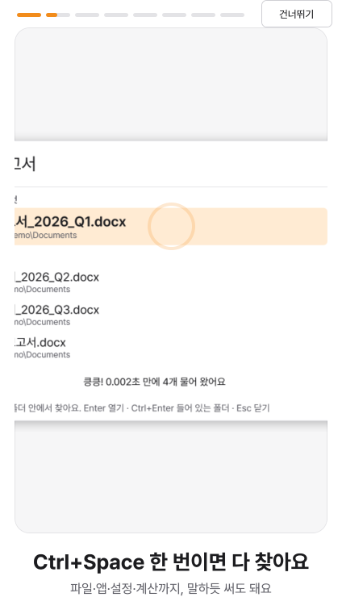

업데이트할 때는 설정이 그대로라서 다시 묻지 않고 "업데이트했어요" 한 줄로만 알려 드려요.

### 자동 업데이트

- 실행 5초 뒤와 6시간마다 GitHub Releases에서 새 버전을 확인합니다. 새 버전은 **Ed25519 서명과 해시를 확인한 뒤에만** 설치합니다. 상태바 오른쪽에 "Foldy x.y.z · 재시작하고 업데이트"가 나타납니다. [재시작하고 업데이트]를 누르면 Foldy가 닫히고 작은 창이 "설치하는 중 → 다시 여는 중"을 보여 줘요. 설치하는 동안 연주와 우진이 코트에서 드리블하고 패스를 주고받다가, 끝나면 연주의 패스를 받은 우진이 레이업으로 2점을 넣고 둘이 하이파이브해요(애니메이션을 끄면 글자만). 새 Foldy가 뜨면 저절로 닫혀요. 다른 Foldy 창이 열려 있으면 닫아 달라고 알려 주고, 실패하면 이유를 알려 줘요.

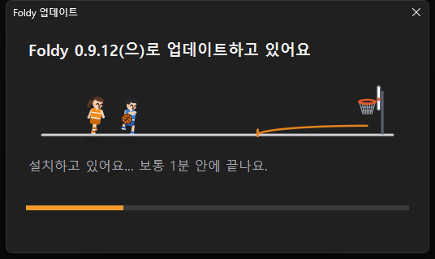
- 색인 서비스가 있으면 **관리자 확인 창 없이**(UAC 없음) 설치하고 Foldy를 다시 띄웁니다. 복사·이동 중에 누르면 작업을 끊지 않고 예약했다가 모두 끝나면 설치합니다.
- **회사 프록시**: 서비스(SYSTEM)는 사용자별 프록시(PAC 스크립트 등)를 못 씁니다. 서비스가 확인에 실패하면 Foldy가 **사용자 권한과 Windows 사용자 프록시 설정으로** 직접 확인·다운로드합니다. 이 경우 설치할 때 관리자 확인이 한 번 필요합니다. 서명·해시 검사는 똑같습니다.
- 사이드바 아래 **… (더 보기) → 업데이트 확인**은 바로 확인하고, 실패하면 이유를 보여 줍니다. 자세한 내용: [docs/auto-update.md](docs/auto-update.md).

## 패널과 탭

맨 왼쪽 **사이드바**, 그 오른쪽에 **왼쪽·오른쪽 두 패널**이 있습니다. 지금 조작하는 패널(활성 패널)은 탭 아래에 강조색 선이 보이고 **Tab** 키로 반대 패널로 옮겨 갑니다.

패널 하나는 위에서부터 이렇게 생겼습니다.

1. **탭 줄**: 폴더마다 색이 다른 탭(OneNote처럼). 오른쪽 끝은 드라이브 바로가기와 **SFTP** 단추(서버 연결).
2. **경로바**: 경로 조각을 누르면 그 폴더로, 빈 곳을 누르거나 **Ctrl+L**이면 직접 입력. Git 저장소 안이면 브랜치 칩(`main ↑2 ↓1`)이 보입니다.
3. **검색칸**(**Ctrl+F**)과 도구 버튼(새로 고침, 폴더 트리, 이미지만 보기, 터미널).
4. **트리 | 목록**: 왼쪽은 폴더 트리, 오른쪽은 파일 목록. 가운데 경계선을 끌면 트리 너비가 바뀌고, 도구 줄 맨 왼쪽 트리 버튼(또는 **Ctrl+B**)으로 숨기고 다시 보입니다. 창이 아주 좁으면 저절로 접혀요.
5. 아래쪽에 **작업 패널**, **파일 작업 버튼 줄**(F2·F3·F5·F6·F7·Del), **상태바**.

| 하고 싶은 것 | 방법 |
| --- | --- |
| 새 탭 / 탭 닫기 | **Ctrl+T** / **Ctrl+W** (가운데 버튼 클릭, 탭의 ✕) |
| 다음/이전 탭 | **Ctrl+Tab** / **Ctrl+Shift+Tab** |
| 순서 바꾸기, 반대 패널로 옮기기 | 탭을 끌어서 다른 탭(또는 반대 패널의 탭) 위에 놓기 |
| 같은 폴더를 새 탭으로 | 탭을 두 번 클릭 |
| 뒤로 / 앞으로 / 위로 | **Alt+←** / **Alt+→** / **Alt+↑** (마우스 뒤로·앞으로 버튼) |

탭·경로·정렬·창 위치는 자동으로 저장되어 다음 실행 때 그대로 복원됩니다. Foldy는 **한 번에 하나만** 뜹니다. 이미 켜져 있을 때 다시 실행하면 그 창이 앞으로 오고, 폴더를 넘겼다면 새 탭으로 열립니다.

## 사이드바

맨 위 패널 버튼(또는 **Ctrl+Shift+B**)으로 접으면 아이콘만 남습니다. 폴더 트리 버튼과 같은 모양이고, 펼쳐져 있으면 눌린 배경으로 보여요. 오른쪽 가장자리를 끌어 너비를 바꿀 수도 있어요(아주 좁히면 아이콘만). **Ctrl+Shift+E**로 키보드 포커스를 옮겨 Tab으로 둘러볼 수 있습니다.

- **자주 쓰는 폴더(빠른 접근)**: 제목 옆 핀 버튼으로 지금 폴더를 고정합니다. 누르면 활성 패널에서 열리고, 오른쪽 클릭으로 새 탭·반대 패널에서 열기, 순서 바꾸기, 고정 해제.
- **최근 폴더**: 최근에 연 폴더 5개가 자동으로 쌓입니다(고정한 폴더는 빠짐).
- **드라이브**: 이름, 사용량 막대, 남은 공간. 90% 넘게 차면 막대가 빨갛게 바뀝니다. 오른쪽 클릭으로 폴더 분석을 바로 시작합니다. Google Drive for desktop의 드라이브(G:)는 구름 아이콘으로 보입니다.
- **도구**: 기능이 많아서 네 묶음으로 모았어요. 누르면 그 묶음의 메뉴가 열려요.
  - 🔍 **찾기**: 파일 검색, 폴더 분석, 이미지만 보기
  - 🧹 **정리하기**: 이 폴더 정리, 템플릿으로 새 폴더, 폴더 위저드, 관리 방식 정하기, 바탕화면·다운로드·로그 정리
  - 🔒 **지키기**: 새 메모, 잠긴 메모, 암호 걸기, 금고, 이전 버전(오른쪽 클릭), 휴지통
  - 🔗 **연결하기**: SFTP, Git 화면, 터미널
- **휴지통**: 쌓인 용량이 보이고(예: 휴지통 · 38 GB), 누르면 Windows 휴지통이 열립니다. **비우기**는 확인을 한 번 거쳐 모든 드라이브의 휴지통을 비웁니다.
- **맨 아래 줄**: 설정(**Ctrl+,**), 도움말(**F1**), 더 보기(모든 명령 **Ctrl+Shift+P**, 테마, 숨김 파일, 목록 간격, 업데이트, 버그 신고, 둘러보기, Foldy 정보).

사이드바 아래의 **명령 팔레트**는 이름 일부만 쳐도 모든 명령을 찾아 실행합니다.

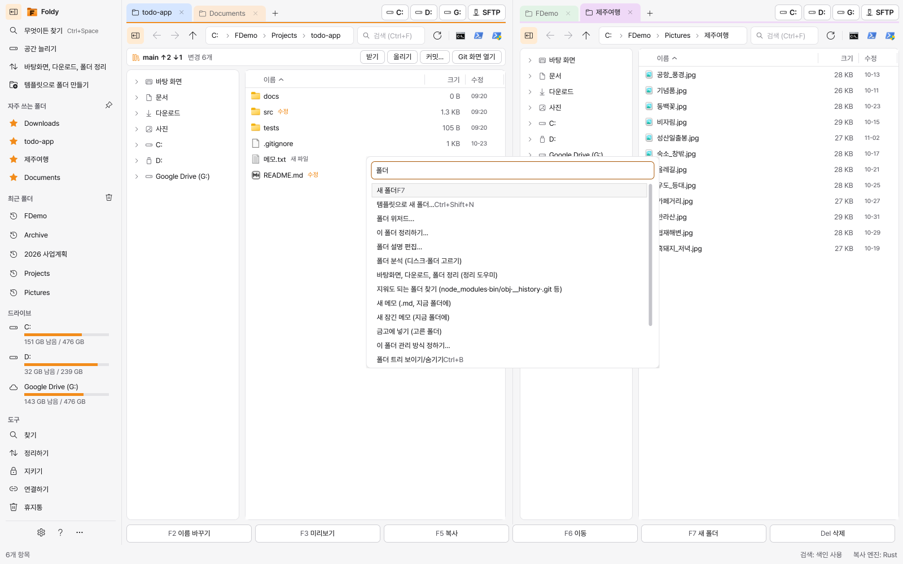

## 파일 작업과 복사 엔진

| 작업 | 키 | 설명 |
| --- | --- | --- |
| 이름 바꾸기 | **F2** | 확장자를 뺀 이름이 선택된 채로 입력칸이 열립니다 |
| 복사 / 이동 | **F5** / **F6** | 선택한 항목을 반대 패널의 폴더로 |
| 새 폴더 | **F7** | 만들자마자 이름을 입력할 수 있습니다 |
| 휴지통으로 / 영구 삭제 | **Delete** / **Shift+Delete** | 영구 삭제는 확인 창이 뜹니다. 파일이 5,000개 넘으면 [빨리 지우기]도 고를 수 있어요 ([아래](#파일이-아주-많은-폴더-지우기-빨리-지우기)) |
| 복사·잘라내기·붙여넣기 | **Ctrl+C / X / V** | 탐색기와 주고받을 수 있습니다 |

- **우클릭**하면 탐색기와 똑같은 메뉴(연결 프로그램, 보내기, 압축 등)가 뜹니다. **Shift+우클릭**은 확장 메뉴.
- **끌어 놓기**: 탐색기와 주고받을 수 있습니다. 같은 드라이브면 이동, 다른 드라이브면 복사가 기본이고 **Shift**는 이동, **Ctrl**은 복사.
- 글자를 입력하면 그 이름으로 시작하는 파일로 바로 이동합니다(Type-ahead).
- 복사와 이동은 **Rust 병렬 복사 엔진**이 맡습니다(상태바에 "복사 엔진: Rust"). 같은 이름이 있으면 "둘 다 유지 / 덮어쓰기 / 건너뛰기"를 묻고 나머지에도 똑같이 적용할 수 있습니다. 진행 상황은 작업 패널과 작업 표시줄에 보입니다. [docs/copy-engine.md](docs/copy-engine.md)

### 아이들이 농구해요

1.5초 넘게 걸리는 작업에는 작업 패널에 농구하는 두 아이가 나타납니다. 복사·이동은 패스하고 드리블하며 진행되는 만큼 나아가다가 끝나면 3점슛 성공 후 하이파이브, 삭제는 공을 휴지통에 던지고, 검색·네트워크 대기는 두리번거리며 공을 찾고, 실패하면 슛이 림을 맞고 튕겨 나갑니다. 설정에서 끌 수 있고, 창이 최소화되거나 가려지면 멈춰서 CPU를 쓰지 않습니다.

기술은 15가지예요: 크로스오버, 비하인드 백, 레그 스루, 스핀 무브, 유로 스텝, 헤지테이션, 스텝백, 슛 페이크, 방향 전환, 기브 앤 고, 바운드 패스, 노룩 패스, 앨리웁, 스크린 앤 롤, 컷인. 모든 기술이 한 번씩 나온 뒤에야 다시 나와요.


## 미리보기

**F3**(또는 아래쪽 **F3 미리보기**)을 누르면 파일 목록 **위쪽**에 미리보기 창이 열리고(파일 이름이 잘리지 않게), 목록에서 고른 파일을 바로 보여 줍니다. 경계선을 끌어 높이를 바꿉니다.

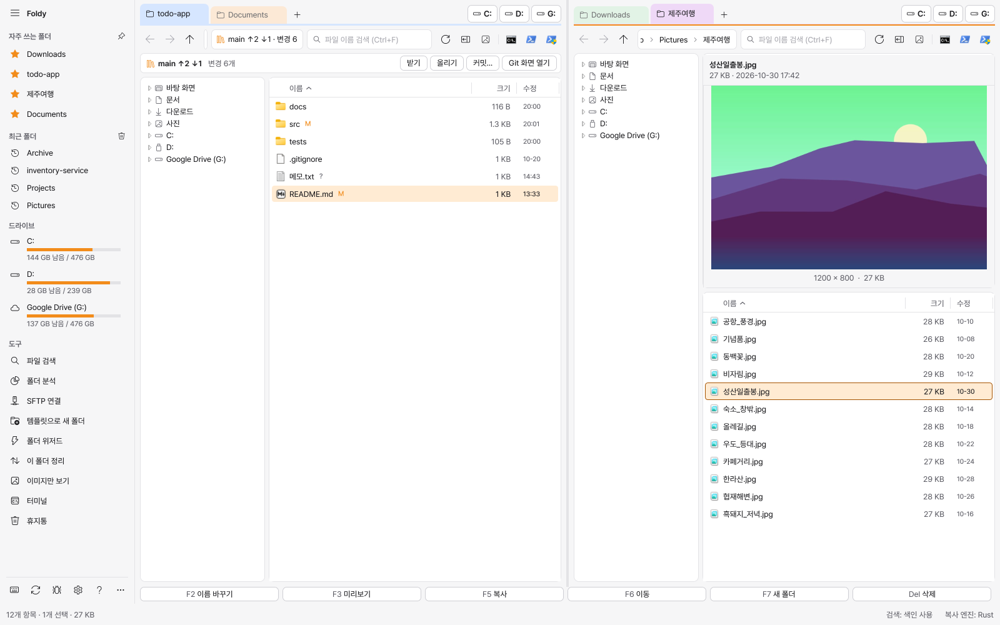

Markdown, 이미지, 텍스트·코드(문법 강조), PDF·Office처럼 Windows 미리보기 처리기가 있는 형식을 지원합니다.

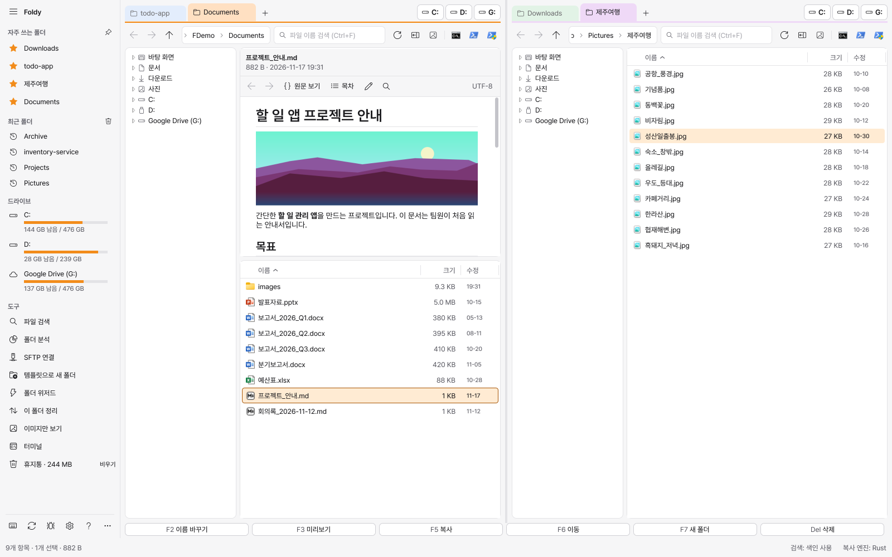

클라우드 전용 파일, 네트워크 드라이브, SFTP는 느려지거나 내려받기가 시작되지 않게 자동으로 읽지 않고 **[미리보기]**를 눌렀을 때만 읽습니다. [docs/preview.md](docs/preview.md)

## Markdown 보기

`.md` 파일을 열면 메모장 대신 Foldy 안의 탭에서 바로 보여 줍니다(0.3.24부터 기본, 설정 → 일반 → Markdown 파일 열기에서 등록된 앱을 고를 수도 있어요). 연필 버튼(**쓰기**)을 누르면 메모 창에서 바로 고칠 수 있어요. 표, 체크박스, 코드(문법 강조·복사 버튼), 상대 경로 그림, 목차, **Ctrl+F** 문서 내 찾기를 지원합니다. 문서 안의 `.md` 링크는 같은 탭에서 열리고(뒤로/앞으로), 폴더 링크는 폴더 탭으로 열립니다. 인터넷 그림은 [이미지 불러오기]를 눌러야만 받습니다. 이 사용 설명서(**F1**)도 같은 뷰어입니다.

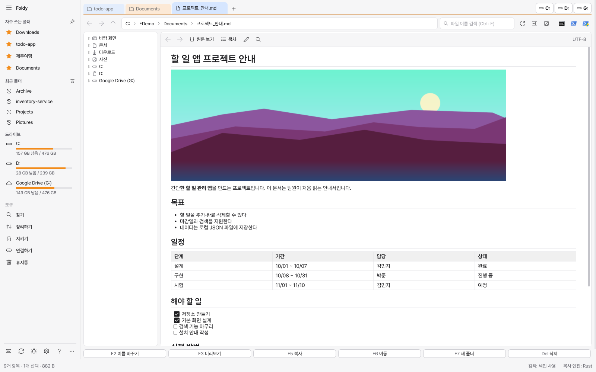

[docs/markdown-viewer.md](docs/markdown-viewer.md)

## 느린 드라이브

회사 보안 드라이브처럼 폴더를 여는 데 오래 걸리는 **네트워크·원격 드라이브**는 Foldy가 열어 본 시간으로 **자동으로** 알아챕니다. 설정은 없습니다.

- 경로바 옆에 **느린 드라이브** 칩이 뜨고, 처음 알아챈 때 한 번 상태줄에 알립니다.
- 목록을 먼저 보여 주고 폴더 크기 같은 것은 나중에 채웁니다. 다른 폴더로 가면 하던 일은 취소됩니다.
- Git 감지, 이미지 썸네일, 파일별 아이콘은 건너뛰고, 미리보기(F3)는 **[미리보기]**를 눌러야 열립니다.
- 폴더 변경은 감시 대신 주기적으로 확인합니다.
- 루트 폴더가 "시스템" 속성이어도(예: K:) 탐색기처럼 **숨김** 속성만 가리고 보여 줍니다.

(느린 드라이브 칩은 실제 느린 드라이브가 있어야 나타나므로 이 문서에는 화면이 없습니다.)

## 🔍 찾기

파일을 찾고, 무엇이 공간을 차지하는지 보는 기능이에요. 사이드바 **찾기**를 누르면 모여 있어요.

### 빠른 검색 (Ctrl+Space)

어느 프로그램을 쓰고 있든 **Ctrl+Space**를 누르면 화면 가운데 큰 검색 칸이 떠요(macOS의 Spotlight처럼). 한 칸에서 다 찾아요.

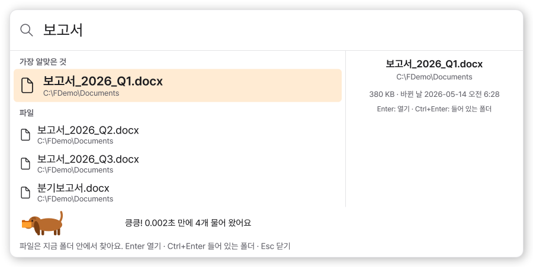

- **파일·폴더**: 색인 서비스가 있으면 모든 드라이브에서, 없으면 지금 폴더 안에서 찾아요. 오른쪽에 미리보기(그림·글 앞부분·크기·날짜)가 보여요.
- **앱**: 시작 메뉴에 있는 프로그램을 이름으로 찾아 바로 실행해요.
- **Windows 설정**: "디스플레이", "와이파이", "글자 크기", "프린터"처럼 치면 그 설정 화면을 바로 열어요.
- **자주 쓰는 폴더·최근 폴더**는 위쪽에 먼저 보여요.
- **Foldy 기능**: "설정", "폴더 분석"처럼 기능 이름으로 실행해요. 초성으로도 찾아요(ㅅㅈ → 설정).
- **말하듯 쳐도 알아들어요**: "다운로드 정리해줘", "메모 쓸래", "휴지통 비워 줘", "글씨 크게 해줘"처럼 쳐도 맞는 기능을 찾아 "이걸 할까요?"라고 보여 줘요. Enter를 누르면 그 기능의 대화 창이 이어서 한 단계씩 물어봐요. 메모 쓰기, 정리 도구, 금고, 설정 같은 Foldy 기능은 모두 여기서 시작할 수 있어요.
- **계산·단위 변환**: `12*3+4`, `200*15%`, `5 km to mi`, `32평`, `100F`, `2 GB MB`처럼 치면 바로 답이 나오고, Enter를 누르면 결과가 복사돼요.

맨 위에는 **가장 알맞은 것** 하나가 크게 보이고, 그 아래로 종류별로 묶여 있어요. **Enter** 열기·실행, **Ctrl+Enter** 들어 있는 폴더를 Foldy에서 보기, **Esc**나 바깥을 누르면 닫혀요. 인터넷 검색은 하지 않아요(밖으로 아무것도 보내지 않아요).

파일을 찾으면 **냄새 잘 맡는 블러드하운드**가 코를 바닥에 대고 킁킁, 귀를 펄럭이며 달려가 파일을 물어 와요. "킁킁! 0.03초 만에 1,284개 물어 왔어요". 못 찾으면 고개를 갸웃해요. 설정의 "애니메이션 사용"을 끄면 글자만 보여요.

**단축키가 겹치면?** 다른 프로그램이 Ctrl+Space를 이미 쓰고 있거나, 중국어·일본어 입력기(Ctrl+Space가 입력 전환 키)가 설치돼 있으면 처음 설정 때 알려 드리고, 비어 있는 다른 키(예: Ctrl+Shift+Space)를 고르거나 직접 눌러서 정할 수 있어요. "Foldy 안에서만 쓰기"도 고를 수 있어요. 업데이트 뒤에는 묻지 않다가, 등록이 안 될 때만 알려 드려요. 나중에 설정 → 단축키에서 언제든 바꿀 수 있어요.

### 검색과 색인 서비스

**Ctrl+F**로 검색칸에 이름 일부를 입력하고 Enter를 누르면 **검색 결과 탭**이 열립니다. 결과에서 폴더를 열면 새 폴더 탭이, 파일은 바로 열립니다. **Esc**는 검색 취소.

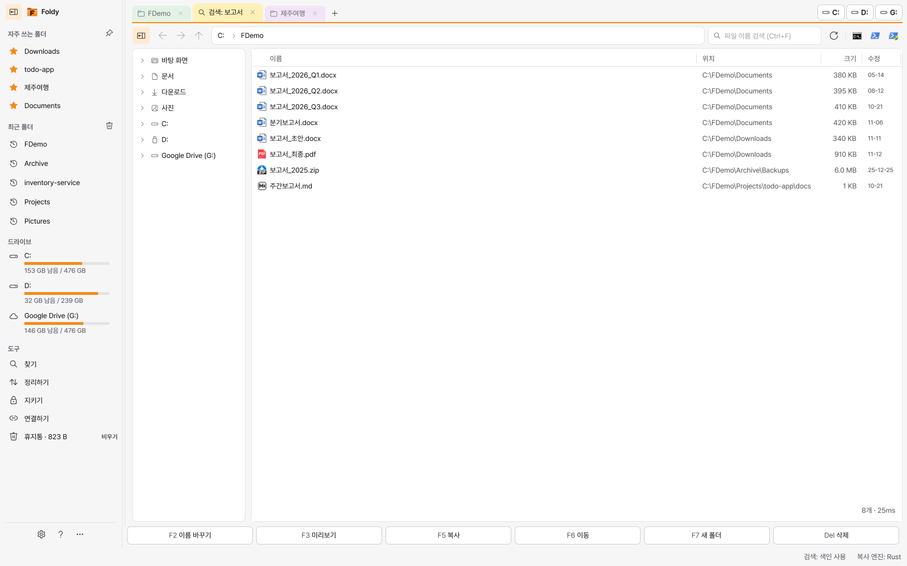

- **색인 서비스**가 설치돼 있으면 NTFS 색인(MFT·USN 저널)으로 전체 드라이브를 즉시 검색합니다. 서비스를 다시 시작해도 저장된 색인을 읽고 변경분만 따라잡습니다. 상태바에 "검색: 색인 사용".
- 서비스가 없으면 현재 폴더 아래를 직접 훑습니다(상태바 "폴더 훑기").
- 서비스는 사이드바 더 보기 → **색인 서비스 설치 (관리자)…** 로 설치하고, MSI·스크립트 설치에는 처음부터 들어 있습니다. 같은 서비스가 폴더 크기, 폴더 분석, 업데이트도 도와줍니다. [docs/index-persistence.md](docs/index-persistence.md)

### 폴더 분석

**폴더 분석**(찾기 메뉴, Ctrl+Space에서 "폴더 분석"이나 "용량", 명령 목록)을 누르면 **어디를 분석할지 먼저 물어봐요.** 디스크마다 남은 공간과 함께 단추가 있고, 지금 폴더, [다른 폴더 고르기…]도 있어요. 고르면 분석 탭이 열립니다. 사이드바 드라이브를 오른쪽 클릭 → 분석은 그 드라이브를 바로 엽니다.

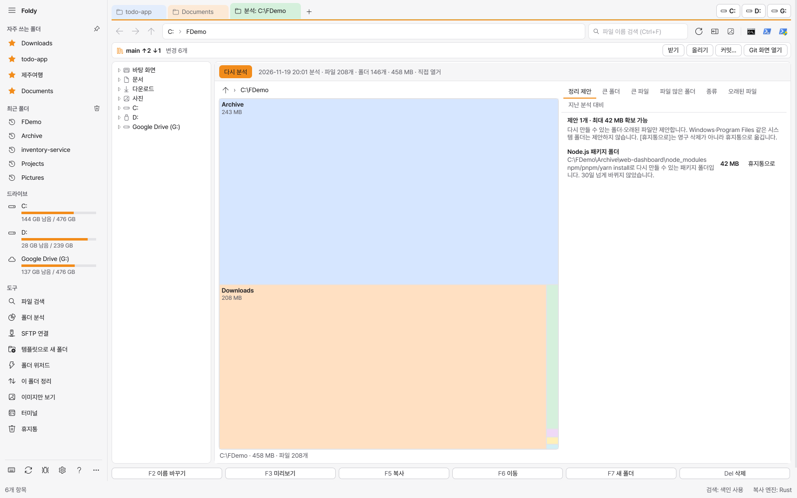

- **트리맵**: 큰 폴더일수록 큰 칸. 칸을 누르면 안으로 들어가고, Backspace·오른쪽 클릭·마우스 뒤로 버튼은 한 단계 위로.
- **목록**: 큰 폴더·큰 파일 순위, 파일 많은 폴더, 종류별, 오래된 파일, 지난 분석보다 늘어난 폴더.
- **정리 제안**: node_modules, 빌드 결과, 임시 파일, 캐시처럼 지워도 다시 만들 수 있는 것만. 시스템 폴더는 절대 제안하지 않고, **[휴지통으로]**는 확인 뒤 휴지통으로만 옮깁니다.
- **F5** 다시 분석, **Esc** 취소.

**정리 제안 대상 (전부)** — 조건: 하위에서 가장 최근 수정이 그 기간보다 오래되고, 크기가 그 이상일 때만 제안합니다.

| 대상 | 위치·이름 | 조건 |
| --- | --- | --- |
| Node.js 패키지 | `node_modules` (옆에 `package.json`) | 30일, 10MB |
| .NET 빌드 출력 | `bin`, `obj` (옆에 `*.csproj` 등) | 14일, 10MB |
| Rust 빌드 출력 | `target` (옆에 `Cargo.toml`) | 14일, 50MB |
| Gradle 빌드 출력 | `build`, `.gradle` (옆에 `build.gradle` 등) | 14일, 10MB |
| 프런트엔드 빌드 캐시 | `.next`, `.nuxt`, `.parcel-cache`, `.turbo`, `.angular`, `.svelte-kit` (옆에 `package.json`) | 14일, 10MB |
| Python 캐시 | `__pycache__`, `.pytest_cache`, `.mypy_cache`, `.ruff_cache`, `.tox` | 30일, 1MB |
| Visual Studio 캐시 | `.vs` | 30일, 100MB |
| 사용자 임시 폴더 | `%LOCALAPPDATA%\Temp` | 7일, 50MB |
| 이름이 temp/tmp인 폴더 | `temp`, `tmp` | 30일, 100MB |
| 브라우저 캐시 | Chrome·Edge 프로필의 `Cache`, `Code Cache` | 100MB |
| 패키지 관리자 캐시 | `npm-cache`, `pip\cache`, `Yarn\Cache`, `%USERPROFILE%\.gradle\caches` | 30일, 500MB |
| NuGet 패키지 캐시 | `%USERPROFILE%\.nuget\packages` | 60일, 1GB |
| 충돌 덤프 파일 | `*.dmp`, `*.hdmp`, `*.mdmp` | 14일, 10MB |
| 충돌 덤프 폴더 | `%LOCALAPPDATA%\CrashDumps` (Windows 오류 보고의 기본 덤프 폴더) | 14일, 10MB |
| 오래된 설치 파일 | 다운로드 폴더의 `*.exe`, `*.msi`, `*.msix`, `*.iso` | 90일, 50MB |

`.git`은 표시만 하고 제안하지 않습니다. Windows, Program Files, ProgramData 같은 시스템 폴더는 규칙과 상관없이 제안하지 않습니다.

**일부러 넣지 않은 것**
- Windows 업데이트 파일, 전송 최적화 파일, 미리 보기(썸네일) 캐시, 이전 Windows(Windows.old): 시스템이 쓰는 파일이라 Windows가 직접 지우는 게 안전합니다. 정리 제안 위의 **[Windows 정리 권장 사항 열기]**를 누르면 Windows 설정의 정리 화면이 열립니다(Windows 10은 디스크 정리).
- V3·알약 같은 백신의 업데이트 백업·검역소(격리) 파일: 지워도 된다는 제조사 공식 안내를 찾지 못했고, 검역소는 잘못 치료한 파일을 되살리는 곳이라 넣지 않았습니다. 백신 프로그램 안의 메뉴로 정리하세요.

색인 서비스가 있으면 디스크를 다시 읽지 않고 몇 초 만에 분석하고, 없으면 낮은 우선순위로 직접 훑습니다. [docs/disk-analysis.md](docs/disk-analysis.md)

### 두 창 비교·맞추기

USB에 옮겨 둔 폴더와 PC 폴더, 어느 쪽이 최신인지 헷갈릴 때 쓰세요. 양쪽 창에 두 폴더를 열고 🔍 **찾기 → 두 창 비교·맞추기**를 누르면 Foldy가 대화하며 알려 드려요.

- **무엇이 다른지**: 왼쪽에만·오른쪽에만 있는 파일, 어느 쪽이 더 최신인지(파일 크기와 고친 시각으로, 2초 차이는 같게 봐요). 그리고 "오른쪽이 더 최신이에요. 12개 파일이 오른쪽에서 고쳐졌어요"처럼 한 줄로 정리해 드려요.
- **어느 쪽으로**: [왼쪽 → 오른쪽] [오른쪽 → 왼쪽] [양쪽 최신으로 맞추기] 중에 고르면, 복사할 목록을 먼저 보여 드리고 확인을 받은 뒤 맞춰요.
- **안전하게**: 한쪽에만 있는 파일을 지우지 않아요. 더 최신 파일을 오래된 것으로 덮어쓰지 않아요. 덮어쓰는 파일은 이전 버전으로 보관하고(USB·네트워크는 옆에 `.foldy-bak`), 끝나면 **[되돌리기]** 한 번으로 원래대로예요.
- **양쪽 다 고친 파일**: 지난번 맞춘 뒤 양쪽 다 바뀐 파일은 저절로 고르지 않고 하나씩 물어봐요.
- Git 저장소·개발 프로젝트 폴더 안은 비교하지 않아요.

### 이미지만 보기

**Ctrl+Shift+I** 또는 사이드바 찾기 → 이미지만 보기로 현재 폴더의 이미지만 썸네일 격자로 봅니다. 다른 파일은 숨길 뿐 움직이지 않습니다.

켜져 있는 동안은 목록 바로 위에 "이미지만 보는 중이에요 · 그림 N개"(그림이 없으면 "이 폴더에는 그림이 없어요")가 보이고, 같은 자리의 **[모든 파일 보기]**로 바로 끌 수 있어요.

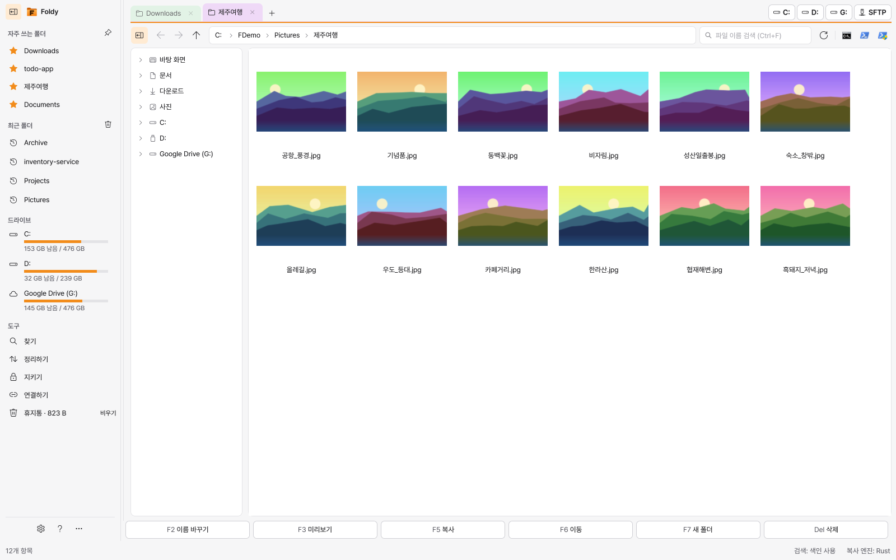

**스페이스**: 크게 보기(← →, 휠 확대, R 회전, Esc), **Ctrl+휠**: 썸네일 크기. 네트워크·클라우드 드라이브는 내용을 읽지 않습니다. [docs/image-view.md](docs/image-view.md)

## 🧹 정리하기

방 청소하듯 폴더를 정리하는 기능이에요. 사이드바 **정리하기**에 모여 있어요. 저절로 버리지 않고, 먼저 보여 드리고, 되돌릴 수 있어요.

### 정리 도구

방 청소해 주듯 컴퓨터를 정리해 드려요. 사이드바의 **정리하기**를 누르면 바탕화면·다운로드·로그 정리를 고를 수 있어요(명령 목록에서도 찾을 수 있어요). 어느 도구든 Foldy가 대화하듯 한 단계씩 물어봐요. 무엇을 찾았는지, 왜 정리하면 좋은지, 누르면 어떻게 되는지 먼저 설명하고 **[이대로 정리] [자세히 보기] [나중에]** 중에서 고르게 해요. 충분히 보고 정하세요.

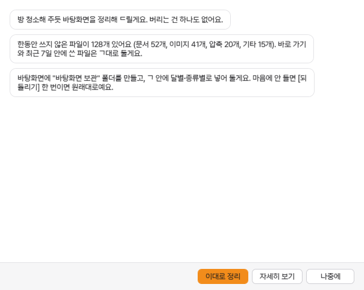

세 가지 약속은 꼭 지켜요.

- **저절로 버리지 않아요.** 먼저 무엇을 어디로 옮길지 보여 드리고, 누르기 전에는 아무것도 하지 않아요.
- **어디 뒀는지 알려 드려요.** 옮긴 곳을 바로 열어 볼 수 있어요.
- **되돌릴 수 있어요.** 지우는 건 늘 휴지통으로만 가고, 바탕화면 정리는 [되돌리기] 한 번이면 원래대로예요.

#### 바탕화면 정리

바탕화면에 파일이 수북이 쌓였나요? 버리지 않고 바탕화면의 **"바탕화면 보관"** 폴더에 종류별로 넣어 두고, 어디 뒀는지 알려 드려요. 마음에 안 들면 **[되돌리기]** 한 번이면 원래대로!

- **옮기는 것**: 바탕화면에 바로 있는 파일 중 최근 7일 동안 쓰지 않은 파일
- **그대로 두는 것**: 바로 가기(`.lnk`, `.url`), 최근 7일 안에 쓴 파일, 폴더, 숨김·시스템 파일
- **옮기는 곳**: `바탕화면\바탕화면 보관\연-월\종류` (종류: 문서, 이미지, 영상, 음악, 압축, 설치파일, 코드, 기타)
- 다른 프로그램이 쓰고 있는 파일은 건너뛰어요.

#### 다운로드 정리

다운로드 폴더는 계속 쌓이죠. 정리할 만한 파일을 찾아서 **휴지통에 버리거나 보관하세요**라고 골라 드려요.

| 찾는 것 | 기준 |
| --- | --- |
| 이미 설치한 프로그램의 설치 파일 | `.exe`의 제품 이름이 설치된 프로그램 목록과 확실히 맞을 때만 (애매하면 넣지 않아요) |
| 중복 파일 | 크기와 내용(SHA-256)이 똑같은 파일. 이름이 가장 짧은 하나는 남겨요 (예: `보고서 (1).pdf`만 골라요) |
| 이미 푼 압축 파일 | 옆에 같은 이름의 폴더가 있는 `.zip` |
| 오래된 파일 | 90일 넘게 열거나 바꾸지 않은 파일 (이건 직접 골라야 해요) |

- 다운로드 폴더 바로 아래의 파일만 봐요. 하위 폴더는 이미 정리해 둔 것으로 보고 건드리지 않아요. 받는 중인 파일(`.crdownload`, `.part`)도 빼요.
- **[휴지통으로]**: 휴지통으로 옮겨요. 휴지통에서 되살릴 수 있어요.
- **[보관하기]**: `다운로드\보관\연-월` 폴더로 옮겨요.

#### 로그 정리

프로그램이 남기는 `*.log` 파일은 모르는 사이에 몇 GB씩 쌓이곤 해요. 오래된 로그를 같은 폴더의 **월별 zip**으로 꼭꼭 눌러 담아 드려요. 텍스트 로그는 보통 85% 넘게 줄어요.

- **대상**: 7일 넘게 바뀌지 않은 `*.log` 파일 (지금 드라이브 전체, 색인 서비스가 있으면 순식간에 찾아요)
- **건드리지 않는 것**: 프로그램이 쓰고 있는 로그, `Windows` 폴더, 휴지통, System Volume Information
- **만드는 것**: 로그가 있던 폴더에 `logs-연-월.zip`
- zip을 다시 열어 내용이 원본과 똑같은지(SHA-256) 확인한 뒤에만 원본을 휴지통으로 옮겨요. 확인이 안 되면 원본은 그대로 둬요.
- 폴더 분석 화면 위쪽의 **[로그 정리]**, **[다운로드 정리]** 버튼으로도 열 수 있어요.

#### 작업 태그 (어디까지 했더라?)

파일 여러 개를 하나씩 처리하다 보면 어디까지 했는지 헷갈리죠. 파일에 **작업 완료**·**반영 완료** 같은 작은 색 표시를 붙여 두세요.

- **붙이기**: 파일을 고르고 **Ctrl+D** = 작업 완료 켜고 끄기. 🧹 정리하기 메뉴(또는 명령 목록)에서 반영 완료·검토 중·제출 완료도 붙일 수 있어요. 여러 파일을 골라 한 번에 해도 돼요.
- **보이는 곳**: 파일 이름 뒤에 작은 색 칩으로 보여요. 이름이 길어 자리가 없으면 칩을 그리지 않아요(이름이 먼저). 폴더 위쪽에는 "파일 20개 중 작업 완료 7 · 반영 완료 3"과 **[다음 파일]**(아직 작업 완료가 아닌 다음 파일로)이 떠요.
- **저장되는 곳**: 그 폴더의 숨김 파일 `.foldy.md`에 사람이 읽을 수 있게 적어요. 그래서 폴더를 다른 디스크·PC로 옮겨도 태그가 따라가요. 파일 자체는 건드리지 않아요. Foldy로 이름을 바꾸면 태그도 따라가요.
- **Git 폴더**: `.foldy.md`가 git status에 뜨지 않게 `.git/info/exclude`에 한 줄 넣어요(.gitignore는 그대로). 같이 쓰는 사람과 나누려면 위쪽 줄의 **[저장소에 공유]**를 켜세요.
- **[태그 모두 지우기]**: 그 폴더 파일들의 태그만 지워요.

### 폴더마다 정리 방법 정해 두기

"이 폴더는 PARA로 관리할래" 하고 정해 두면, Foldy가 그 방법대로 가끔 살펴보고 정리할 게 생기면 말을 걸어요. 폴더마다 다른 방법을 정할 수 있어요.

- **정하는 법**: 폴더를 오른쪽 클릭 → **이 폴더 관리 방식 정하기…**. Foldy가 방법마다 무엇을 하는지 설명하고, 고르면 필요한 폴더도 만들어 줄지 물어봐요.
- **고를 수 있는 방법**: PARA, Johnny.Decimal, 번호·날짜 붙이기, 날짜별
- **표시**: 정한 폴더(맨 위 폴더 하나)의 아이콘에 작은 점이 붙고, 왼쪽 트리에는 깃발이 보여요. 그 안에 들어가면 위쪽에 "PARA 방법으로 관리 중 · 정리할 것 3가지" 한 줄이 떠요. 파일 탐색기에서도 그 폴더에 Foldy 아이콘이 보여요.
- **기억하는 곳**: 폴더 안의 숨김 파일 `.foldy.md` 하나예요. 사람이 읽을 수 있는 메모라서 폴더를 옮겨도 따라가고, 지우면 관리가 꺼질 뿐 파일은 그대로예요. 하위 폴더는 가장 가까운 `.foldy.md`를 따라요.

**이런 걸 알려 드려요**

| 방법 | 알려 드리는 것 | 하는 일 (확인을 누르면) |
| --- | --- | --- |
| 모든 방법 | 맨 위에 아직 나누지 않은 파일 | `00_받은 파일`에 일단 모아요 (날짜별이면 연도\연-월 폴더로) |
| PARA | 1_Projects 안에서 90일째 손대지 않은 프로젝트 | 4_Archives로 옮겨요 |
| 번호·날짜 붙이기 | 01_진행중 안에서 90일째 손대지 않은 폴더 | 03_완료로 옮겨요 |
| Johnny.Decimal | 번호 없는 폴더 | 알려만 드려요 (이름은 직접 붙여 주세요) |

**걱정하지 않으셔도 돼요**

- 저절로 옮기지 않아요. 무엇을 어디로 옮길지 보여 드리고, **[이대로 정리]**를 누를 때만 옮겨요. 끝나면 **[되돌리기]** 한 번으로 원래대로예요.
- 실행 파일, 설정 파일, 바로 가기(`.exe`, `.dll`, `.ini`, `.json`, `.lnk` 등)는 옮기지 않아요. 다른 프로그램이나 바로 가기가 깨질 수 있어서요.
- **Git 저장소·개발 프로젝트 폴더**에는 방법을 정할 수 없어요. 저장소들을 담은 위 폴더는 관리할 수 있고, 그 안의 저장소는 폴더째로만 옮기자고 해요(안은 건드리지 않아요).
- 열려 있는 파일은 건너뛰고 "열려 있어서 건너뛰었어요"라고 알려 드려요.
- OneDrive·Google Drive 같은 **동기화 폴더**에서는 "동기화 폴더예요"라고 먼저 알려 드려요. 옮기면 다른 PC에도 반영되거든요. 이런 폴더와 네트워크·느린 드라이브에는 탐색기 아이콘(desktop.ini)을 만들지 않아요.
- 정리할 게 많이 쌓이면 다른 정리 도구처럼 일주일에 한 번까지 한 줄로 알려 드려요(설정 → 정리 알림).

#### 필요할 때 한 줄로 알려 드려요

기능을 찾아다니지 않아도 되게, 지금 보는 폴더에 맞는 기능을 위쪽에 한 줄로 알려 드려요. 한 번에 하나만, **[닫기]**를 누르면 그 폴더에서는 다시 안 보여요. 설정 → 일반 → **정리 알림**을 끄면 나오지 않아요.

- 다운로드 폴더에 파일이 40개 넘으면 → [다운로드 정리]
- 바탕화면에 파일이 50개 넘으면 → [바탕화면 정리]
- 로그 파일(.log)이 20개 넘는 폴더 → [로그 정리]

### 쌓이면 살짝 알려 드려요

모르고 지나치기 쉬워서, Foldy가 가끔 가볍게 살펴보고 정리할 게 많을 때만 창 아래에 한 줄로 알려 드려요. 일주일에 한 번까지만 알려 드리고, 저절로 정리하지는 않아요.

- 로그: 줄일 수 있는 양이 1GB를 넘거나 그 드라이브 남은 공간의 5%를 넘을 때 (색인 서비스가 있을 때만 확인)
- 다운로드: 정리할 만한 파일이 1GB를 넘을 때
- 바탕화면: 보관할 파일이 50개를 넘을 때
- 끄려면: 설정 → 일반 → **정리 알림**

### 폴더 템플릿·위저드·정리

사이드바의 도구(또는 **Ctrl+Shift+P**)에서 엽니다.

#### 템플릿으로 새 폴더 (Ctrl+Shift+N)

폴더 구조를 한 번에 만듭니다. 오른쪽에서 만들어질 트리를 미리 보고 필요 없는 폴더는 체크를 풀 수 있고, 이미 있는 폴더는 건드리지 않고 없는 것만 만듭니다. 각 스타일의 **사용법**도 볼 수 있습니다. 묶음별 내장 템플릿:

- **개인·업무**: PARA, Johnny.Decimal, 번호·날짜 붙이기, 고객·프로젝트 업무, 문서 작성 단계, 연구·학습, 생활·가정 서류
- **개발**: 소프트웨어 프로젝트(일반), **Java(Maven·Gradle)**, Python, Node·TypeScript, .NET 솔루션, Go, **Claude Code 프로젝트**(CLAUDE.md·스킬·에이전트·MCP), **Claude 스킬 하나**, **AI 작업 폴더**(프롬프트·데이터·결과·평가)
- **미디어·창작**: 사진·영상 보관, 디자인·창작 자산
- **기록·보관**: 날짜별 보관함

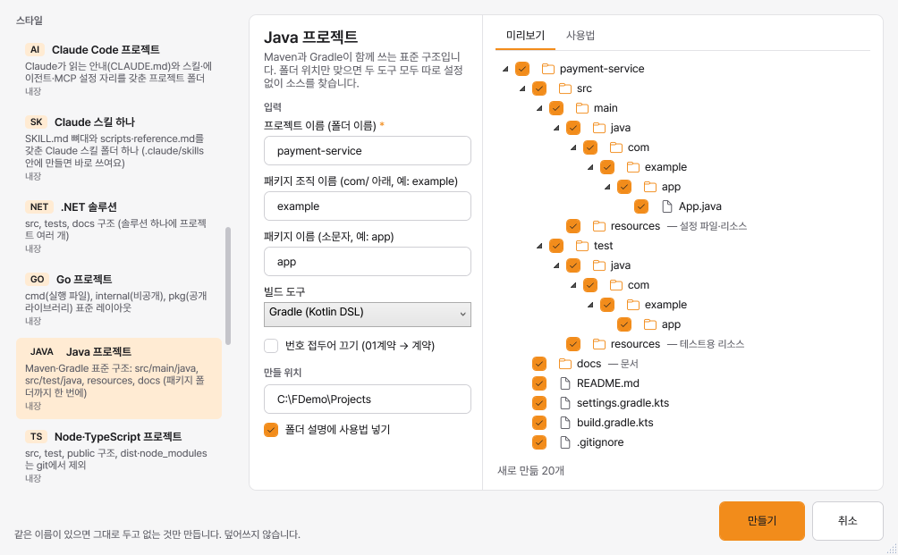

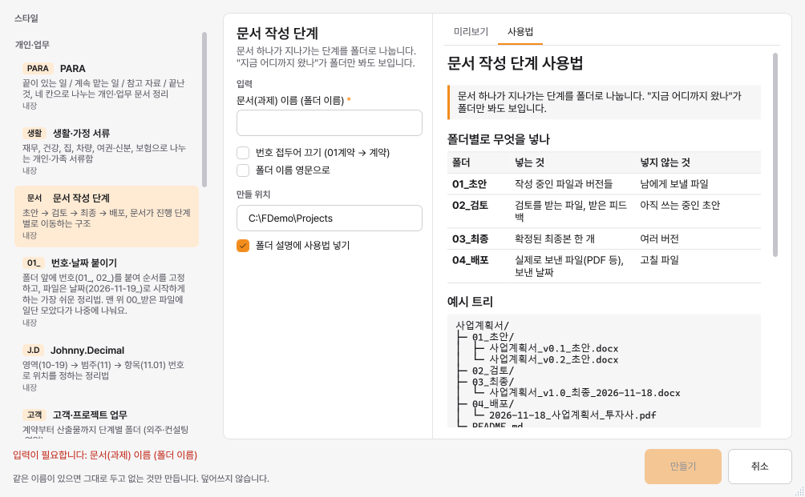

#### 인터넷에서 본 그 정리법, 클릭 한 번으로

"PARA가 좋다던데…" 하고 따라 해 보려다 폴더 만들기에서 멈춘 적 있죠? 템플릿을 고르면 폴더가 한 번에 생기고, 미리보기에서 **폴더마다 무엇을 넣는 곳인지** 이름 옆에 짧게 알려 드려요.

**PARA** (티아고 포르테) — "언제 끝나나?"로 네 칸에 나눠요.

| 폴더 | 넣는 것 |
| --- | --- |
| 1_Projects | 지금 하는 일 (끝나는 날이 있는 일) |
| 2_Areas | 계속 관리하는 영역 (건강, 돈, 집, 팀) |
| 3_Resources | 참고 자료 (언젠가 쓸 정보) |
| 4_Archives | 끝난 것 (지우지 말고 여기로) |

**Johnny.Decimal** — 모든 자리에 번호를 붙여서 "11.03" 하면 바로 찾아가요.

| 단계 | 예 | 뜻 |
| --- | --- | --- |
| 영역 | `10-19 생활` | 큰 묶음 10개까지 |
| 카테고리 | `11 집` | 영역 안의 칸 10개까지 |
| 항목 | `11.01 이사 견적` | 카테고리 안의 실제 폴더 |

**번호·날짜 붙이기** — 제일 쉬운 방법이에요. 폴더 앞 번호로 순서를 고정하고, 파일 이름은 날짜로 시작해요.

| 폴더 | 넣는 것 |
| --- | --- |
| 00_받은 파일 | 일단 여기에 (받은 파일·아직 안 나눈 것). 맨 위라서 늘 눈에 띄어요 |
| 01_진행중 | 지금 하고 있는 일 |
| 02_자료 | 자주 보는 참고 자료 |
| 03_완료 | 끝났지만 가끔 보는 것 |
| 99_보관 | 오래돼서 거의 안 보는 것 |

파일은 `2026-11-19_보고서.docx`처럼 **날짜_내용**으로 지으면 이름순이 곧 날짜순이에요.

> 💡 **받은 파일 칸 팁**: 어떤 방법을 쓰든 맨 위에 `00_받은 파일` 하나를 두세요. 새 파일은 고민 없이 일단 거기에 넣고, 일주일에 한 번 비우면서 나누면 쌓이지 않아요.

다른 템플릿(고객 프로젝트, 문서 작성 단계, 연구, 생활 서류, 사진 보관, 개발 프로젝트들)도 폴더마다 같은 방식으로 설명이 붙어 있어요.

#### 폴더 위저드

용도(개인·업무·개발 등)를 고르고, 몇 가지 질문(개발이면 **사용 언어**)에 답하면 알맞은 스타일을 추천하고 같이 맞춰 만듭니다. "정리가 필요해요"를 고르면 정리 창으로 이어집니다.

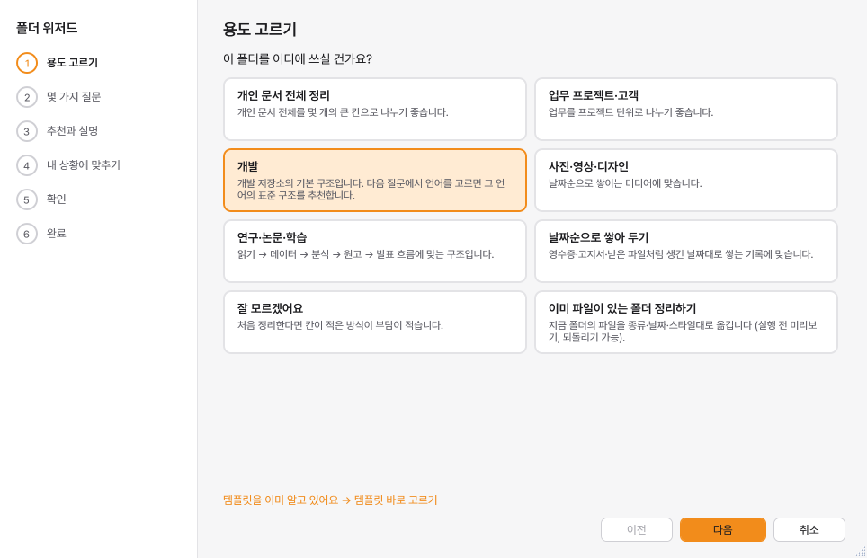

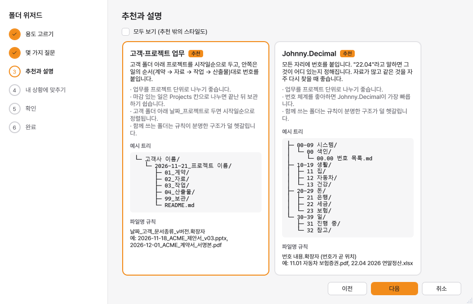

#### 이 폴더 정리하기

다운로드·바탕 화면처럼 어지러운 **일반 폴더**를 종류별·날짜별·스타일대로·직접 규칙으로 옮겨 줍니다.

1. 정리 방식을 고르고 **계획 만들기**를 누르면 "지금 → 정리 후"가 트리로 보입니다. 같은 내용의 파일은 "_중복 후보"로 모읍니다.
2. 옮길 파일 목록에서 항목마다 체크를 풀거나 폴더 이름을 고칠 수 있습니다.
3. **정리하기**를 누릅니다. **아무것도 삭제하지 않으며**, **되돌리기** 한 번으로 원래대로 돌아갑니다.

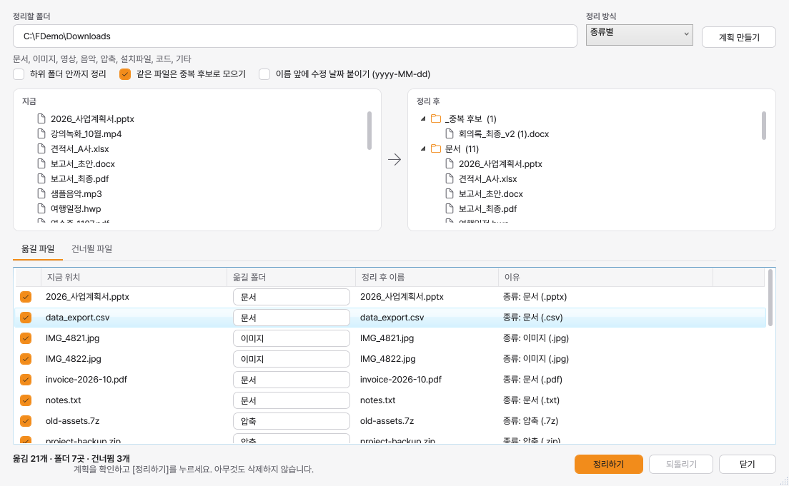

**Git 저장소·개발 프로젝트 폴더**(.git, .sln, package.json 등이 있는 폴더)는 **일부러 정리하지 않습니다.** 파일을 옮기면 빌드나 Git 기록이 깨질 수 있어서, 이런 폴더에서는 아래처럼 빨간 안내 문구만 보이고 정리하기 버튼이 꺼져 있습니다. 프로젝트 밖의 일반 폴더에서 정리하세요. (일반 폴더 안의 프로젝트 폴더는 통째로 그대로 둡니다.)

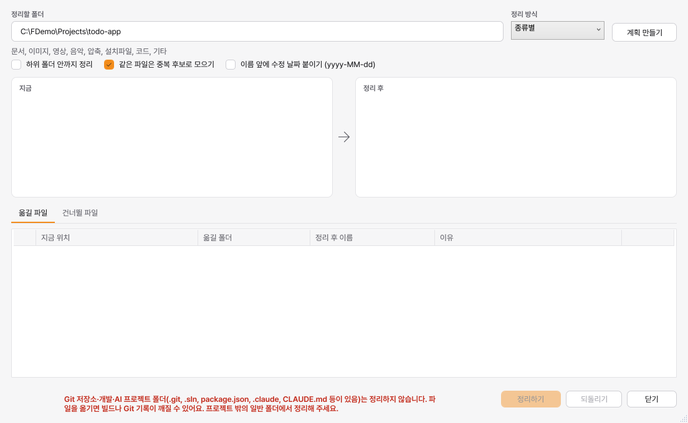

폴더 설명 편집(폴더에 설명 달기)도 같은 도구에 있습니다. [docs/templates-wizard.md](docs/templates-wizard.md)

## 🔒 지키기

소중한 파일을 지키는 기능이에요. 사이드바 **지키기**에 모여 있어요.

### 메모 쓰기 (.md · .textpack)

생각나는 걸 바로 적어 두세요. 🔒 **지키기 → 새 메모**를 누르면 지금 폴더에 `새 메모.md`가 생기고 메모 창이 열려요. `.md` 파일을 열면 Foldy 뷰어로 보이고, 뷰어의 **쓰기**(연필) 버튼을 누르면 같은 메모 창에서 고칠 수 있어요.

- **[쓰기 / 보기]**: 쓰기는 왼쪽에 글, 오른쪽에 다 쓴 모습. 보기는 다 쓴 모습만. 복잡한 서식 단추는 없고 Markdown(# 제목, - 목록, **굵게**)으로 써요.
- **그림 넣기**: **Ctrl+V**로 붙여 넣거나, 그림 파일을 끌어다 놓거나, **[화면 캡처]**를 누르세요. Windows 캡처 도구가 열리고, 캡처하면 바로 메모에 들어가요(Win+Shift+S로 캡처한 뒤 Ctrl+V도 돼요).
- **파일 형식**: 그림이 없으면 그냥 `.md`, 그림을 넣으면 같은 이름의 **`.textpack`** 한 파일로 바뀌어 저장돼요(TextBundle 규격: 글 + 그림을 zip 하나에, 그림은 원본 화질 그대로). `.textpack`을 두 번 누르면 메모 창이 [보기]로 열려요.
- **저장**: **Ctrl+S**, 닫을 때도 저장해요. 비밀번호처럼 숨겨야 할 내용은 **새 잠긴 메모**를 쓰세요(아래 "잠긴 메모").

### 이전 버전 (덮어쓰기 복구)

Foldy로 복사·이동하다 같은 이름의 파일을 **덮어쓰면**, 원래 파일을 7일 동안 몰래 보관해 둬요. 실수로 덮어써도 걱정 마세요.

- **되살리기**: 파일을 오른쪽 클릭 → **이전 버전 보기…** → 시각을 고르고 **[되돌리기]**(지금 파일도 보관해 두니 다시 돌릴 수 있어요) 또는 **[옆에 꺼내기]**(옆에 "이름 (이전 버전 날짜).확장자"로).
- **보관하는 곳**: 같은 드라이브의 숨김 폴더(`X:\.foldy\이전 버전`, 시스템 드라이브는 `%LOCALAPPDATA%\Foldy\이전 버전`). 같은 드라이브라 옮기는 데 시간이 걸리지 않아요.
- **한도**: 7일이 지나거나 드라이브마다 2GB(또는 드라이브의 5% 중 작은 쪽)를 넘으면 오래된 것부터 지워요. 한도보다 큰 파일은 보관하지 않아요.
- Foldy 밖에서(다른 프로그램이) 덮어쓴 것은 해당하지 않아요. 설정 → 일반 → **이전 버전**에서 끌 수 있어요.

### 잠긴 메모

와이파이 암호, 현관 비밀번호처럼 꼭 기억해야 하는데 아무 데나 적어 두기 불안한 것, 있죠? **잠긴 메모**에 적어 두세요. 열 때마다 암호를 물어보고, Foldy 안에서 바로 보고 고칠 수 있어요.

- **만들기**: 사이드바 **지키기** → **새 잠긴 메모**. 지금 폴더에 `새 메모.memo.foldylock`이 생기고 바로 편집 창이 열려요. 이름은 F2로 바꾸면 돼요.
- **열기**: 두 번 누르면 암호를 묻고 편집 창이 열려요. 왼쪽은 글, 오른쪽은 미리 보기예요(Markdown).
- **그림**: 화면을 캡처해서 **Ctrl+V**로 붙여 넣거나 그림 파일을 끌어다 놓으면 메모 안에 함께 담겨요.
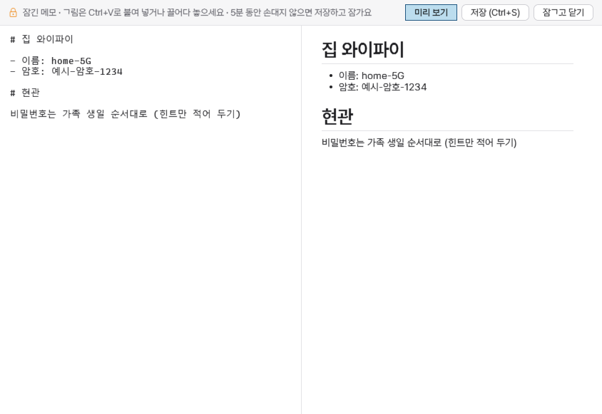

- **저장**: **Ctrl+S**. 저장할 때마다 다시 암호를 걸어요. 5분 동안 손대지 않으면 저장하고 저절로 잠가요.
- 내용은 메모리에서만 풀어요. 암호가 풀린 글이 디스크(임시 파일 포함)에 남지 않아요.
- 💡 중요한 비밀번호가 아주 많다면 Bitwarden이나 KeePass 같은 비밀번호 관리 프로그램도 함께 써 보세요.

### 암호 걸기 (파일 하나)

계약서처럼 이미 있는 파일에 암호를 걸 수 있어요. 파일을 오른쪽 클릭 → **🔒 암호 걸기…**. 같은 폴더에 `계약서.pdf.foldylock`이 생기고, 제대로 풀리는지 확인한 뒤 "원본은 휴지통으로 보낼까요?"라고 물어봐요.

- 두 번 누르면 암호를 묻고, 사진·글이면 Foldy 안에서 바로 보여 줘요. 그 밖의 파일은 "원래 프로그램으로 열어 주세요"라고 알려 드리고 **[풀어서 열기]**로 원래 파일로 되돌려 열어요.
- 잠글 때 넣은 내용을 그대로 돌려줘요. 한 바이트도 바꾸지 않아요.

### 금고

중요한 폴더를 통째로 금고에 넣어 두세요. 폴더를 오른쪽 클릭 → **🔒 금고에 넣기…**. `폴더이름.foldyvault` 한 파일이 생기고, 하나하나 풀어 보며 확인한 뒤 원본 폴더를 휴지통으로 보낼지 물어봐요.

- 두 번 누르면 암호를 묻고 안에 든 파일 목록을 보여 줘요. 골라서 **미리 보기**(메모리에서만), **꺼내기**, **모두 꺼내기**를 할 수 있어요.

### 잠긴 파일 공통

- 자물쇠(잠긴 파일)·금고 아이콘으로 보이고, 설치하면 파일 탐색기에서 두 번 눌러도 Foldy가 열어요.
- **암호를 잊으면 Foldy도 열 수 없어요.** 암호는 어디에도 저장하지 않고 기록(로그)에도 남기지 않아요.
- 회사 PC라면 파일 암호화가 보안 정책에 맞는지 먼저 확인해 주세요.
- 속은 AES-256으로 암호화한 zip이고, 암호는 60만 번 다져서(PBKDF2-SHA256) 열쇠로 만들어요. 그래서 암호 맞히기가 아주 느리고, 파일 이름도 암호 없이는 보이지 않아요. 대신 7-Zip·반디집으로는 열 수 없고 Foldy로 열어요 (형식은 소스에 공개되어 있어요). 0.3.18까지 만든 금고는 그대로 열려요.
- 새 암호는 8글자 이상이에요. 단어 몇 개를 띄어 쓴 문장을 권해요.


### 파일이 아주 많은 폴더 지우기 (빨리 지우기)

`node_modules`처럼 파일이 **5,000개 넘게** 든 폴더를 지우면 먼저 물어봐요. 휴지통으로 보내면 되살릴 수 있지만, 이만큼 많으면 몇 분에서 몇십 분이 걸릴 수 있거든요.

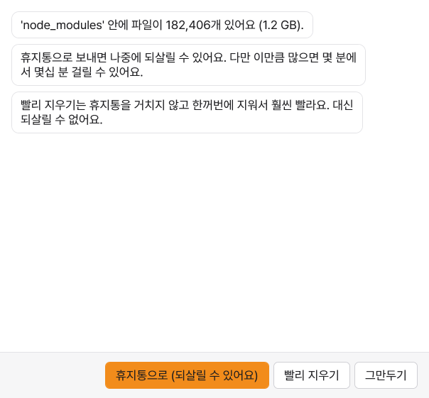

- **[휴지통으로 (되살릴 수 있어요)]**: 기본이에요. 평소처럼 휴지통으로 가요.
- **[빨리 지우기]**: 휴지통을 거치지 않고 여러 개를 한꺼번에 지워서 훨씬 빨라요. 대신 **되살릴 수 없어요.** 고르면 "되살릴 수 없어요, 중간에 멈춰도 이미 지운 것은 돌아오지 않아요"를 한 번 더 알려 드리고, 그 확인 창의 기본 단추는 **[그만두기]**예요(Enter를 잘못 눌러도 지워지지 않아요).
- 지우는 동안 작업 창에 지운 개수가 보이고, 언제든 **취소**할 수 있어요.
- 읽기 전용 파일, 아주 긴 경로(260자 넘음)도 지워요. 폴더 안의 **바로 가기 링크(정션·심볼릭 링크)는 링크만 지우고, 링크가 가리키는 원래 폴더는 건드리지 않아요.**
- 네트워크 드라이브에서는 서버에 무리가 가지 않게 천천히(동시에 4개씩) 지워요.
- 드라이브 맨 위, Windows, Program Files, 사용자 폴더·바탕화면·문서 폴더 자체는 빨리 지우기를 쓸 수 없어요(휴지통으로만).

### 휴지통

사이드바 아래쪽에 휴지통에 쌓인 용량이 보이고, **비우기**로 바로 비울 수 있어요(비우기는 되살릴 수 없으니 한 번 더 물어봐요). Foldy에서 지운 파일은 기본으로 휴지통으로 가요. 서버(SFTP)에는 휴지통이 없어서 지울 때마다 꼭 한 번 더 확인해요.

## 🔗 연결하기

서버, Git, 터미널과 이어 주는 기능이에요. 사이드바 **연결하기**에 모여 있어요.

### SFTP와 SSH

탭 줄 오른쪽 드라이브 단추 끝의 **SFTP** 단추, **Ctrl+Shift+O**, 사이드바 연결하기 → SFTP 중 하나로 서버에 접속하면 SFTP 폴더가 그 패널에 탭으로 열립니다. 왼쪽 트리는 서버 트리로 바뀌고, 처음 연 폴더와 서버 맨 위(/)가 한 단계 펼쳐져 있어 바로 폴더들이 보여요.

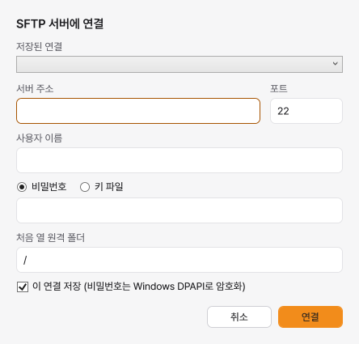

- 비밀번호 또는 키 파일 인증. "이 연결 저장"을 켜면 비밀번호는 Windows DPAPI로 암호화해 저장합니다. `~/.ssh/config`의 Host 항목도 저장된 연결에 나옵니다.
- 처음 보는 서버는 호스트 키 지문을 보여 주고 묻습니다(known_hosts는 OpenSSH와 같이 씀). 키가 바뀌었으면 경고합니다.
- 로컬 ↔ SFTP **복사·이동·끌어 놓기·붙여넣기**가 양방향으로 됩니다. 덮어쓸 때도 임시 파일에 끝까지 쓴 뒤 바꿔 넣으므로 실패해도 기존 파일은 그대로입니다. 이동은 복사가 모두 성공한 뒤에 원본을 지웁니다.
- SFTP에는 휴지통이 없어 삭제 전에 한 번 더 묻습니다.
- SFTP 탭에서는 터미널 버튼이 **SSH**로 바뀌어 같은 서버·폴더로 열립니다. [docs/sftp.md](docs/sftp.md)

### Git

Git 저장소 폴더에 들어가면 Git이 저절로 켜집니다. Git for Windows가 설치돼 있어야 합니다.

- **Git 바**: 파일 목록 위의 얇은 줄. 브랜치, 올릴/받을 커밋 수(↑↓), 변경 개수와 **받기 / 올리기 / 커밋… / Git 화면 열기**. 받기·올리기는 화면을 옮기지 않고 실행하고 결과를 상태바에 알립니다.
- 목록의 변경 표시: 파일 이름 옆에 **수정**(마지막 커밋 뒤에 고침), **추가**(다음 커밋에 들어감), **새 파일**(Git이 아직 기록하지 않음), **충돌**(합치지 못함)이 쉬운 말로 보이고, 마우스를 올리면 한 줄 설명이 나와요. 무시된 파일은 흐리게. 이름이 길어 자리가 없으면 표시가 이름을 덮지 않고 빠져요.
- 설정 → 일반 → Git: "Git 바 보이기". Git 화면은 Git 바의 [Git 화면 열기]로 한 번에 열어요.

#### 변경 사항과 diff

Git 화면의 **변경 사항** 탭: 커밋할 파일의 체크박스를 켜고(스테이지), 파일을 누르면 오른쪽에 바뀐 내용(diff: 추가 초록·삭제 빨강, 통합/나란히 보기)이 보입니다. 아래에 메시지를 쓰고 **커밋** 또는 **커밋 후 올리기**. 임시 보관(stash), 브랜치 전환·만들기도 위쪽 줄에서 합니다.

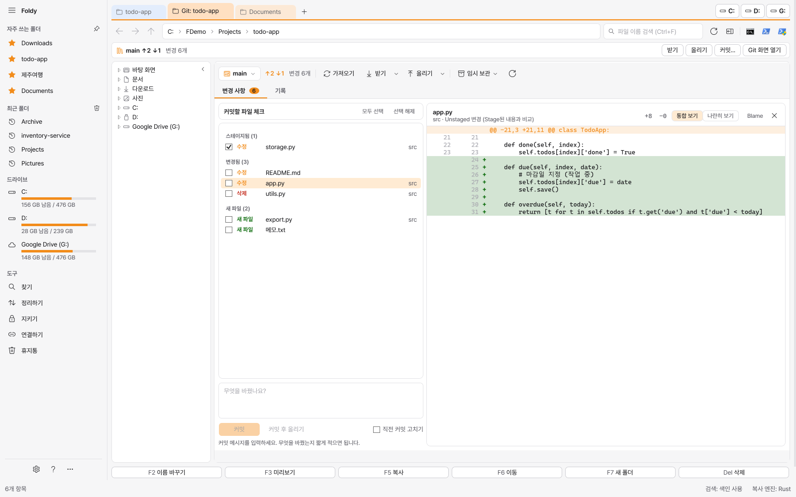

#### Blame

파일을 우클릭해 **이 파일 Blame**을 고르거나(또는 명령 팔레트의 "Git: 이 파일 Blame") diff 머리글의 **Blame** 버튼. 줄마다 해시·작성자·날짜가 보이고, 해시를 누르면 기록 탭에서 그 커밋이 선택됩니다.

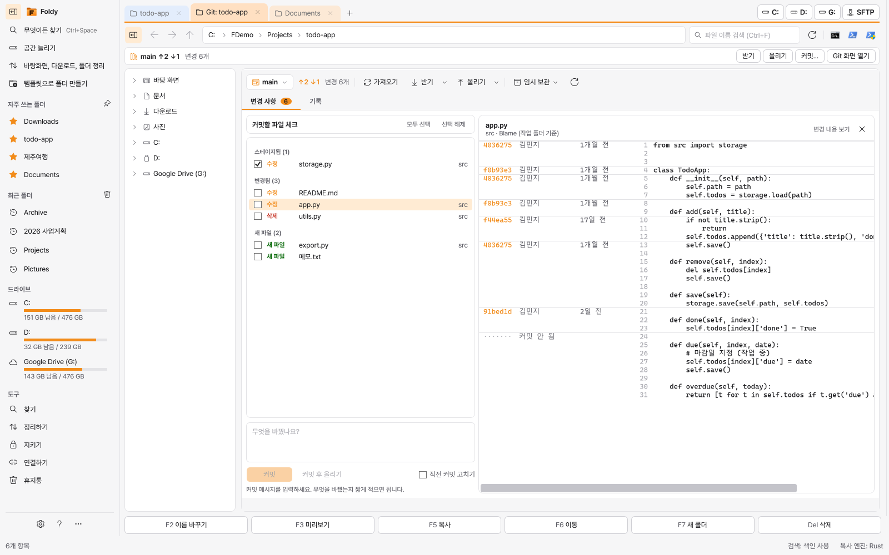

#### 기록(History)

**기록** 탭: 브랜치 그래프와 커밋 목록(메시지·작성자·해시 검색). 커밋을 누르면 바뀐 파일이, 파일을 누르면 그 커밋에서 바뀐 내용이 보입니다.

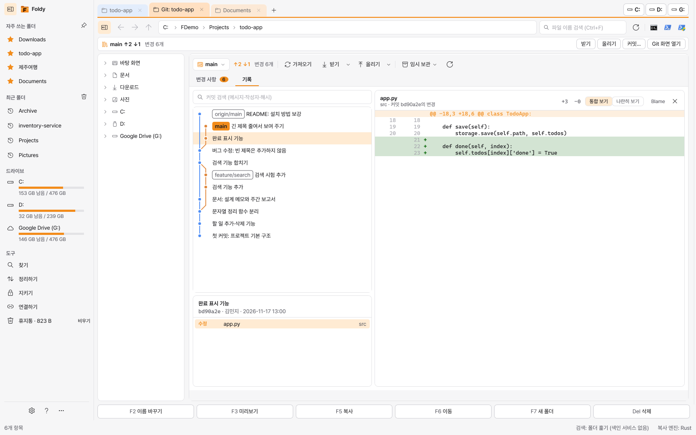

저장소가 아닌 폴더에서는 "여기에 Git 저장소 만들기" 버튼이 나옵니다. 강제 올리기는 `--force-with-lease`만 쓰고 경고를 거칩니다. [docs/git-view.md](docs/git-view.md)

## 설정과 테마

**글씨가 작으면 화면을 키우세요.** 기본은 Windows 설정을 따라가요: Windows 설정 → 접근성 → **텍스트 크기**를 키우면 Foldy도 그만큼 커져요(디스플레이 배율도 그대로 따라가요). Foldy만 따로 키우려면 **Ctrl+=** 크게, **Ctrl+-** 작게, **Ctrl+0**은 다시 Windows 따르기예요. 더 보기 메뉴의 "화면 크기"에서 고를 수도 있어요. 글씨와 버튼이 함께 커지고, 대화 창·메모 창도 같은 크기로 열려요.

**Ctrl+,**(또는 사이드바 설정)로 엽니다. 일반, 모양, 목록, 터미널, 복사, 업데이트, 단축키 페이지가 있습니다.

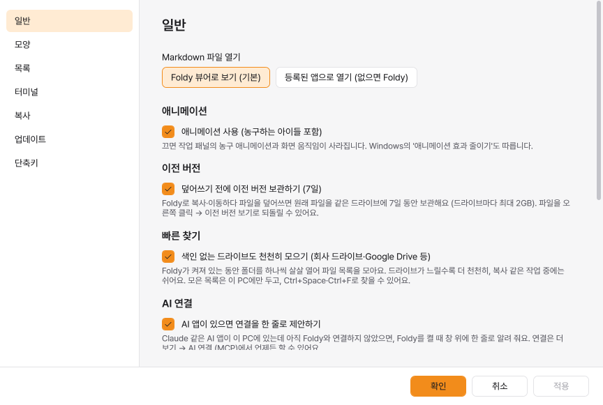

- **테마**: 시스템 설정 따르기(라이트/다크 자동) · 라이트 · 다크 · 레트로. **강조색**: Foldy 오렌지 또는 Windows 강조색.
- **목록 간격**(촘촘하게/보통/널널하게), **숨김 파일 보기**(Ctrl+H)는 사이드바 더 보기에서도 바꿉니다.
- **복사**: 병렬 복사 스레드 수. **업데이트**: 확인 방식. **터미널**: 기본 셸(PowerShell/cmd)과 Windows Terminal 사용.
- **단축키**: 칸을 누르고 새 조합을 누르면 바뀝니다(겹치면 경고). 바꾼 것만 `%LOCALAPPDATA%\Foldy\keymap.json`에 저장됩니다.

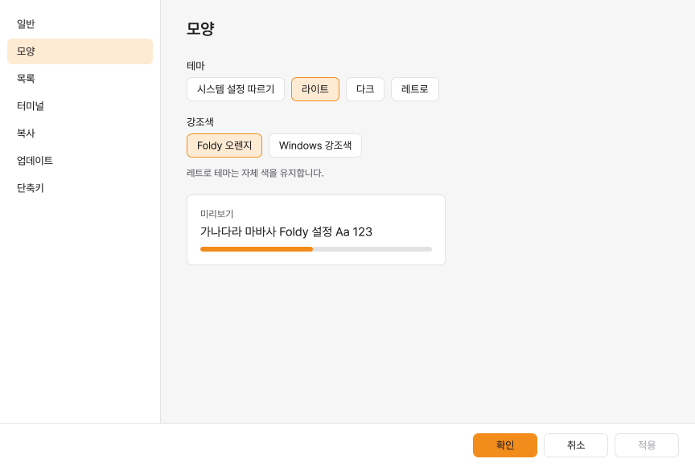

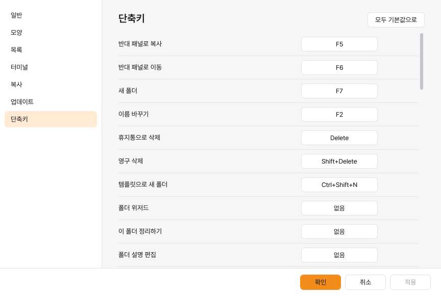

설정과 기록은 `%LOCALAPPDATA%\Foldy`(settings.json, session.json, logs)에, 색인 데이터는 `%ProgramData%\Foldy`에 있습니다. [docs/settings.md](docs/settings.md)

## 단축키

모든 명령은 **Ctrl+Shift+P**로 이름을 쳐서 찾을 수 있고, 설정 → 단축키에서 바꿀 수 있습니다.

| 키 | 동작 |
| --- | --- |
| **F1** | 도움말 (사용 설명서) |
| **F2** / **F5** / **F6** / **F7** | 이름 바꾸기 / 복사 / 이동 / 새 폴더 |
| **F3** | 미리보기 창 보이기/숨기기 |
| **Delete** / **Shift+Delete** | 휴지통으로 / 영구 삭제 |
| **Tab** | 다른 패널로 |
| **Ctrl+T** / **Ctrl+W** | 새 탭 / 탭 닫기 |
| **Ctrl+Tab** / **Ctrl+Shift+Tab** | 다음 / 이전 탭 |
| **Alt+←** / **Alt+→** / **Alt+↑** | 뒤로 / 앞으로 / 위로 |
| **Ctrl+L** | 경로 직접 입력 |
| **Ctrl+F** | 파일 이름 검색 |
| **Ctrl+R** | 새로 고침 |
| **Ctrl+H** | 숨김 파일 보이기/숨기기 |
| **Ctrl+B** | 폴더 트리 보이기/숨기기 |
| **Ctrl+Shift+B** | 사이드바 접기/펼치기 |
| **Ctrl+Shift+E** | 사이드바로 포커스 이동 (Esc로 목록 복귀) |
| **Ctrl+Shift+I** | 이미지만 보기 |
| **Ctrl+Shift+N** | 템플릿으로 새 폴더 |
| **Ctrl+Shift+O** | SFTP 서버에 연결 |
| **Ctrl+`** / **Ctrl+Shift+`** | 터미널 / 관리자 터미널 (SFTP 탭에서는 Ctrl+` = SSH) |
| **Ctrl+Shift+P** | 모든 명령 |
| **Ctrl+Space** | 빠른 검색: 파일·앱·설정·기능·계산 (다른 프로그램에서도, 겹치면 바꿀 수 있음) |
| **Ctrl+,** | 설정 |

## 버그 신고와 버그 진단 모드

- 사이드바 아래 **버그 신고**(또는 Foldy 정보 창)는 앱·Windows 버전과 최근 기록을 채운 GitHub 이슈 작성 페이지를 엽니다.
- Foldy는 오류를 자동으로 모아 두고(같은 오류는 한 번만), 처음에 보낼지 묻습니다. 보고서에는 앱·Windows 버전, 오류 내용, 최근 로그만 들어가고 **파일 경로와 사용자 이름은 지웁니다**. 설정 → 일반에서 언제든 끌 수 있습니다. [docs/bug-reporting.md](docs/bug-reporting.md), [PRIVACY.md](PRIVACY.md)
- **버그 진단 모드**: 특정 상황에서만 생기는 문제(예: 네트워크 드라이브가 빈 화면)는 사이드바 맨 아래 ⋯(더 보기) → **버그 진단 모드 켜기/끄기**로 자세한 기록을 남깁니다. 켜면 상태바에 "버그 진단 중"이 보이고, 문제를 다시 재현한 뒤 끄면 기록을 오류 보고서로 보낼지 묻습니다. 24시간 뒤 저절로 꺼집니다. 기록 파일은 ⋯ → **로그 폴더 열기**.

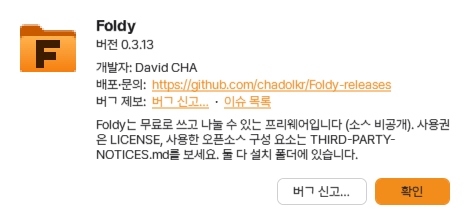

## 자주 묻는 질문

**검색이 현재 폴더만 찾아요.**
색인 서비스가 설치돼 있지 않거나 준비 중입니다. 사이드바 더 보기 → **색인 서비스 설치 (관리자)…**. 첫 색인은 드라이브 크기에 따라 수십 초 걸립니다.

**네트워크 드라이브가 끊겨 있으면 느려지나요?**
아니요. 드라이브마다 따로 일하므로 응답 없는 드라이브가 있어도 다른 탭과 패널은 그대로 움직입니다. 그 탭에서 **Esc**로 불러오기를 취소할 수 있습니다.

**회사 보안 드라이브가 빈 화면이에요.**
루트가 "시스템" 속성이어도 이제 보입니다(탐색기처럼 Hidden만 숨김). 그래도 비면 버그 진단 모드를 켜고 다시 열어 본 뒤 기록을 보내 주세요.

**Foldy를 또 실행하면 창이 두 개 뜨나요?**
아니요. 켜져 있는 창이 앞으로 오고, 경로를 넘겼다면 새 탭으로 열립니다.

**회사망에서 업데이트가 안 돼요.**
사이드바 아래 **… (더 보기) → 업데이트 확인**을 눌러 보세요. 서비스가 못 나가도 Foldy가 사용자 프록시로 다시 확인합니다. 그래도 실패하면 이유가 표시됩니다.

**폴더 정리가 안 돼요 ("정리하지 않습니다" 빨간 글씨).**
Git 저장소·프로젝트 폴더는 일부러 정리하지 않습니다. 일반 폴더에서 실행하세요.

**농구 애니메이션을 끄고 싶어요.**
설정 → 일반 → "애니메이션 사용"을 끄세요.

**삭제한 파일을 되살리고 싶어요.**
Delete는 휴지통으로 보냅니다(사이드바 휴지통에서 열기). Shift+Delete와 SFTP 삭제는 되살릴 수 없어 확인을 한 번 더 묻습니다.

## 소스에서 빌드

필요한 도구: .NET 10 SDK, Rust stable (MSVC), Visual Studio C++ Build Tools.

```powershell
./build.ps1            # Rust → .NET 빌드 + 전체 테스트
./build.ps1 -Bench     # 10만 개 목록 스크롤 벤치 추가 실행
```

실행: `src/Foldy.App/bin/Release/net10.0-windows/Foldy.exe`

유용한 옵션: `--theme system|light|dark|retro`, `--bench-list [--step N]`, `--bench-folder <폴더>`, `--list-wpf`(비교용 기본 ListView).
이 문서의 화면은 `./build/doc-screenshots.ps1`(= `Foldy.exe --doc-screenshots <폴더>`)로 가짜 샘플 폴더에서 다시 만들 수 있습니다.

| 경로 | 내용 |
| --- | --- |
| `src/Foldy.App` | WPF 실행 파일 (조립 루트) |
| `src/Foldy.UI` | 테마(모던 라이트/다크, 레트로), FastFileList 등 컨트롤 |
| `src/Foldy.Presentation` | 화면 상태(ViewModel)와 설정·세션 저장 |
| `src/Foldy.Core` | 모델, Provider 추상화, 드라이브별 작업 큐, 템플릿·정리 |
| `src/Foldy.Platform` | Win32 호출 (테마·제목 표시줄, 셸 연동) |
| `src/Foldy.Providers.Local`, `Foldy.Providers.Sftp` | 로컬·SMB 폴더, SFTP |
| `src/Foldy.Git`, `Foldy.Analysis`, `Foldy.Reporting` | Git, 폴더 분석, 오류 보고 |
| `src/Foldy.Copy.Native` | Rust 복사 엔진 P/Invoke (csbindgen 생성) |
| `src/Foldy.Indexer.Client` | 색인 서비스 Named Pipe 클라이언트 |
| `engine/` | Rust 워크스페이스: `foldy-proto`, `foldy-index`, `foldy-copy`, `foldy-ntfs` |
| `tests/` | xUnit v3 테스트, 벤치마크 도구 |

설계와 진행 상황은 [docs/DESIGN.md](docs/DESIGN.md), [docs/PROGRESS.md](docs/PROGRESS.md).

## 기여하기

누구나 함께할 수 있어요.

- **버그·아이디어**: [이슈](https://github.com/chadolkr/Foldy/issues)에 남겨 주세요. 앱의 도움말 → 버그 신고를 쓰면 버전과 로그가 자동으로 채워집니다.
- **코드**: 저장소를 포크해 고친 뒤 PR을 보내 주세요. 보내기 전에 `./build.ps1`로 빌드와 테스트가 모두 통과하는지 확인해 주세요.
- **원칙**: 복잡한 기능보다 단순하고 안정적인 쪽을 고릅니다. 화면이나 기능을 바꾸기 전에 [디자인 원칙](docs/DESIGN-PRINCIPLES.md)을 읽고, PR에서 점검표를 확인해 주세요.
- **주의**: 회사·개인 정보(사내 주소, 서버 이름, 사용자 경로 등)는 코드·이슈·화면 캡처에 넣지 말아 주세요. 기여한 코드는 GPL-3.0-or-later로 배포됩니다.

## Code signing policy

Free code signing provided by [SignPath.io](https://about.signpath.io), certificate by [SignPath Foundation](https://signpath.org).

Windows 실행 파일(`Foldy.exe`, `Foldy.*.dll`, `foldy-index.exe`, `foldy-update.exe`)과 MSI 설치 파일은 이 저장소의 소스에서 GitHub Actions([release.yml](.github/workflows/release.yml))로만 빌드되고, 릴리스마다 승인자가 직접 승인한 뒤에 서명됩니다.
업데이트 정보(`update.json`)는 이와 별도로 Ed25519로 서명됩니다 ([docs/release-signing.md](docs/release-signing.md)).

Team roles / 역할:

- Committers and reviewers / 커미터·리뷰어: [David CHA](https://github.com/chadolkr)
- Approvers / 승인자: [David CHA](https://github.com/chadolkr)

Privacy policy / 개인정보 정책: [PRIVACY.md](PRIVACY.md). 이 프로그램은 사용자가 켜거나 직접 실행한 기능(업데이트 확인, 동의한 오류 보고, SFTP·Git 연결 등)을 빼고는 어떤 정보도 다른 네트워크 시스템으로 보내지 않습니다.
This program will not transfer any information to other networked systems unless specifically requested by the user or the person installing or operating it.

## 왜 오픈소스인가요

오랫동안 오픈소스에서 많은 것을 얻기만 했어요. 이제는 저도 작은 보탬이 되고 싶어 Foldy를 GPL-3.0으로 공개합니다.
쓰다가 불편한 점이나 아이디어가 있으면 언제든 [이슈](https://github.com/chadolkr/Foldy/issues)와 PR로 함께해 주세요.

## 라이선스

[GPL-3.0-or-later](LICENSE) · [오픈소스 고지](THIRD-PARTY-NOTICES.md) · 개발자 David CHA · <https://github.com/chadolkr/Foldy>
