# Foldy User Guide

**A fast, smart file manager that works offline.** <small>Connect AI to make it even easier.</small>

Foldy is a fast, never-freezing dual-pane file manager for Windows. You can open this guide anytime with **F1** or the **? Help** button at the bottom of the sidebar.

| | |
| --- | --- |
| Version | {{version}} |
| Developer | David CHA |
| Repository | https://github.com/chadolkr/Foldy |
| License | GPL-3.0-or-later (free software) |

- [Easy for everyone](#easy-for-everyone)
- [First run](#first-run)
- [A tour of the screen](#a-tour-of-the-screen)
- [The sidebar](#the-sidebar)
- [Tabs](#tabs)
- [The kids play basketball](#the-kids-play-basketball)
- [File operations](#file-operations)
- [Preview](#preview)
- [Markdown viewer](#markdown-viewer)
- [Slow drives](#slow-drives)
- [Keyboard shortcuts](#keyboard-shortcuts)
- **[🔍 Find](#-find)**
  - [Quick search (Ctrl+Space)](#quick-search-ctrlspace)
  - [Search](#search)
  - [Folder analysis](#folder-analysis)
  - [Images only](#images-only)
- **[🧹 Tidy](#-tidy)**
  - [Tidy tools](#tidy-tools)
  - [That method you saw online, in one click](#that-method-you-saw-online-in-one-click)
  - [Folder templates, wizard and tidying](#folder-templates-wizard-and-tidying)
- **[🔒 Protect](#-protect)**
  - [Deleting folders with lots of files](#deleting-folders-with-lots-of-files-fast-delete)
  - [Recycle Bin](#recycle-bin)
- **[🔗 Connect](#-connect)**
  - [SFTP and SSH](#sftp-and-ssh)
  - [Git](#git)
  - [Terminal](#terminal)
- [Settings and themes](#settings-and-themes)
- [Updates](#updates)
- [Reporting bugs](#reporting-bugs)
- [FAQ](#faq)

## Easy for everyone

Foldy is made so that even grandparents can use it without a manual. Buttons are big enough to hit in one go, things you turn on and off are always in the same place with the same button, and buttons of the same kind share the same icon. Deleting goes to the Recycle Bin by default, and anything that can't be undone is clearly announced first. If the text is too small, press **Ctrl+=** to enlarge it.

## First run

The first time you start Foldy, it helps you make things comfortable to read.

1. **Text size**: Normal, Large, Larger and Largest, shown on a real file list. Changes apply as soon as you press, so choose while you look.
2. **Brightness**: Light, Dark or Follow Windows.
3. **Quick search shortcut**: checks whether Ctrl+Space clashes with another program and, if it does, lets you pick another key right there.
4. **Short intro**: like a vertical short video, the real Foldy screen moves while one line at a time shows the main features (Ctrl+Space quick search — files, Windows settings, math and plain-language commands; drag and drop to copy; folder analysis; desktop tidy; folder tidy; locked notes; folder structure templates; Git). It advances by itself; click the right side for next, the left side for previous, and [Skip] anytime. Scenes you have seen do not play again after you reinstall or update; when an update adds a new feature, only that scene plays once. You can watch the whole intro again anytime from the **?** button at the bottom of the sidebar → "Short intro".

   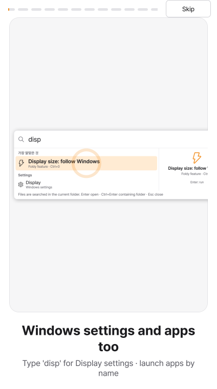

When you update, your settings stay as they are, so Foldy doesn't ask again; it just tells you in one line that it was updated.

## A tour of the screen

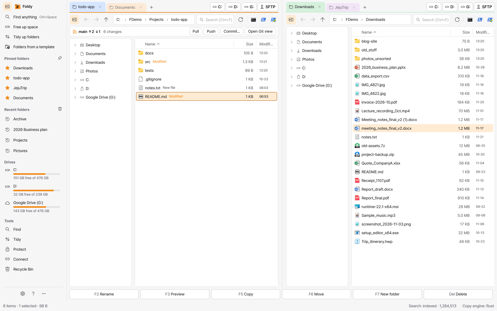

On the far left is the **sidebar** (pinned folders, drives, tools, settings), and to its right are the **left and right panes**. The pane you're working in (the active pane) shows an accent-colored line under its tabs. Press **Tab** to switch to the other pane.

From top to bottom, each pane has:

1. **Tab bar**: one tab per folder, each with its own color (like OneNote). On the right are drive shortcuts (C: D: …) and an **SFTP** button (pick a saved server or make a new connection). Hover over a drive to see its name and free space.
2. **Path bar**: click a part of the path to go to that folder; click an empty spot or press **Ctrl+L** to type a path. Inside a Git repository a branch chip (`main ↑2 ↓1`) appears.
3. **Search box**: file name search (**Ctrl+F**).
4. **Tool buttons**: show/hide the folder tree on the far left (**Ctrl+B**), back, forward, up, path, search, refresh, terminal.
5. **Tree | List**: in both panes the folder tree is on the left and the files of the folder chosen in the tree are on the right. Drag the border between them to change the tree width, and use the tree button at the far left of the toolbar (or **Ctrl+B**) to hide or show it in the same place (the width is remembered). The tree follows the folder you're viewing: whether you type an address, jump with Ctrl+Space or switch tabs, it expands to that folder and highlights it. Click a column header to sort.

At the bottom are the **jobs panel** (copy and move progress), the **file operation buttons** (F2, F3, F5, F6, F7, Del) and the **status bar**. The middle of the status bar shows what just happened (a message like "Copied 3") in large text, and new messages briefly glow in the accent color. On the left are the item count and selected size; on the right, the search mode, copy engine and update notice.

Only one Foldy runs at a time. If you start it again while it's running (a shortcut, opening a folder with Foldy, and so on), **the running window comes to the front** instead of a new window, and a folder you passed opens in a new tab.

## The sidebar

The strip on the far left holds features you use from either pane. Collapse it with the pane button at the top (or **Ctrl+Shift+B**) to leave only icons; press the same button again to expand it. It looks like the folder tree button and shows a pressed background when expanded. You can also drag its right edge to change the width (very narrow shows icons only).

- **The four flagship features at the top** (one click):
  1. 🔎 **Find anything** (anywhere with **Ctrl+Space**): files, apps, Windows settings, Foldy features and math, all in one box
  2. 📊 **Free up space**: see what takes up space with folder analysis, and clear only what's safe to delete
  3. 🧹 **Tidy up folders**: the tidy helper asks "Where?" and "How?" (by type, by date, PARA) one at a time and shows the result first. Nothing is deleted, and it can be undone
  4. 🗂️ **Folders from a template** (**Ctrl+Shift+N**): preview a folder structure like PARA or industry project phases and create it in one go
- **Pinned folders**: press the **pin** button next to the title to pin the current folder. Click to open it in the active pane; right-click to open it in a new tab or the other pane, reorder or unpin.
- **Recent folders**: the last 5 folders you opened appear automatically (pinned ones are left out). Clear them with the trash button next to the title.
- **Drives**: each drive shows its name, a usage bar and free space. Over 90% full, the bar turns red. Right-click to start a folder analysis right away.
- **Tools**: the remaining features are gathered into four groups. Clicking a group opens its menu.
  - 🔍 **Find**: file search, folder analysis, images only
  - 🧹 **Tidy**: tidy this folder, new folder from template, folder wizard, set a management style, tidy Desktop / Downloads / logs
  - 🔒 **Protect**: new note, locked note, lock a file, vault, previous versions (right-click), Recycle Bin
  - 🔗 **Connect**: SFTP, Git view, terminal
- **Recycle Bin**: shows how much has piled up; **Empty** empties it right away.
- **At the bottom**: settings (**Ctrl+,**), help (**F1**), more (all commands **Ctrl+Shift+P**, theme, hidden files, list spacing, updates, bug report, tour, about Foldy).

## Tabs

| What you want | How |
| --- | --- |
| New tab | **Ctrl+T** or **+** on the tab bar |
| Close tab | **Ctrl+W**, middle-click, or the tab's ✕ |
| Next/previous tab | **Ctrl+Tab** / **Ctrl+Shift+Tab** |
| Reorder | drag a tab onto another tab |
| Move to the other pane | drag a tab onto a tab in the other pane |
| Same folder in a new tab | double-click the tab |

Tabs, paths, sorting and window position are saved automatically and restored next time. Even if Foldy shuts down suddenly, it comes back to the last state (up to 2 seconds before).

## The kids play basketball

For jobs that take longer than 1.5 seconds, two kids playing basketball appear in the jobs panel.

They know 15 moves: crossover, behind the back, between the legs, spin move, euro step, hesitation, step-back, shot fake, change of direction, give and go, bounce pass, no-look pass, alley-oop, screen and roll, and cut. Every move appears once before any repeats.

- Copy and move: one kid passes, the other dribbles forward as the job progresses and, at the end, **sinks a three-pointer** followed by a high five!
- Delete: they throw the ball into the trash. For permanent delete the ball flies out of the court.
- Search and network waits: the two look around for the ball.
- Indexing and analysis: one kid practices dribbling while the other takes notes.
- Paused or name conflict: a kid holds the ball and waits. If something fails, the shot bounces off the rim.

You can turn it off with "Use animations" in Settings → General, and it stops (using no CPU) when the window is minimized or covered.

## File operations

| Operation | Key | Description |
| --- | --- | --- |
| Rename | **F2** | Opens an edit box with the name (without extension) selected. Enter to confirm, Esc to cancel |
| Copy | **F5** | Selected items to the folder in the other pane |
| Move | **F6** | To the folder in the other pane |
| New folder | **F7** | You can type the name right after it's created |
| Delete to Recycle Bin | **Delete** | |
| Delete permanently | **Shift+Delete** | Asks for confirmation. With more than 5,000 files you can also choose [fast delete](#deleting-folders-with-lots-of-files-fast-delete) |
| Copy, cut, paste | **Ctrl+C / X / V** | Works with File Explorer too |
| Up | **Backspace**, **Alt+↑** | Focus goes to the folder you just left |
| Back/forward | **Alt+← / →**, mouse back/forward buttons | |

- **Right-click** shows the same menu as File Explorer (Open with, Send to, compress, and so on). **Shift+right-click** shows the extended menu.
- **Drag and drop**: drag from or to File Explorer. Within the same drive the default is move, across drives it's copy; **Shift** moves and **Ctrl** copies.
- Copying and moving are handled by the **parallel copy engine**. If a name already exists, it asks "Keep both / Overwrite / Skip" (optionally for all remaining conflicts). Progress appears in the jobs panel and on the taskbar, and you can browse other folders freely while copying.
- Typing letters jumps to the file whose name starts with them (type-ahead). Pressing the same letter again moves to the next match.

**Who is using this file?** If a copy, move or delete fails, Foldy tells you in the jobs panel and status bar which program is using the file (for example "Microsoft Excel is using it. Close that program and try again"). It only asks Windows; it never force-closes a program.

## Preview

Press **F3** (or **F3 Preview** at the bottom) to open a preview pane above the file list that shows the contents of the selected file. It supports Markdown, images, text and code (with syntax highlighting), and formats that have a Windows preview handler such as PDF and Office. Drag the border to change the preview height.

The preview pane closes by itself when you go to another folder, drive or tab (turn it on again with F3). When nothing is selected it just says "Preview pane".

- Cloud-only files aren't read, so nothing gets downloaded.
- Network drives and SFTP aren't read automatically (to stay fast); they're read only when you press **[Preview]**.
- The same goes for the Google Drive for desktop drive (usually G:). It shows in the sidebar with a cloud icon as "Google Drive", and thumbnails, icons and previews never download online-only files by themselves. A file is downloaded only when you open or copy it.
- **Files protected by DRM or a password** show "This file is protected by DRM, so it can't be previewed" (or "…password-protected…") instead of an error. Open the file to view it in the app your security software allows. Foldy recognizes them when the start of the file doesn't match its format (Office, Hangul, PDF, images) and looks encrypted.

## Markdown viewer

When you open a `.md` file, Foldy shows it right inside the app instead of Notepad (the default; you can pick a registered app instead in Settings → General → Open Markdown files). Press the pencil button (**Edit**) to edit it in the note window. Tables, checkboxes, code (with syntax highlighting and a copy button), images with relative paths, a table of contents and in-document search (**Ctrl+F**) are supported. Links to other `.md` files open in the same tab (with back/forward), and folder links open as folder tabs. Images from the internet are loaded only when you press [Load images].

## Slow drives

Drives that take a long time to open folders, such as company security drives, are detected **automatically** from how long they take. There's nothing to set.

- A **Slow drive** mark appears next to the path bar, and the status bar tells you once when it's first detected.
- The list is shown first; things like folder sizes are filled in later. Going to another folder cancels the pending work.
- Git detection, image thumbnails and per-file icons are skipped, and the preview (F3) opens only when you press **[Preview]**.
- Folder changes are checked periodically instead of watched. Copying still adjusts automatically.

## Keyboard shortcuts

| Key | Action |
| --- | --- |
| **F1** | This guide |
| **Ctrl+Shift+P** | All commands (find and run by name) |
| **Ctrl+Space** | Quick search: files, apps, settings, features, math (even from other programs) |
| **Tab** | Switch to the other pane |
| **Ctrl+L** | Type a path |
| **Ctrl+F** | File name search |
| **Ctrl+R** | Refresh |
| **Ctrl+H** | Show/hide hidden files |
| **F3** | Show/hide the preview pane |
| **Ctrl+,** | Settings |
| **Ctrl+B** | Show/hide the folder tree |
| **Ctrl+Shift+B** | Collapse/expand the sidebar |
| **Ctrl+Shift+I** | Images only |
| **Ctrl+Shift+N** | New folder from template |
| **Ctrl+Shift+O** | Connect to an SFTP server |
| **Ctrl+`** | Terminal (SSH in an SFTP tab) |
| **Ctrl+Shift+`** | Admin terminal |

## 🔍 Find

Features for finding files and seeing what takes up space. They're gathered under **Find** in the sidebar.

### Quick search (Ctrl+Space)

Whatever program you're using, press **Ctrl+Space** and a big search box appears in the middle of the screen (like Spotlight on macOS). Find everything in one box.

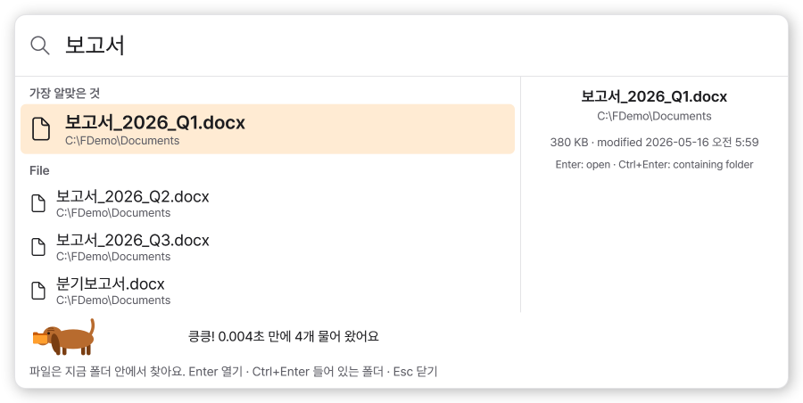

- **Files and folders**: searches every drive if the index service is installed, otherwise inside the current folder. A preview (picture, start of the text, size, date) appears on the right.
- **Apps**: finds programs in the Start menu by name and runs them.
- **Windows settings and Control Panel**: type something like "display", "wifi", "text size" or "printer" to open that settings page directly. Classic Control Panel and admin tool names such as "control panel", "add or remove programs", "device manager", "task manager" or "environment variables", and everyday words like "driver" or "not responding", work too.
- **Pinned and recent folders** appear at the top.
- **Foldy features**: run a feature by its name, like "settings" or "folder analysis".
- **Plain language works (Korean)**: Foldy understands Korean requests such as "다운로드 정리해줘" (tidy my downloads) and shows "Do this?". In other languages, type the feature's name instead.
- **Math and unit conversion**: type `12*3+4`, `200*15%`, `5 km to mi`, `100F` or `2 GB MB` for an instant answer; press Enter to copy the result.

The **best match** appears large at the top, with the rest grouped by kind below (apps, settings, folders, Foldy features, files), like Windows search. Click **All, App, Settings, Folder, Files or Foldy features** under the search box, or press **Tab**, to see just one group with more results. Each group name shows how many were found (**Files · 220**). Files keep loading as you scroll down (or press ↓ on the last one), and the bottom line reads "Showing 30 of 220" until you reach "All 220 shown". Groups that show only 5, such as apps and settings, end with **See all 12 ›** to show just that group. You can also open the selected item with the large **[Open]** button on the right. **Enter** opens or runs, **Ctrl+Enter** shows the containing folder in Foldy, and **Esc** or clicking outside closes it. It never searches the internet (nothing is sent outside).

When it finds files, a **sharp-nosed bloodhound** sniffs the floor, runs with its ears flapping and fetches them: "Sniff! Fetched 1,284 in 0.03 s". If nothing turns up, it tilts its head. Turn off "Use animations" in settings to see text only.

**How far does it search?** The index is built for this PC's NTFS drives (C: and so on). Under each drive in the sidebar you'll see "Indexed" or "Indexing 62%". Drives without an index (company drives, Google Drive, USB sticks, SD cards and so on) are **gathered gently** in the background while Foldy is running: one at a time, resting more if the drive slows down, and pausing during jobs like copying. The drive shows "Indexing · 12,345" and then "Indexed" when done. While another drive is being gathered it says what it's waiting for, like "Waiting for its turn · after G:". When gathering again, only changed folders are read, and new or deleted files are reflected right away. You can search what has been gathered so far, and the folder you have open is always scanned directly. Turn it off in Settings → General → Quick find.

**What if the shortcut clashes?** If another program already uses Ctrl+Space, or a Chinese or Japanese input method is installed (where Ctrl+Space switches input), Foldy tells you during the first setup and lets you pick a free key (such as Ctrl+Shift+Space) or press your own. You can also choose "Use only inside Foldy". After updates it doesn't ask again unless registration fails. You can change it anytime in Settings → Shortcuts.

### Search

Press **Ctrl+F**, type part of a name in the search box and press Enter to open a search results tab.

- With the **index service** installed, every drive is searched instantly (milliseconds even for millions of files). The status bar shows "Search: indexed".
- Without the service, the current folder and below are scanned directly (up to 20,000 items).
- Opening a folder in the results opens a new folder tab; files open directly. Esc cancels the search.

### Folder analysis

Choose **Folder analysis** (from the Find menu, "folder analysis" in Ctrl+Space, or the command list) and **Foldy first asks what to analyze.** There's a button for each disk with its free space, the current folder, and [Choose another folder…]. Your choice opens an analysis tab. Right-clicking a drive in the sidebar → Analyze opens that drive directly.

- **Treemap**: bigger folders get bigger boxes. Click a box to go inside; Backspace, right-click or the mouse back button goes up one level.
- **Lists**: largest folders and files, and folders that grew the most since the last analysis.
- **Cleanup candidates**: things that can be rebuilt if deleted, such as node_modules, build output, temp files and caches. System folders are never suggested.
- **[To Recycle Bin]**: moves items to the Recycle Bin only, after you confirm (never a permanent delete).
- **F5** analyzes again, **Esc** cancels. Double-click a list item to open that location in a folder tab.

**Everything that can be suggested** — only suggested when the most recent change inside is older than the period and the size is at least the amount shown.

| Target | Location and name | Condition |
| --- | --- | --- |
| Node.js packages | `node_modules` (next to `package.json`) | 30 days, 10 MB |
| .NET build output | `bin`, `obj` (next to `*.csproj` etc.) | 14 days, 10 MB |
| Rust build output | `target` (next to `Cargo.toml`) | 14 days, 50 MB |
| Gradle build output | `build`, `.gradle` (next to `build.gradle` etc.) | 14 days, 10 MB |
| Front-end build caches | `.next`, `.nuxt`, `.parcel-cache`, `.turbo`, `.angular`, `.svelte-kit` (next to `package.json`) | 14 days, 10 MB |
| Python caches | `__pycache__`, `.pytest_cache`, `.mypy_cache`, `.ruff_cache`, `.tox` | 30 days, 1 MB |
| Visual Studio cache | `.vs` | 30 days, 100 MB |
| User temp folder | `%LOCALAPPDATA%\Temp` | 7 days, 50 MB |
| Folders named temp/tmp | `temp`, `tmp` | 30 days, 100 MB |
| Browser caches | `Cache`, `Code Cache` in Chrome and Edge profiles | 100 MB |
| Package manager caches | `npm-cache`, `pip\cache`, `Yarn\Cache`, `%USERPROFILE%\.gradle\caches` | 30 days, 500 MB |
| NuGet package cache | `%USERPROFILE%\.nuget\packages` | 60 days, 1 GB |
| Crash dump files | `*.dmp`, `*.hdmp`, `*.mdmp` | 14 days, 10 MB |
| Crash dump folder | `%LOCALAPPDATA%\CrashDumps` (the default folder for Windows Error Reporting) | 14 days, 10 MB |
| Old installers | `*.exe`, `*.msi`, `*.msix`, `*.iso` in Downloads | 90 days, 50 MB |

`.git` is shown but never suggested. System folders such as Windows, Program Files and ProgramData are never suggested, whatever the rules.

**Left out on purpose**
- Windows Update files, Delivery Optimization files, the thumbnail cache and the previous Windows installation (Windows.old): the system uses these, so it's safer to let Windows remove them. Press **[Open Windows cleanup recommendations]** above the suggestions to open the cleanup page in Windows Settings (Disk Cleanup on Windows 10).
- Antivirus update backups and quarantine files: we found no official guidance from vendors saying they're safe to delete, and quarantine exists to restore wrongly cleaned files, so they're not included. Clean them up from the antivirus program's own menu.

With the index service installed, analysis takes a few seconds without rereading the disk. Without it, the disk is scanned directly at low priority.

### Compare and sync both panes

Use this when you can't tell which is newer, a folder you copied to USB or the one on your PC. Open the two folders in the two panes and press 🔍 **Find → Compare and sync both panes**; Foldy talks you through it.

- **What's different**: files only on the left or only on the right, and which side is newer (by size and modified time; a difference of 2 seconds counts as the same). It sums it up in one line, like "The right side is newer. 12 files were changed on the right".
- **Which way**: choose [Left → right], [Right → left] or [Sync both to newest]; Foldy shows the copy list first and syncs only after you confirm.
- **Safely**: files that exist on only one side are never deleted. Newer files are never overwritten by older ones. Overwritten files are kept as previous versions (on USB and network drives, as `.foldy-bak` next to them), and one **[Undo]** puts everything back.
- **Files changed on both sides**: files changed on both sides since the last sync aren't picked automatically; Foldy asks about each one.
- Inside Git repositories and development project folders, nothing is compared.

### Images only

Press **Ctrl+Shift+I** or Find → Images only in the sidebar to show only the images in the current folder as a thumbnail grid. Other files are just hidden, never moved.

While it's on, a line right above the list says "Showing images only · N pictures" (or "this folder has no pictures"), and **[Show all files]** in the same place turns it off.

- **Space**: view large (← → previous/next, wheel to zoom, R to rotate, Esc to close)
- **Ctrl+wheel**: thumbnail size
- Network drives, the Google Drive drive (G:) and cloud-only files aren't read (so no download starts).

## 🧹 Tidy

Features that tidy folders the way you'd clean a room. They're gathered under **Tidy** in the sidebar. Nothing is thrown away on its own: you see it first, and it can be undone.

### Tidy tools

Foldy tidies your computer the way you'd clean a room. Press **Tidy** in the sidebar to choose desktop, Downloads or log cleanup (also in the command list). Every tool talks you through it one step at a time: what it found, why tidying helps and what happens when you press, and then lets you choose **[Clean up as shown] [See details] [Later]**. Take your time.

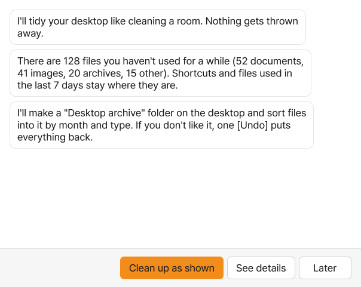

Three promises, always:

- **Nothing is thrown away on its own.** You see what goes where first, and nothing happens until you press.
- **You're told where things went.** You can open the destination right away.
- **It can be undone.** Deleting always goes to the Recycle Bin, and a desktop tidy is undone with one [Undo].

#### Desktop tidy

Is your desktop piled high with files? Without throwing anything away, Foldy puts them by type into a **"Desktop archive"** folder on the desktop and tells you where they went. Don't like it? One **[Undo]** puts everything back!

- **What moves**: files directly on the desktop that haven't been used in the last 7 days
- **What stays**: shortcuts (`.lnk`, `.url`), files used in the last 7 days, folders, hidden and system files
- **Where they go**: `Desktop\Desktop archive\year-month\type` (types: Documents, Images, Videos, Music, Archives, Installers, Code, Other)
- Files in use by another program are skipped.
- An existing folder made by an earlier Korean version (바탕화면 보관) keeps being used.
- **A one-line suggestion at startup**: if the desktop or Downloads has more than 20 files (not counting shortcuts), a line appears at the top of the window when Foldy starts, like "There are 27 files on your desktop. Shall I sort them by type?" with [Tidy up] [Later] [Don't ask again]. If you ignore it, it disappears; [Later] asks again after 7 days; undo [Don't ask again] in Settings → General → Tidy reminders.

#### Downloads tidy

The Downloads folder keeps piling up. Foldy finds files worth tidying and suggests you **send them to the Recycle Bin or archive them**.

| What it finds | Rule |
| --- | --- |
| Installers for programs you already installed | Only when the `.exe` product name clearly matches an installed program (if in doubt, it's left out) |
| Duplicate files | Same size and content (SHA-256). The one with the shortest name is kept (e.g. only `report (1).pdf` is selected) |
| Archives already extracted | A `.zip` with a folder of the same name next to it |
| Old files | Not opened or changed for over 90 days (you pick these yourself) |

- Only files directly in Downloads are checked. Subfolders are treated as already organized and left alone. Files still downloading (`.crdownload`, `.part`) are excluded too.
- **[To Recycle Bin]**: moves them to the Recycle Bin, where you can restore them.
- **[Archive]**: moves them to `Downloads\Archive\year-month`.

#### Log cleanup

The `*.log` files programs leave behind can quietly pile up to several GB. Foldy packs old logs tightly into **monthly zips** in the same folder. Text logs usually shrink by more than 85%.

- **Targets**: `*.log` files unchanged for more than 7 days (the whole current drive; with the index service they're found in an instant)
- **Left alone**: logs a program is using, the `Windows` folder, the Recycle Bin, System Volume Information
- **What it makes**: `logs-year-month.zip` in the folder where the logs were
- The originals go to the Recycle Bin only after the zip is reopened and checked to match them exactly (SHA-256). If the check fails, the originals stay.
- You can also open it with the **[Log cleanup]** and **[Tidy Downloads]** buttons at the top of the folder analysis screen.

#### Find folders you can delete (developer leftovers)

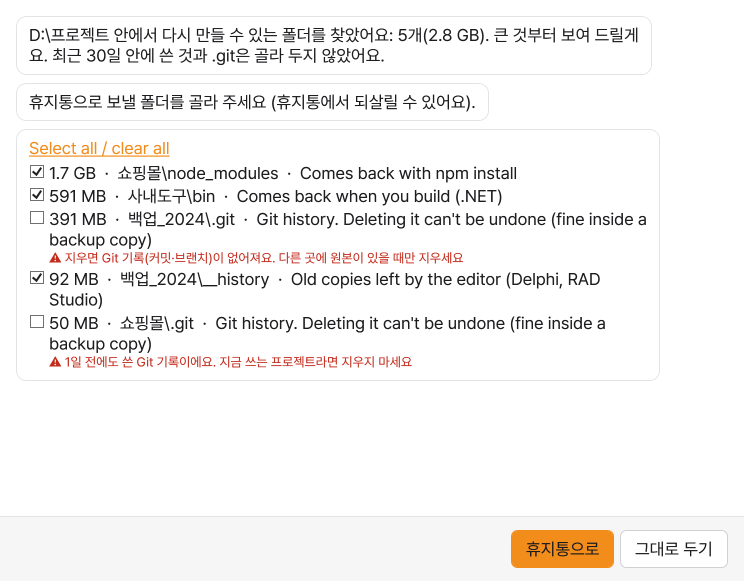

Project folders collect folders that can be rebuilt, often several GB (node_modules, bin/obj, target, __pycache__, .venv, dist/build, Delphi's __history). Find them in Tidy → **Find folders you can delete**, **[Folders you can delete]** in folder analysis, or Ctrl+Space.

- Searches **only inside the folder you're viewing** and shows the biggest first. With the index, sizes appear right away.
- Picks a folder **only when a project file is next to it**: node_modules next to package.json, bin/obj next to a .csproj, target next to Cargo.toml. A photo folder that just happens to be called "build" is left alone.
- Anything used in the last 30 days isn't preselected.
- **.git is never preselected.** Deleting it loses Git history, so Foldy warns in red, and for a recently used .git it says "Don't delete it if you're still working on the project". If it's a backup copy whose original exists elsewhere, you can pick it yourself (Foldy asks once more).
- Only what you pick goes **to the Recycle Bin**, where you can restore it.
- To look for more names, list them with commas in Settings → General → Find folders you can delete.

#### Clean developer caches

Cleans the caches downloaded by npm, NuGet, pip, Yarn and pnpm, and the Docker build cache. Tidy → **Clean developer caches**.

- Shows only the tools installed on this PC, with their size and a note that they can be downloaded again.
- Never deletes folders directly; it runs only **each tool's official command** (`npm cache clean --force`, `dotnet nuget locals all --clear`, `py -m pip cache purge`, `yarn cache clean`, `pnpm store prune`, `docker builder prune --force`).
- For Docker, **only the build cache**: images, containers and volumes aren't touched.
- This skips the Recycle Bin and can't be undone, so Foldy shows the size and **asks once** first. Anything needed is downloaded again on the next build or install.

#### Work tags (where was I?)

When you go through many files one by one, it's easy to lose track. Put small colored marks like **Done** or **Applied** on files.

- **Adding**: select files and press **Ctrl+D** to toggle Done. From the 🧹 Tidy menu (or the command list) you can also add Applied, In review and Submitted. You can do several files at once.
- **Where they show**: as small colored chips after the file name. If the name is too long to leave room, the chip isn't drawn (the name comes first). At the top of the folder you'll see "of 20 files, Done 7 · Applied 3" and **[Next file]** (the next file that isn't Done yet).
- **Where they're stored**: in human-readable form in the folder's hidden `.foldy.md` file. So tags follow the folder when you move it to another disk or PC. The files themselves aren't touched. Renaming in Foldy keeps the tags.
- **Git folders**: Foldy adds a line to `.git/info/exclude` so `.foldy.md` doesn't show up in git status (.gitignore stays as it is). To share tags with collaborators, turn on **[Share in repository]** in the line at the top.
- **[Clear all tags]**: removes only the tags of the files in that folder.

### A management style per folder

Decide "I'll manage this folder with PARA", and Foldy checks it now and then and speaks up when there's something to tidy. Each folder can have its own style.

- **How to set it**: right-click a folder → **Choose how to manage this folder…**. Foldy explains what each style does and, once you choose, asks whether to create the folders it needs.
- **Styles**: PARA, Johnny.Decimal, Numbers and dates, By date
- **Marks**: the managed folder (the top one) gets a small dot on its icon and a flag in the tree. Inside it, a line at the top says "Managed with PARA · 3 things to tidy". File Explorer also shows the Foldy icon on that folder.
- **Where it's remembered**: a single hidden `.foldy.md` file in the folder. It's a human-readable note, so it follows the folder, and deleting it just turns management off; your files stay as they are. Subfolders follow the nearest `.foldy.md`.

**What Foldy tells you about**

| Style | What it points out | What it does (when you confirm) |
| --- | --- | --- |
| All styles | Unsorted files at the top | Gathers them in `00_Inbox` first (for By date, into year\year-month folders) |
| PARA | Projects in 1_Projects untouched for 90 days | Moves them to 4_Archives |
| Numbers and dates | Folders in 01_In progress untouched for 90 days | Moves them to 03_Done |
| Johnny.Decimal | Folders without a number | Only tells you (please name them yourself) |

**Nothing to worry about**

- Nothing moves on its own. You see what goes where, and things move only when you press **[Clean up as shown]**. Afterwards, one **[Undo]** puts everything back.
- Programs, settings files and shortcuts (`.exe`, `.dll`, `.ini`, `.json`, `.lnk` and so on) are never moved, because other programs or shortcuts could break.
- **Git repositories and development project folders** can't have a style. The folder above that holds the repositories can, and repositories inside it are only ever moved as a whole (their insides are never touched).
- Open files are skipped with "Skipped: it's open".
- In **sync folders** like OneDrive or Google Drive, Foldy first tells you "This is a sync folder", because moves are reflected on your other PCs too. No File Explorer icon (desktop.ini) is created in such folders or on network and slow drives.
- If a lot piles up, Foldy tells you in one line at most once a week, like the other tidy tools (Settings → Tidy reminders).
- Folder names follow the app language when created (00_Inbox, 01_In progress …). Folders created earlier with Korean names (00_받은 파일 …) keep being used.

#### A one-line hint when it's useful

So you don't have to go looking for features, Foldy shows one line at the top suggesting a feature that fits the folder you're viewing. Only one at a time; press **[Close]** and it won't show again in that folder. Turn off **Tidy reminders** in Settings → General to hide them.

- More than 40 files in Downloads → [Tidy Downloads]
- More than 50 files on the desktop → [Tidy Desktop]
- A folder with more than 20 log files (.log) → [Log cleanup]

### A gentle nudge when things pile up

Because it's easy to miss, Foldy takes a light look now and then and, only when there's a lot to tidy, mentions it in one line at the bottom of the window. At most once a week, and it never tidies on its own.

- Logs: when the space you could save exceeds 1 GB or 5% of the drive's free space (checked only with the index service)
- Downloads: when files worth tidying exceed 1 GB
- Desktop: when more than 50 files could be archived
- To turn it off: Settings → General → **Tidy reminders**

### That method you saw online, in one click

Ever wanted to try "that PARA thing" but got stuck creating the folders? Pick a template and the folders appear in one go, and the preview tells you briefly **what each folder is for**, right next to its name.

**PARA** (Tiago Forte) — four boxes, sorted by "when does it end?"

| Folder | What goes in |
| --- | --- |
| 1_Projects | What you're doing now (work with an end date) |
| 2_Areas | Areas you keep managing (health, money, home, team) |
| 3_Resources | Reference material (information for someday) |
| 4_Archives | Finished things (don't delete; move them here) |

**Johnny.Decimal** — every place gets a number, so "11.03" takes you straight there.

| Level | Example | Meaning |
| --- | --- | --- |
| Area | `10-19 Life` | up to 10 big groups |
| Category | `11 Home` | up to 10 boxes per area |
| Item | `11.01 Moving quotes` | the actual folders in a category |

**Numbers and dates** — the easiest method. Numbers in front of folders fix their order, and file names start with the date.

| Folder | What goes in |
| --- | --- |
| 00_Inbox | Put things here first (received files, not yet sorted). Always visible at the top |
| 01_In progress | What you're working on now |
| 02_Materials | Reference material you look at often |
| 03_Done | Finished but looked at now and then |
| 99_Archive | Old and rarely looked at |

Name files **Date_Content**, like `2026-11-19_Report.docx`, and name order becomes date order.

> 💡 **Inbox tip**: whatever method you use, keep one `00_Inbox` at the top. Put new files there without thinking, and sort them while emptying it once a week; nothing piles up.

The other templates (client projects, document stages, research, household papers, photo archive and more) also come with a short note for each folder.

Folders are named in the app language at the moment they're created. Folders that already exist keep their names.

### Folder templates, wizard and tidying

Open these from the sidebar tools or the command list (**Ctrl+Shift+P**).

- **New folder from template** (**Ctrl+Shift+N**): creates the structures below in one go. Preview the tree on the right and untick folders you don't need. Existing folders are left alone; only missing ones are created. You can also read each style's **How to use**.
  - **Personal & work**: PARA, Johnny.Decimal, Numbers and dates (with an inbox), client projects, document stages (draft → review → final → distributed), research & study (literature, data, analysis, manuscript, presentations), household papers (finances, health, home, vehicle, passport, insurance)
  - **Projects** (international standard phases by industry): project management (PMBOK: initiating, planning, executing, monitoring and controlling, closing), IT system development documents (ISO/IEC/IEEE 12207: requirements, analysis, design, implementation, testing, transition, operation and maintenance; code lives in Git), construction & design information (ISO 19650: work in progress, shared, published, archived)
  - **Media & creative**: photo & video archive, design & creative assets (originals, work, exports, reference)
  - **Records & archive**: archive by date (year/year-month)
- The preview briefly shows **what goes in** next to each folder name.
- Code projects (Java, Python and so on) have structures fixed by each language, so they're not among the built-in templates. Make your own template if you need one.
- **Folder wizard**: choose a purpose (personal, work, media and so on), answer a few questions, and it recommends a fitting style and builds it with you.
- **Tidy this folder**: moves files in a messy everyday folder like Downloads or the desktop by type, by date or by style. You see the "after" view first, **nothing is deleted**, and one [Undo] puts everything back. Files with identical content are gathered in "_Possible duplicates". Click that row, or open the **Identical files** tab, to see the full path of every identical copy and pick the one to keep with **[Keep]** (only the others go to "_Possible duplicates"). Code project folders such as Delphi (.dproj) or VB (.vbp) are left whole. If there's nothing to move, it shows why (skipped files) right away. Plans for big folders are saved with your checks, so after closing the window or restarting the PC you can pick up where you left off with **[Continue]** (a plan untouched for 7 days is removed). When you press [Tidy up], files that changed or disappeared since the plan was made are not moved, and you're told about them.
  - **Git repositories and development project folders** (folders with .git, .sln, package.json and so on) are deliberately not tidied. Moving files could break builds or Git history, so such folders only show a red note and the tidy button stays off. Tidy everyday folders outside the project instead. A project folder inside an everyday folder is left as a whole.

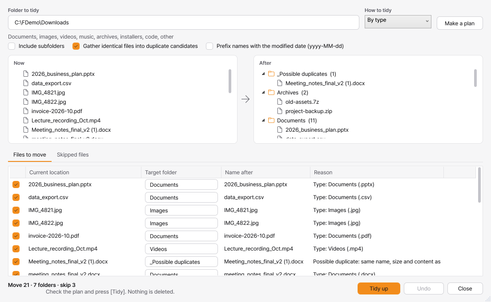
- **Edit folder description**: add a description to a folder.

## 🔒 Protect

Features that protect your important files. They're gathered under **Protect** in the sidebar.

### Notes (.md · .textpack)

Jot down whatever comes to mind. 🔒 **Protect → New note** creates `New note.md` in the current folder and opens the note window. Opening a `.md` file shows it in the Foldy viewer; press the viewer's **Edit** (pencil) button to edit it in the same note window.

- **[Edit / View]**: Edit shows the text on the left and the finished look on the right; View shows only the finished look. There are no complicated formatting buttons; you write Markdown (# heading, - list, **bold**).
- **Adding pictures**: paste with **Ctrl+V**, drag in a picture file, or press **[Screen capture]**. The Windows Snipping Tool opens, and your capture goes straight into the note (capturing with Win+Shift+S and pasting with Ctrl+V works too).
- **File format**: without pictures it's a plain `.md`; with pictures it's saved as a single **`.textpack`** file of the same name (the TextBundle format: text and pictures in one zip, pictures at original quality). Double-click a `.textpack` to open the note window in [View].
- **Saving**: **Ctrl+S**, and also when closing. For things to keep secret, such as passwords, use a **New locked note** (see "Locked notes" below).

### Previous versions (overwrite recovery)

When copying or moving with Foldy **overwrites** a file with the same name, Foldy quietly keeps the original for 7 days. Overwrote something by mistake? Don't worry.

- **Restoring**: right-click the file → **Previous versions…** → pick a time and press **[Restore]** (the current file is kept too, so you can switch back) or **[Save a copy beside it]** (next to it as "name (previous version date).ext").
- **Where they're kept**: a hidden folder on the same drive (`X:\.foldy\이전 버전`; on the system drive, `%LOCALAPPDATA%\Foldy\이전 버전`). Being on the same drive, it takes no time to move. They are kept only on disks inside this PC. Nothing is kept on USB or network drives (such as a shared work drive), because other people could see it there.
- **Limits**: after 7 days, or beyond 2 GB per drive (or 5% of the drive, whichever is smaller), the oldest are deleted first. Files larger than the limit aren't kept.
- Overwrites made outside Foldy (by other programs) aren't covered. Turn it off in Settings → General → **Previous versions**.

### Locked notes

The Wi-Fi password, the door code — things you must remember but don't want written just anywhere. Put them in a **locked note**. It asks for the password every time you open it, and you can read and edit it right inside Foldy.

- **Creating**: sidebar **Protect** → **🔒 Write a locked note**. `New note.memo.foldylock` appears in the current folder (in Documents if the current folder isn't on this PC) and the editor opens. Rename it with F2. Foldy then selects the new file in the list and shows where it was saved at the top of the note window.
- **Opening**: double-click, enter the password, and the editor opens. Text on the left, preview on the right (Markdown).
- **Pictures**: capture the screen and paste with **Ctrl+V**, or drag in a picture file, and it's stored inside the note.
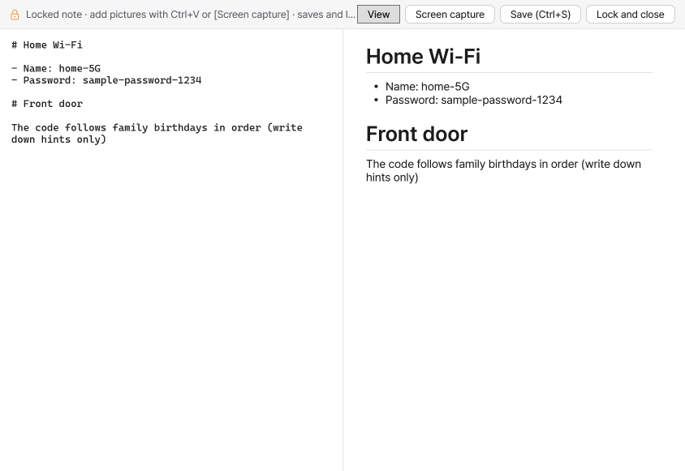

- **Saving**: **Ctrl+S**. It's encrypted again every time you save. After 5 minutes without activity it saves and locks itself.
- The content is decrypted in memory only. Decrypted text never stays on disk (temporary files included).
- 💡 If you have lots of important passwords, a password manager such as Bitwarden or KeePass is also worth using.

### Locking a file

You can lock an existing file, such as a contract. Right-click the file → **🔒 Lock (password)…**, or sidebar **Protect** → **🔒 Lock a file** (if no file is selected, a window opens to choose one). `contract.pdf.foldylock` appears in the same folder; after checking that it decrypts correctly, Foldy asks "Send the original to the Recycle Bin?".

- Double-click to enter the password; pictures and text are shown right inside Foldy. For other files, Foldy says "Open it with its usual program" and **[Decrypt and open]** turns it back into the original file and opens it.
- You get back exactly what you locked. Not a single byte changes.

### Vault

Put an important folder into a vault, whole. Right-click the folder → **🔒 Put in vault…**, or sidebar **Protect** → **🔒 Put a folder in a vault** (if no folder is selected, a window opens to choose one). A single `foldername.foldyvault` file appears; after checking each file by decrypting it, Foldy asks whether to send the original folder to the Recycle Bin.

- **There's no size limit.** Files over 4 GB go in and come out fine. Foldy keeps the originals until it's done, though, so it needs that much extra free space, and an older USB stick formatted as FAT32 can't hold a vault over 4 GB. Foldy checks **before** asking for a password, tells you right away if space is short, and offers [Free up space] to help you clear some.
- Double-click to enter the password and see the list of files inside. Pick files to **preview** (in memory only), **extract**, or **extract all**. Files you take out go, without a password, into a folder with the same name next to the vault; they also stay in the vault.
- **Adding more files**: in the opened vault, press **[Add more files]** and choose files (several at once is fine). If a name already exists, Foldy asks whether to keep both or replace the one in the vault. The vault is rewritten and every file is checked before it replaces the old one, so if anything fails the original vault stays as it was. At the end Foldy asks what to do with the original files you added.

### About locked files

- They show a padlock (locked file) or safe (vault) icon, and once Foldy is installed, double-clicking them in File Explorer opens Foldy too.
- **If you forget the password, even Foldy can't open it.** The password is never stored anywhere or written to the logs.
- On a company PC, please check first that file encryption fits the security policy.
- Inside is a zip encrypted with AES-256, and the password is stretched 600,000 times (PBKDF2-SHA256) into the key. That makes guessing passwords very slow, and even file names are hidden without the password. On the other hand, 7-Zip and similar tools can't open it; use Foldy (the format is public in the source code). Vaults made with 0.3.18 or earlier still open.
- New passwords need at least 8 characters. A sentence of a few words separated by spaces is recommended.

### Deleting folders with lots of files (fast delete)

When you delete a folder with **more than 5,000 files**, like `node_modules`, Foldy asks first. The Recycle Bin lets you restore them, but with that many it can take several minutes or more.

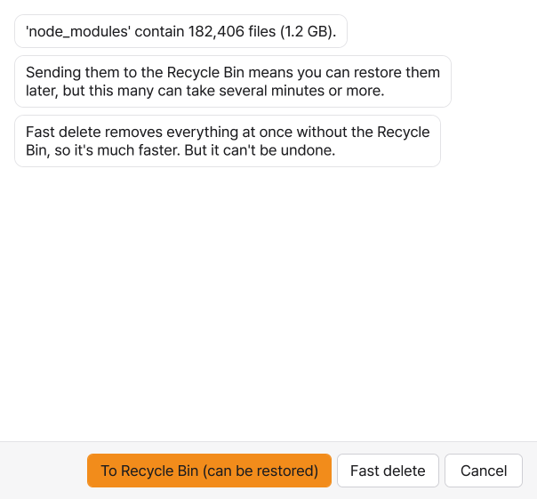

- **[To Recycle Bin (can be restored)]**: the default. Goes to the Recycle Bin as usual.
- **[Fast delete]**: skips the Recycle Bin and deletes many at once, so it's much faster. But **it can't be undone.** If you choose it, Foldy says once more "it can't be undone, and anything already deleted stays deleted even if you stop partway", and the default button of that confirmation is **[Cancel]** (pressing Enter by mistake deletes nothing).
- While deleting, the jobs panel shows the count, and you can **cancel** anytime.
- Read-only files and very long paths (over 260 characters) are deleted too. For **links inside the folder (junctions and symbolic links), only the link is removed; the folder it points to is never touched.**
- On network drives it deletes slowly (4 at a time) to go easy on the server.
- Drive roots, Windows, Program Files, and the user, Desktop and Documents folders themselves can't be fast-deleted (Recycle Bin only).

### Recycle Bin

The **Recycle Bin** line in the sidebar shows how much has piled up (e.g. Recycle Bin · 38 GB). Click it to open the Windows Recycle Bin; press **Empty** on the right to empty the Recycle Bin on every drive after one confirmation (can't be undone).

## 🔗 Connect

Features that connect you to servers, Git and the terminal. They're gathered under **Connect** in the sidebar.

### SFTP and SSH

Connect to a server with the **SFTP** button at the end of the drive buttons on the tab bar, **Ctrl+Shift+O**, or Connect → SFTP in the sidebar, and the SFTP folder opens as a tab in that pane. The tree on the left becomes the server tree, with the folder you opened and the server root (/) expanded one level so you see the folders right away.

- Authenticate with a password or a key file. With "Save this connection" on, the password is stored encrypted with Windows DPAPI.
- Host entries in `~/.ssh/config` also appear in "Saved connections". When you choose a key file, a default key such as `~/.ssh/id_ed25519` is filled in automatically.
- For a server you've never seen, Foldy shows the host key fingerprint and asks (known_hosts is shared with OpenSSH). If the key changed, it warns you.
- In an SFTP tab the terminal button becomes **SSH**, opening a terminal to the same server, account and current folder.

#### Copying and moving between local and SFTP

- **Copy (F5), move (F6), drag and drop, and Ctrl+C / Ctrl+V** work both ways between local and SFTP. Folders are uploaded and downloaded with everything inside.
- A **move** within the same server only renames on the server, so no data is transferred and it's fast. Copies between servers or within the same server go through a temporary file.
- A move deletes the source only **after every copy has succeeded**. If it fails or you cancel, the source stays and partly written files are removed.
- If a name already exists you get the same window as for local copies: keep both (with `(2)` after the name), overwrite, skip, and do the same for remaining conflicts.
- Progress appears in bytes in the jobs panel, and you can **cancel**.
- Deleting SFTP files is immediate because **there's no Recycle Bin**, so Foldy asks once more first. Creating folders and renaming work too.
- Overwriting is safe too: the file is first written completely to a temporary `.name.foldy-part` and then swapped in, so the existing file stays intact if you cancel or something fails.
- Symbolic links are skipped, and Foldy tells you how many at the end (a folder containing links isn't deleted from the source even when moved).

### Git

Git turns on by itself when you enter a Git repository folder (one where that folder or a folder above has `.git`).

- A **branch chip** appears in the path bar. Click it to open the Git view.
- A thin **Git bar** appears above the file list, with the branch, commits to push and pull (↑↓), the number of changes and **Pull / Push / Commit… / Open Git view** buttons. Pull and push run without leaving the screen and report the result in the status bar. The bar disappears when you leave the repository.
- Change marks in the list: next to file names you'll see **Modified** (changed since the last commit), **Added** (goes into the next commit), **New file** (not tracked by Git yet) and **Conflict** (couldn't be merged) in plain words, with a one-line explanation on hover. Ignored files are dimmed. If the name is too long, the mark steps aside rather than covering it.
- **Settings → General → Git**: "Show Git bar" (on by default). Open the Git view in one click with [Open Git view] on the Git bar.

#### Git view

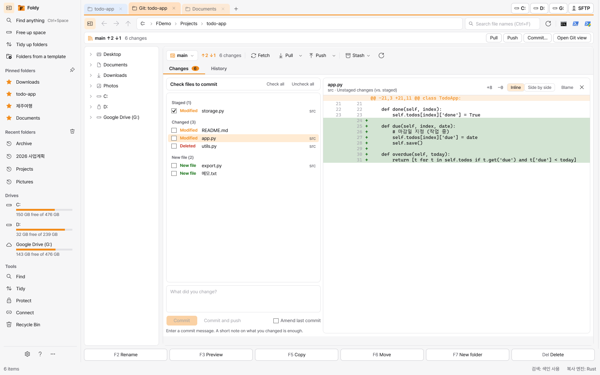

The top line: the current **branch** (click to switch or create one), ↑↓, the number of changes, **Fetch** (just check for news) · **Pull** (merge remote commits) · **Push** (send your commits) · **Stash** (set aside what you were changing). Hover over a button for an explanation.

**Changes** tab (making a commit)

1. In the list on the left, tick the **checkbox** of each file to commit (ticked = staged). **Select all** and **Clear** toggle them all at once. Files are grouped as staged / changed / new, with Modified, Added, Deleted, New file and Conflict badges.
2. Click a file to see what changed on the right.
3. Write "What did you change?" in the box at the bottom and press **Commit** or **Commit and push**. With no files ticked or an empty message, the buttons are off, and hovering explains why.

**History** tab: the branch graph and commit list (search by message, author or hash). Click a commit to see its changed files, and a file to see what changed in that commit.

**Viewing changes (diff)**: with old/new line numbers, added lines are green, removed lines red and hunk headers orange. Switch between **Unified** and **Side by side** at the top. Very large changes show up to 20,000 lines, with **Show more** to continue. Binary files such as pictures just say "Binary file".

**Blame** (who changed each line): right-click a file and choose **Blame this file**, or press the **Blame** button in the diff header. Each line shows a short hash, author and date, with alternating shading per commit. **Click a hash** to select that commit in the History tab. You can also select a file in the folder list and run **All commands (Ctrl+Shift+P) → "Git: Blame this file"**.

**Guidance screens**: with no changes you'll see "No changes. Files you edit appear here"; opening the Git view in a folder that isn't a repository shows a **Create a Git repository here (git init)** button. If Git isn't installed, a link to the install page (git-scm.com) appears. If sign-in fails on push or pull, Foldy explains in plain words what to check. When a job finishes, a short notice like "Pushed: 3 commits" appears.

Force push uses only `--force-with-lease` and goes through a warning. Git for Windows must be installed.

### Terminal

The buttons at the top right of a local folder tab open a terminal **in the current folder**.

- Command Prompt, PowerShell (7 if installed), and admin PowerShell (shield icon)
- **Ctrl+click** a button to open it as administrator. Admin launches always go through UAC and never store credentials.
- If Windows Terminal is installed, it opens there. It also opens in the right place for network paths (UNC) and mapped drives.

### AI connection (MCP)

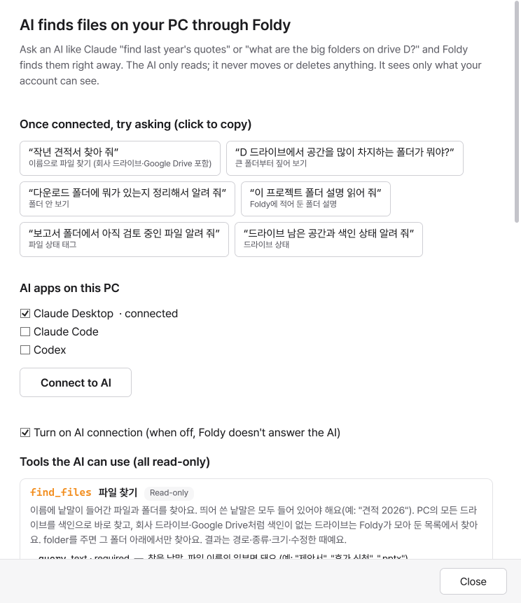

You can let AI apps like Claude find files on your PC through Foldy (an MCP server). Open **More (⋯) → Connect AI (MCP)…** or "AI connection" in Ctrl+Space, and one **[Connect to AI]** is all it takes. Only the AI apps installed on this PC are shown (Claude Desktop, Claude Code, Codex, Gemini CLI, Cursor, VS Code, Antigravity); pressing it adds Foldy to that app's settings (the original settings are backed up). Restart the app and try "find proposals on drive D".

**After connecting** (the window shows these steps for each app)

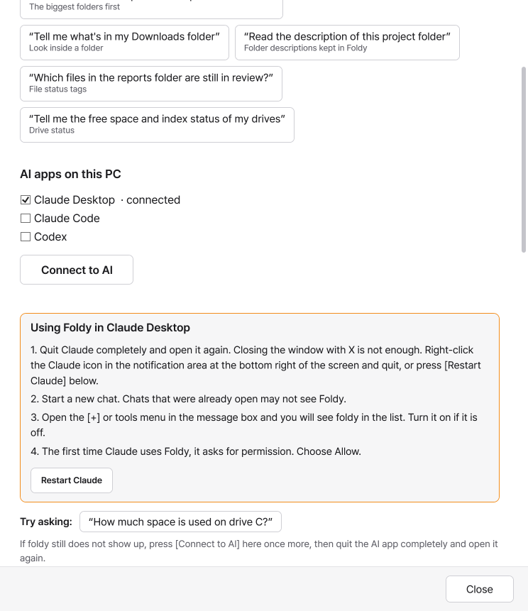

AI apps read their settings only when they start, so Foldy won't show up until you restart the app.

1. **Quit the AI app completely and open it again.** Closing Claude Desktop with X is not enough. Right-click the Claude icon in the notification area at the bottom right of the screen and quit, or press **[Restart Claude]** in the window (anything Claude is doing stops).
2. **Start a new chat.** Chats that were already open may not see Foldy.
3. Check that **foldy** is on in the [+] or tools menu of the message box. When it asks for permission the first time, choose **Allow**.
4. Ask "How much space is used on drive C?"

Each app is a little different. For Claude Code, Gemini CLI and the Codex command line, start them again and check with `/mcp` that foldy is there; for Cursor and VS Code, restart and use Agent mode. In Antigravity, just start a new conversation. If it still doesn't show up, press [Connect to AI] once more and quit and reopen the app.

**Once connected, try asking** (click in the AI connection window to copy):

- "Find last year's quotes": find files by name (including company drives and Google Drive)
- "Which folders take up the most space on drive D?": the biggest folders first
- "Tell me what's in my Downloads folder": look inside a folder
- "Read the description of this project folder": folder descriptions kept in Foldy
- "Which files in the reports folder are still in review?": file status tags
- "Tell me the free space and index status of my drives": drive status

If an AI app is installed on this PC but not connected yet, Foldy mentions it in one line at the top of the window when it starts, for example: Ask Claude Desktop "find last year's quotes" and Foldy finds it on your PC [Connect] [Later] [Don't ask again] (the example changes each time). If you ignore it, it disappears; to see it again, turn it on in Settings → General → AI connection.

- What the AI can use: find files (including company drives and Google Drive), look inside folders, folder sizes, folder descriptions, file status tags, drive and index status. **All read-only.** There's no moving or deleting.
- It only sees what your account can see. Nothing is opened to the internet; Foldy talks only with the AI app inside your PC (how the AI app uses the results follows that app's policy).
- It's off by default. Turn it off anytime with "Turn on AI connection" in that window, where you can also see the tool list (names, descriptions, inputs).
- For other AI apps, copy the settings under "Add manually" at the bottom (`Foldy.exe --mcp`). ChatGPT can only connect over the internet, so for safety it isn't supported.

## Settings and themes

**If the text is small, make the screen bigger.** By default Foldy follows Windows: enlarge Windows Settings → Accessibility → **Text size** and Foldy grows with it (it follows the display scale too). To enlarge Foldy alone, press **Ctrl+=** to enlarge, **Ctrl+-** to shrink, and **Ctrl+0** to follow Windows again. You can also choose "Display size" in the More menu. Text and buttons grow together, and dialogs and the note window open at the same size.

Open the settings window with **Ctrl+,** or **Settings** in the sidebar. There are General, Appearance, List, Terminal, Copy, Updates and Shortcuts pages.

- **Language**: Follow Windows, or choose 한국어, English, Español, 日本語 or 简体中文 in Settings → Appearance → Language.
- **Accent color**: Foldy orange, or follow the Windows accent color
- **Shortcuts**: click a box and press a new combination (Esc to cancel, Backspace to clear). Clashing shortcuts are flagged with a warning. Only what you change is saved, in `%LOCALAPPDATA%\Foldy\keymap.json`.

Common settings can also be changed right from the **More** menu in the sidebar.

- **Theme**: Follow system (light/dark automatically) · Light · Dark · Retro
- **List spacing**: Compact · Normal · Roomy
- **Show hidden files** (**Ctrl+H**)
- **Open settings file**: `%LOCALAPPDATA%\Foldy\settings.json`

## Updates

Foldy checks GitHub Releases for a new version 5 seconds after starting and every 6 hours. A new version is installed only after its signature (Ed25519) and hash are verified, and **"Foldy x.y.z · restart and update"** appears on the right of the status bar. Press [Restart and update] and Foldy closes while a small window shows "installing → reopening". During the install, the two kids dribble and pass on the court, and at the end one catches the other's pass, makes a layup for two points, and they high-five (text only if animations are off). It closes itself when the new Foldy opens. If another Foldy window is open, it asks you to close it, and if something fails it tells you why. Behind a company proxy (PAC, or a proxy without authentication), the Windows user proxy settings are used as they are. If the index service (running as SYSTEM) can't check, Foldy checks directly with your user account, and then installing needs one administrator confirmation. If you press "restart and update" during a job such as copying, the update is scheduled without interrupting the job and installed automatically when everything is done, then Foldy restarts (press again while scheduled to cancel). **… (More) → Check for updates…** at the bottom of the sidebar checks right away and asks whether to install a new version. If the check fails, it shows why.

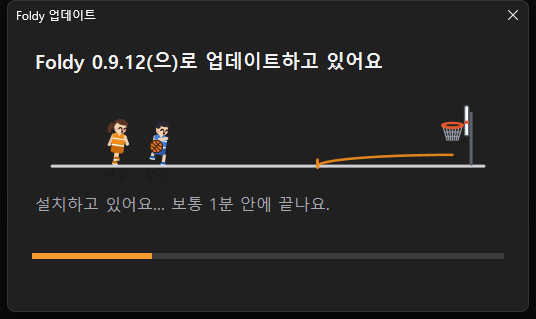

## Reporting bugs

The **Report a bug** button at the bottom of the sidebar (or More → Report a bug…, or the About window) opens a GitHub issue page pre-filled with the app and Windows versions and recent logs.

Foldy collects errors automatically: not just crashes but also errors that happened and passed, recording each kind only once. The first time, it asks whether to send them.

- **Always send automatically**: from then on, it sends quietly at startup and every 30 minutes without asking.
- **Send just this once** / **Don't send**

Reports include only the app and Windows versions, the error and recent logs; file paths and user names are removed. The same error is grouped into one GitHub issue, which just counts how often it happened. Turn it off anytime in Settings → General.

### Bug diagnostic mode

For problems that happen only in certain situations (for example a network drive showing an empty screen), **⋯ (More) → Toggle bug diagnostic mode** at the bottom of the sidebar (or the command list) records detailed logs.

1. Turn on bug diagnostic mode, and **Diagnosing** appears on the right of the status bar.
2. Reproduce the problem.
3. Click **Diagnosing** or turn it off from the menu, and Foldy asks whether to send the log as an error report (paths and user names are removed).

It turns off by itself after 24 hours. If a drive can't be opened, Foldy records the cause (drive type, connection target, permissions) even outside diagnostic mode and, if you agreed, reports it automatically. You can find the log files with **⋯ (More) → Open log folder** (`%LOCALAPPDATA%\Foldy\logs`).

## FAQ

**Search only finds files in the current folder.**
The index service isn't installed or is still getting ready. Press **More** in the sidebar → **Install index service (admin)…**. The first index takes tens of seconds depending on drive size.

**Does a disconnected network drive slow things down?**
No. Each drive works separately, so the other tabs and panes keep moving even if one drive doesn't respond. Press **Esc** in that tab to cancel loading.

**My company security drive shows an empty screen.**
Like File Explorer, only the "hidden" attribute is hidden (since 0.3.5). Root folders with the "system" attribute are shown. If it's still empty, turn on **bug diagnostic mode**, open it again and send the log. Slow drives like this open in a lighter mode automatically, as described in [Slow drives](#slow-drives).

**Does starting Foldy again open two windows?**
No. If it's already running, that window comes to the front, and a folder you passed opens in a new tab.

**Updates don't work (company network).**
Press **… (More) → Check for updates** at the bottom of the sidebar. Even if the service can't get out, Foldy checks again through your user proxy. If it still fails, the reason is shown; please paste it into a [bug report](#reporting-bugs).

**Where are the settings and logs?**
`%LOCALAPPDATA%\Foldy` (settings.json, session.json, logs). Index data is in `%ProgramData%\Foldy`.

**Source code and license?**
Foldy is free software under GPL-3.0-or-later. https://github.com/chadolkr/Foldy
