# Guía de uso de Foldy

**Un gestor de archivos rápido e inteligente, también sin conexión.** <small>Conéctalo a la IA y será aún más cómodo.</small>

Foldy es un gestor de archivos de doble panel para Windows, rápido y que nunca se bloquea. Puedes abrir esta guía cuando quieras con **F1** o con el botón **? Ayuda** de la parte inferior de la barra lateral.

| | |
| --- | --- |
| Versión | {{version}} |
| Desarrollador | David CHA |
| Repositorio | https://github.com/chadolkr/Foldy |
| Licencia | GPL-3.0-or-later (software libre) |

- [Fácil para todos](#fácil-para-todos)
- [Primer inicio](#primer-inicio)
- [Un paseo por la pantalla](#un-paseo-por-la-pantalla)
- [La barra lateral](#la-barra-lateral)
- [Pestañas](#pestañas)
- [Los niños juegan al baloncesto](#los-niños-juegan-al-baloncesto)
- [Operaciones con archivos](#operaciones-con-archivos)
- [Vista previa](#vista-previa)
- [Visor de Markdown](#visor-de-markdown)
- [Unidades lentas](#unidades-lentas)
- [Atajos de teclado](#atajos-de-teclado)
- **[🔍 Buscar](#-buscar)**
  - [Búsqueda rápida (Ctrl+Space)](#búsqueda-rápida-ctrlspace)
  - [Búsqueda](#búsqueda)
  - [Análisis de carpetas](#análisis-de-carpetas)
  - [Solo imágenes](#solo-imágenes)
- **[🧹 Ordenar](#-ordenar)**
  - [Herramientas de orden](#herramientas-de-orden)
  - [Ese método que viste en internet, en un clic](#ese-método-que-viste-en-internet-en-un-clic)
  - [Plantillas, asistente y orden de carpetas](#plantillas-asistente-y-orden-de-carpetas)
- **[🔒 Proteger](#-proteger)**
  - [Borrar carpetas con muchísimos archivos](#borrar-carpetas-con-muchísimos-archivos-borrado-rápido)
  - [Papelera](#papelera)
- **[🔗 Conectar](#-conectar)**
  - [SFTP y SSH](#sftp-y-ssh)
  - [Git](#git)
  - [Terminal](#terminal)
- [Configuración y temas](#configuración-y-temas)
- [Actualizaciones](#actualizaciones)
- [Informar de errores](#informar-de-errores)
- [Preguntas frecuentes](#preguntas-frecuentes)

## Fácil para todos

Foldy está hecho para que hasta los abuelos lo usen sin manual. Los botones son lo bastante grandes para acertar a la primera, lo que se activa y desactiva está siempre en el mismo sitio y con el mismo botón, y los botones del mismo tipo usan el mismo icono. Borrar envía a la papelera por defecto, y todo lo que no se puede deshacer se avisa claramente antes. Si el texto es pequeño, pulsa **Ctrl+=** para agrandarlo.

## Primer inicio

La primera vez, Foldy te ayuda a dejar la vista cómoda.

1. **Tamaño del texto**: Normal, Grande, Más grande y Máximo, mostrados sobre una lista de archivos real. Los cambios se aplican al pulsar, así que elige mientras miras.
2. **Brillo**: Claro, Oscuro o Según Windows.
3. **Atajo de búsqueda rápida**: comprueba si Ctrl+Space choca con otro programa y, si es así, te deja elegir otra tecla en ese momento.
4. **Presentación breve**: como un vídeo corto vertical, la pantalla real de Foldy se mueve mientras una línea cada vez muestra las funciones principales (búsqueda rápida con Ctrl+Space — archivos, ajustes de Windows, cálculos y órdenes; arrastrar para copiar; análisis de carpetas; orden del escritorio; orden de carpetas; notas bloqueadas; plantillas de carpetas; Git). Avanza sola; haz clic a la derecha para seguir, a la izquierda para volver y en [Omitir] cuando quieras. Las escenas que ya viste no vuelven a aparecer al reinstalar o actualizar; si una actualización añade una función nueva, solo se muestra esa escena una vez. Puedes volver a verla entera desde el botón **?** de la parte inferior de la barra lateral → "Presentación breve".

   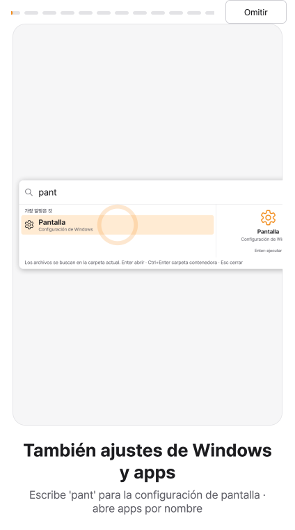

Al actualizar, tu configuración se mantiene, así que Foldy no vuelve a preguntar; solo te avisa en una línea de que se actualizó.

## Un paseo por la pantalla

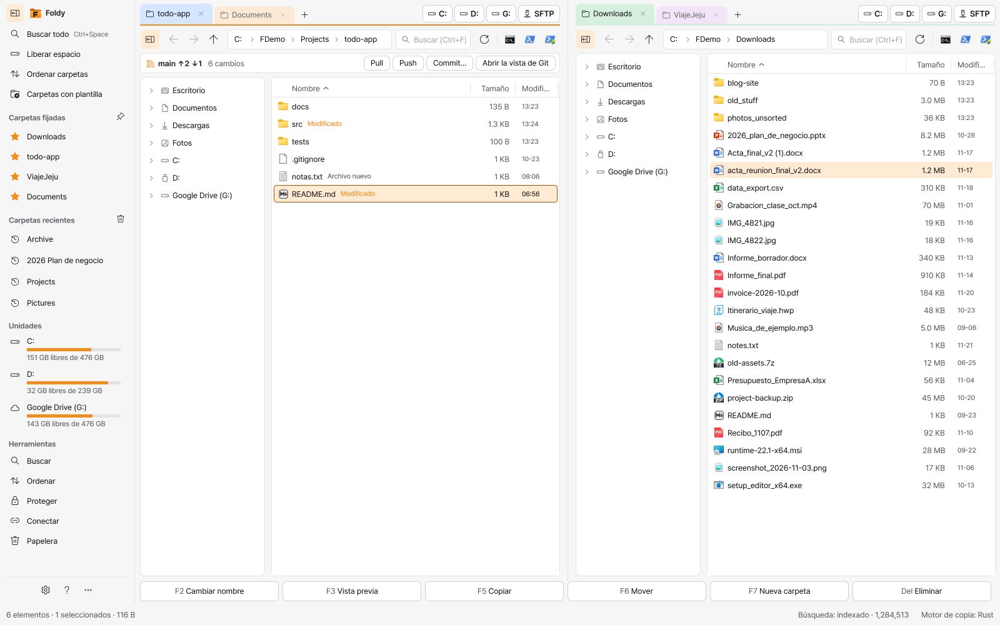

A la izquierda del todo está la **barra lateral** (carpetas fijadas, unidades, herramientas, configuración) y a su derecha los **paneles izquierdo y derecho**. El panel en el que trabajas (el panel activo) muestra una línea del color de acento bajo sus pestañas. Pulsa **Tab** para cambiar al otro panel.

De arriba abajo, cada panel tiene:

1. **Barra de pestañas**: una pestaña por carpeta, cada una de un color (como en OneNote). A la derecha están los accesos a las unidades (C: D: …) y un botón **SFTP** (elegir un servidor guardado o crear una conexión nueva). Pasa el ratón por una unidad para ver su nombre y el espacio libre.
2. **Barra de ruta**: haz clic en una parte de la ruta para ir a esa carpeta; haz clic en un hueco vacío o pulsa **Ctrl+L** para escribir una ruta. Dentro de un repositorio Git aparece una etiqueta de rama (`main ↑2 ↓1`).
3. **Cuadro de búsqueda**: búsqueda por nombre de archivo (**Ctrl+F**).
4. **Botones de herramientas**: mostrar u ocultar el árbol de carpetas (**Ctrl+B**), atrás, adelante, subir, ruta, buscar, actualizar, terminal.
5. **Árbol | Lista**: en ambos paneles el árbol de carpetas está a la izquierda y los archivos de la carpeta elegida a la derecha. Arrastra el borde entre ambos para cambiar el ancho del árbol, y usa el botón del árbol a la izquierda de la barra de herramientas (o **Ctrl+B**) para ocultarlo o mostrarlo en el mismo sitio (el ancho se recuerda). El árbol sigue la carpeta que estás viendo: tanto si escribes una dirección como si saltas con Ctrl+Space o cambias de pestaña, se despliega hasta esa carpeta y la resalta. Haz clic en el encabezado de una columna para ordenar.

Abajo están el **panel de tareas** (progreso de copias y movimientos), los **botones de operaciones** (F2, F3, F5, F6, F7, Supr) y la **barra de estado**. El centro de la barra de estado muestra en grande lo que acaba de pasar (un mensaje como "Se copiaron 3"), y los mensajes nuevos brillan un momento en el color de acento. A la izquierda verás el número de elementos y el tamaño seleccionado; a la derecha, el modo de búsqueda, el motor de copia y el aviso de actualización.

Solo se ejecuta un Foldy a la vez. Si lo vuelves a abrir mientras está en marcha (un acceso directo, abrir una carpeta con Foldy, etc.), **la ventana abierta pasa al frente** en lugar de abrir otra, y la carpeta que le pasaste se abre en una pestaña nueva.

## La barra lateral

La franja de la izquierda reúne las funciones que usas desde cualquier panel. Contráela con el botón de panel de arriba (o **Ctrl+Shift+B**) para dejar solo los iconos; vuelve a pulsarlo para expandirla. Se parece al botón del árbol de carpetas y muestra un fondo pulsado cuando está expandida. También puedes arrastrar su borde derecho para cambiar el ancho (muy estrecha muestra solo iconos).

- **Las cuatro funciones principales, arriba** (un clic):
  1. 🔎 **Buscar todo** (desde cualquier sitio con **Ctrl+Space**): archivos, apps, ajustes de Windows, funciones de Foldy y cálculos en un solo cuadro
  2. 📊 **Liberar espacio**: mira qué ocupa espacio con el análisis de carpetas y vacía solo lo que se puede borrar
  3. 🧹 **Ordenar carpetas**: el asistente de orden pregunta "¿Dónde?" y "¿Cómo?" (por tipo, por fecha, PARA) paso a paso y te muestra el resultado antes. No se borra nada y se puede deshacer
  4. 🗂️ **Carpetas con plantilla** (**Ctrl+Shift+N**): previsualiza una estructura como PARA o las fases de un proyecto por sector y créala de una vez
- **Carpetas fijadas**: pulsa el botón de **chincheta** junto al título para fijar la carpeta actual. Haz clic para abrirla en el panel activo; con el botón derecho puedes abrirla en una pestaña nueva o en el otro panel, reordenarla o quitarla.
- **Carpetas recientes**: aparecen solas las 5 últimas carpetas que abriste (sin las fijadas). Bórralas con el botón de papelera junto al título.
- **Unidades**: cada unidad muestra su nombre, una barra de uso y el espacio libre. Por encima del 90% la barra se vuelve roja. Con el botón derecho inicias un análisis de carpetas al momento.
- **Herramientas**: el resto de funciones se reúne en cuatro grupos. Al pulsar un grupo se abre su menú.
  - 🔍 **Buscar**: búsqueda de archivos, análisis de carpetas, solo imágenes
  - 🧹 **Ordenar**: ordenar esta carpeta, carpeta nueva desde plantilla, asistente de carpetas, elegir un método de gestión, ordenar escritorio, Descargas y registros
  - 🔒 **Proteger**: nota nueva, nota bloqueada, bloquear un archivo, caja fuerte, versiones anteriores (botón derecho), papelera
  - 🔗 **Conectar**: SFTP, vista Git, terminal
- **Papelera**: muestra cuánto se ha acumulado; **Vaciar** la vacía al momento.
- **Abajo del todo**: configuración (**Ctrl+,**), ayuda (**F1**), más (todos los comandos **Ctrl+Shift+P**, tema, archivos ocultos, espaciado de la lista, actualizaciones, informar de un error, recorrido, acerca de Foldy).

## Pestañas

| Lo que quieres | Cómo |
| --- | --- |
| Pestaña nueva | **Ctrl+T** o **+** en la barra de pestañas |
| Cerrar pestaña | **Ctrl+W**, clic central o la ✕ de la pestaña |
| Pestaña siguiente/anterior | **Ctrl+Tab** / **Ctrl+Shift+Tab** |
| Reordenar | arrastra una pestaña sobre otra |
| Llevar al otro panel | arrastra una pestaña sobre una pestaña del otro panel |
| La misma carpeta en otra pestaña | doble clic en la pestaña |

Las pestañas, rutas, el orden y la posición de la ventana se guardan solos y se restauran la próxima vez. Aunque Foldy se cierre de golpe, vuelve al último estado (hasta 2 segundos antes).

## Los niños juegan al baloncesto

En las tareas que tardan más de 1,5 segundos aparecen en el panel de tareas dos niños jugando al baloncesto.

Saben 15 movimientos: crossover, por detrás de la espalda, entre las piernas, giro, euro step, amago, step-back, finta de tiro, cambio de dirección, dar y seguir, pase picado, pase sin mirar, alley-oop, bloqueo y continuación, y corte. Cada movimiento sale una vez antes de que se repita ninguno.

- Copiar y mover: uno pasa, el otro avanza botando según progresa la tarea y, al final, **¡encesta un triple** y chocan los cinco!
- Borrar: tiran el balón a la papelera. En el borrado definitivo el balón sale volando de la pista.
- Búsquedas y esperas de red: los dos buscan el balón con la mirada.
- Indexación y análisis: uno practica el bote y el otro toma notas.
- Pausa o nombre repetido: un niño espera con el balón en brazos. Si algo falla, el tiro rebota en el aro.

Puedes desactivarlo con "Usar animaciones" en Configuración → General, y se detiene (sin gastar CPU) cuando la ventana está minimizada o tapada.

## Operaciones con archivos

| Operación | Tecla | Descripción |
| --- | --- | --- |
| Cambiar nombre | **F2** | Abre un cuadro con el nombre (sin extensión) seleccionado. Enter confirma, Esc cancela |
| Copiar | **F5** | Lo seleccionado a la carpeta del otro panel |
| Mover | **F6** | A la carpeta del otro panel |
| Carpeta nueva | **F7** | Puedes escribir el nombre justo al crearla |
| A la papelera | **Supr** | |
| Eliminar definitivamente | **Shift+Supr** | Pide confirmación. Con más de 5.000 archivos también puedes elegir el [borrado rápido](#borrar-carpetas-con-muchísimos-archivos-borrado-rápido) |
| Copiar, cortar, pegar | **Ctrl+C / X / V** | También con el Explorador de archivos |
| Subir | **Retroceso**, **Alt+↑** | El foco va a la carpeta que acabas de dejar |
| Atrás/adelante | **Alt+← / →**, botones atrás/adelante del ratón | |

- El **botón derecho** muestra el mismo menú que el Explorador (Abrir con, Enviar a, comprimir, etc.). **Shift+botón derecho** muestra el menú ampliado.
- **Arrastrar y soltar**: desde o hacia el Explorador. En la misma unidad, por defecto se mueve; entre unidades, se copia. **Shift** mueve y **Ctrl** copia.
- Copiar y mover lo hace el **motor de copia en paralelo**. Si ya existe el nombre, pregunta "Conservar ambos / Sobrescribir / Omitir" (opcionalmente para todos los conflictos restantes). El progreso se ve en el panel de tareas y en la barra de tareas, y puedes navegar por otras carpetas mientras copias.
- Al escribir letras saltas al archivo cuyo nombre empieza por ellas. Si repites la misma letra pasas a la siguiente coincidencia.

**¿Quién está usando este archivo?** Si falla una copia, un movimiento o un borrado, Foldy te dice en el panel de tareas y en la barra de estado qué programa usa el archivo (por ejemplo "Microsoft Excel lo está usando. Cierra ese programa y vuelve a intentarlo"). Solo se lo pregunta a Windows; nunca cierra un programa a la fuerza.

## Vista previa

Pulsa **F3** (o **F3 Vista previa** abajo) para abrir sobre la lista un panel que muestra el contenido del archivo seleccionado. Admite Markdown, imágenes, texto y código (con resaltado de sintaxis) y los formatos con controlador de vista previa de Windows, como PDF y Office. Arrastra el borde para cambiar su altura.

El panel se cierra solo al ir a otra carpeta, unidad o pestaña (vuelve a abrirlo con F3). Si no hay nada seleccionado, solo dice "Panel de vista previa".

- Los archivos que solo están en la nube no se leen, así que no se descarga nada.
- Las unidades de red y SFTP no se leen automáticamente (para no ralentizar); solo al pulsar **[Vista previa]**.
- Lo mismo vale para la unidad de Google Drive para escritorio (normalmente G:). Aparece en la barra lateral con un icono de nube como "Google Drive", y las miniaturas, iconos y vistas previas nunca descargan por sí solos los archivos solo en línea. Un archivo se descarga solo cuando lo abres o lo copias.
- **Los archivos protegidos con DRM o contraseña** muestran "Este archivo está protegido con DRM, así que no se puede previsualizar" (o "…tiene contraseña…") en lugar de un error. Ábrelo para verlo en la app que permita tu software de seguridad. Foldy los reconoce cuando el inicio del archivo no coincide con su formato (Office, Hangul, PDF, imágenes) y parece cifrado.

## Visor de Markdown

Al abrir un archivo `.md`, Foldy lo muestra dentro de la propia app en lugar del Bloc de notas (es lo predeterminado; en Configuración → General → Abrir archivos Markdown puedes elegir una app registrada). Pulsa el lápiz (**Editar**) para editarlo en la ventana de notas. Admite tablas, casillas, código (con resaltado y botón de copiar), imágenes con rutas relativas, índice y búsqueda en el documento (**Ctrl+F**). Los enlaces a otros `.md` se abren en la misma pestaña (con atrás/adelante) y los de carpetas como pestañas de carpeta. Las imágenes de internet solo se cargan al pulsar [Cargar imágenes].

## Unidades lentas

Las unidades que tardan mucho en abrir carpetas, como las unidades de seguridad de empresa, se detectan **automáticamente** por lo que tardan. No hay nada que configurar.

- Junto a la barra de ruta aparece la marca **Unidad lenta**, y la barra de estado lo avisa una vez la primera vez.
- Primero se muestra la lista; cosas como el tamaño de las carpetas se rellenan después. Al ir a otra carpeta se cancela lo pendiente.
- Se omiten la detección de Git, las miniaturas y los iconos por archivo, y la vista previa (F3) solo se abre al pulsar **[Vista previa]**.
- Los cambios en la carpeta se comprueban cada cierto tiempo en lugar de vigilarse. La copia se ajusta sola igualmente.

## Atajos de teclado

| Tecla | Acción |
| --- | --- |
| **F1** | Esta guía |
| **Ctrl+Shift+P** | Todos los comandos (buscar y ejecutar por nombre) |
| **Ctrl+Space** | Búsqueda rápida: archivos, apps, ajustes, funciones, cálculos (también desde otros programas) |
| **Tab** | Cambiar al otro panel |
| **Ctrl+L** | Escribir una ruta |
| **Ctrl+F** | Búsqueda por nombre de archivo |
| **Ctrl+R** | Actualizar |
| **Ctrl+H** | Mostrar u ocultar archivos ocultos |
| **F3** | Mostrar u ocultar la vista previa |
| **Ctrl+,** | Configuración |
| **Ctrl+B** | Mostrar u ocultar el árbol de carpetas |
| **Ctrl+Shift+B** | Contraer o expandir la barra lateral |
| **Ctrl+Shift+I** | Solo imágenes |
| **Ctrl+Shift+N** | Carpeta nueva desde plantilla |
| **Ctrl+Shift+O** | Conectar a un servidor SFTP |
| **Ctrl+`** | Terminal (SSH en una pestaña SFTP) |
| **Ctrl+Shift+`** | Terminal de administrador |

## 🔍 Buscar

Funciones para encontrar archivos y ver qué ocupa espacio. Están en **Buscar** de la barra lateral.

### Búsqueda rápida (Ctrl+Space)

Uses el programa que uses, pulsa **Ctrl+Space** y aparece un gran cuadro de búsqueda en el centro de la pantalla (como Spotlight en macOS). Encuentra todo en un solo cuadro.

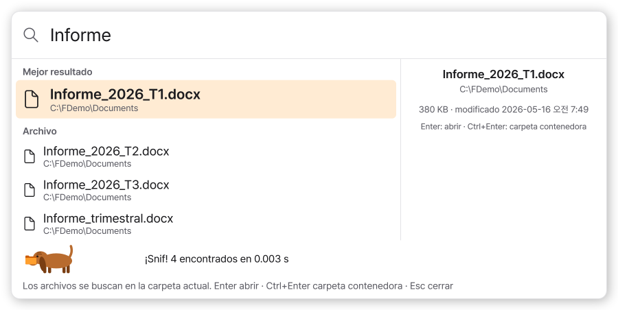

- **Archivos y carpetas**: busca en todas las unidades si está instalado el servicio de índice; si no, dentro de la carpeta actual. A la derecha aparece una vista previa (imagen, inicio del texto, tamaño, fecha).
- **Apps**: encuentra programas del menú Inicio por su nombre y los abre.
- **Ajustes de Windows y Panel de control**: escribe algo como "pantalla", "wifi", "tamaño del texto" o "impresora" para abrir esa página de ajustes. También encuentra los nombres clásicos del Panel de control y de las herramientas, como "panel de control", "agregar o quitar programas", "administrador de dispositivos", "administrador de tareas" o "variables de entorno", y palabras cotidianas como "controlador" o "no responde".
- **Carpetas fijadas y recientes** aparecen arriba.
- **Funciones de Foldy**: ejecuta una función por su nombre, como "configuración" o "análisis de carpetas".
- **Lenguaje natural (en coreano)**: Foldy entiende peticiones en coreano como "다운로드 정리해줘" (ordena mis descargas). En otros idiomas, escribe el nombre de la función.
- **Cálculos y conversión de unidades**: escribe `12*3+4`, `200*15%`, `5 km to mi`, `100F` o `2 GB MB` para obtener la respuesta al instante; Enter copia el resultado.

La **mejor coincidencia** aparece en grande arriba y el resto, agrupado por tipo debajo (apps, configuración, carpetas, funciones de Foldy, archivos), como en la búsqueda de Windows. Pulsa **Todo, App, Configuración, Carpeta, Archivos o Funciones de Foldy** bajo el cuadro de búsqueda, o la tecla **Tab**, para ver un solo grupo con más resultados. Junto al nombre de cada grupo se ve cuántos se encontraron (**Archivos · 220**). Los archivos se siguen cargando al bajar (o con ↓ en el último), y la última línea dice «Mostrando 30 de 220» hasta llegar a «Se muestran los 220». Los grupos que muestran solo 5, como apps y ajustes, terminan con **Ver los 12 ›** para ver solo ese grupo. También puedes abrir lo elegido con el botón grande **[Abrir]** de la derecha. **Enter** abre o ejecuta, **Ctrl+Enter** muestra la carpeta contenedora en Foldy, y **Esc** o un clic fuera lo cierra. Nunca busca en internet (no se envía nada fuera).

Cuando encuentra archivos, un **sabueso de buen olfato** olfatea el suelo, corre con las orejas al viento y te los trae: "¡Snif! 1.284 encontrados en 0,03 s". Si no encuentra nada, ladea la cabeza. Desactiva "Usar animaciones" en la configuración para ver solo texto.

**¿Hasta dónde busca?** El índice se crea para las unidades NTFS de este PC (C:, etc.). Bajo cada unidad de la barra lateral verás "Indexado" o "Indexando 62%". Las unidades sin índice (unidades de empresa, Google Drive, USB, tarjetas SD, etc.) se **recopilan con calma** en segundo plano mientras Foldy está abierto: de una en una, descansando más si la unidad se ralentiza y pausando durante tareas como copiar. La unidad muestra "Indexando · 12.345" y luego "Indexado". Mientras se recopila otra unidad indica a qué espera, como "Esperando turno · después de G:". Al recopilar de nuevo solo se leen las carpetas cambiadas (Google Drive se lee entera cada vez, porque la hora de sus carpetas no siempre cambia), y los archivos nuevos o borrados se reflejan al momento. **Indexar periódicamente**: en Configuración → General → Búsqueda rápida elige cada hora (predeterminado), cada 6 horas, una vez al día o solo cuando lo pidas. Cuenta desde la última vez que terminó, mientras Foldy está abierto. **Indexar ahora**: haz clic derecho en una unidad → **Indexar ahora**, o elige "Indexar ahora" en el menú **Buscar** o en Ctrl+Space (todas esas unidades) para leer todas las carpetas desde el principio; así también se corrigen los archivos que solo cambiaron de tamaño. Si se está recopilando otra unidad, empieza después. La hora en que terminó aparece junto a "Indexado". Puedes buscar en lo ya recopilado, y la carpeta abierta siempre se recorre directamente. Desactívalo en Configuración → General → Búsqueda rápida.

**¿Y si el atajo choca?** Si otro programa ya usa Ctrl+Space, o hay un método de entrada chino o japonés (donde Ctrl+Space cambia el idioma de escritura), Foldy te avisa en la primera configuración y te deja elegir una tecla libre (como Ctrl+Shift+Space) o pulsar la tuya. También puedes elegir "Usar solo dentro de Foldy". Tras actualizar no vuelve a preguntar salvo que falle el registro. Cámbialo cuando quieras en Configuración → Atajos.

### Búsqueda

Pulsa **Ctrl+F**, escribe parte del nombre en el cuadro de búsqueda y pulsa Enter para abrir una pestaña de resultados.

- Con el **servicio de índice** instalado, se busca en todas las unidades al instante (milisegundos incluso con millones de archivos). La barra de estado muestra "Búsqueda: indexado".
- Sin el servicio, se recorre directamente la carpeta actual y las de debajo (hasta 20.000 elementos).
- Abrir una carpeta de los resultados abre una pestaña nueva; los archivos se abren directamente. Esc cancela la búsqueda.

### Análisis de carpetas

Elige **Análisis de carpetas** (en el menú Buscar, "análisis de carpetas" en Ctrl+Space o la lista de comandos) y **Foldy pregunta primero qué analizar.** Hay un botón por disco con su espacio libre, la carpeta actual y [Elegir otra carpeta…]. Tu elección abre una pestaña de análisis. Botón derecho en una unidad de la barra lateral → Analizar abre esa unidad directamente.

- **Mapa de árbol**: las carpetas más grandes tienen cajas más grandes. Haz clic en una caja para entrar; Retroceso, el botón derecho o el botón atrás del ratón suben un nivel.
- **Listas**: las carpetas y archivos más grandes, y las carpetas que más crecieron desde el último análisis.
- **Candidatas a limpiar**: cosas que se pueden regenerar si se borran, como node_modules, resultados de compilación, archivos temporales y cachés. Las carpetas del sistema nunca se sugieren.
- **[A la papelera]**: solo mueve a la papelera, tras confirmar (nunca un borrado definitivo).
- **F5** vuelve a analizar, **Esc** cancela. Doble clic en un elemento de la lista para abrir esa ubicación en una pestaña de carpeta.

**Todo lo que se puede sugerir** — solo si el cambio más reciente dentro es más antiguo que el periodo y el tamaño es al menos el indicado.

| Objetivo | Ubicación y nombre | Condición |
| --- | --- | --- |
| Paquetes de Node.js | `node_modules` (junto a `package.json`) | 30 días, 10 MB |
| Compilación .NET | `bin`, `obj` (junto a `*.csproj`, etc.) | 14 días, 10 MB |
| Compilación Rust | `target` (junto a `Cargo.toml`) | 14 días, 50 MB |
| Compilación Gradle | `build`, `.gradle` (junto a `build.gradle`, etc.) | 14 días, 10 MB |
| Cachés de front-end | `.next`, `.nuxt`, `.parcel-cache`, `.turbo`, `.angular`, `.svelte-kit` (junto a `package.json`) | 14 días, 10 MB |
| Cachés de Python | `__pycache__`, `.pytest_cache`, `.mypy_cache`, `.ruff_cache`, `.tox` | 30 días, 1 MB |
| Caché de Visual Studio | `.vs` | 30 días, 100 MB |
| Temporales del usuario | `%LOCALAPPDATA%\Temp` | 7 días, 50 MB |
| Carpetas temp/tmp | `temp`, `tmp` | 30 días, 100 MB |
| Cachés del navegador | `Cache`, `Code Cache` en perfiles de Chrome y Edge | 100 MB |
| Cachés de gestores de paquetes | `npm-cache`, `pip\cache`, `Yarn\Cache`, `%USERPROFILE%\.gradle\caches` | 30 días, 500 MB |
| Caché de paquetes NuGet | `%USERPROFILE%\.nuget\packages` | 60 días, 1 GB |
| Volcados de bloqueo | `*.dmp`, `*.hdmp`, `*.mdmp` | 14 días, 10 MB |
| Carpeta de volcados | `%LOCALAPPDATA%\CrashDumps` (la carpeta predeterminada del Informe de errores de Windows) | 14 días, 10 MB |
| Instaladores antiguos | `*.exe`, `*.msi`, `*.msix`, `*.iso` en Descargas | 90 días, 50 MB |

`.git` se muestra pero nunca se sugiere. Las carpetas del sistema como Windows, Program Files y ProgramData nunca se sugieren, sean cuales sean las reglas.

**Excluido a propósito**
- Archivos de Windows Update, de Optimización de distribución, la caché de miniaturas y la instalación anterior de Windows (Windows.old): los usa el sistema, así que es más seguro que los quite Windows. Pulsa **[Abrir recomendaciones de limpieza de Windows]** sobre las sugerencias para abrir la página de limpieza en Configuración de Windows (Liberador de espacio en Windows 10).
- Copias de actualización y cuarentena de los antivirus: no encontramos indicaciones oficiales de los fabricantes de que sea seguro borrarlas, y la cuarentena sirve para recuperar archivos desinfectados por error, así que no se incluyen. Límpialas desde el menú del propio antivirus.

Con el servicio de índice, el análisis tarda unos segundos sin volver a leer el disco. Sin él, el disco se recorre directamente con baja prioridad.

### Comparar y sincronizar ambos paneles

Úsalo cuando no sepas qué es más reciente, si la carpeta que copiaste al USB o la del PC. Abre las dos carpetas en los dos paneles y pulsa 🔍 **Buscar → Comparar y sincronizar ambos paneles**; Foldy te guía.

- **Qué es distinto**: archivos solo a la izquierda o solo a la derecha, y qué lado es más reciente (por tamaño y fecha de modificación; 2 segundos de diferencia cuentan como iguales). Lo resume en una línea, como "El lado derecho es más reciente. Se cambiaron 12 archivos a la derecha".
- **En qué sentido**: elige [Izquierda → derecha], [Derecha → izquierda] o [Sincronizar ambos con lo más reciente]; Foldy muestra primero la lista de copias y sincroniza solo tras tu confirmación.
- **Con seguridad**: nunca se borran archivos que solo están en un lado. Los archivos más nuevos nunca se sobrescriben con otros más antiguos. Los sobrescritos se guardan como versiones anteriores (en USB y red, como `.foldy-bak` al lado), y un **[Deshacer]** lo devuelve todo.
- **Cambiados en ambos lados**: los archivos cambiados en los dos lados desde la última sincronización no se eligen solos; Foldy pregunta por cada uno.
- Dentro de repositorios Git y carpetas de proyectos de desarrollo no se compara nada.

### Solo imágenes

Pulsa **Ctrl+Shift+I** o Buscar → Solo imágenes en la barra lateral para ver solo las imágenes de la carpeta actual como cuadrícula de miniaturas. Los demás archivos solo se ocultan, nunca se mueven.

Mientras está activo, una línea justo encima de la lista dice "Solo imágenes · N imágenes" (o "esta carpeta no tiene imágenes"), y **[Mostrar todos los archivos]** en el mismo sitio lo desactiva.

- **Espacio**: ver en grande (← → anterior/siguiente, rueda para ampliar, R para girar, Esc para cerrar)
- **Ctrl+rueda**: tamaño de las miniaturas
- Las unidades de red, la unidad de Google Drive (G:) y los archivos solo en la nube no se leen (para que no empiece ninguna descarga).

## 🧹 Ordenar

Funciones para ordenar carpetas como quien ordena una habitación. Están en **Ordenar** de la barra lateral. Nada se tira por su cuenta: primero lo ves, y se puede deshacer.

### Herramientas de orden

Foldy ordena tu ordenador como quien ordena una habitación. Pulsa **Ordenar** en la barra lateral para elegir el orden del escritorio, de Descargas o de los registros (también en la lista de comandos). Cada herramienta te guía paso a paso: qué encontró, por qué conviene ordenar y qué pasa al pulsar, y luego te deja elegir **[Limpiar así] [Ver detalles] [Más tarde]**. Tómate tu tiempo.

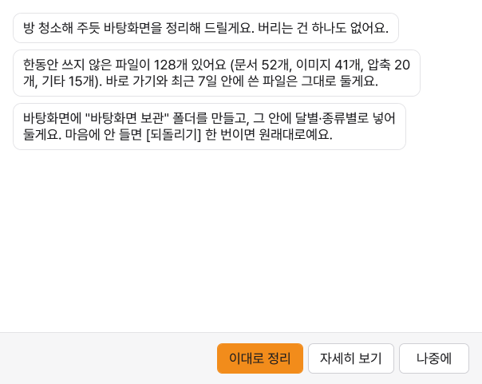

Tres promesas, siempre:

- **Nada se tira por su cuenta.** Primero ves qué va adónde, y no pasa nada hasta que pulsas.
- **Te dice adónde fueron las cosas.** Puedes abrir el destino enseguida.
- **Se puede deshacer.** Borrar siempre va a la papelera, y el orden del escritorio se deshace con un [Deshacer].

#### Orden del escritorio

¿Tu escritorio está lleno de archivos? Sin tirar nada, Foldy los guarda por tipo en una carpeta **"Archivo del escritorio"** del escritorio y te dice dónde están. ¿No te gusta? ¡Un **[Deshacer]** lo deja todo como estaba!

- **Qué se mueve**: archivos que están directamente en el escritorio y no se han usado en los últimos 7 días
- **Qué se queda**: accesos directos (`.lnk`, `.url`), archivos usados en los últimos 7 días, carpetas, archivos ocultos y de sistema
- **Adónde van**: `Escritorio\Archivo del escritorio\año-mes\tipo` (tipos: Documentos, Imágenes, Vídeos, Música, Comprimidos, Instaladores, Código, Otros)
- Los archivos en uso por otro programa se omiten.
- Si ya existe una carpeta creada por una versión coreana anterior (바탕화면 보관), se sigue usando.
- **Una sugerencia de una línea al iniciar**: si el escritorio o Descargas tienen más de 20 archivos (sin contar accesos directos), al abrir Foldy aparece arriba una línea como "Hay 27 archivos en tu escritorio. ¿Los ordeno por tipo?" con [Ordenar] [Más tarde] [No volver a preguntar]. Si la ignoras, desaparece; [Más tarde] vuelve a preguntar a los 7 días; deshaz [No volver a preguntar] en Configuración → General → Avisos de orden.

#### Orden de Descargas

La carpeta Descargas no para de llenarse. Foldy encuentra archivos que conviene ordenar y te propone **enviarlos a la papelera o archivarlos**.

| Qué busca | Regla |
| --- | --- |
| Instaladores de programas ya instalados | Solo si el nombre de producto del `.exe` coincide claramente con un programa instalado (si hay dudas, no se incluye) |
| Archivos duplicados | Mismo tamaño y contenido (SHA-256). Se conserva el de nombre más corto (p. ej. solo se marca `informe (1).pdf`) |
| Comprimidos ya extraídos | Un `.zip` con una carpeta del mismo nombre al lado |
| Archivos antiguos | Sin abrir ni modificar desde hace más de 90 días (estos los eliges tú) |

- Solo se revisan los archivos que están directamente en Descargas. Las subcarpetas se consideran ya ordenadas y no se tocan. También se excluyen los archivos que aún se descargan (`.crdownload`, `.part`).
- **[A la papelera]**: los mueve a la papelera, desde donde puedes recuperarlos.
- **[Archivar]**: los mueve a `Descargas\Archivo\año-mes`.

#### Limpieza de registros

Los archivos `*.log` que dejan los programas pueden acumular varios GB sin que te des cuenta. Foldy comprime los registros antiguos en **zips mensuales** en la misma carpeta. Los registros de texto suelen reducirse más de un 85%.

- **Objetivo**: archivos `*.log` sin cambios desde hace más de 7 días (toda la unidad actual; con el servicio de índice se encuentran al instante)
- **No se tocan**: registros en uso por un programa, la carpeta `Windows`, la papelera, System Volume Information
- **Qué crea**: `logs-año-mes.zip` en la carpeta donde estaban los registros
- Los originales van a la papelera solo después de reabrir el zip y comprobar que coincide exactamente (SHA-256). Si la comprobación falla, los originales se quedan.
- También puedes abrirla con los botones **[Limpieza de registros]** y **[Ordenar Descargas]** de la parte superior del análisis de carpetas.

#### Buscar carpetas que se pueden borrar (restos de desarrollo)

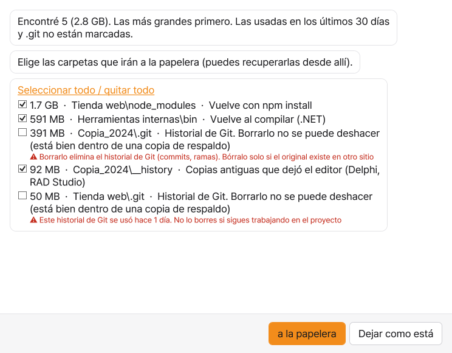

Las carpetas de proyectos acumulan carpetas regenerables, a menudo de varios GB (node_modules, bin/obj, target, __pycache__, .venv, dist/build, __history de Delphi). Encuéntralas en Ordenar → **Buscar carpetas que se pueden borrar**, en **[Carpetas que se pueden borrar]** del análisis o con Ctrl+Space.

- Busca **solo dentro de la carpeta que estás viendo** y muestra primero las más grandes. Con el índice, los tamaños salen al momento.
- Elige una carpeta **solo si hay un archivo de proyecto al lado**: node_modules junto a package.json, bin/obj junto a un .csproj, target junto a Cargo.toml. Una carpeta de fotos que se llama "build" no se toca.
- Lo usado en los últimos 30 días no se marca de antemano.
- **.git nunca se marca de antemano.** Borrarlo pierde el historial de Git, así que Foldy avisa en rojo y, si se usó hace poco, dice "No lo borres si sigues trabajando en el proyecto". Si es una copia de respaldo cuyo original existe en otro sitio, puedes elegirlo tú (Foldy vuelve a preguntar).
- Solo lo que eliges va **a la papelera**, desde donde puedes recuperarlo.
- Para buscar más nombres, escríbelos separados por comas en Configuración → General → Buscar carpetas que se pueden borrar.

#### Limpiar cachés de desarrollo

Limpia las cachés descargadas por npm, NuGet, pip, Yarn y pnpm, y la caché de compilación de Docker. Ordenar → **Limpiar cachés de desarrollo**.

- Solo muestra las herramientas instaladas en este PC, con su tamaño y una nota de que se pueden volver a descargar.
- Nunca borra carpetas directamente; solo ejecuta **el comando oficial de cada herramienta** (`npm cache clean --force`, `dotnet nuget locals all --clear`, `py -m pip cache purge`, `yarn cache clean`, `pnpm store prune`, `docker builder prune --force`).
- En Docker, **solo la caché de compilación**: no toca imágenes, contenedores ni volúmenes.
- No pasa por la papelera y no se puede deshacer, así que Foldy muestra el tamaño y **pregunta una vez** antes. Lo necesario se vuelve a descargar en la siguiente compilación o instalación.

#### Etiquetas de trabajo (¿por dónde iba?)

Cuando revisas muchos archivos uno a uno, es fácil perder la cuenta. Pon pequeñas marcas de color como **Hecho** o **Aplicado** en los archivos.

- **Añadir**: selecciona archivos y pulsa **Ctrl+D** para marcar o desmarcar Hecho. Desde el menú 🧹 Ordenar (o la lista de comandos) también puedes poner Aplicado, En revisión y Entregado. Puedes hacerlo con varios archivos a la vez.
- **Dónde se ven**: como pequeñas etiquetas de color tras el nombre del archivo. Si el nombre es demasiado largo, la etiqueta no se dibuja (el nombre va primero). En la parte superior de la carpeta verás "de 20 archivos, Hecho 7 · Aplicado 3" y **[Siguiente archivo]** (el siguiente que aún no está Hecho).
- **Dónde se guardan**: de forma legible en el archivo oculto `.foldy.md` de la carpeta. Así las etiquetas acompañan a la carpeta si la llevas a otro disco u otro PC. Los archivos en sí no se tocan. Al cambiar el nombre en Foldy, la etiqueta se conserva.
- **Carpetas Git**: Foldy añade una línea a `.git/info/exclude` para que `.foldy.md` no aparezca en git status (.gitignore no se toca). Para compartir las etiquetas con tus colaboradores, activa **[Compartir en el repositorio]** en la línea superior.
- **[Quitar todas las etiquetas]**: quita solo las etiquetas de los archivos de esa carpeta.

### Un método de gestión por carpeta

Decide "esta carpeta la gestiono con PARA" y Foldy la revisará de vez en cuando y te avisará cuando haya algo que ordenar. Cada carpeta puede tener su propio método.

- **Cómo elegirlo**: botón derecho en una carpeta → **Elegir cómo gestionar esta carpeta…**. Foldy explica qué hace cada método y, al elegir, pregunta si crea las carpetas necesarias.
- **Métodos**: PARA, Johnny.Decimal, Números y fechas, Por fecha
- **Marcas**: la carpeta gestionada (la de arriba) lleva un punto en su icono y una bandera en el árbol. Dentro, una línea arriba dice "Gestionada con PARA · 3 cosas que ordenar". El Explorador de archivos también muestra el icono de Foldy en esa carpeta.
- **Dónde se recuerda**: en un solo archivo oculto `.foldy.md` dentro de la carpeta. Es una nota legible, así que acompaña a la carpeta, y si la borras solo se desactiva la gestión; tus archivos no cambian. Las subcarpetas siguen el `.foldy.md` más cercano.

**De qué te avisa Foldy**

| Método | Qué señala | Qué hace (cuando confirmas) |
| --- | --- | --- |
| Todos | Archivos sin ordenar arriba | Los reúne primero en `00_Bandeja de entrada` (con Por fecha, en carpetas año\año-mes) |
| PARA | Proyectos de 1_Projects sin tocar desde hace 90 días | Los mueve a 4_Archives |
| Números y fechas | Carpetas de 01_En curso sin tocar desde hace 90 días | Las mueve a 03_Hecho |
| Johnny.Decimal | Carpetas sin número | Solo avisa (ponles nombre tú) |

**Nada de qué preocuparse**

- Nada se mueve solo. Ves qué va adónde, y solo se mueve al pulsar **[Limpiar así]**. Después, un **[Deshacer]** lo devuelve todo.
- Los programas, archivos de configuración y accesos directos (`.exe`, `.dll`, `.ini`, `.json`, `.lnk`, etc.) nunca se mueven, porque otros programas o accesos directos podrían romperse.
- **Los repositorios Git y carpetas de proyectos de desarrollo** no pueden tener método. La carpeta de arriba que los contiene sí, y los repositorios de dentro solo se mueven enteros (nunca se toca su interior).
- Los archivos abiertos se omiten con "Omitido: está abierto".
- En **carpetas sincronizadas** como OneDrive o Google Drive, Foldy avisa primero "Es una carpeta sincronizada", porque los movimientos se reflejan también en tus otros PC. En ellas y en unidades de red o lentas no se crea el icono del Explorador (desktop.ini).
- Si se acumula mucho, Foldy avisa en una línea como máximo una vez por semana, igual que las demás herramientas (Configuración → Avisos de orden).
- Los nombres de las carpetas siguen el idioma de la app al crearse (00_Bandeja de entrada, 01_En curso…). Las carpetas creadas antes con nombres coreanos (00_받은 파일…) se siguen usando.

#### Una pista de una línea cuando viene bien

Para que no tengas que buscar funciones, Foldy muestra una línea arriba sugiriendo una función que encaja con la carpeta que ves. Solo una a la vez; pulsa **[Cerrar]** y no vuelve a aparecer en esa carpeta. Desactiva **Avisos de orden** en Configuración → General para ocultarlas.

- Más de 40 archivos en Descargas → [Ordenar Descargas]
- Más de 50 archivos en el escritorio → [Ordenar el escritorio]
- Una carpeta con más de 20 archivos de registro (.log) → [Limpieza de registros]

### Un aviso suave cuando se acumula

Como es fácil pasarlo por alto, Foldy echa un vistazo ligero de vez en cuando y, solo si hay mucho que ordenar, lo menciona en una línea abajo de la ventana. Como mucho una vez por semana, y nunca ordena por su cuenta.

- Registros: cuando lo que podrías ahorrar supera 1 GB o el 5% del espacio libre de la unidad (solo se comprueba con el servicio de índice)
- Descargas: cuando los archivos que conviene ordenar superan 1 GB
- Escritorio: cuando hay más de 50 archivos que archivar
- Para desactivarlo: Configuración → General → **Avisos de orden**

### Ese método que viste en internet, en un clic

¿Has querido probar "eso de PARA" y te has atascado creando carpetas? Elige una plantilla y las carpetas aparecen de una vez, y la vista previa te dice brevemente **para qué sirve cada carpeta**, junto a su nombre.

**PARA** (Tiago Forte) — cuatro cajas, según "¿cuándo termina?"

| Carpeta | Qué va dentro |
| --- | --- |
| 1_Projects | En lo que trabajas ahora (con fecha de fin) |
| 2_Areas | Áreas que gestionas de forma continua (salud, dinero, hogar, equipo) |
| 3_Resources | Material de referencia (información para algún día) |
| 4_Archives | Lo terminado (no lo borres; tráelo aquí) |

**Johnny.Decimal** — cada lugar lleva un número, así que "11.03" te lleva directo.

| Nivel | Ejemplo | Significado |
| --- | --- | --- |
| Área | `10-19 Vida` | hasta 10 grupos grandes |
| Categoría | `11 Hogar` | hasta 10 cajas por área |
| Elemento | `11.01 Presupuestos de mudanza` | las carpetas reales de una categoría |

**Números y fechas** — el método más fácil. Los números delante de las carpetas fijan su orden, y los nombres de archivo empiezan por la fecha.

| Carpeta | Qué va dentro |
| --- | --- |
| 00_Bandeja de entrada | Pon aquí las cosas primero (recibidas, sin ordenar). Siempre visible arriba |
| 01_En curso | En lo que trabajas ahora |
| 02_Material | Material de referencia que consultas a menudo |
| 03_Hecho | Terminado, pero lo consultas a veces |
| 99_Archivo | Antiguo y casi nunca consultado |

Nombra los archivos **Fecha_Contenido**, como `2026-11-19_Informe.docx`, y el orden por nombre será el orden por fecha.

> 💡 **Consejo de la bandeja de entrada**: uses el método que uses, ten una `00_Bandeja de entrada` arriba. Mete ahí los archivos nuevos sin pensar y ordénalos al vaciarla una vez por semana; nada se acumula.

Las demás plantillas (proyectos de cliente, etapas del documento, investigación, documentos del hogar, archivo de fotos y más) también traen una nota breve para cada carpeta.

Las carpetas se nombran en el idioma de la app en el momento de crearlas. Las que ya existen conservan su nombre.

### Plantillas, asistente y orden de carpetas

Ábrelos desde las herramientas de la barra lateral o la lista de comandos (**Ctrl+Shift+P**).

- **Carpeta nueva desde plantilla** (**Ctrl+Shift+N**): crea de una vez las estructuras de abajo. Previsualiza el árbol a la derecha y desmarca las carpetas que no necesites. Las carpetas existentes no se tocan; solo se crean las que faltan. También puedes leer el **Cómo se usa** de cada estilo.
  - **Personal y trabajo**: PARA, Johnny.Decimal, Números y fechas (con bandeja de entrada), proyectos de cliente, etapas del documento (borrador → revisión → final → distribución), investigación y estudio (bibliografía, datos, análisis, manuscrito, presentaciones), documentos del hogar (finanzas, salud, hogar, vehículo, pasaporte, seguros)
  - **Proyectos** (fases de estándares internacionales por sector): gestión de proyectos (PMBOK: inicio, planificación, ejecución, seguimiento y control, cierre), documentos de desarrollo de sistemas TI (ISO/IEC/IEEE 12207: requisitos, análisis, diseño, implementación, pruebas, transición, operación y mantenimiento; el código va en Git), información de construcción y diseño (ISO 19650: en curso, compartido, publicado, archivo)
  - **Medios y creación**: archivo de fotos y vídeos, recursos de diseño y creación (originales, trabajo, exportaciones, referencia)
  - **Registros y archivo**: archivo por fechas (año/año-mes)
- La vista previa muestra brevemente **qué va dentro** junto al nombre de cada carpeta.
- Los proyectos de código (Java, Python, etc.) tienen estructuras fijadas por cada lenguaje, así que no están entre las plantillas integradas. Crea tu propia plantilla si la necesitas.
- **Asistente de carpetas**: elige un uso (personal, trabajo, medios, etc.), responde unas preguntas y te recomienda un estilo adecuado y lo crea contigo.
- **Ordenar esta carpeta**: mueve por tipo, por fecha o según un estilo los archivos de una carpeta cotidiana desordenada, como Descargas o el escritorio. Primero ves el "después", **no se borra nada** y un [Deshacer] lo devuelve todo. Los archivos de contenido idéntico se reúnen en "_Posibles duplicados". Haz clic en esa fila o abre la pestaña **Archivos idénticos** para ver la ruta completa de cada copia y elegir con **[Conservar]** cuál se queda (solo las demás van a "_Posibles duplicados"). Las carpetas de proyectos de código, como Delphi (.dproj) o VB (.vbp), se dejan enteras. Si no hay nada que mover, muestra el motivo (archivos omitidos) al momento. Los planes de carpetas grandes se guardan con tus marcas: aunque cierres la ventana o reinicies el PC, con **[Continuar]** sigues donde lo dejaste (un plan sin tocar durante 7 días se borra solo). Al pulsar [Ordenar], los archivos que cambiaron o desaparecieron desde que se hizo el plan no se mueven y se te avisa.
  - **Los repositorios Git y carpetas de proyectos de desarrollo** (carpetas con .git, .sln, package.json, etc.) no se ordenan a propósito. Mover archivos podría romper compilaciones o el historial de Git, así que en esas carpetas solo verás una nota en rojo y el botón de ordenar queda desactivado. Ordena las carpetas cotidianas fuera del proyecto. Si una carpeta de proyecto está dentro de una carpeta cotidiana, se deja entera.

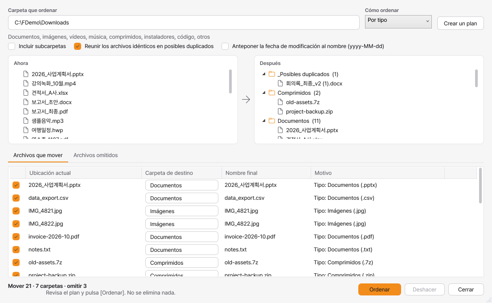
- **Editar la descripción de la carpeta**: añade una descripción a una carpeta.

## 🔒 Proteger

Funciones para proteger tus archivos importantes. Están en **Proteger** de la barra lateral.

### Notas (.md · .textpack)

Apunta lo que se te ocurra. 🔒 **Proteger → Nota nueva** crea `Nueva nota.md` en la carpeta actual y abre la ventana de notas. Al abrir un `.md` se ve en el visor de Foldy; pulsa **Editar** (lápiz) en el visor para editarlo en la misma ventana de notas.

- **[Editar / Ver]**: Editar muestra el texto a la izquierda y el resultado a la derecha; Ver muestra solo el resultado. No hay botones de formato complicados; escribes en Markdown (# título, - lista, **negrita**).
- **Añadir imágenes**: pega con **Ctrl+V**, arrastra un archivo de imagen o pulsa **[Captura de pantalla]**. Se abre la Herramienta Recortes de Windows y tu captura va directa a la nota (capturar con Win+Shift+S y pegar con Ctrl+V también vale).
- **Formato de archivo**: sin imágenes es un `.md` normal; con imágenes se guarda como un único archivo **`.textpack`** con el mismo nombre (formato TextBundle: texto e imágenes en un zip, imágenes en calidad original). Doble clic en un `.textpack` abre la ventana de notas en [Ver].
- **Guardar**: **Ctrl+S**, y también al cerrar. Para lo que deba quedar en secreto, como contraseñas, usa una **nota bloqueada nueva** (ver "Notas bloqueadas" abajo).

### Versiones anteriores (recuperar lo sobrescrito)

Cuando una copia o un movimiento con Foldy **sobrescribe** un archivo del mismo nombre, Foldy guarda el original en silencio durante 7 días. ¿Sobrescribiste algo sin querer? Tranquilo.

- **Recuperar**: botón derecho en el archivo → **Versiones anteriores…** → elige un momento y pulsa **[Restaurar]** (el archivo actual también se guarda, así que puedes volver) o **[Guardar una copia al lado]** (junto a él como "nombre (versión anterior fecha).ext").
- **Dónde se guardan**: en una carpeta oculta de la misma unidad (`X:\.foldy\이전 버전`; en la unidad del sistema, `%LOCALAPPDATA%\Foldy\이전 버전`). Al estar en la misma unidad, no tarda nada en moverse. Solo se guardan en los discos de este PC. En unidades USB o de red (como una unidad compartida del trabajo) no se guarda nada, porque otras personas podrían verlo.
- **Límites**: pasados 7 días, o por encima de 2 GB por unidad (o el 5% de la unidad, lo que sea menor), se borran primero los más antiguos. Los archivos más grandes que el límite no se guardan.
- No cubre lo que sobrescriben otros programas fuera de Foldy. Desactívalo en Configuración → General → **Versiones anteriores**.

### Notas bloqueadas

La contraseña del wifi, el código de la puerta: cosas que debes recordar pero no quieres apuntar en cualquier sitio. Guárdalas en una **nota bloqueada**. Pide la contraseña cada vez que la abres, y puedes leerla y editarla dentro de Foldy.

- **Crear**: barra lateral **Proteger** → **🔒 Escribir una nota bloqueada**. Aparece `Nueva nota.memo.foldylock` en la carpeta actual (en Documentos si la carpeta actual no está en este PC) y se abre el editor. Cambia el nombre con F2. Después Foldy selecciona el archivo nuevo en la lista y muestra dónde se guardó arriba de la ventana de la nota.
- **Abrir**: doble clic, escribe la contraseña y se abre el editor. Texto a la izquierda, vista previa a la derecha (Markdown).
- **Imágenes**: captura la pantalla y pega con **Ctrl+V**, o arrastra un archivo de imagen, y queda guardado dentro de la nota.
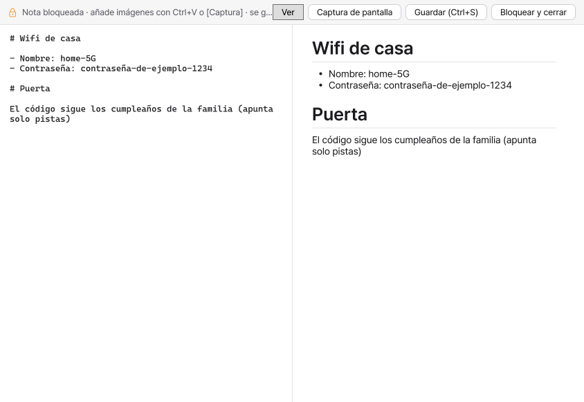

- **Guardar**: **Ctrl+S**. Se vuelve a cifrar cada vez que guardas. Tras 5 minutos sin actividad se guarda y se bloquea sola.
- El contenido se descifra solo en memoria. El texto descifrado nunca queda en el disco (ni en archivos temporales).
- 💡 Si tienes muchas contraseñas importantes, también vale la pena usar un gestor como Bitwarden o KeePass.

### Bloquear un archivo

Puedes bloquear un archivo existente, como un contrato. Botón derecho en el archivo → **🔒 Bloquear (contraseña)…**, o en la barra lateral **Proteger** → **🔒 Bloquear un archivo** (si no hay ninguno seleccionado, se abre una ventana para elegirlo). Aparece `contrato.pdf.foldylock` en la misma carpeta; tras comprobar que se descifra bien, Foldy pregunta "¿Envío el original a la papelera?".

- Doble clic para escribir la contraseña; las imágenes y el texto se muestran dentro de Foldy. Para otros archivos, Foldy dice "Ábrelo con su programa habitual" y **[Descifrar y abrir]** lo convierte de nuevo en el archivo original y lo abre.
- Recuperas exactamente lo que bloqueaste. No cambia ni un byte.

### Caja fuerte

Guarda una carpeta importante entera en una caja fuerte. Botón derecho en la carpeta → **🔒 Guardar en la caja fuerte…**, o en la barra lateral **Proteger** → **🔒 Guardar una carpeta en una caja fuerte** (si no hay ninguna seleccionada, se abre una ventana para elegirla). Aparece un único archivo `nombredecarpeta.foldyvault`; tras comprobar cada archivo descifrándolo, Foldy pregunta si envía la carpeta original a la papelera.

- **No hay límite de tamaño.** Los archivos de más de 4 GB entran y salen sin problema. Eso sí, Foldy conserva los originales hasta terminar, así que necesita ese espacio libre extra, y una memoria USB antigua en FAT32 no puede guardar una caja fuerte de más de 4 GB. Foldy lo comprueba **antes** de pedir la contraseña, te avisa enseguida si falta espacio y te ofrece [Liberar espacio] para hacer sitio.
- Doble clic para escribir la contraseña y ver la lista de archivos de dentro. Elige archivos para **previsualizar** (solo en memoria), **extraer** o **extraer todo**. Los archivos que saques van sin contraseña a una carpeta con el mismo nombre junto a la caja fuerte, y también se quedan dentro.
- **Añadir más archivos**: en la caja fuerte abierta, pulsa **[Añadir más archivos]** y elige archivos (puedes elegir varios). Si ya hay uno con el mismo nombre, Foldy pregunta si conservar ambos o sustituir el de la caja fuerte. La caja fuerte se reescribe y se comprueba cada archivo antes de sustituir la anterior, así que si algo falla la original se queda como estaba. Al final, Foldy pregunta qué hacer con los archivos originales que añadiste.

### Sobre los archivos bloqueados

- Muestran un candado (archivo bloqueado) o una caja fuerte (caja fuerte), y con Foldy instalado, al hacer doble clic en el Explorador también se abre Foldy.
- **Si olvidas la contraseña, ni Foldy puede abrirlo.** La contraseña nunca se guarda ni se escribe en los registros.
- En un PC de empresa, comprueba antes que cifrar archivos encaja con la política de seguridad.
- Por dentro es un zip cifrado con AES-256, y la contraseña se refuerza 600.000 veces (PBKDF2-SHA256) para crear la clave. Eso hace muy lento adivinar contraseñas, y sin la contraseña ni siquiera se ven los nombres de archivo. A cambio, 7-Zip y similares no pueden abrirlo; usa Foldy (el formato es público en el código fuente). Las cajas fuertes hechas con la 0.3.18 o anteriores se siguen abriendo.
- Las contraseñas nuevas necesitan al menos 8 caracteres. Se recomienda una frase de unas cuantas palabras separadas por espacios.

### Borrar carpetas con muchísimos archivos (borrado rápido)

Al borrar una carpeta con **más de 5.000 archivos**, como `node_modules`, Foldy pregunta antes. La papelera permite recuperarlos, pero con tantos puede tardar desde varios minutos hasta mucho más.

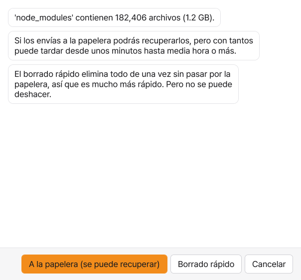

- **[A la papelera (se puede recuperar)]**: lo predeterminado. Va a la papelera como siempre.
- **[Borrado rápido]**: no pasa por la papelera y borra muchos a la vez, así que es mucho más rápido. Pero **no se puede deshacer.** Si lo eliges, Foldy repite "no se puede deshacer, y lo ya borrado sigue borrado aunque pares a mitad", y el botón predeterminado de esa confirmación es **[Cancelar]** (pulsar Enter por error no borra nada).
- Mientras borra, el panel de tareas muestra la cuenta, y puedes **cancelar** cuando quieras.
- También borra archivos de solo lectura y rutas muy largas (más de 260 caracteres). En los **vínculos dentro de la carpeta (uniones y enlaces simbólicos), solo se quita el vínculo; la carpeta a la que apunta nunca se toca.**
- En unidades de red borra despacio (4 a la vez) para no cargar el servidor.
- Las raíces de unidad, Windows, Program Files y las propias carpetas de usuario, Escritorio y Documentos no admiten borrado rápido (solo papelera).

### Papelera

La línea **Papelera** de la barra lateral muestra cuánto se ha acumulado (p. ej. Papelera · 38 GB). Haz clic para abrir la papelera de Windows; pulsa **Vaciar** a la derecha para vaciar la papelera de todas las unidades tras una confirmación (no se puede deshacer).

## 🔗 Conectar

Funciones para conectarte a servidores, Git y la terminal. Están en **Conectar** de la barra lateral.

### SFTP y SSH

Conéctate a un servidor con el botón **SFTP** al final de los botones de unidad de la barra de pestañas, con **Ctrl+Shift+O** o con Conectar → SFTP en la barra lateral, y la carpeta SFTP se abre como pestaña en ese panel. El árbol de la izquierda pasa a ser el del servidor, con la carpeta abierta y la raíz del servidor (/) desplegadas un nivel para que veas las carpetas al momento.

- Autentícate con contraseña o archivo de clave. Con "Guardar esta conexión" activado, la contraseña se guarda cifrada con DPAPI de Windows.
- Las entradas Host de `~/.ssh/config` también aparecen en "Conexiones guardadas". Al elegir archivo de clave se rellena automáticamente una clave predeterminada como `~/.ssh/id_ed25519`.
- En un servidor nuevo, Foldy muestra la huella de la clave del host y pregunta (known_hosts se comparte con OpenSSH). Si la clave cambió, avisa.
- En una pestaña SFTP el botón de terminal se convierte en **SSH** y abre una terminal con el mismo servidor, cuenta y carpeta actual.

#### Copiar y mover entre local y SFTP

- **Copiar (F5), mover (F6), arrastrar y soltar, y Ctrl+C / Ctrl+V** funcionan en ambos sentidos entre local y SFTP. Las carpetas se suben y descargan con todo su contenido.
- Un **movimiento** dentro del mismo servidor solo cambia el nombre en el servidor, así que no se transfieren datos y es rápido. Las copias entre servidores o dentro del mismo servidor pasan por un archivo temporal.
- Un movimiento borra el origen solo **cuando todas las copias han terminado bien**. Si falla o cancelas, el origen se queda y los archivos a medio escribir se eliminan.
- Si el nombre ya existe aparece la misma ventana que en las copias locales: conservar ambos (con `(2)` tras el nombre), sobrescribir, omitir, y hacer lo mismo con los conflictos restantes.
- El progreso aparece en bytes en el panel de tareas, y puedes **cancelar**.
- Borrar archivos SFTP es inmediato porque **no hay papelera**, así que Foldy pregunta una vez más antes. Crear carpetas y cambiar nombres también funciona.
- Sobrescribir también es seguro: primero se escribe el archivo completo en un temporal `.nombre.foldy-part` y luego se intercambia, así que el archivo existente queda intacto si cancelas o algo falla.
- Los enlaces simbólicos se omiten, y Foldy te dice cuántos al final (una carpeta con enlaces no se borra del origen aunque se mueva).

### Git

Git se activa solo al entrar en una carpeta de repositorio Git (una en la que esa carpeta o una superior tiene `.git`).

- En la barra de ruta aparece una **etiqueta de rama**. Haz clic para abrir la vista Git.
- Sobre la lista de archivos aparece una fina **barra Git**, con la rama, los commits por subir y bajar (↑↓), el número de cambios y los botones **Pull / Push / Confirmar… / Abrir vista Git**. Pull y push se ejecutan sin salir de la pantalla y el resultado aparece en la barra de estado. La barra desaparece al salir del repositorio.
- Marcas de cambio en la lista: junto a los nombres verás **Modificado** (cambiado desde el último commit), **Añadido** (entra en el próximo commit), **Archivo nuevo** (Git aún no lo sigue) y **Conflicto** (no se pudo combinar) con palabras sencillas, y una explicación de una línea al pasar el ratón. Los archivos ignorados se ven atenuados. Si el nombre es demasiado largo, la marca se aparta en lugar de taparlo.
- **Configuración → General → Git**: "Mostrar barra Git" (activado por defecto). Abre la vista Git de un clic con [Abrir vista Git] en la barra Git.

#### Vista Git

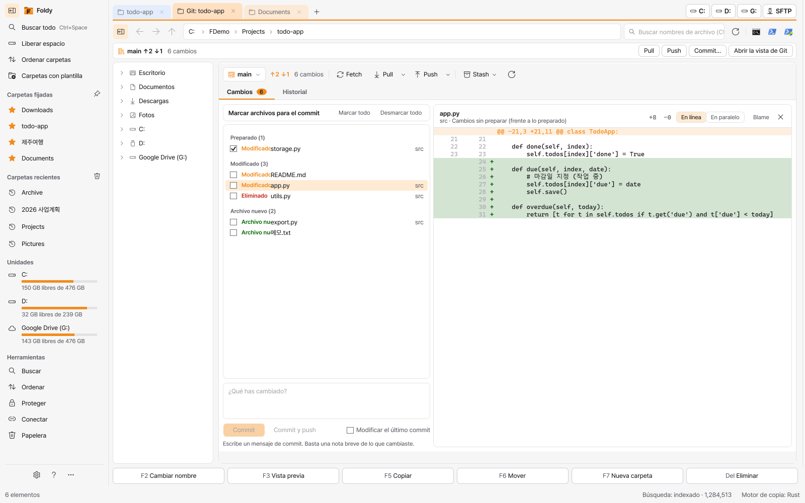

La línea superior: la **rama** actual (haz clic para cambiar o crear una), ↑↓, el número de cambios, **Obtener** (solo mirar si hay novedades) · **Pull** (combinar commits remotos) · **Push** (enviar tus commits) · **Stash** (apartar lo que estabas cambiando). Pasa el ratón por un botón para ver su explicación.

Pestaña **Cambios** (hacer un commit)

1. En la lista de la izquierda, marca la **casilla** de cada archivo a confirmar (marcado = preparado). **Seleccionar todo** y **Quitar** los alternan todos a la vez. Los archivos se agrupan como preparados / cambiados / nuevos, con insignias de Modificado, Añadido, Eliminado, Archivo nuevo y Conflicto.
2. Haz clic en un archivo para ver a la derecha qué cambió.
3. Escribe "¿Qué cambiaste?" en el cuadro de abajo y pulsa **Confirmar** o **Confirmar y subir**. Sin archivos marcados o con el mensaje vacío, los botones están desactivados y al pasar el ratón se explica por qué.

Pestaña **Historial**: el gráfico de ramas y la lista de commits (busca por mensaje, autor o hash). Haz clic en un commit para ver sus archivos cambiados, y en un archivo para ver qué cambió en ese commit.

**Ver los cambios (diff)**: con números de línea antiguos y nuevos, las líneas añadidas en verde, las quitadas en rojo y los encabezados de bloque en naranja. Cambia entre **Unificado** y **Lado a lado** arriba. Los cambios muy grandes muestran hasta 20.000 líneas, con **Mostrar más** para seguir. Los archivos binarios como imágenes solo dicen "Archivo binario".

**Blame** (quién cambió cada línea): botón derecho en un archivo y elige **Blame de este archivo**, o pulsa el botón **Blame** del encabezado del diff. Cada línea muestra un hash corto, autor y fecha, con sombreado alterno por commit. **Haz clic en un hash** para seleccionar ese commit en la pestaña Historial. También puedes seleccionar un archivo en la lista de carpetas y ejecutar **Todos los comandos (Ctrl+Shift+P) → "Git: Blame de este archivo"**.

**Pantallas de ayuda**: sin cambios verás "No hay cambios. Los archivos que edites aparecerán aquí"; abrir la vista Git en una carpeta que no es repositorio muestra el botón **Crear aquí un repositorio Git (git init)**. Si Git no está instalado, aparece un enlace a la página de instalación (git-scm.com). Si falla el inicio de sesión al hacer push o pull, Foldy explica con palabras sencillas qué revisar. Al terminar una tarea aparece un breve aviso como "Push hecho: 3 commits".

El push forzado usa solo `--force-with-lease` y pasa por un aviso. Git for Windows debe estar instalado.

### Terminal

Los botones de arriba a la derecha de una pestaña de carpeta local abren una terminal **en la carpeta actual**.

- Símbolo del sistema, PowerShell (la 7 si está instalada) y PowerShell de administrador (icono de escudo)
- **Ctrl+clic** en un botón lo abre como administrador. Las aperturas de administrador siempre pasan por UAC y nunca guardan credenciales.
- Si Windows Terminal está instalado, se abre ahí. También se abre en el sitio correcto con rutas de red (UNC) y unidades asignadas.

### Conexión con IA (MCP)

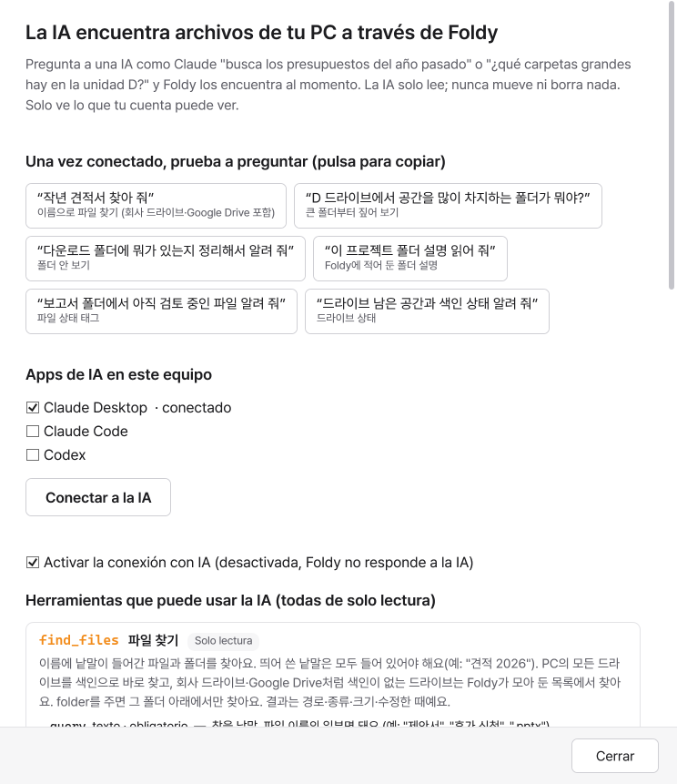

Puedes dejar que apps de IA como Claude encuentren archivos de tu PC a través de Foldy (un servidor MCP). Abre **Más (⋯) → Conectar IA (MCP)…** o "conexión con IA" en Ctrl+Space, y basta con pulsar **[Conectar a la IA]**. Solo se muestran las apps de IA instaladas en este PC (Claude Desktop, Claude Code, Codex, Gemini CLI, Cursor, VS Code, Antigravity); al pulsar, Foldy se añade a la configuración de esa app (la configuración original se guarda como copia). Reinicia la app y prueba "busca propuestas en la unidad D".

**Después de conectar** (la ventana muestra estos pasos para cada app)

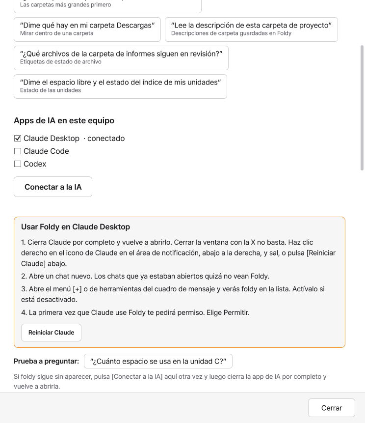

Las apps de IA solo leen su configuración al iniciarse, así que Foldy no aparecerá hasta que reinicies la app.

1. **Cierra la app de IA por completo y vuelve a abrirla.** Cerrar Claude Desktop con la X no basta. Haz clic derecho en el icono de Claude en el área de notificación, abajo a la derecha, y sal, o pulsa **[Reiniciar Claude]** en la ventana (lo que Claude esté haciendo se detiene).
2. **Abre un chat nuevo.** Los chats que ya estaban abiertos quizá no vean Foldy.
3. Comprueba que **foldy** esté activado en el menú [+] o de herramientas del cuadro de mensaje. Cuando pida permiso la primera vez, elige **Permitir**.
4. Pregunta "¿Cuánto espacio se usa en la unidad C?".

Cada app es un poco distinta. En Claude Code, Gemini CLI y la línea de comandos de Codex, vuelve a iniciarlos y comprueba con `/mcp` que foldy está ahí; en Cursor y VS Code, reinicia y usa el modo Agent. En Antigravity basta con abrir una conversación nueva. Si aún no aparece, pulsa [Conectar a la IA] otra vez y cierra y vuelve a abrir la app.

**Una vez conectado, prueba a preguntar** (haz clic en la ventana de conexión con IA para copiar):

- "Busca los presupuestos del año pasado": buscar archivos por nombre (incluidas unidades de empresa y Google Drive)
- "¿Qué carpetas ocupan más espacio en la unidad D?": las carpetas más grandes primero
- "Dime qué hay en mi carpeta Descargas": mirar dentro de una carpeta
- "Lee la descripción de esta carpeta de proyecto": descripciones de carpeta guardadas en Foldy
- "¿Qué archivos de la carpeta de informes siguen en revisión?": etiquetas de estado de archivo
- "Dime el espacio libre y el estado del índice de mis unidades": estado de las unidades

Si hay una app de IA instalada en este PC pero aún no está conectada, Foldy lo menciona en una línea arriba de la ventana al iniciar, por ejemplo: Pregunta a Claude Desktop "busca los presupuestos del año pasado" y Foldy lo encuentra en tu PC [Conectar] [Más tarde] [No volver a preguntar] (el ejemplo cambia cada vez). Si la ignoras, desaparece; para volver a verla, actívala en Configuración → General → Conexión con IA.

- Lo que puede usar la IA: buscar archivos (incluidas unidades de empresa y Google Drive), mirar dentro de carpetas, tamaños de carpetas, descripciones de carpetas, etiquetas de estado de archivo, estado de unidades e índice. **Todo de solo lectura.** No hay mover ni borrar.
- Solo ve lo que puede ver tu cuenta. No se abre nada a internet; Foldy solo habla con la app de IA dentro de tu PC (cómo usa la app de IA los resultados depende de su propia política).
- Está desactivado por defecto. Desactívalo cuando quieras con "Activar la conexión con IA" en esa ventana, donde también puedes ver la lista de herramientas (nombres, descripciones, parámetros).
- Para otras apps de IA, copia la configuración de "Añadir a mano" abajo (`Foldy.exe --mcp`). ChatGPT solo se puede conectar por internet, así que por seguridad no es compatible.

## Configuración y temas

**Si el texto es pequeño, agranda la pantalla.** Por defecto Foldy sigue a Windows: aumenta Configuración de Windows → Accesibilidad → **Tamaño del texto** y Foldy crece con él (también sigue la escala de pantalla). Para agrandar solo Foldy, pulsa **Ctrl+=** para ampliar, **Ctrl+-** para reducir y **Ctrl+0** para volver a seguir a Windows. También puedes elegir "Tamaño de pantalla" en el menú Más. El texto y los botones crecen juntos, y los diálogos y la ventana de notas se abren al mismo tamaño.

Abre la ventana de configuración con **Ctrl+,** o **Configuración** en la barra lateral. Tiene las páginas General, Apariencia, Lista, Terminal, Copia, Actualizaciones y Atajos.

- **Idioma**: Según Windows, o elige 한국어, English, Español, 日本語 o 简体中文 en Configuración → Apariencia → Idioma.
- **Color de acento**: naranja Foldy, o seguir el color de acento de Windows
- **Atajos**: haz clic en un cuadro y pulsa una combinación nueva (Esc cancela, Retroceso borra). Los atajos que chocan se marcan con un aviso. Solo se guarda lo que cambias, en `%LOCALAPPDATA%\Foldy\keymap.json`.

Los ajustes habituales también se cambian directamente desde el menú **Más** de la barra lateral.

- **Tema**: Según el sistema (claro/oscuro automático) · Claro · Oscuro · Retro
- **Espaciado de la lista**: Compacto · Normal · Amplio
- **Mostrar archivos ocultos** (**Ctrl+H**)
- **Abrir el archivo de configuración**: `%LOCALAPPDATA%\Foldy\settings.json`

## Actualizaciones

Foldy busca una versión nueva en GitHub Releases 5 segundos después de arrancar y cada 6 horas. Una versión nueva solo se instala después de verificar su firma (Ed25519) y su hash, y en la parte derecha de la barra de estado aparece **"Foldy x.y.z · reiniciar y actualizar"**. Pulsa [Reiniciar y actualizar] y Foldy se cierra mientras una ventana pequeña muestra "instalando → volviendo a abrir". Durante la instalación los dos niños botan y se pasan el balón en la pista y, al final, uno recibe el pase del otro, encesta una bandeja de dos puntos y chocan los cinco (solo texto si las animaciones están desactivadas). Se cierra sola cuando se abre el nuevo Foldy. Si hay otra ventana de Foldy abierta, te pide cerrarla, y si algo falla te dice por qué. Detrás de un proxy de empresa (PAC, o un proxy sin autenticación) se usa tal cual la configuración de proxy del usuario de Windows. Si el servicio de índice (que se ejecuta como SYSTEM) no puede comprobarlo, Foldy lo comprueba directamente con tu cuenta, y entonces la instalación necesita una confirmación de administrador. Si pulsas "reiniciar y actualizar" durante una tarea como una copia, la actualización se programa sin interrumpir la tarea, se instala sola cuando todo termina y Foldy se reinicia (vuelve a pulsar mientras está programada para cancelar). **… (Más) → Buscar actualizaciones…** en la parte inferior de la barra lateral comprueba al momento y pregunta si instalar una versión nueva. Si la comprobación falla, muestra por qué.

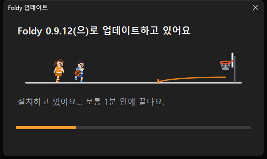

## Informar de errores

El botón **Informar de un error** de la parte inferior de la barra lateral (o Más → Informar de un error…, o la ventana Acerca de) abre una página de GitHub con una issue rellenada con las versiones de la app y de Windows y los registros recientes.

Foldy recopila los errores automáticamente: no solo los cierres inesperados, sino también los errores que ocurrieron y pasaron, registrando cada tipo una sola vez. La primera vez pregunta si enviarlos.

- **Enviar siempre automáticamente**: a partir de entonces los envía en silencio al iniciar y cada 30 minutos, sin preguntar.
- **Enviar solo esta vez** / **No enviar**

Los informes solo incluyen las versiones de la app y de Windows, el error y los registros recientes; se quitan las rutas de archivo y los nombres de usuario. El mismo error se agrupa en una sola issue de GitHub, que solo cuenta cuántas veces ocurrió. Desactívalo cuando quieras en Configuración → General.

### Modo de diagnóstico

Para problemas que solo ocurren en ciertas situaciones (por ejemplo, una unidad de red que se ve vacía), **⋯ (Más) → Activar o desactivar el modo de diagnóstico** en la parte inferior de la barra lateral (o la lista de comandos) registra información detallada.

1. Activa el modo de diagnóstico y aparecerá **Diagnosticando** a la derecha de la barra de estado.
2. Reproduce el problema.
3. Haz clic en **Diagnosticando** o desactívalo desde el menú, y Foldy pregunta si enviar el registro como informe de error (se quitan rutas y nombres de usuario).

Se desactiva solo a las 24 horas. Si una unidad no se puede abrir, Foldy registra la causa (tipo de unidad, destino de la conexión, permisos) incluso fuera del modo de diagnóstico y, si lo aceptaste, lo informa automáticamente. Encuentra los archivos de registro con **⋯ (Más) → Abrir la carpeta de registros** (`%LOCALAPPDATA%\Foldy\logs`).

## Preguntas frecuentes

**La búsqueda solo encuentra archivos en la carpeta actual.**
El servicio de índice no está instalado o aún se está preparando. Pulsa **Más** en la barra lateral → **Instalar servicio de índice (admin)…**. El primer índice tarda unas decenas de segundos según el tamaño de la unidad.

**¿Una unidad de red desconectada lo ralentiza todo?**
No. Cada unidad trabaja por separado, así que las demás pestañas y paneles siguen funcionando aunque una unidad no responda. Pulsa **Esc** en esa pestaña para cancelar la carga.

**La unidad de seguridad de mi empresa se ve vacía.**
Como el Explorador, solo se oculta el atributo "oculto" (desde la 0.3.5). Las carpetas raíz con atributo "sistema" se muestran. Si sigue vacía, activa el **modo de diagnóstico**, ábrela otra vez y envía el registro. Las unidades lentas como esta se abren automáticamente en un modo más ligero, como se explica en [Unidades lentas](#unidades-lentas).

**¿Abrir Foldy otra vez abre dos ventanas?**
No. Si ya está abierto, esa ventana pasa al frente, y la carpeta que le pasaste se abre en una pestaña nueva.

**Las actualizaciones no funcionan (red de empresa).**
Pulsa **… (Más) → Buscar actualizaciones** en la parte inferior de la barra lateral. Aunque el servicio no pueda salir, Foldy vuelve a comprobarlo a través de tu proxy de usuario. Si sigue fallando, se muestra el motivo; pégalo en un [informe de error](#informar-de-errores).

**¿Dónde están la configuración y los registros?**
`%LOCALAPPDATA%\Foldy` (settings.json, session.json, logs). Los datos del índice están en `%ProgramData%\Foldy`.

**¿Código fuente y licencia?**
Foldy es software libre bajo GPL-3.0-or-later. https://github.com/chadolkr/Foldy
