# Foldy 使い方ガイド

**速くて賢いファイル マネージャー、オフラインでも。** <small>AI とつなげばもっと便利に。</small>

Foldy は速くて固まらない、Windows 用の 2 画面ファイル マネージャーです。このガイドはいつでも **F1** か、左のメニュー下の **? ヘルプ** ボタンで開けます。

| | |
| --- | --- |
| バージョン | {{version}} |
| 開発者 | David CHA |
| リポジトリ | https://github.com/chadolkr/Foldy |
| ライセンス | GPL-3.0-or-later (自由ソフトウェア) |

- [誰でもかんたん](#誰でもかんたん)
- [初めての起動](#初めての起動)
- [画面の見かた](#画面の見かた)
- [左のメニュー](#左のメニュー)
- [タブ](#タブ)
- [子どもたちがバスケをします](#子どもたちがバスケをします)
- [ファイル操作](#ファイル操作)
- [プレビュー](#プレビュー)
- [Markdown ビューアー](#markdown-ビューアー)
- [遅いドライブ](#遅いドライブ)
- [キーボード ショートカット](#キーボード-ショートカット)
- **[🔍 探す](#-探す)**
  - [クイック検索 (Ctrl+Space)](#クイック検索-ctrlspace)
  - [検索](#検索)
  - [フォルダー分析](#フォルダー分析)
  - [画像のみ表示](#画像のみ表示)
- **[🧹 整理する](#-整理する)**
  - [整理ツール](#整理ツール)
  - [ネットで見たあの整理法を、ワンクリックで](#ネットで見たあの整理法をワンクリックで)
  - [フォルダー テンプレート・ウィザード・整理](#フォルダー-テンプレートウィザード整理)
- **[🔒 守る](#-守る)**
  - [ファイルがとても多いフォルダーを消す](#ファイルがとても多いフォルダーを消す-高速削除)
  - [ごみ箱](#ごみ箱)
- **[🔗 つなぐ](#-つなぐ)**
  - [SFTP と SSH](#sftp-と-ssh)
  - [Git](#git)
  - [ターミナル](#ターミナル)
- [設定とテーマ](#設定とテーマ)
- [更新](#更新)
- [バグの報告](#バグの報告)
- [よくある質問](#よくある質問)

## 誰でもかんたん

Foldy はおじいちゃん、おばあちゃんでも説明書なしで使えるように作っています。ボタンはマウスで一度で押せる大きさで、オン・オフはいつも同じ場所の同じボタン、同じ種類のボタンは同じアイコンです。削除は基本的にごみ箱へ行き、元に戻せない操作は前もってはっきりお知らせします。文字が小さければ **Ctrl+=** で大きくしてください。

## 初めての起動

最初に起動したときは、まず見やすく合わせます。

1. **文字の大きさ**: 標準・大きく・とても大きく・最大を、実際のファイル一覧の見た目でお見せします。押すとすぐ変わるので、見ながら選んでください。
2. **画面の明るさ**: 明るく・暗く・Windows に合わせる。
3. **クイック検索のショートカット**: Ctrl+Space がほかのプログラムと重なっていないか確かめ、重なっていればその場で別のキーを選べます。
4. **短い紹介**: 縦長のショート動画のように、実際の Foldy の画面が動きながら主な機能を 1 行ずつ紹介します (Ctrl+Space クイック検索 — ファイル・Windows の設定・計算・ことばで機能、ドラッグ&ドロップでコピー、フォルダー分析、デスクトップ整理、フォルダー整理、ロック付きメモ、フォルダー構成テンプレート、Git)。自動で進み、右側をクリックすると次、左側で前、[スキップ] でいつでも終われます。一度見た場面は再インストールや更新の後も表示されず、更新で新しい機能が増えたときはその場面だけを一度表示します。左のメニュー下の **?** ボタン → 「短い紹介」でいつでももう一度見られます。

   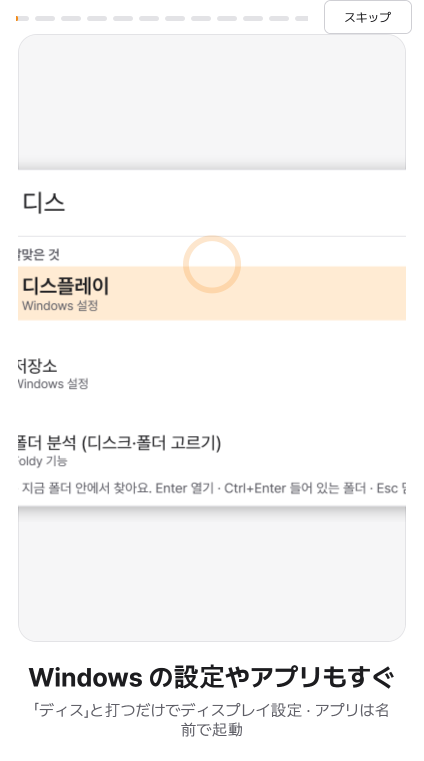

更新のときは設定がそのままなので、もう一度は聞かず「更新しました」と 1 行だけお知らせします。

## 画面の見かた

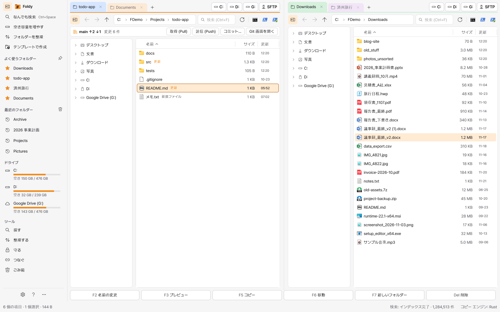

いちばん左が **左のメニュー** (よく使うフォルダー、ドライブ、ツール、設定)、その右が **左右 2 つの画面** です。いま操作している画面 (アクティブな画面) は、タブの下にアクセント カラーの線が出ます。**Tab** キーで反対側の画面に移ります。

1 つの画面は、上から次のようになっています。

1. **タブ バー**: フォルダーごとに色の違うタブ (OneNote のように)。右端にはドライブへのショートカット (C: D: …) と **SFTP** ボタン (保存したサーバーを選ぶ・新しい接続)。ドライブにマウスを載せると名前と空き容量が見えます。
2. **パス バー**: パスの一部を押すとそのフォルダーへ、空いている所を押すか **Ctrl+L** で直接入力します。Git リポジトリの中ではブランチのチップ (`main ↑2 ↓1`) が出ます。
3. **検索ボックス**: ファイル名で検索 (**Ctrl+F**)。
4. **ツール ボタン**: いちばん左のフォルダー ツリーの表示・非表示 (**Ctrl+B**)、戻る・進む・上へ、パス、検索、最新の情報に更新、ターミナル。
5. **ツリー | 一覧**: 左右どちらも、左がフォルダー ツリー、右がツリーで選んだフォルダーのファイル一覧です。境目をドラッグするとツリーの幅が変わり、ツール バー左端のツリー ボタン (または **Ctrl+B**) で同じ場所から隠したり出したりできます (幅は次回も覚えています)。ツリーはいま見ているフォルダーについていきます。アドレスを入力しても、Ctrl+Space で移動しても、タブを切り替えても、そのフォルダーまで開いて強調します。列見出しを押すと並べ替えます。

下には **ジョブ画面** (コピー・移動の進み具合)、**ファイル操作ボタン** (F2・F3・F5・F6・F7・Del)、**ステータス バー** があります。ステータス バーの中央には、いま起きたこと (「3 個コピーしました」のようなメッセージ) が大きく出て、新しいメッセージは少しのあいだアクセント カラーで光ります。左は項目数と選択したサイズ、右は検索方式・コピー エンジン・更新のお知らせです。

Foldy は同時に 1 つだけ起動します。すでに起動中にもう一度起動すると (ショートカット、フォルダーを Foldy で開く など)、新しいウィンドウの代わりに **起動中のウィンドウが前に出て**、フォルダーを渡した場合は新しいタブで開きます。

## 左のメニュー

いちばん左の帯には、どちらの画面からでも使う機能を集めました。上の画面ボタン (または **Ctrl+Shift+B**) で折りたたむとアイコンだけになり、もう一度押すと広がります。フォルダー ツリーのボタンと同じ形で、広げているときは押された背景になります。右端をドラッグして幅を変えることもできます (とても狭くするとアイコンだけ)。

- **いちばん上の代表機能 4 つ** (ワンクリックですぐ):
  1. 🔎 **なんでも検索** (どこでも **Ctrl+Space**): ファイル・アプリ・Windows の設定・Foldy の機能・計算まで 1 つの欄で
  2. 📊 **空き容量を増やす**: フォルダー分析で何が容量を使っているかを見て、消してよいものだけを選んで空ける
  3. 🧹 **フォルダーを整理**: 整理ヘルパーが「どこを?」「どう?」(種類別・日付別・PARA) を 1 つずつ聞き、整理後の様子を先に見せます。消さずに、元に戻せます
  4. 🗂️ **テンプレートで作成** (**Ctrl+Shift+N**): PARA や業種別のプロジェクト段階のようなフォルダー構成をプレビューして一度に
- **よく使うフォルダー**: タイトル横の **ピン** ボタンを押すと、いまのフォルダーを固定します。押すとアクティブな画面で開き、右クリックで新しいタブや反対側の画面で開く、並べ替え、固定解除ができます。
- **最近のフォルダー**: 最近開いたフォルダー 5 つが自動でたまります (固定したフォルダーは除く)。タイトル横のごみ箱ボタンで消します。
- **基本のフォルダー**: 最近のフォルダーのいちばん上に **デスクトップ・ダウンロード・ドキュメント・ピクチャ・ビデオ** がいつもあります。フォルダーごとに絵が違うので一目でわかります。OneDrive に移ったデスクトップ・ドキュメント・ピクチャや、別のドライブに移したダウンロードも本当の場所で開きます。最近のフォルダーを消しても残ります。
- **ドライブ**: ドライブごとに名前、使用量のバー、空き容量が見えます。90% を超えるとバーが赤くなります。右クリックですぐフォルダー分析を始めます。
- **ツール**: そのほかの機能は 4 つのまとまりにしました。押すとそのまとまりのメニューが開きます。
  - 🔍 **探す**: ファイル検索、フォルダー分析、画像のみ表示
  - 🧹 **整理する**: このフォルダーを整理、テンプレートから新規フォルダー、フォルダー ウィザード、管理方法を決める、デスクトップ・ダウンロード・ログの整理
  - 🔒 **守る**: 新しいメモ、ロック付きメモ、ファイルのロック、金庫、以前のバージョン (右クリック)、ごみ箱
  - 🔗 **つなぐ**: SFTP、Git 画面、ターミナル
- **ごみ箱**: たまった容量が見え、**空にする** ですぐ空にできます。
- **いちばん下**: 設定 (**Ctrl+,**)、ヘルプ (**F1**)、その他 (すべてのコマンド **Ctrl+Shift+P**、テーマ、隠しファイル、一覧の間隔、更新、バグの報告、ツアー、Foldy について)。

## タブ

| したいこと | 方法 |
| --- | --- |
| 新しいタブ | **Ctrl+T** またはタブ バーの **+** |
| タブを閉じる | **Ctrl+W**、中ボタンでクリック、タブの ✕ |
| 次/前のタブ | **Ctrl+Tab** / **Ctrl+Shift+Tab** |
| 並べ替え | タブをドラッグしてほかのタブの上に置く |
| 反対側の画面へ移す | タブを反対側の画面のタブの上へドラッグ |
| 同じフォルダーを新しいタブで | タブをダブルクリック |

タブ、パス、並べ替え、ウィンドウの位置は自動で保存され、次回の起動でそのまま戻ります。突然終了しても、最後の状態 (2 秒前まで) に戻ります。

## 子どもたちがバスケをします

1.5 秒より長くかかる作業では、ジョブ画面にバスケットボールをする 2 人の子どもが出てきます。

技は 15 種類: クロスオーバー、ビハインド・ザ・バック、レッグスルー、スピン ムーブ、ユーロ ステップ、ヘジテーション、ステップバック、シュート フェイク、方向転換、ギブ・アンド・ゴー、バウンド パス、ノールック パス、アリウープ、スクリーン・アンド・ロール、カットイン。すべての技が一度ずつ出てから、また出てきます。

- コピー・移動: 1 人がパスし、進んだ分だけもう 1 人がドリブルで進んで、終わると **3 ポイント シュート成功**、そしてハイタッチ!
- 削除: ボールをごみ箱に投げます。完全に削除のときはボールがコートの外へ飛んでいきます。
- 検索・ネットワーク待ち: 2 人がきょろきょろとボールを探します。
- 検索リスト・分析: 1 人はドリブルの練習、もう 1 人は記録をとります。
- 一時停止・名前の重複: 子どもがボールを抱えて待ちます。失敗するとシュートがリングに当たって跳ね返ります。

設定 → 全般の「アニメーションを使う」でオフにでき、ウィンドウが最小化されたり隠れたりすると止まって CPU を使いません。

## ファイル操作

| 操作 | キー | 説明 |
| --- | --- | --- |
| 名前の変更 | **F2** | 拡張子を除いた名前が選択された状態で入力欄が開きます。Enter で確定、Esc で取り消し |
| コピー | **F5** | 選んだ項目を反対側の画面のフォルダーへ |
| 移動 | **F6** | 反対側の画面のフォルダーへ |
| 新しいフォルダー | **F7** | 作るとすぐ名前を入力できます |
| ごみ箱へ | **Delete** | |
| 完全に削除 | **Shift+Delete** | 確認画面が出ます。ファイルが 5,000 個を超えると [高速削除](#ファイルがとても多いフォルダーを消す-高速削除) も選べます |
| コピー・切り取り・貼り付け | **Ctrl+C / X / V** | エクスプローラーともやり取りできます |
| 上へ | **Backspace**、**Alt+↑** | いままでいたフォルダーにフォーカスが行きます |
| 戻る/進む | **Alt+← / →**、マウスの戻る・進むボタン | |

- **右クリック** するとエクスプローラーと同じメニュー (プログラムから開く、送る、圧縮 など) が出ます。**Shift+右クリック** は拡張メニューです。
- **ドラッグ&ドロップ**: エクスプローラーから持ってきたり、エクスプローラーへ送ったりできます。同じドライブなら移動、別のドライブならコピーが基本で、**Shift** は移動、**Ctrl** はコピーです。
- コピーと移動は **並列コピー エンジン** が受け持ちます。同じ名前があると「両方残す / 上書き / スキップ」を聞きます (残りにも同じように適用できます)。進み具合は下のジョブ画面とタスク バーに出て、コピー中もほかのフォルダーを自由に見られます。
- 文字を入力すると、その文字で始まるファイルへすぐ移動します。同じ文字を続けて押すと次の項目へ移ります。

**このファイルを使っているのは誰?** コピー・移動・削除が失敗すると、そのファイルを使っているプログラムの名前をジョブ画面とステータス バーでお知らせします (例: 「Microsoft Excel が使っています。そのプログラムを閉じてからもう一度お試しください」)。Windows に問い合わせるだけで、プログラムを強制終了することはありません。

## プレビュー

**F3** (または下の **F3 プレビュー**) を押すと、ファイル一覧の上にプレビュー画面が開き、一覧で選んだファイルの内容をすぐ表示します。Markdown、画像、テキスト・コード (構文の色分け)、PDF・Office のように Windows のプレビュー ハンドラーがある形式に対応しています。境目をドラッグしてプレビューの高さを変えられます。

ほかのフォルダー・ドライブ・タブへ移るとプレビュー画面は自動で閉じます (F3 でまた開きます)。何も選んでいないときは「プレビュー画面」と表示されます。

- クラウド専用のファイルは、ダウンロードされないよう内容を読みません。
- ネットワーク ドライブと SFTP は遅くならないよう自動では読まず、**[プレビュー]** を押したときだけ読みます。
- Google ドライブ パソコン版のドライブ (たいてい G:) も同じです。左のメニューに雲のアイコンと「Google Drive」で表示され、サムネイル・アイコン・プレビューがオンライン専用のファイルを勝手にダウンロードすることはありません。ファイルを開いたりコピーしたりしたときにダウンロードします。
- **DRM やパスワードで保護されたファイル**は、エラーではなく「DRM で保護されたファイルのため、プレビューできません」(パスワードなら「パスワードが設定されたファイルのため…」) と表示します。ファイルを開くと、セキュリティ ソフトが許可したアプリで見られます。Foldy は、ファイルの先頭が本来の形式 (Office・ハングル・PDF・画像) と違い、暗号化されているように見えるかで判断します。

## Markdown ビューアー

`.md` ファイルを開くと、メモ帳の代わりに Foldy の中ですぐ表示します (既定。設定 → 全般 → Markdown ファイルを開く で登録されたアプリも選べます)。鉛筆ボタン (**編集**) を押すとメモ画面ですぐ直せます。表、チェック ボックス、コード (構文の色分け・コピー ボタン)、相対パスの画像、目次、**Ctrl+F** の文書内検索に対応しています。文書の中のほかの `.md` へのリンクは同じタブで開き (戻る/進む)、フォルダーへのリンクはフォルダー タブで開きます。インターネット上の画像は [画像を読み込む] を押したときだけ取得します。

## 遅いドライブ

会社のセキュリティ ドライブのように、フォルダーを開くのに時間がかかるドライブは、開いたときの時間から Foldy が **自動で** 見分けます。設定はありません。

- パス バーの横に **遅いドライブ** の表示が出て、最初に見分けたときに一度ステータス バーでお知らせします。
- 一覧を先に表示し、フォルダーのサイズなどは後から埋めます。ほかのフォルダーへ移ると、やりかけの作業は取り消します。
- Git の検出、画像のサムネイル、ファイルごとのアイコンは省き、プレビュー (F3) は **[プレビュー]** を押したときだけ開きます。
- フォルダーの変更は監視の代わりに定期的に確認します。コピーはこれまでどおり自動で調整されます。

## キーボード ショートカット

| キー | 動作 |
| --- | --- |
| **F1** | このガイド |
| **Ctrl+Shift+P** | すべてのコマンド (名前で探して実行) |
| **Ctrl+Space** | クイック検索: ファイル・アプリ・設定・機能・計算 (ほかのプログラムからも) |
| **Tab** | 反対側の画面へ |
| **Ctrl+L** | パスを直接入力 |
| **Ctrl+F** | ファイル名で検索 |
| **Ctrl+R** | 最新の情報に更新 |
| **Ctrl+H** | 隠しファイルの表示・非表示 |
| **F3** | プレビュー画面の表示・非表示 |
| **Ctrl+,** | 設定 |
| **Ctrl+B** | フォルダー ツリーの表示・非表示 |
| **Ctrl+Shift+B** | 左のメニューの折りたたみ・展開 |
| **Ctrl+Shift+I** | 画像のみ表示 |
| **Ctrl+Shift+N** | テンプレートから新規フォルダー |
| **Ctrl+Shift+O** | SFTP サーバーに接続 |
| **Ctrl+`** | ターミナル (SFTP タブでは SSH) |
| **Ctrl+Shift+`** | 管理者ターミナル |

## 🔍 探す

ファイルを探したり、何が容量を使っているかを見たりする機能です。左のメニューの **探す** にまとまっています。

### クイック検索 (Ctrl+Space)

どのプログラムを使っていても **Ctrl+Space** を押すと、画面の中央に大きな検索欄が出ます (macOS の Spotlight のように)。1 つの欄で全部探せます。

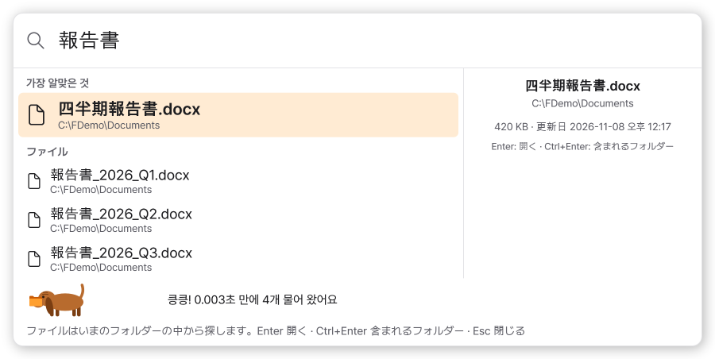

- **ファイル・フォルダー**: 高速検索ヘルパーがあればすべてのドライブから、なければいまのフォルダーの中から探します。右側にプレビュー (画像・文章の冒頭・サイズ・日付) が出ます。
- **アプリ**: スタート メニューにあるプログラムを名前で探してすぐ起動します。
- **Windows の設定・コントロール パネル**: 「ディスプレイ」「Wi-Fi」「テキストのサイズ」「プリンター」のように入力すると、その設定画面をすぐ開きます。「コントロール パネル」「プログラムの追加と削除」「デバイス マネージャー」「タスク マネージャー」「環境変数」のような昔からの名前や、「ドライバー」「応答なし」のような言葉でも見つかります。
- **よく使うフォルダー・最近のフォルダー** は上の方に先に出ます。
- **Foldy の機能**: 「設定」「フォルダー分析」のように機能の名前で実行します。
- **ことばでの指示 (韓国語)**: 「다운로드 정리해줘」(ダウンロードを整理して) のような韓国語の言い方を理解します。ほかの言語では機能の名前を入力してください。
- **計算・単位変換**: `12*3+4`、`200*15%`、`5 km to mi`、`100F`、`2 GB MB` のように入力するとすぐ答えが出て、Enter で結果をコピーします。

いちばん上に **最も合うもの** が 1 つ大きく出て、その下にアプリ・設定・フォルダー・Foldy の機能・ファイルのように種類別にまとまります (Windows の検索のように)。検索欄の下の **すべて・アプリ・設定・フォルダー・ファイル・Foldy の機能** ボタンか **Tab** キーで、1 つのまとまりだけをもっと多く表示できます。まとまりの名前の横に見つかった数が出ます (**ファイル · 220 件**)。ファイルは下へスクロールするだけで続きが出て (最後の項目で ↓ キーでも)、いちばん下に「220 件中 30 件を表示中」と出て、全部見ると「220 件すべて表示しました」に変わります。アプリ・設定のように 5 件だけ出るまとまりは、最後の **12 件をすべて表示 ›** でそのまとまりだけを全部表示します。右側の大きな **[開く]** ボタンでも開けます。**Enter** で開く・実行、**Ctrl+Enter** で含まれているフォルダーを Foldy で表示、**Esc** か外側をクリックで閉じます。インターネット検索はしません (外に何も送りません)。

**画面を動かす**: 検索欄の上の短いバーか空いている所をつかんでドラッグします。動かした場所を覚えていて、次もそこに開きます (モニターを外すなどしてその場所が画面の外なら中央に)。検索画面を開くと **Foldy の画面も一緒に** 前に出ます。最小化していても、ほかのアプリの後ろにあっても、Foldy を起動していなくても大丈夫です。

ファイルが見つかると、**鼻のきくブラッドハウンド** が床に鼻をつけてくんくん、耳をぱたぱたさせて走ってファイルをくわえてきます。「くんくん! 0.03 秒で 1,284 個くわえてきました」。見つからないと首をかしげます。設定の「アニメーションを使う」をオフにすると文字だけになります。

**どこまで探しますか?** 検索リストはこの PC の NTFS ドライブ (C: など) に作ります。左のメニューのドライブの下に「検索の準備完了」「検索の準備中 62%」のように出ます。そのほかのドライブ (会社のドライブ・Google ドライブ・USB・SD カードなど) は、Foldy が起動している間に裏で **ゆっくり集めます**。一度に 1 つずつ、ドライブが遅くなればもっと休み、コピーなどの作業中は止まります。ドライブの横に「検索リストを作成中 · 12,345 件」と出て、集め終わると「検索の準備完了」に変わります。ほかのドライブを集めている間は「順番待ち · G: の次」のように何を待っているかを表示します。集め直すときは変わったフォルダーだけを読み (Google ドライブはフォルダーの時刻が変わらないことがあるため、毎回すべて読みます)、新しく作ったり消したりしたファイルはすぐ反映します。**検索リストを自動で更新**: 設定 → 全般 → クイック検索で、1 時間ごと (既定)・6 時間ごと・1 日 1 回・自分で押したときだけ から選べます。Foldy の起動中に、最後に集め終えたときから数えます。**今すぐ検索リストを更新**: ドライブを右クリック → **今すぐ検索リストを更新**、または **探す** メニューや Ctrl+Space の「今すぐ検索リストを更新」(該当するドライブすべて) で、すべてのフォルダーを最初から読み直します。サイズだけ変わったファイルも正しくなります。ほかのドライブを集めているときは、その次に始めます。集め終えた時刻は「検索の準備完了」の横に出ます。集めている途中でも集めたところまで探せて、いま開いているフォルダーの中は常に直接走査します。設定 → 全般 → クイック検索でオフにできます。

**ショートカットが重なったら?** ほかのプログラムがすでに Ctrl+Space を使っていたり、中国語・日本語の入力システム (Ctrl+Space が入力切り替えのキー) が入っていたりすると、最初の設定のときにお知らせし、空いている別のキー (例: Ctrl+Shift+Space) を選んだり、自分で押して決めたりできます。「Foldy の中だけで使う」も選べます。更新後は聞かず、登録できないときだけお知らせします。あとで 設定 → ショートカット でいつでも変えられます。

### 検索

**Ctrl+F** で検索欄に名前の一部を入れて Enter を押すと、検索結果のタブが開きます。

- **高速検索ヘルパー** が入っていれば、すべてのドライブを即座に検索します (数百万個のファイルでも数ミリ秒)。ステータス バーに「検索: 準備完了」と表示されます。
- サービスがなければ、いまのフォルダー以下を直接走査します (最大 2 万個)。
- 結果からフォルダーを開くと新しいフォルダー タブが開き、ファイルはすぐ開きます。Esc で検索を取り消します。

### フォルダー分析

**フォルダー分析** (探すメニュー、Ctrl+Space で「フォルダー分析」、コマンド一覧) を押すと、**まずどこを分析するかを聞きます。** ディスクごとに空き容量付きのボタンがあり、いまのフォルダー、[別のフォルダーを選ぶ…] もあります。選ぶと分析タブが開きます。左のメニューのドライブを右クリック → 分析 は、そのドライブをすぐ開きます。

- **ツリーマップ**: 大きいフォルダーほど大きな四角。四角を押すと中に入り、Backspace・右クリック・マウスの戻るボタンで 1 つ上へ。
- **一覧**: 大きいフォルダー・大きいファイルの順位、前回の分析より大きく増えたフォルダー。
- **整理の候補**: node_modules、ビルド結果、一時ファイル、キャッシュのように、消してもまた作れるもの。システム フォルダーは決して候補に入れません。
- **[ごみ箱へ]**: 確認のうえ、ごみ箱へ移すだけです (完全に削除はしません)。
- **F5** でもう一度分析、**Esc** で分析を取り消し。一覧をダブルクリックすると、その場所をフォルダー タブで開きます。

**整理を提案する対象 (すべて)** — 条件: 中のいちばん新しい更新がその期間より古く、サイズがその値以上のときだけ提案します。

| 対象 | 場所・名前 | 条件 |
| --- | --- | --- |
| Node.js パッケージ | `node_modules` (隣に `package.json`) | 30 日、10MB |
| .NET のビルド出力 | `bin`、`obj` (隣に `*.csproj` など) | 14 日、10MB |
| Rust のビルド出力 | `target` (隣に `Cargo.toml`) | 14 日、50MB |
| Gradle のビルド出力 | `build`、`.gradle` (隣に `build.gradle` など) | 14 日、10MB |
| フロントエンドのビルド キャッシュ | `.next`、`.nuxt`、`.parcel-cache`、`.turbo`、`.angular`、`.svelte-kit` (隣に `package.json`) | 14 日、10MB |
| Python のキャッシュ | `__pycache__`、`.pytest_cache`、`.mypy_cache`、`.ruff_cache`、`.tox` | 30 日、1MB |
| Visual Studio のキャッシュ | `.vs` | 30 日、100MB |
| Unity プロジェクトのキャッシュ | `Library` (隣に `ProjectSettings`) | 30 日、100MB |
| Unreal の中間ファイル・キャッシュ | `Intermediate`、`DerivedDataCache` (隣に `*.uproject`、`Saved` には触れません) | 30 日、100MB |
| Flutter・Dart のビルド出力 | `.dart_tool`、`build` (隣に `pubspec.yaml`) | 14 日、10MB |
| CMake のビルド出力 (CLion) | `cmake-build-*` (隣に `CMakeLists.txt`) | 14 日、10MB |
| その他のビルド出力 | `.cxx`、`.stack-work`、`dist-newstyle`、`_build`、`.zig-cache` (隣にそのツールのプロジェクト ファイル) | 14 日、10MB |
| Adobe のメディア キャッシュ | `%APPDATA%\Adobe\Common\Media Cache Files`、`Media Cache` | 14 日、500MB |
| ユーザーの一時フォルダー | `%LOCALAPPDATA%\Temp` | 7 日、50MB |
| 名前が temp/tmp のフォルダー | `temp`、`tmp` | 30 日、100MB |
| ブラウザーのキャッシュ | Chrome・Edge・Whale・Brave のプロファイルの `Cache`、`Code Cache`、Firefox のプロファイルの `cache2` | 100MB |
| パッケージ マネージャーのキャッシュ | `npm-cache`、`pip\cache`、`Yarn\Cache`、`%USERPROFILE%\.gradle\caches`、`go-build`、`uv\cache`、`Composer`、`%USERPROFILE%\.bun\install\cache` | 30 日、500MB |
| NuGet パッケージ キャッシュ | `%USERPROFILE%\.nuget\packages` | 60 日、1GB |
| クラッシュ ダンプ ファイル | `*.dmp`、`*.hdmp`、`*.mdmp` | 14 日、10MB |
| クラッシュ ダンプ フォルダー | `%LOCALAPPDATA%\CrashDumps` (Windows エラー報告の既定のダンプ フォルダー) | 14 日、10MB |
| 古いインストーラー | ダウンロード フォルダーの `*.exe`、`*.msi`、`*.msix`、`*.iso` | 90 日、50MB |
| ダウンロードしきれなかったファイル | ダウンロード フォルダーの `*.crdownload`、`*.part` | 14 日、1MB |

`.git` は表示だけして提案しません。Windows、Program Files、ProgramData のようなシステム フォルダーは、ルールに関係なく提案しません。

**わざと入れていないもの**
- Windows Update のファイル、配信の最適化のファイル、サムネイルのキャッシュ、以前の Windows (Windows.old): システムが使うファイルなので、Windows 自身が消すのが安全です。整理の提案の上の **[Windows のクリーンアップ推奨設定を開く]** を押すと、Windows の設定のクリーンアップ画面が開きます (Windows 10 はディスク クリーンアップ)。
- ウイルス対策ソフトの更新バックアップ・検疫 (隔離) ファイル: 消してよいというメーカーの公式案内が見つからず、検疫は誤って駆除したファイルを戻す場所なので入れていません。ウイルス対策ソフトの中のメニューで整理してください。

高速検索ヘルパーがあれば、ディスクを読み直さずに数秒で分析します。なければ低い優先度で直接走査します。

### 左右を比較・同期

USB に移したフォルダーと PC のフォルダー、どちらが新しいか迷ったときに使います。左右の画面に 2 つのフォルダーを開いて 🔍 **探す → 左右を比較・同期** を押すと、Foldy が会話しながら教えます。

- **何が違うか**: 左だけ・右だけにあるファイル、どちらが新しいか (ファイル サイズと更新日時で。2 秒の差は同じとみなします)。そして「右の方が新しいです。12 個のファイルが右で変更されました」のように 1 行でまとめます。
- **どちらに合わせるか**: [左 → 右] [右 → 左] [両方を新しい方に合わせる] から選ぶと、コピーする一覧を先に見せて、確認を受けてから合わせます。
- **安全に**: 片側にしかないファイルは消しません。新しいファイルを古いもので上書きしません。上書きするファイルは以前のバージョンとして保管し (USB・ネットワークでは隣に `.foldy-bak`)、終わったら **[元に戻す]** 1 回で元どおりです。
- **両方で変更したファイル**: 前回合わせた後に両方で変わったファイルは自動では選ばず、1 つずつ聞きます。
- Git リポジトリ・開発プロジェクトのフォルダーの中は比較しません。

### 画像のみ表示

**Ctrl+Shift+I** または左のメニューの 探す → 画像のみ表示 を押すと、いまのフォルダーの画像だけをサムネイルの格子で表示します。ほかのファイルは隠すだけで動かしません。

オンの間は一覧のすぐ上に「画像のみ表示中 · 画像 N 個」(画像がなければ「このフォルダーに画像はありません」) が出て、同じ場所の **[すべてのファイルを表示]** ですぐオフにできます。

- **スペース**: 大きく表示 (← → で前/次、ホイールで拡大、R で回転、Esc で閉じる)
- **Ctrl+ホイール**: サムネイルの大きさ
- ネットワーク ドライブ、Google ドライブのドライブ (G:)、クラウド専用のファイルは内容を読みません (ダウンロードが始まらないように)。

## 🧹 整理する

部屋を片付けるようにフォルダーを整理する機能です。左のメニューの **整理する** にまとまっています。勝手に捨てず、先にお見せして、元に戻せます。

### 整理ツール

部屋を片付けるようにパソコンを整理します。左のメニューの **整理する** を押すと、デスクトップ・ダウンロード・ログの整理を選べます (コマンド一覧からも探せます)。どのツールも Foldy が会話するように 1 段階ずつ聞きます。何が見つかったか、なぜ整理するとよいか、押すとどうなるかを先に説明し、**[このまま整理] [詳しく見る] [あとで]** から選んでもらいます。じっくり見て決めてください。

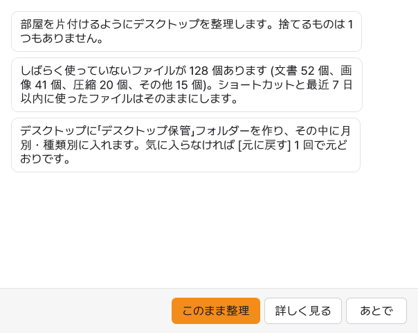

3 つの約束は必ず守ります。

- **勝手に捨てません。** 先に何をどこへ移すかをお見せし、押すまでは何もしません。
- **どこに置いたかお知らせします。** 移した場所をすぐ開いて見られます。
- **元に戻せます。** 消すものは必ずごみ箱へ行き、デスクトップの整理は [元に戻す] 1 回で元どおりです。

#### デスクトップの整理

デスクトップにファイルが山積みですか? 捨てずにデスクトップの **「デスクトップ保管」** フォルダーに種類別に入れ、どこに置いたかお知らせします。気に入らなければ **[元に戻す]** 1 回で元どおり!

- **移すもの**: デスクトップに直接あるファイルのうち、最近 7 日間使っていないファイル
- **そのままにするもの**: ショートカット (`.lnk`、`.url`)、最近 7 日以内に使ったファイル、フォルダー、隠し・システム ファイル
- **移す先**: `デスクトップ\デスクトップ保管\年-月\種類` (種類: 文書、画像、動画、音楽、圧縮ファイル、インストーラー、コード、その他)
- ほかのプログラムが使っているファイルはスキップします。
- 以前の韓国語版が作ったフォルダー (바탕화면 보관) があれば、そのまま使い続けます。
- **起動時の 1 行の提案**: デスクトップかダウンロード フォルダーに (ショートカットを除いて) ファイルが 20 個を超えると、Foldy を起動したときに画面の上に「デスクトップにファイルが 27 個あります。種類別に整理しましょうか?」[整理する] [あとで] [今後は聞かない] が出ます。そのままにすると自動で消え、[あとで] は 7 日後にまた、[今後は聞かない] は 設定 → 全般 → 整理の通知 で戻せます。

#### ダウンロードの整理

ダウンロード フォルダーはどんどんたまりますよね。整理できそうなファイルを探して、**ごみ箱に捨てるか保管するか** を選べるようにします。

| 探すもの | 基準 |
| --- | --- |
| インストール済みプログラムのインストーラー | `.exe` の製品名がインストールされたプログラムの一覧と確実に一致するときだけ (あいまいなら入れません) |
| 重複ファイル | サイズと内容 (SHA-256) がまったく同じファイル。名前がいちばん短い 1 つは残します (例: `報告書 (1).pdf` だけを選びます) |
| 展開済みの圧縮ファイル | 隣に同じ名前のフォルダーがある `.zip` |
| 古いファイル | 90 日以上開いたり変更したりしていないファイル (これは自分で選んでください) |

- ダウンロード フォルダー直下のファイルだけを見ます。サブフォルダーは整理済みとみなして触れません。ダウンロード中のファイル (`.crdownload`、`.part`) も除きます。
- **[ごみ箱へ]**: ごみ箱へ移します。ごみ箱から戻せます。
- **[保管する]**: `ダウンロード\保管\年-月` フォルダーへ移します。

#### ログの整理

プログラムが残す `*.log` ファイルは、知らないうちに数 GB もたまることがあります。古いログを同じフォルダーの **月ごとの zip** にぎゅっとまとめます。テキストのログはたいてい 85% 以上小さくなります。

- **対象**: 7 日以上変わっていない `*.log` ファイル (いまのドライブ全体。高速検索ヘルパーがあれば一瞬で見つけます)
- **触れないもの**: プログラムが使っているログ、`Windows` フォルダー、ごみ箱、System Volume Information
- **作るもの**: ログがあったフォルダーに `logs-年-月.zip`
- zip を開き直して内容が元とまったく同じか (SHA-256) 確かめてから、元のファイルをごみ箱へ移します。確かめられなければ元はそのままです。
- フォルダー分析画面の上の **[ログの整理]**、**[ダウンロードを整理]** ボタンからも開けます。

#### 削除してよいフォルダーを探す (開発の残りもの)

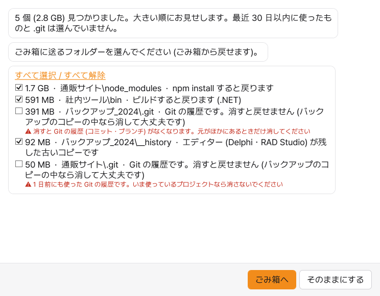

プロジェクト フォルダーには、作り直せるフォルダーが数 GB もたまります (node_modules、bin・obj、target、__pycache__、.venv、dist・build、Delphi の __history、Unity の Library、Unreal の Intermediate、.next などの Web ビルド キャッシュ、.pytest_cache などの Python キャッシュ、Flutter・CMake・Haskell・Elixir・Zig のビルド フォルダー)。整理する → **削除してよいフォルダーを探す**、フォルダー分析の **[削除してよいフォルダー]**、または Ctrl+Space から探せます。

- **いま見ているフォルダーの中だけ** を探し、大きいものから見せます。検索リストがあればサイズがすぐ出ます。
- **隣にプロジェクト ファイルがあるときだけ** 選びます: package.json の隣の node_modules、.csproj の隣の bin・obj、Cargo.toml の隣の target。ただ「build」という名前の写真フォルダーには触れません。
- 最近 30 日以内に使ったものは選んでおきません。
- **.git は最初から選びません。** 消すと Git の履歴がなくなるので赤い文字でお知らせし、最近使った .git なら「いま使っているプロジェクトなら消さないでください」と言います。元が別にあるバックアップのコピーなら、自分で選んで消せます (もう一度聞きます)。
- 選んだものだけが **ごみ箱へ** 行きます。ごみ箱から戻せます。
- 探す名前を増やすには、設定 → 全般 → 削除してよいフォルダーを探す にコンマ区切りで書きます。

#### 開発キャッシュの整理

npm・NuGet・pip・Yarn・pnpm・uv・Bun・Composer がためたキャッシュ、Go・Docker のビルド キャッシュ、conda のダウンロード済み圧縮ファイルを整理します。整理する → **開発キャッシュを整理**。

- この PC に入っているツールだけを、サイズと「またダウンロードすれば大丈夫」という説明と一緒に見せます。
- フォルダーを直接消さず、**各ツールの公式のコマンド** だけを実行します (`npm cache clean --force`、`dotnet nuget locals all --clear`、`py -m pip cache purge`、`yarn cache clean`、`pnpm store prune`、`docker builder prune --force`、`go clean -cache`、`uv cache clean`、`conda clean --tarballs --index-cache --yes`、`bun pm cache rm`、`composer clear-cache`)。
- Docker は **ビルド キャッシュだけ**: イメージ・コンテナー・ボリュームには触れません。
- ごみ箱を通さないので戻せません。サイズを見せて **一度確認** してから行います。必要なら次のビルドやインストールでまたダウンロードされます。

#### 作業タグ (どこまでやったっけ?)

ファイルを 1 つずつ処理していると、どこまでやったか分からなくなりますよね。ファイルに **完了**・**反映済み** のような小さな色の印を付けておきましょう。

- **付ける**: ファイルを選んで **Ctrl+D** = 完了のオン・オフ。🧹 整理するメニュー (またはコマンド一覧) から 反映済み・レビュー中・提出済み も付けられます。複数のファイルを選んで一度にしてもかまいません。
- **見える場所**: ファイル名の後ろに小さな色のチップで出ます。名前が長くて場所がなければチップは描きません (名前が優先)。フォルダーの上には「ファイル 20 個のうち 完了 7 · 反映済み 3」と **[次のファイル]** (まだ完了でない次のファイルへ) が出ます。
- **保存される場所**: そのフォルダーの隠しファイル `.foldy.md` に、人が読める形で書きます。だからフォルダーを別のディスクや PC に移してもタグがついていきます。ファイル自体には触れません。Foldy で名前を変えるとタグもついていきます。
- **Git フォルダー**: `.foldy.md` が git status に出ないよう `.git/info/exclude` に 1 行入れます (.gitignore はそのまま)。共同作業者と共有するには、上の行の **[リポジトリで共有]** をオンにしてください。
- **[タグをすべて消す]**: そのフォルダーのファイルのタグだけを消します。

### フォルダーごとに管理方法を決めておく

「このフォルダーは PARA で管理しよう」と決めておくと、Foldy がその方法でときどき見て、整理するものが出てきたら声をかけます。フォルダーごとに違う方法を決められます。

- **決め方**: フォルダーを右クリック → **このフォルダーの管理方法を決める…**。Foldy が方法ごとに何をするかを説明し、選ぶと必要なフォルダーも作るか聞きます。
- **選べる方法**: PARA、Johnny.Decimal、番号・日付を付ける、日付別
- **表示**: 決めたフォルダー (いちばん上のフォルダー 1 つ) のアイコンに小さな点が付き、左のツリーには旗が出ます。その中に入ると上に「PARA で管理中 · 整理するもの 3 件」と 1 行出ます。エクスプローラーでもそのフォルダーに Foldy のアイコンが出ます。
- **覚えておく場所**: フォルダーの中の隠しファイル `.foldy.md` 1 つです。人が読めるメモなのでフォルダーを移してもついていき、消すと管理がオフになるだけでファイルはそのままです。サブフォルダーはいちばん近い `.foldy.md` に従います。

**こんなことをお知らせします**

| 方法 | お知らせすること | すること (確認を押すと) |
| --- | --- | --- |
| すべての方法 | 一番上のまだ分けていないファイル | ひとまず `00_受信` に集めます (日付別なら 年\年-月 フォルダーへ) |
| PARA | 1_Projects の中で 90 日触っていないプロジェクト | 4_Archives へ移します |
| 番号・日付を付ける | 01_進行中 の中で 90 日触っていないフォルダー | 03_完了 へ移します |
| Johnny.Decimal | 番号のないフォルダー | お知らせだけ (名前は自分で付けてください) |

**ご心配なく**

- 勝手に移しません。何をどこへ移すかをお見せし、**[このまま整理]** を押したときだけ移します。終わったら **[元に戻す]** 1 回で元どおりです。
- 実行ファイル、設定ファイル、ショートカット (`.exe`、`.dll`、`.ini`、`.json`、`.lnk` など) は移しません。ほかのプログラムやショートカットが壊れることがあるからです。
- **Git リポジトリ・開発プロジェクトのフォルダー** には方法を決められません。リポジトリをまとめた上のフォルダーは管理でき、その中のリポジトリはフォルダーごと移すだけです (中には触れません)。
- 開いているファイルはスキップし、「開いているのでスキップしました」とお知らせします。
- OneDrive・Google ドライブのような **同期フォルダー** では、まず「同期フォルダーです」とお知らせします。移すとほかの PC にも反映されるからです。こうしたフォルダーやネットワーク・遅いドライブには、エクスプローラーのアイコン (desktop.ini) を作りません。
- 整理するものがたくさんたまったら、ほかの整理ツールと同じく週に 1 回まで 1 行でお知らせします (設定 → 整理の通知)。
- フォルダー名は作るときのアプリの言語になります (00_受信、01_進行中 …)。以前に韓国語の名前で作ったフォルダー (00_받은 파일 …) はそのまま使い続けます。

#### 必要なときに 1 行でお知らせ

機能を探し回らなくてもいいように、いま見ているフォルダーに合う機能を上に 1 行でお知らせします。一度に 1 つだけ、**[閉じる]** を押すとそのフォルダーではもう出ません。設定 → 全般 → **整理の通知** をオフにすると出ません。

- ダウンロード フォルダーにファイルが 40 個を超えると → [ダウンロードを整理]
- デスクトップにファイルが 50 個を超えると → [デスクトップを整理]
- ログ ファイル (.log) が 20 個を超えるフォルダー → [ログの整理]

### たまったらそっとお知らせ

気づかずに過ぎてしまいやすいので、Foldy がときどき軽く見て、整理するものが多いときだけウィンドウの下に 1 行でお知らせします。週に 1 回まで、勝手に整理はしません。

- ログ: 減らせる量が 1GB を超えるか、そのドライブの空き容量の 5% を超えたとき (高速検索ヘルパーがあるときだけ確認)
- ダウンロード: 整理できそうなファイルが 1GB を超えたとき
- デスクトップ: 保管するファイルが 50 個を超えたとき
- オフにするには: 設定 → 全般 → **整理の通知**

### ネットで見たあの整理法を、ワンクリックで

「PARA がいいらしい…」と試そうとして、フォルダー作りで止まったことはありませんか? テンプレートを選ぶとフォルダーが一度にでき、プレビューでは **フォルダーごとに何を入れる場所か** を名前の横に短くお知らせします。

**PARA** (ティアゴ・フォーテ) — 「いつ終わる?」で 4 つに分けます。

| フォルダー | 入れるもの |
| --- | --- |
| 1_Projects | いま取り組んでいること (終わる日があること) |
| 2_Areas | 続けて管理する領域 (健康、お金、家、チーム) |
| 3_Resources | 参考資料 (いつか使う情報) |
| 4_Archives | 終わったもの (消さずにここへ) |

**Johnny.Decimal** — すべての場所に番号を付けて、「11.03」と言えばすぐたどり着きます。

| 段階 | 例 | 意味 |
| --- | --- | --- |
| エリア | `10-19 生活` | 大きなまとまり 10 個まで |
| カテゴリー | `11 家` | エリアの中の区分 10 個まで |
| 項目 | `11.01 引っ越しの見積もり` | カテゴリーの中の実際のフォルダー |

**番号・日付を付ける** — いちばん簡単な方法です。フォルダーの前の番号で順番を固定し、ファイル名は日付で始めます。

| フォルダー | 入れるもの |
| --- | --- |
| 00_受信 | ひとまずここへ (受け取ったファイル・まだ分けていないもの)。一番上なのでいつも目に入ります |
| 01_進行中 | いま取り組んでいること |
| 02_資料 | よく見る参考資料 |
| 03_完了 | 終わったがときどき見るもの |
| 99_保管 | 古くてほとんど見ないもの |

ファイルを `2026-11-19_報告書.docx` のように **日付_内容** で名付けると、名前順がそのまま日付順になります。

> 💡 **受信フォルダーのコツ**: どの方法でも、一番上に `00_受信` を 1 つ置きましょう。新しいファイルは悩まずひとまずそこへ入れ、週に 1 回空にしながら分ければたまりません。

ほかのテンプレート (顧客プロジェクト、文書作成の段階、研究、生活の書類、写真の保管 など) にも、フォルダーごとに同じように説明が付いています。

フォルダーは作るときのアプリの言語で名付けます。すでにあるフォルダーの名前はそのままです。

### フォルダー テンプレート・ウィザード・整理

左のメニューのツールやコマンド一覧 (**Ctrl+Shift+P**) から開きます。

- **テンプレートから新規フォルダー** (**Ctrl+Shift+N**): 下の構成を一度に作ります。右側で作られるツリーをプレビューし、いらないフォルダーはチェックを外せます。すでにあるフォルダーには触れず、ないものだけを作ります。各スタイルの **使い方** も一緒に見られます。
  - **個人・仕事**: PARA、Johnny.Decimal、番号・日付を付ける (受信フォルダー付き)、顧客・プロジェクト業務、文書作成の段階 (下書き → レビュー → 最終 → 配布)、研究・学習 (文献・データ・分析・原稿・発表)、生活・家庭の書類 (家計・健康・家・車・パスポート・保険)
  - **プロジェクト** (業種別の国際標準の段階): プロジェクト管理 (PMBOK: 立ち上げ・計画・実行・監視コントロール・終結)、IT システム開発文書 (ISO/IEC/IEEE 12207: 要件・分析・設計・実装・試験・移行・運用保守、コードは Git に)、建設・設計の情報管理 (ISO 19650: 作業中・共有・発行・保管)
  - **メディア・制作**: 写真・動画の保管、デザイン・制作アセット (元データ・作業・書き出し・参考)
  - **記録・保管**: 日付別の保管庫 (年/年-月)
- プレビューでは、フォルダー名の横に **何を入れる場所か** を短く表示します。
- コードのプロジェクト (Java・Python など) は言語ごとに決まったフォルダー構成があるので、内蔵テンプレートから外しました。必要ならマイ テンプレートとして作って使ってください。
- **フォルダー ウィザード**: 用途 (個人・仕事・メディアなど) を選んでいくつかの質問に答えると、合うスタイルをおすすめし、一緒に合わせて作ります。
- **このフォルダーを整理**: ダウンロードやデスクトップのような散らかった普通のフォルダーを、種類別・日付別・スタイルどおりに移します。実行前に「整理後の様子」を見せ、**何も削除せず**、[元に戻す] 1 回で元どおりになります。同じ内容のファイルは「_重複候補」に集めます。一覧でその行を押すか **同じファイル** タブを開くと、同じファイルがそれぞれどのフォルダーにあるかをフル パスで確認でき、**[残す]** で残すファイルを 1 つ選べます (ほかだけが「_重複候補」へ移ります)。Delphi (.dproj) や VB (.vbp) のようなコードのプロジェクト フォルダーはまるごとそのままにします。移すファイルがなければ、理由 (スキップしたファイル) をすぐ表示します。 大きなフォルダーの計画はチェックまで保存しておくので、画面を閉じたり PC を再起動したりしても **[続きから]** でそのまま続けられます (7 日間触らなかった計画は自動で消します)。[整理する] を押すと、計画を作った後に変わったファイルやなくなったファイルは移さずにお知らせします。
  - **Git リポジトリ・開発プロジェクトのフォルダー** (.git、.sln、package.json などがあるフォルダー) はわざと整理しません。ファイルを移すとビルドや Git の履歴が壊れることがあるので、こうしたフォルダーでは赤い案内文だけが出て、整理ボタンはオンになりません。プロジェクトの外の普通のフォルダーで整理してください。普通のフォルダーの中にプロジェクト フォルダーがあれば、そのフォルダーはまるごとそのままにします。

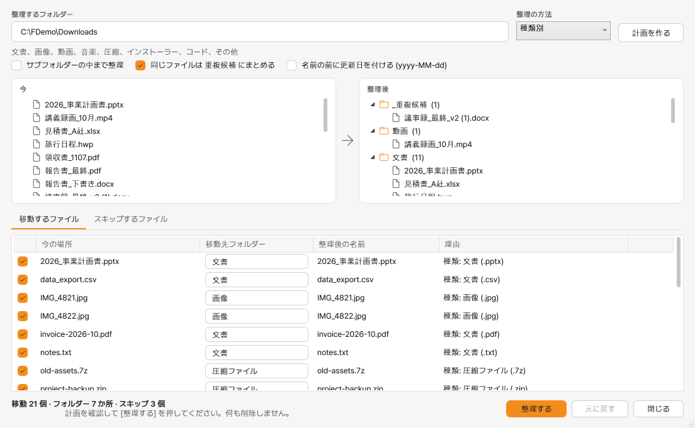
- **フォルダーの説明を編集**: フォルダーに説明を付けておきます。

## 🔒 守る

大事なファイルを守る機能です。左のメニューの **守る** にまとまっています。

### メモを書く (.md · .textpack)

思いついたことをすぐ書き留めましょう。🔒 **守る → 新しいメモ** を押すと、いまのフォルダーに `新しいメモ.md` ができてメモ画面が開きます。`.md` ファイルを開くと Foldy のビューアーで表示され、ビューアーの **編集** (鉛筆) ボタンを押すと同じメモ画面で直せます。

- **[編集 / 表示]**: 編集は左に文章、右に仕上がり。表示は仕上がりだけ。複雑な書式ボタンはなく、Markdown (# 見出し、- 箇条書き、**太字**) で書きます。
- **画像を入れる**: **Ctrl+V** で貼り付けるか、画像ファイルをドラッグするか、**[画面キャプチャ]** を押してください。Windows の Snipping Tool が開き、キャプチャするとすぐメモに入ります (Win+Shift+S でキャプチャしてから Ctrl+V でも大丈夫です)。
- **ファイルの形式**: 画像がなければ普通の `.md`、画像を入れると同じ名前の **`.textpack`** 1 つのファイルに変わって保存されます (TextBundle の形式: 文章 + 画像を 1 つの zip に、画像は元の画質のまま)。`.textpack` をダブルクリックするとメモ画面が [表示] で開きます。
- **保存**: **Ctrl+S**、閉じるときも保存します。パスワードのように隠すべき内容は **新しいロック付きメモ** を使ってください (下の「ロック付きメモ」)。

### 以前のバージョン (上書きの復元)

Foldy でコピー・移動して同じ名前のファイルを **上書きすると**、元のファイルを 7 日間こっそり保管しておきます。うっかり上書きしても心配いりません。

- **戻す**: ファイルを右クリック → **以前のバージョンを見る…** → 時刻を選んで **[元に戻す]** (いまのファイルも保管するので、また戻せます) または **[隣に取り出す]** (隣に「名前 (以前のバージョン 日付).拡張子」で)。
- **保管する場所**: 同じドライブの隠しフォルダー (`X:\.foldy\이전 버전`、システム ドライブは `%LOCALAPPDATA%\Foldy\이전 버전`)。同じドライブなので移すのに時間がかかりません。この PC のディスクにだけ保管します。USB やネットワーク ドライブ (職場の共有ドライブなど) には、ほかの人に見られるおそれがあるので残しません。
- **上限**: 7 日たつか、ドライブごとに 2GB (またはドライブの 5% の小さい方) を超えると古いものから消します。上限より大きいファイルは保管しません。
- Foldy の外で (ほかのプログラムが) 上書きしたものは対象外です。設定 → 全般 → **以前のバージョン** でオフにできます。

### ロック付きメモ

Wi-Fi のパスワードや玄関の暗証番号のように、必ず覚えておきたいけれど、どこかに書いておくのは不安なもの、ありますよね? **ロック付きメモ** に書いておきましょう。開くたびにパスワードを聞き、Foldy の中ですぐ見たり直したりできます。

- **作る**: 左のメニューの **守る** → **🔒 ロック付きメモを書く**。いまのフォルダー (この PC のフォルダーでなければ「ドキュメント」) に `新しいメモ.memo.foldylock` ができ、すぐ編集画面が開きます。名前は F2 で変えられます。 作ると一覧でそのファイルを選んで見せ、メモ画面の上に保存した場所を表示します。
- **開く**: ダブルクリックするとパスワードを聞いて編集画面が開きます。左は文章、右はプレビューです (Markdown)。
- **画像**: 画面をキャプチャして **Ctrl+V** で貼り付けるか、画像ファイルをドラッグすると、メモの中に一緒に入ります。
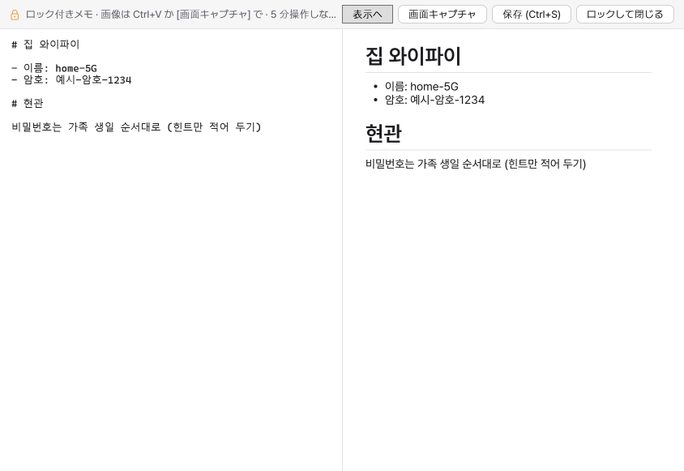

- **保存**: **Ctrl+S**。保存するたびにまたパスワードをかけます。5 分間操作しないと保存して自動でロックします。
- 内容はメモリーの中でだけ解きます。解いた文章がディスク (一時ファイルを含む) に残ることはありません。
- 💡 大事なパスワードがとても多いなら、Bitwarden や KeePass のようなパスワード管理ソフトも一緒に使ってみてください。

### ファイルをロック (ファイル 1 つ)

契約書のように、すでにあるファイルをロックできます。ファイルを右クリック → **🔒 ロック (パスワード)…**、または左のメニューの **守る** → **🔒 ファイルをロック** (ファイルを選んでいなければ選ぶ画面が開きます)。同じフォルダーに `契約書.pdf.foldylock` ができ、正しく解けるか確かめてから「元のファイルはごみ箱へ送りますか?」と聞きます。

- ダブルクリックするとパスワードを聞き、写真・文章なら Foldy の中ですぐ表示します。そのほかのファイルは「元のプログラムで開いてください」とお知らせし、**[解いて開く]** で元のファイルに戻して開きます。
- ロックしたときの内容をそのまま返します。1 バイトも変えません。

### 金庫

大事なフォルダーをまるごと金庫に入れておきましょう。フォルダーを右クリック → **🔒 金庫に入れる…**、または左のメニューの **守る** → **🔒 フォルダーを金庫に入れる** (フォルダーを選んでいなければ選ぶ画面が開きます)。`フォルダー名.foldyvault` 1 つのファイルができ、1 つずつ解いて確かめてから、元のフォルダーをごみ箱へ送るか聞きます。

- **サイズの制限はありません。** 4 GB を超えるファイルも入れて取り出せます。ただし終わるまで元のファイルを残すので、その分の空き容量が必要です。また古い USB メモリ (FAT32) には 4 GB を超える金庫を作れません。Foldy はパスワードを聞く**前に**確認し、足りなければすぐ知らせて [空き容量を増やす] で片付けを手伝います。
- ダブルクリックするとパスワードを聞き、中のファイル一覧を見せます。選んで **プレビュー** (メモリーの中だけ)、**取り出す**、**すべて取り出す** ができます。 取り出したファイルは金庫の隣の同じ名前のフォルダーにパスワードなしで出てきて、金庫の中にもそのまま残ります。
- **ファイルを追加**: 金庫を開いた画面で **[ファイルを追加]** を押してファイルを選びます (複数可)。同じ名前があれば、両方残すか金庫の中のものを置き換えるかを聞きます。金庫を書き直して 1 つずつ解いて確かめてから入れ替えるので、途中で失敗しても元の金庫はそのままです。入れた元のファイルをどうするかは最後に聞きます。

### ロックしたファイル共通

- 鍵 (ロックしたファイル)・金庫のアイコンで表示され、インストールしていればエクスプローラーでダブルクリックしても Foldy が開きます。
- **パスワードを忘れると Foldy でも開けません。** パスワードはどこにも保存せず、記録 (ログ) にも残しません。
- 会社の PC なら、ファイルの暗号化がセキュリティ ポリシーに合っているか先に確認してください。
- 中身は AES-256 で暗号化した zip で、パスワードは 60 万回練って (PBKDF2-SHA256) 鍵にします。そのためパスワードの総当たりはとても遅く、ファイル名もパスワードなしでは見えません。その代わり 7-Zip などでは開けず、Foldy で開きます (形式はソースで公開しています)。0.3.18 までに作った金庫もそのまま開けます。
- 新しいパスワードは 8 文字以上です。単語をいくつか空白でつないだ文をおすすめします。

### ファイルがとても多いフォルダーを消す (高速削除)

`node_modules` のようにファイルが **5,000 個を超える** フォルダーを消すと、先に聞きます。ごみ箱へ送れば戻せますが、これだけ多いと数分から数十分かかることがあるからです。

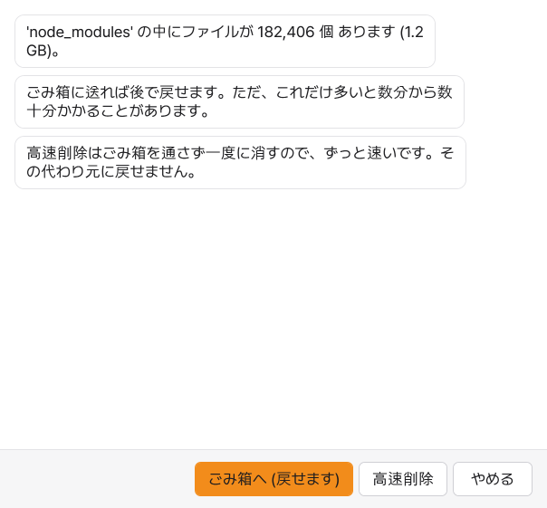

- **[ごみ箱へ (戻せます)]**: 既定です。いつもどおりごみ箱へ行きます。
- **[高速削除]**: ごみ箱を通さずにまとめて消すので、ずっと速いです。その代わり **元に戻せません。** 選ぶと「元に戻せません、途中で止めてもすでに消したものは戻りません」ともう一度お知らせし、その確認画面の既定のボタンは **[キャンセル]** です (Enter をうっかり押しても消えません)。
- 消している間はジョブ画面に消した数が出て、いつでも **取り消し** できます。
- 読み取り専用のファイル、とても長いパス (260 文字超え) も消します。フォルダーの中の **リンク (ジャンクション・シンボリック リンク) はリンクだけを消し、リンク先の元のフォルダーには触れません。**
- ネットワーク ドライブではサーバーに負担がかからないよう、ゆっくり (同時に 4 つずつ) 消します。
- ドライブの一番上、Windows、Program Files、ユーザー フォルダー・デスクトップ・ドキュメントのフォルダーそのものは高速削除できません (ごみ箱へのみ)。

### ごみ箱

左の左のメニューの **ごみ箱** の行に、いまたまっている容量 (例: ごみ箱 · 38 GB) が出ます。押すと Windows のごみ箱が開き、右の **空にする** を押すと、一度確認してからすべてのドライブのごみ箱を空にします (元に戻せません)。

## 🔗 つなぐ

サーバー、Git、ターミナルとつなぐ機能です。左のメニューの **つなぐ** にまとまっています。

### SFTP と SSH

タブ バー右のドライブ ボタンの端の **SFTP** ボタン、**Ctrl+Shift+O**、左のメニューの つなぐ → SFTP のどれかでサーバーに接続すると、SFTP フォルダーがその画面にタブで開きます。左のツリーはサーバーのツリーに変わり、最初に開いたフォルダーとサーバーの一番上 (/) が 1 段開いているので、すぐフォルダーが見えます。

- パスワードかキー ファイルで認証します。「この接続を保存」をオンにすると、パスワードは Windows DPAPI で暗号化して保存します。
- `~/.ssh/config` の Host 項目も「保存した接続」に出ます。キー ファイルを選ぶと `~/.ssh/id_ed25519` のような既定のキーを自動で入れます。
- 初めてのサーバーではホスト キーのフィンガープリントを見せて聞きます (known_hosts は OpenSSH と共有します)。キーが変わっていれば警告します。
- SFTP タブではターミナル ボタンが **SSH** に変わります。同じサーバー・アカウント・いまのフォルダーでターミナルが開きます。

#### ローカルと SFTP の間のコピー・移動

- **コピー (F5)、移動 (F6)、ドラッグ&ドロップ、Ctrl+C / Ctrl+V** がローカル ↔ SFTP の両方向でできます。フォルダーは中身ごとまるごとアップロード・ダウンロードします。
- 同じサーバーの中での **移動** はサーバー上で名前を変えるだけなので、データを移さず速いです。サーバー間のコピーや同じサーバーでのコピーは一時ファイルを経由します。
- 移動はコピーが **すべて成功してから** 元を消します。失敗したり取り消したりすると元はそのままで、書きかけのファイルは消します。
- 同じ名前があると、ローカルのコピーと同じ画面が出ます: 両方残す (名前の後に `(2)`)、上書き、スキップ、残りの競合にも同じように。
- 進み具合はジョブ画面にバイト単位で出ます。**取り消し** できます。
- SFTP のファイルを消すと **ごみ箱がないので** すぐなくなります。消す前にもう一度聞きます。フォルダーの作成と名前の変更もできます。
- 上書きも安全です。先に `.名前.foldy-part` という一時ファイルに最後まで書いてから入れ替えるので、取り消しや失敗があっても既存のファイルはそのままです。
- シンボリック リンクはスキップし、終わると何個スキップしたかお知らせします (リンクの入ったフォルダーは移動しても元を消しません)。

### Git

Git リポジトリのフォルダー (そのフォルダーか上のフォルダーに `.git` がある所) に入ると、Git が自動でオンになります。

- パス バーに **ブランチのチップ** が出ます。押すと Git 画面が開きます。
- ファイル一覧の上に細い **Git バー** が出ます。ブランチ、プッシュ/プルするコミット数 (↑↓)、変更の数と **プル / プッシュ / コミット… / Git 画面を開く** ボタンがあります。プルとプッシュは画面を移らずに実行し、結果を下のステータス バーでお知らせします。リポジトリの外へ出るとバーは消えます。
- 一覧の変更の印: ファイル名の横に **更新** (最後のコミットの後に変更)、**追加** (次のコミットに入る)、**新規ファイル** (Git がまだ記録していない)、**競合** (まとめられなかった) がやさしいことばで出て、マウスを載せると 1 行の説明が出ます。無視されたファイルは薄く表示。名前が長くて場所がなければ、印は名前を覆わずに外れます。
- **設定 → 全般 → Git**: 「Git バーを表示」(既定でオン)。Git 画面は Git バーの [Git 画面を開く] で一度に開きます。

#### Git 画面

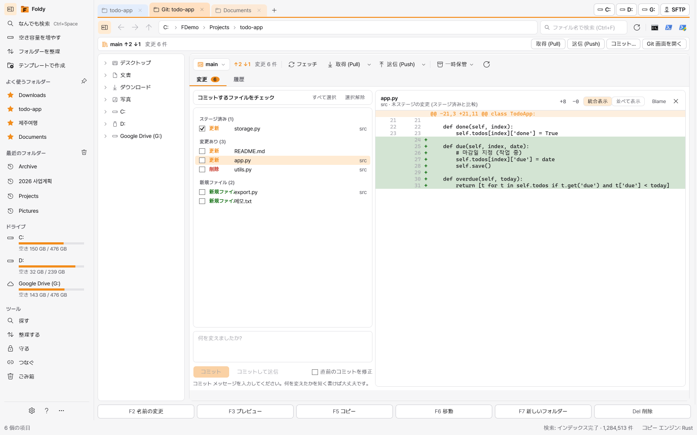

上の 1 行: いまの **ブランチ** (押して切り替え・新規作成)、↑↓、変更の数、**フェッチ** (新着の確認だけ) · **プル** (リモートのコミットをまとめる) · **プッシュ** (自分のコミットを送る) · **スタッシュ** (直していた内容をいったん退避)。ボタンにマウスを載せると説明が出ます。

**変更** タブ (コミットを作る)

1. 左の一覧で、コミットするファイルの **チェック ボックス** をオンにします (チェック = ステージ)。**すべて選択** と **選択解除** で一度にオン・オフします。ファイルはステージ済み / 変更あり / 新規ファイルにまとめられ、更新・追加・削除・新規ファイル・競合のバッジが付きます。
2. ファイルを押すと右に変わった内容が出ます。
3. 下の欄に「何を変えましたか?」を書いて **コミット** または **コミットしてプッシュ** を押します。チェックしたファイルがないか、メッセージが空のときはボタンがオフになり、マウスを載せると理由が出ます。

**履歴** タブ: ブランチのグラフとコミットの一覧 (メッセージ・作成者・ハッシュで検索)。コミットを押すと変わったファイルが、ファイルを押すとそのコミットで変わった内容が出ます。

**変更内容 (差分) を見る**: 行番号 (前/後) と一緒に、追加した行は緑、消した行は赤、ハンクの見出しはオレンジで表示します。上の **統合表示 / 左右に並べる** で切り替えます。とても大きな変更は 20,000 行まで表示し、**さらに表示** で続けて見ます。画像のようなバイナリ ファイルは「バイナリ ファイル」とだけ表示します。

**Blame** (行ごとに誰が直したか): ファイルを右クリックして **このファイルを Blame** を選ぶか、差分の見出しの **Blame** ボタンを押します。行ごとに短いハッシュ・作成者・日付が出て、同じコミットのまとまりは網掛けが交互に変わります。**ハッシュを押すと** 履歴タブでそのコミットが選ばれます。フォルダーの一覧でファイルを選んだまま **すべてのコマンド (Ctrl+Shift+P) → 「Git: このファイルを Blame」** を実行してもかまいません。

**案内画面**: 変更がなければ「変更はありません。ファイルを直すとここに出ます」が出て、Git リポジトリでないフォルダーで Git 画面を開くと **ここに Git リポジトリを作成 (git init)** ボタンが出ます。Git がインストールされていなければ、インストール ページ (git-scm.com) へのリンクが出ます。プッシュ・プルでサインインに失敗すると、何を確認すればよいかをやさしいことばでお知らせします。作業が終わると「プッシュ完了: 3 件のコミット」のようなお知らせが少し出ます。

強制プッシュは `--force-with-lease` だけを使い、警告画面を通ります。Git for Windows がインストールされている必要があります。

### ターミナル

ローカルのフォルダー タブの右上のボタンで、**いまのフォルダーで** ターミナルを開きます。

- コマンド プロンプト、PowerShell (7 があれば 7)、管理者の PowerShell (盾のアイコン)
- ボタンを **Ctrl+クリック** すると管理者で開きます。管理者での実行は必ず UAC を通り、資格情報は保存しません。
- Windows Terminal があればその中で開きます。ネットワーク パス (UNC) や割り当てたドライブでも正しい場所で開きます。

### AI 接続 (MCP)

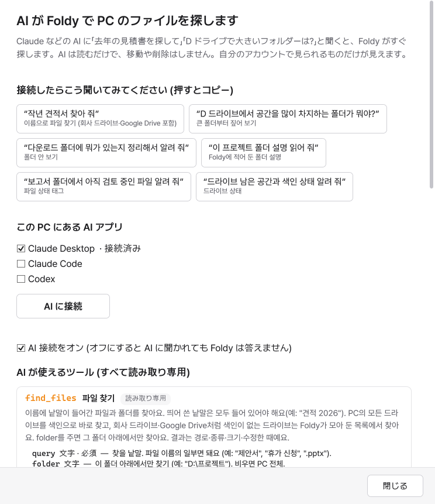

Claude のような AI アプリに、Foldy を通して PC のファイルを探させることができます (MCP サーバー)。**その他 (⋯) → AI と接続 (MCP)…** または Ctrl+Space で「AI 接続」を開き、**[AI に接続]** を 1 回押せば終わりです。この PC に入っている AI アプリ (Claude Desktop、Claude Code、Codex、Gemini CLI、Cursor、VS Code、Antigravity) だけが表示され、押すとそのアプリの設定に Foldy を入れます (元の設定はバックアップ)。そのアプリを再起動して「D ドライブで提案書を探して」と言ってみてください。

**接続したあとにすること** (画面にアプリごとの手順が出ます)

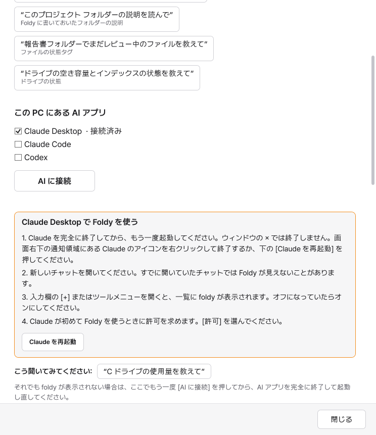

AI アプリは起動したときにだけ設定を読みます。そのため、接続しただけでは Foldy は表示されません。

1. **AI アプリを完全に終了してから起動し直します。** Claude Desktop はウィンドウの × では終了しません。画面右下の通知領域にある Claude のアイコンを右クリックして終了するか、画面の **[Claude を再起動]** を押してください (Claude で実行中の作業は止まります)。
2. **新しいチャットを開きます。** すでに開いていたチャットでは Foldy が見えないことがあります。
3. 入力欄の [+] またはツールメニューで **foldy** がオンになっているか確認します。初めて使うときに許可を求められたら **[許可]** を選びます。
4. 「C ドライブの使用量を教えて」と聞いてみてください。

アプリによって少し違います。Claude Code・Gemini CLI・Codex のコマンドラインは起動し直してから `/mcp` で foldy があるか確認し、Cursor・VS Code は再起動して Agent モードで使います。Antigravity は新しい会話を開けば大丈夫です。それでも表示されない場合は、[AI に接続] をもう一度押してから、アプリを完全に終了して起動し直してください。

**接続したらこう聞いてみてください** (AI 接続の画面で押すとコピーされます):

- 「去年の見積書を探して」: 名前でファイルを探す (会社のドライブ・Google ドライブを含む)
- 「D ドライブで容量をたくさん使っているフォルダーは?」: 大きいフォルダーから見ていく
- 「ダウンロード フォルダーに何があるかまとめて教えて」: フォルダーの中を見る
- 「このプロジェクト フォルダーの説明を読んで」: Foldy に書いておいたフォルダーの説明
- 「報告書フォルダーでまだレビュー中のファイルを教えて」: ファイルの状態タグ
- 「ドライブの空き容量と検索の準備状況を教えて」: ドライブの状態

AI アプリがこの PC にあるのにまだ接続していなければ、Foldy を起動したときに画面の上に 1 行でお知らせします。例: Claude Desktop に「去年の見積書を探して」と言うと、Foldy が PC から探します [接続する] [あとで] [今後は聞かない] (例は起動するたびに変わります)。そのままにすると自動で消え、もう一度見るには 設定 → 全般 → AI 接続 でオンにします。

- AI が使えるもの: ファイルを探す (会社のドライブ・Google ドライブを含む)、フォルダーの中を見る、フォルダーのサイズ、フォルダーの説明、ファイルの状態タグ、ドライブと検索の準備状況。**すべて読み取り専用** です。移動や削除はありません。
- 自分のアカウントで見られるものだけが見えます。インターネットには開かず、PC の中で AI アプリとだけやり取りします (AI アプリが受け取った結果をどう使うかは、そのアプリのポリシーに従います)。
- 既定ではオフです。画面の「AI 接続をオン」でいつでもオフにできます。ツールの一覧 (名前・説明・入力) もその画面で見られます。
- ほかの AI アプリは、画面下の「手動で追加」の設定をコピーして入れれば大丈夫です (`Foldy.exe --mcp`)。ChatGPT はインターネット経由でしかつなげないため、安全のため対応していません。

## 設定とテーマ

**文字が小さければ画面を大きくしてください。** 既定では Windows の設定に従います: Windows の設定 → アクセシビリティ → **テキストのサイズ** を大きくすると Foldy もその分大きくなります (ディスプレイの拡大率にもそのまま従います)。Foldy だけを大きくするには **Ctrl+=** で拡大、**Ctrl+-** で縮小、**Ctrl+0** で Windows に合わせる設定に戻ります。その他メニューの「画面サイズ」から選ぶこともできます。文字とボタンが一緒に大きくなり、会話画面・メモ画面も同じ大きさで開きます。

**Ctrl+,** または左のメニューの **設定** で設定画面を開きます。全般、外観、一覧、ターミナル、コピー、更新、ショートカットのページがあります。

- **言語**: Windows に合わせる、または 設定 → 外観 → 言語 で 한국어・English・Español・日本語・简体中文 を選べます。
- **アクセント カラー**: Foldy オレンジ、または Windows のアクセント カラーに合わせる
- **ショートカット**: 欄を押して新しい組み合わせを押すと変わります (Esc で取り消し、Backspace で消去)。重なるショートカットは警告でお知らせします。`%LOCALAPPDATA%\Foldy\keymap.json` に変えたものだけを保存します。

よく使うものは左のメニューの **その他** メニューからもすぐ変えられます。

- **テーマ**: システム設定に従う (ライト/ダーク自動) · ライト · ダーク · レトロ
- **一覧の間隔**: 詰める · 標準 · ゆったり
- **隠しファイルを表示** (**Ctrl+H**)
- **設定ファイルを開く**: `%LOCALAPPDATA%\Foldy\settings.json`

## 更新

Foldy は起動の 5 秒後と 6 時間ごとに GitHub Releases で新しいバージョンを確認します。新しいバージョンは署名 (Ed25519) とハッシュを確かめてからだけインストールし、ステータス バーの右に **「Foldy x.y.z · 再起動して更新」** が出ます。[再起動して更新] を押すと Foldy が閉じ、小さな画面が「インストール中 → また開いています」を見せます。インストールの間は 2 人の子どもがコートでドリブルしてパスを回し、終わるとパスを受けた 1 人がレイアップで 2 点を決めて、2 人でハイタッチします (アニメーションをオフにすると文字だけ)。新しい Foldy が開くと自動で閉じます。ほかの Foldy の画面が開いていれば閉じるようお願いし、失敗したら理由をお知らせします。会社のプロキシ (PAC・認証のないプロキシ) があっても、Windows のユーザーのプロキシ設定をそのまま使います。高速検索ヘルパー (SYSTEM 権限) が確認できなければ、Foldy がユーザー権限で直接確認し、このときはインストール時に管理者の確認が 1 回必要です。コピー・移動などの作業中に「再起動して更新」を押すと、作業を止めずに予約しておき、すべて終わったら自動でインストールしてまた起動します (予約中にもう一度押すと取り消し)。左のメニュー下の **… (その他) → 更新の確認…** を押すとすぐ確認し、新しいバージョンがあればインストールするか聞きます。確認に失敗したら理由を表示します。

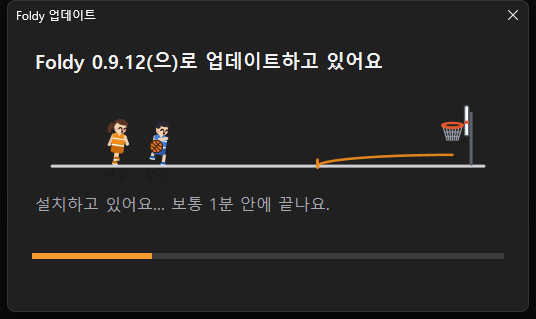

## バグの報告

左のメニュー下の **バグを報告** ボタン (または その他 → バグを報告…、Foldy について の画面) を押すと、アプリ・Windows のバージョンと最近の記録を入れた GitHub Issue の作成ページが開きます。

Foldy はエラーを自動で集めておきます。異常終了だけでなく、ふだん起きて過ぎたエラーも集め、同じエラーは一度だけ記録します。最初は送るかどうか聞きます。

- **常に自動で送る**: 次からは聞かずに、起動時と 30 分ごとに静かに送ります。
- **今回だけ送る** / **送信しない**

レポートにはアプリ・Windows のバージョン、エラーの内容、最近のログだけが入り、ファイル パスとユーザー名は消します。同じエラーは 1 つの GitHub Issue にまとめられ、何回起きたかだけが増えます。設定 → 全般 でいつでもオフにできます。

### バグ診断モード

特定の状況でだけ起きる問題 (例: ネットワーク ドライブが空の画面に見える) は、左のメニューのいちばん下の **⋯ (その他) → バグ診断モードの切り替え** (またはコマンド一覧) で詳しい記録を残せます。

1. バグ診断モードをオンにすると、ステータス バーの右に **診断中** と出ます。
2. 問題をもう一度起こします。
3. **診断中** を押すかメニューからオフにすると、記録をエラー レポートとして送るか聞きます (パス・ユーザー名は消します)。

24 時間たつと自動でオフになります。ドライブを開けないときは、バグ診断モードでなくても原因の情報 (ドライブの種類、接続先、権限) を記録し、同意していれば自動で報告します。記録ファイルは **⋯ (その他) → ログ フォルダーを開く** (`%LOCALAPPDATA%\Foldy\logs`) で見られます。

## よくある質問

**検索がいまのフォルダーしか探しません。**
高速検索ヘルパーがインストールされていないか、準備中です。左のメニューの **その他** → **高速検索ヘルパーをインストール (Windows が許可を求めます) (理者)…** を押してください。最初の準備はドライブの大きさによって数十秒かかります。

**ネットワーク ドライブが切れていると遅くなりますか?**
いいえ。ドライブごとに別々に動くので、応答しないドライブがあってもほかのタブや画面はそのまま動きます。そのタブで **Esc** を押すと読み込みを取り消せます。

**会社のセキュリティ ドライブが空の画面です。**
エクスプローラーと同じく「隠し」属性だけを隠します (0.3.5 から)。ルート フォルダーが「システム」属性でも表示されます。それでも空なら、**バグ診断モード** をオンにしてもう一度開いてから記録を送ってください。こうした遅いドライブは [遅いドライブ](#遅いドライブ) のように自動で軽く開きます。

**Foldy をもう一度起動するとウィンドウが 2 つ開きますか?**
いいえ。すでに起動していればそのウィンドウが前に出て、フォルダーを渡した場合は新しいタブで開きます。

**更新できません (会社のネットワーク)。**
左のメニュー下の **… (その他) → 更新の確認** を押してみてください。サービスが外に出られなくても、Foldy がユーザーのプロキシでもう一度確認します。それでも失敗したら理由が表示されるので、[バグの報告](#バグの報告) に貼り付けてください。

**設定と記録はどこにありますか?**
`%LOCALAPPDATA%\Foldy` (settings.json、session.json、logs)。検索リストのデータは `%ProgramData%\Foldy`。

**ソース コードとライセンスは?**
GPL-3.0-or-later の自由ソフトウェアです。https://github.com/chadolkr/Foldy
