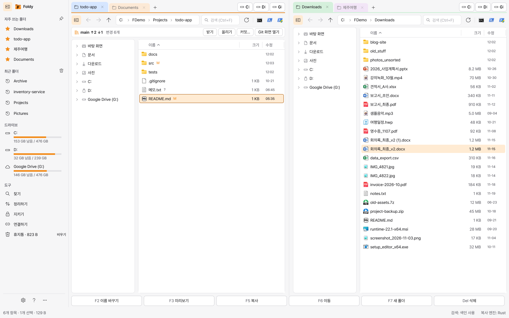
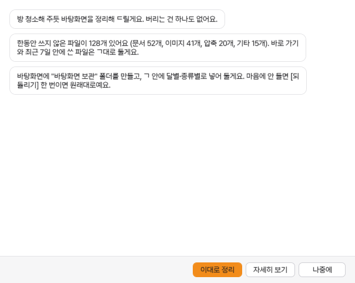
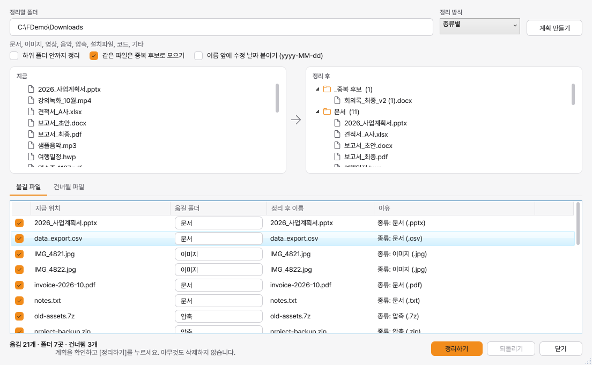
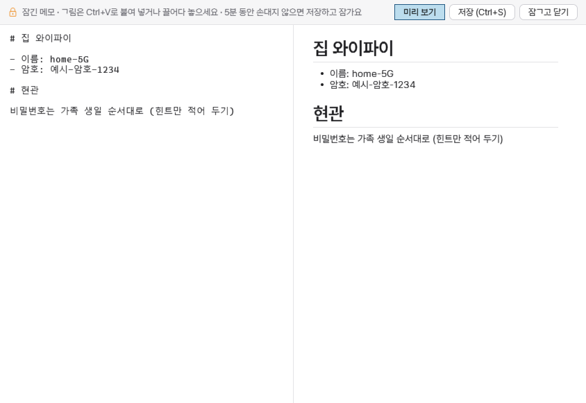
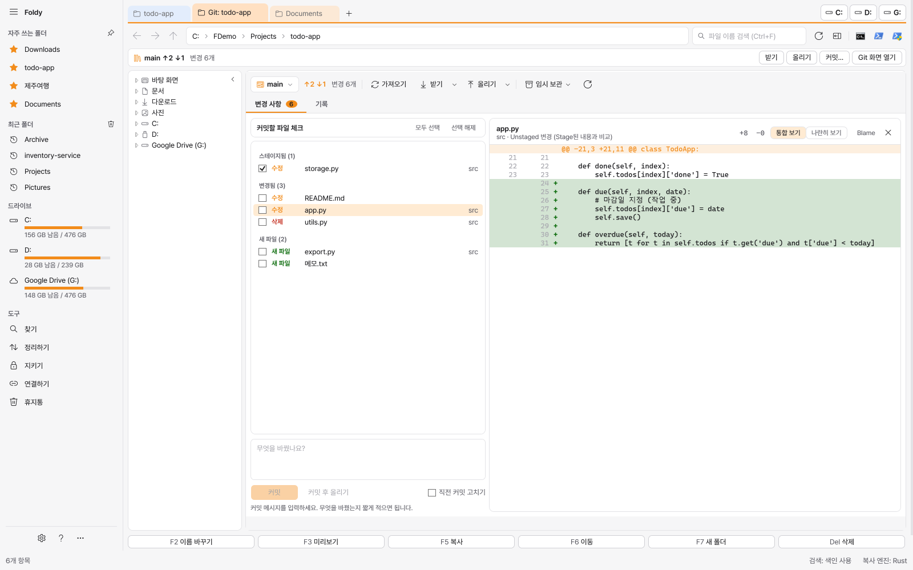

# Foldy 사용 설명서

Foldy는 빠르고 멈추지 않는 Windows 듀얼 패널 파일 관리자입니다. 이 설명서는 언제든 **F1** 또는 아래쪽 **? 도움말** 버튼으로 열 수 있습니다.

| | |
| --- | --- |
| 버전 | {{version}} |
| 개발자 | David CHA |
| 저장소 | https://github.com/chadolkr/Foldy |
| 라이선스 | GPL-3.0-or-later (자유 소프트웨어) |

- [화면 둘러보기](#화면-둘러보기)
- [공통 사이드바](#공통-사이드바)
- [탭](#탭)
- [아이들이 농구해요](#아이들이-농구해요)
- [파일 작업](#파일-작업)
- [미리보기](#미리보기)
- [Markdown 보기](#markdown-보기)
- [느린 드라이브](#느린-드라이브)
- [단축키](#단축키)
- **[🔍 찾기](#-찾기)**
  - [검색](#검색)
  - [폴더 분석](#폴더-분석)
  - [이미지만 보기](#이미지만-보기)
- **[🧹 정리하기](#-정리하기)**
  - [정리 도구](#정리-도구)
  - [인터넷에서 본 그 정리법, 클릭 한 번으로](#인터넷에서-본-그-정리법-클릭-한-번으로)
  - [폴더 템플릿·위저드·정리](#폴더-템플릿위저드정리)
- **[🔒 지키기](#-지키기)**
  - [휴지통](#휴지통)
- **[🔗 연결하기](#-연결하기)**
  - [SFTP와 SSH](#sftp와-ssh)
  - [Git](#git)
  - [터미널](#터미널)
- [설정과 테마](#설정과-테마)
- [업데이트](#업데이트)
- [버그 신고](#버그-신고)
- [자주 묻는 질문](#자주-묻는-질문)

## 화면 둘러보기

맨 왼쪽은 **공통 사이드바**(자주 쓰는 폴더, 드라이브, 도구, 설정)이고, 그 오른쪽이 **왼쪽·오른쪽 두 패널**입니다. 지금 조작하는 패널(활성 패널)은 탭 아래에 강조색 선이 보입니다. **Tab** 키로 반대 패널로 옮겨 갑니다.

패널 하나는 위에서부터 이렇게 생겼습니다.

1. **탭 줄**: 폴더마다 색이 다른 탭(OneNote처럼). 오른쪽 끝은 드라이브 바로가기(C: D: …). 마우스를 올리면 이름과 남은 공간이 보입니다.
2. **경로바**: 경로 조각을 누르면 그 폴더로, 빈 곳을 누르거나 **Ctrl+L**을 누르면 직접 입력합니다. Git 저장소 안이면 브랜치 칩(`main ↑2 ↓1`)이 보입니다.
3. **검색칸**: 파일 이름 검색 (**Ctrl+F**).
4. **도구 버튼**: 새로 고침, 폴더 트리(**Ctrl+B**), 이미지만 보기, 터미널.
5. **트리 | 목록**: 두 패널 모두 왼쪽은 폴더 트리, 오른쪽은 트리에서 고른 폴더의 파일 목록입니다. 트리와 목록 사이 경계선을 끌면 트리 너비가 바뀌고, **Ctrl+B**로 트리를 숨기거나 다시 보입니다(너비는 다음에 켤 때도 기억합니다). 열 머리글을 누르면 정렬됩니다.

아래쪽에는 **작업 패널**(복사·이동 진행), **파일 작업 버튼 줄**(F2·F3·F5·F6·F7·Del), **상태바**가 있습니다. 상태바 가운데에는 방금 일어난 일("3개 복사함" 같은 메시지)이 크게 보이고, 새 메시지는 잠깐 강조색으로 빛납니다. 왼쪽은 항목 수·선택 용량, 오른쪽은 검색 방식·복사 엔진·업데이트 알림입니다.

Foldy는 한 번에 하나만 뜹니다. 이미 켜져 있을 때 다시 실행하면(바로 가기, 폴더를 Foldy로 열기 등) 새 창 대신 **켜져 있는 창이 앞으로 오고**, 폴더를 넘겼다면 새 탭으로 열립니다.

## 공통 사이드바

맨 왼쪽 띠에는 어느 패널에서나 쓰는 기능을 모았습니다. 맨 위 **≡** 버튼(또는 **Ctrl+Shift+B**)으로 접으면 아이콘만 남고, 다시 누르면 펼쳐집니다.

- **자주 쓰는 폴더**: 제목 옆 **핀** 버튼을 누르면 지금 폴더가 고정됩니다. 누르면 활성 패널에서 열리고, 마우스 오른쪽 버튼으로 새 탭·반대 패널에서 열기, 순서 바꾸기, 고정 해제를 할 수 있습니다.
- **최근 폴더**: 최근에 연 폴더 5개가 자동으로 쌓입니다(고정한 폴더는 빠짐). 제목 옆 휴지통 버튼으로 지웁니다.
- **드라이브**: 드라이브마다 이름, 사용량 막대, 남은 공간이 보입니다. 90% 넘게 차면 막대가 빨갛게 바뀝니다. 오른쪽 클릭으로 폴더 분석을 바로 시작합니다.
- **도구**: 기능이 많아서 네 묶음으로 모았어요. 누르면 그 묶음의 메뉴가 열려요.
  - 🔍 **찾기**: 파일 검색, 폴더 분석, 이미지만 보기
  - 🧹 **정리하기**: 이 폴더 정리, 템플릿으로 새 폴더, 폴더 위저드, 관리 방식 정하기, 바탕화면·다운로드·로그 정리
  - 🔒 **지키기**: 잠긴 메모, 암호 걸기, 금고, 휴지통
  - 🔗 **연결하기**: SFTP, Git 화면, 터미널
- **휴지통**: 쌓인 용량이 보이고 **비우기**로 바로 비울 수 있습니다.
- **맨 아래**: 모든 명령(**Ctrl+Shift+P**), 업데이트, 버그 신고, 설정(**Ctrl+,**), 도움말(**F1**), 더 보기(테마, 숨김 파일, 목록 간격, 색인 서비스, Foldy 정보).

## 탭

| 하고 싶은 것 | 방법 |
| --- | --- |
| 새 탭 | **Ctrl+T** 또는 탭 줄의 **+** |
| 탭 닫기 | **Ctrl+W**, 가운데 버튼 클릭, 탭의 ✕ |
| 다음/이전 탭 | **Ctrl+Tab** / **Ctrl+Shift+Tab** |
| 순서 바꾸기 | 탭을 끌어서 다른 탭 위에 놓기 |
| 반대 패널로 옮기기 | 탭을 반대 패널의 탭 위로 끌기 |
| 같은 폴더를 새 탭으로 | 탭을 두 번 클릭 |

탭과 경로, 정렬, 창 위치는 자동으로 저장되어 다음 실행 때 그대로 복원됩니다. 갑자기 꺼져도 마지막 상태(2초 전까지)로 돌아옵니다.

## 아이들이 농구해요

1.5초 넘게 걸리는 작업에는 작업 패널에 농구하는 두 아이가 나타납니다.

- 복사·이동: 한 아이가 패스하고, 진행되는 만큼 다른 아이가 드리블해 나아가다가 끝나면 **3점슛 성공** 후 하이파이브!
- 삭제: 공을 휴지통에 던져요. 영구 삭제는 공이 코트 밖으로 날아가요.
- 검색·네트워크 대기: 둘이 두리번거리며 공을 찾아요.
- 색인·분석: 한 아이는 드리블 연습을 하고 다른 아이는 기록해요.
- 일시정지·이름 충돌: 아이가 공을 안고 기다려요. 실패하면 슛이 림을 맞고 튕겨 나가요.

설정 → 일반의 "애니메이션 사용"으로 끌 수 있고, 창이 최소화되거나 가려지면 멈춰서 CPU를 쓰지 않습니다.

## 파일 작업

| 작업 | 키 | 설명 |
| --- | --- | --- |
| 이름 바꾸기 | **F2** | 확장자를 뺀 이름이 선택된 채로 입력칸이 열립니다. Enter로 확정, Esc로 취소 |
| 복사 | **F5** | 선택한 항목을 반대 패널의 폴더로 |
| 이동 | **F6** | 반대 패널의 폴더로 |
| 새 폴더 | **F7** | 만들자마자 이름을 입력할 수 있습니다 |
| 휴지통으로 | **Delete** | |
| 영구 삭제 | **Shift+Delete** | 확인 창이 뜹니다 |
| 복사·잘라내기·붙여넣기 | **Ctrl+C / X / V** | 탐색기와 주고받을 수 있습니다 |
| 위로 | **Backspace**, **Alt+↑** | 방금 있던 폴더에 포커스가 갑니다 |
| 뒤로/앞으로 | **Alt+← / →**, 마우스 뒤로·앞으로 버튼 | |

- **우클릭** 하면 탐색기와 똑같은 메뉴(연결 프로그램, 보내기, 압축 등)가 뜹니다. **Shift+우클릭**은 확장 메뉴입니다.
- **끌어 놓기**: 탐색기에서 끌어오거나 탐색기로 끌어 보낼 수 있습니다. 같은 드라이브면 이동, 다른 드라이브면 복사가 기본이고, **Shift**는 이동, **Ctrl**은 복사입니다.
- 복사와 이동은 **병렬 복사 엔진**이 맡습니다. 같은 이름이 있으면 "둘 다 유지 / 덮어쓰기 / 건너뛰기"를 묻습니다(남은 것에도 똑같이 적용 가능). 진행 상황은 아래 작업 패널과 작업 표시줄에 보이고, 복사 중에도 다른 폴더를 마음대로 볼 수 있습니다.
- 글자를 입력하면 그 이름으로 시작하는 파일로 바로 이동합니다(Type-ahead). 같은 글자를 계속 누르면 다음 항목으로 넘어갑니다.

## 미리보기

**F3**(또는 아래쪽 **F3 미리보기**)을 누르면 파일 목록 위쪽에 미리보기 창이 열리고, 목록에서 고른 파일의 내용을 바로 보여 줍니다. Markdown, 이미지, 텍스트·코드(문법 강조), PDF·Office처럼 Windows 미리보기 처리기가 있는 형식을 지원합니다. 경계선을 끌어 미리보기 창의 높이를 바꿀 수 있습니다.

- 클라우드 전용 파일은 내려받지 않도록 내용을 읽지 않습니다.
- 네트워크 드라이브와 SFTP는 느려지지 않게 자동으로 읽지 않고, **[미리보기]** 를 눌렀을 때만 읽습니다.
- Google Drive for desktop의 드라이브(보통 G:)도 같습니다. 사이드바에 구름 아이콘과 "Google Drive"로 보이고, 썸네일·아이콘·미리보기가 온라인 전용 파일을 저절로 내려받지 않습니다. 파일을 열거나 복사하면 그때 내려받습니다.

## Markdown 보기

`.md` 파일을 열 때 연결된 앱이 없으면 Foldy 안에서 바로 보여 줍니다. 표, 체크박스, 코드(문법 강조·복사 버튼), 상대 경로 그림, 목차, **Ctrl+F** 문서 내 찾기를 지원합니다. 문서 안의 다른 `.md` 링크는 같은 탭에서 열리고(뒤로/앞으로), 폴더 링크는 폴더 탭으로 열립니다. 인터넷 그림은 [이미지 불러오기]를 눌러야만 받습니다.

## 느린 드라이브

회사 보안 드라이브처럼 폴더를 여는 데 오래 걸리는 드라이브는 Foldy가 열어 본 시간으로 **자동으로** 알아챕니다. 설정은 없습니다.

- 경로 표시줄 옆에 **느린 드라이브** 표시가 뜨고, 처음 알아챈 때 한 번 상태 줄에 알려 줍니다.
- 목록은 먼저 보여 주고, 폴더 크기 같은 것은 나중에 채웁니다. 다른 폴더로 가면 하던 일은 취소됩니다.
- Git 감지, 이미지 썸네일, 파일별 아이콘은 건너뛰고, 미리보기(F3)는 **[미리보기]**를 눌러야 열립니다.
- 폴더 변경은 감시 대신 주기적으로 확인합니다. 복사는 그대로 자동으로 맞춰집니다.

## 단축키

| 키 | 동작 |
| --- | --- |
| **F1** | 이 도움말 |
| **Ctrl+Shift+P** | 모든 명령 보기 (이름으로 찾아 실행) |
| **Tab** | 다른 패널로 |
| **Ctrl+L** | 경로 직접 입력 |
| **Ctrl+F** | 파일 이름 검색 |
| **Ctrl+R** | 새로 고침 |
| **Ctrl+H** | 숨김 파일 보이기/숨기기 |
| **F3** | 미리보기 창 보이기/숨기기 |
| **Ctrl+,** | 설정 |
| **Ctrl+B** | 폴더 트리 보이기/숨기기 |
| **Ctrl+Shift+B** | 공통 사이드바 접기/펼치기 |
| **Ctrl+Shift+I** | 이미지만 보기 |
| **Ctrl+Shift+N** | 템플릿으로 새 폴더 |
| **Ctrl+Shift+O** | SFTP 서버에 연결 |
| **Ctrl+`** | 터미널 (SFTP 탭에서는 SSH) |
| **Ctrl+Shift+`** | 관리자 터미널 |

## 🔍 찾기

파일을 찾고, 무엇이 공간을 차지하는지 보는 기능이에요. 사이드바 **찾기**를 누르면 모여 있어요.

### 검색

**Ctrl+F**로 검색칸에 이름 일부를 입력하고 Enter를 누르면 검색 결과 탭이 열립니다.

- **색인 서비스**가 설치돼 있으면 전체 드라이브를 즉시 검색합니다(수백만 개 파일도 수 ms). 상태바에 "검색: 색인 사용"으로 표시됩니다.
- 서비스가 없으면 현재 폴더 아래를 직접 훑습니다(최대 2만 개).
- 결과에서 폴더를 열면 새 폴더 탭이 열리고, 파일은 바로 열립니다. Esc는 검색 취소입니다.

### 폴더 분석

사이드바의 **폴더 분석** (또는 명령 목록의 "폴더 분석")을 누르면 지금 폴더가 있는 드라이브를 분석하는 탭이 열립니다.

- **트리맵**: 큰 폴더일수록 큰 칸. 칸을 누르면 안으로 들어가고, Backspace·오른쪽 클릭·마우스 뒤로 버튼은 한 단계 위로.
- **목록**: 큰 폴더·큰 파일 순위, 지난 분석보다 많이 늘어난 폴더.
- **정리 후보**: node_modules, 빌드 결과, 임시 파일, 캐시처럼 지워도 다시 만들 수 있는 것. 시스템 폴더는 절대 후보에 넣지 않습니다.
- **[휴지통으로]**: 확인을 거친 뒤 휴지통으로만 옮깁니다(영구 삭제는 하지 않음).
- **F5** 다시 분석, **Esc** 분석 취소. 목록을 두 번 누르면 그 위치를 폴더 탭으로 엽니다.

**정리 제안 대상 (전부)** — 조건: 하위에서 가장 최근 수정이 그 기간보다 오래되고, 크기가 그 이상일 때만 제안합니다.

| 대상 | 위치·이름 | 조건 |
| --- | --- | --- |
| Node.js 패키지 | `node_modules` (옆에 `package.json`) | 30일, 10MB |
| .NET 빌드 출력 | `bin`, `obj` (옆에 `*.csproj` 등) | 14일, 10MB |
| Rust 빌드 출력 | `target` (옆에 `Cargo.toml`) | 14일, 50MB |
| Gradle 빌드 출력 | `build`, `.gradle` (옆에 `build.gradle` 등) | 14일, 10MB |
| 프런트엔드 빌드 캐시 | `.next`, `.nuxt`, `.parcel-cache`, `.turbo`, `.angular`, `.svelte-kit` (옆에 `package.json`) | 14일, 10MB |
| Python 캐시 | `__pycache__`, `.pytest_cache`, `.mypy_cache`, `.ruff_cache`, `.tox` | 30일, 1MB |
| Visual Studio 캐시 | `.vs` | 30일, 100MB |
| 사용자 임시 폴더 | `%LOCALAPPDATA%\Temp` | 7일, 50MB |
| 이름이 temp/tmp인 폴더 | `temp`, `tmp` | 30일, 100MB |
| 브라우저 캐시 | Chrome·Edge 프로필의 `Cache`, `Code Cache` | 100MB |
| 패키지 관리자 캐시 | `npm-cache`, `pip\cache`, `Yarn\Cache`, `%USERPROFILE%\.gradle\caches` | 30일, 500MB |
| NuGet 패키지 캐시 | `%USERPROFILE%\.nuget\packages` | 60일, 1GB |
| 충돌 덤프 파일 | `*.dmp`, `*.hdmp`, `*.mdmp` | 14일, 10MB |
| 충돌 덤프 폴더 | `%LOCALAPPDATA%\CrashDumps` (Windows 오류 보고의 기본 덤프 폴더) | 14일, 10MB |
| 오래된 설치 파일 | 다운로드 폴더의 `*.exe`, `*.msi`, `*.msix`, `*.iso` | 90일, 50MB |

`.git`은 표시만 하고 제안하지 않습니다. Windows, Program Files, ProgramData 같은 시스템 폴더는 규칙과 상관없이 제안하지 않습니다.

**일부러 넣지 않은 것**
- Windows 업데이트 파일, 전송 최적화 파일, 미리 보기(썸네일) 캐시, 이전 Windows(Windows.old): 시스템이 쓰는 파일이라 Windows가 직접 지우는 게 안전합니다. 정리 제안 위의 **[Windows 정리 권장 사항 열기]**를 누르면 Windows 설정의 정리 화면이 열립니다(Windows 10은 디스크 정리).
- V3·알약 같은 백신의 업데이트 백업·검역소(격리) 파일: 지워도 된다는 제조사 공식 안내를 찾지 못했고, 검역소는 잘못 치료한 파일을 되살리는 곳이라 넣지 않았습니다. 백신 프로그램 안의 메뉴로 정리하세요.

색인 서비스가 있으면 디스크를 다시 읽지 않고 몇 초 만에 분석합니다. 없으면 낮은 우선순위로 직접 훑습니다.

### 이미지만 보기

**Ctrl+Shift+I** 또는 도구 버튼(그림 아이콘)을 누르면 현재 폴더의 이미지만 썸네일 격자로 보여 줍니다. 다른 파일은 숨길 뿐 움직이지 않습니다.

- **스페이스**: 크게 보기 (← →로 이전/다음, 휠로 확대, R 회전, Esc 닫기)
- **Ctrl+휠**: 썸네일 크기
- 네트워크 드라이브, Google Drive 드라이브(G:), 클라우드 전용 파일은 내용을 읽지 않습니다(내려받기가 시작되지 않게).

## 🧹 정리하기

방 청소하듯 폴더를 정리하는 기능이에요. 사이드바 **정리하기**에 모여 있어요. 저절로 버리지 않고, 먼저 보여 드리고, 되돌릴 수 있어요.

### 정리 도구

방 청소해 주듯 컴퓨터를 정리해 드려요. 사이드바의 **정리하기**를 누르면 바탕화면·다운로드·로그 정리를 고를 수 있어요(명령 목록에서도 찾을 수 있어요). 어느 도구든 Foldy가 대화하듯 한 단계씩 물어봐요. 무엇을 찾았는지, 왜 정리하면 좋은지, 누르면 어떻게 되는지 먼저 설명하고 **[이대로 정리] [자세히 보기] [나중에]** 중에서 고르게 해요. 충분히 보고 정하세요.

세 가지 약속은 꼭 지켜요.

- **저절로 버리지 않아요.** 먼저 무엇을 어디로 옮길지 보여 드리고, 누르기 전에는 아무것도 하지 않아요.
- **어디 뒀는지 알려 드려요.** 옮긴 곳을 바로 열어 볼 수 있어요.
- **되돌릴 수 있어요.** 지우는 건 늘 휴지통으로만 가고, 바탕화면 정리는 [되돌리기] 한 번이면 원래대로예요.

#### 바탕화면 정리

바탕화면에 파일이 수북이 쌓였나요? 버리지 않고 바탕화면의 **"바탕화면 보관"** 폴더에 종류별로 넣어 두고, 어디 뒀는지 알려 드려요. 마음에 안 들면 **[되돌리기]** 한 번이면 원래대로!

- **옮기는 것**: 바탕화면에 바로 있는 파일 중 최근 7일 동안 쓰지 않은 파일
- **그대로 두는 것**: 바로 가기(`.lnk`, `.url`), 최근 7일 안에 쓴 파일, 폴더, 숨김·시스템 파일
- **옮기는 곳**: `바탕화면\바탕화면 보관\연-월\종류` (종류: 문서, 이미지, 영상, 음악, 압축, 설치파일, 코드, 기타)
- 다른 프로그램이 쓰고 있는 파일은 건너뛰어요.

#### 다운로드 정리

다운로드 폴더는 계속 쌓이죠. 정리할 만한 파일을 찾아서 **휴지통에 버리거나 보관하세요**라고 골라 드려요.

| 찾는 것 | 기준 |
| --- | --- |
| 이미 설치한 프로그램의 설치 파일 | `.exe`의 제품 이름이 설치된 프로그램 목록과 확실히 맞을 때만 (애매하면 넣지 않아요) |
| 중복 파일 | 크기와 내용(SHA-256)이 똑같은 파일. 이름이 가장 짧은 하나는 남겨요 (예: `보고서 (1).pdf`만 골라요) |
| 이미 푼 압축 파일 | 옆에 같은 이름의 폴더가 있는 `.zip` |
| 오래된 파일 | 90일 넘게 열거나 바꾸지 않은 파일 (이건 직접 골라야 해요) |

- 다운로드 폴더 바로 아래의 파일만 봐요. 하위 폴더는 이미 정리해 둔 것으로 보고 건드리지 않아요. 받는 중인 파일(`.crdownload`, `.part`)도 빼요.
- **[휴지통으로]**: 휴지통으로 옮겨요. 휴지통에서 되살릴 수 있어요.
- **[보관하기]**: `다운로드\보관\연-월` 폴더로 옮겨요.

#### 로그 정리

프로그램이 남기는 `*.log` 파일은 모르는 사이에 몇 GB씩 쌓이곤 해요. 오래된 로그를 같은 폴더의 **월별 zip**으로 꼭꼭 눌러 담아 드려요. 텍스트 로그는 보통 85% 넘게 줄어요.

- **대상**: 7일 넘게 바뀌지 않은 `*.log` 파일 (지금 드라이브 전체, 색인 서비스가 있으면 순식간에 찾아요)
- **건드리지 않는 것**: 프로그램이 쓰고 있는 로그, `Windows` 폴더, 휴지통, System Volume Information
- **만드는 것**: 로그가 있던 폴더에 `logs-연-월.zip`
- zip을 다시 열어 내용이 원본과 똑같은지(SHA-256) 확인한 뒤에만 원본을 휴지통으로 옮겨요. 확인이 안 되면 원본은 그대로 둬요.
- 폴더 분석 화면 위쪽의 **[로그 정리]**, **[다운로드 정리]** 버튼으로도 열 수 있어요.

#### 폴더마다 정리 방법 정해 두기

"이 폴더는 PARA로 관리할래" 하고 정해 두면, Foldy가 그 방법대로 가끔 살펴보고 정리할 게 생기면 말을 걸어요. 폴더마다 다른 방법을 정할 수 있어요.

- **정하는 법**: 폴더를 오른쪽 클릭 → **이 폴더 관리 방식 정하기…**. Foldy가 방법마다 무엇을 하는지 설명하고, 고르면 필요한 폴더도 만들어 줄지 물어봐요.
- **고를 수 있는 방법**: PARA, Johnny.Decimal, 번호·날짜 붙이기, 날짜별
- **표시**: 정한 폴더(맨 위 폴더 하나)의 아이콘에 작은 점이 붙고, 왼쪽 트리에는 깃발이 보여요. 그 안에 들어가면 위쪽에 "PARA 방법으로 관리 중 · 정리할 것 3가지" 한 줄이 떠요. 파일 탐색기에서도 그 폴더에 Foldy 아이콘이 보여요.
- **기억하는 곳**: 폴더 안의 숨김 파일 `.foldy.md` 하나예요. 사람이 읽을 수 있는 메모라서 폴더를 옮겨도 따라가고, 지우면 관리가 꺼질 뿐 파일은 그대로예요. 하위 폴더는 가장 가까운 `.foldy.md`를 따라요.

**이런 걸 알려 드려요**

| 방법 | 알려 드리는 것 | 하는 일 (확인을 누르면) |
| --- | --- | --- |
| 모든 방법 | 맨 위에 아직 나누지 않은 파일 | `00_받은 파일`에 일단 모아요 (날짜별이면 연도\연-월 폴더로) |
| PARA | 1_Projects 안에서 90일째 손대지 않은 프로젝트 | 4_Archives로 옮겨요 |
| 번호·날짜 붙이기 | 01_진행중 안에서 90일째 손대지 않은 폴더 | 03_완료로 옮겨요 |
| Johnny.Decimal | 번호 없는 폴더 | 알려만 드려요 (이름은 직접 붙여 주세요) |

**걱정하지 않으셔도 돼요**

- 저절로 옮기지 않아요. 무엇을 어디로 옮길지 보여 드리고, **[이대로 정리]**를 누를 때만 옮겨요. 끝나면 **[되돌리기]** 한 번으로 원래대로예요.
- 실행 파일, 설정 파일, 바로 가기(`.exe`, `.dll`, `.ini`, `.json`, `.lnk` 등)는 옮기지 않아요. 다른 프로그램이나 바로 가기가 깨질 수 있어서요.
- **Git 저장소·개발 프로젝트 폴더**에는 방법을 정할 수 없어요. 저장소들을 담은 위 폴더는 관리할 수 있고, 그 안의 저장소는 폴더째로만 옮기자고 해요(안은 건드리지 않아요).
- 열려 있는 파일은 건너뛰고 "열려 있어서 건너뛰었어요"라고 알려 드려요.
- OneDrive·Google Drive 같은 **동기화 폴더**에서는 "동기화 폴더예요"라고 먼저 알려 드려요. 옮기면 다른 PC에도 반영되거든요. 이런 폴더와 네트워크·느린 드라이브에는 탐색기 아이콘(desktop.ini)을 만들지 않아요.
- 정리할 게 많이 쌓이면 다른 정리 도구처럼 일주일에 한 번까지 한 줄로 알려 드려요(설정 → 정리 알림).

#### 쌓이면 살짝 알려 드려요

모르고 지나치기 쉬워서, Foldy가 가끔 가볍게 살펴보고 정리할 게 많을 때만 창 아래에 한 줄로 알려 드려요. 일주일에 한 번까지만 알려 드리고, 저절로 정리하지는 않아요.

- 로그: 줄일 수 있는 양이 1GB를 넘거나 그 드라이브 남은 공간의 5%를 넘을 때 (색인 서비스가 있을 때만 확인)
- 다운로드: 정리할 만한 파일이 1GB를 넘을 때
- 바탕화면: 보관할 파일이 50개를 넘을 때
- 끄려면: 설정 → 일반 → **정리 알림**

### 인터넷에서 본 그 정리법, 클릭 한 번으로

"PARA가 좋다던데…" 하고 따라 해 보려다 폴더 만들기에서 멈춘 적 있죠? 템플릿을 고르면 폴더가 한 번에 생기고, 미리보기에서 **폴더마다 무엇을 넣는 곳인지** 이름 옆에 짧게 알려 드려요.

**PARA** (티아고 포르테) — "언제 끝나나?"로 네 칸에 나눠요.

| 폴더 | 넣는 것 |
| --- | --- |
| 1_Projects | 지금 하는 일 (끝나는 날이 있는 일) |
| 2_Areas | 계속 관리하는 영역 (건강, 돈, 집, 팀) |
| 3_Resources | 참고 자료 (언젠가 쓸 정보) |
| 4_Archives | 끝난 것 (지우지 말고 여기로) |

**Johnny.Decimal** — 모든 자리에 번호를 붙여서 "11.03" 하면 바로 찾아가요.

| 단계 | 예 | 뜻 |
| --- | --- | --- |
| 영역 | `10-19 생활` | 큰 묶음 10개까지 |
| 카테고리 | `11 집` | 영역 안의 칸 10개까지 |
| 항목 | `11.01 이사 견적` | 카테고리 안의 실제 폴더 |

**번호·날짜 붙이기** — 제일 쉬운 방법이에요. 폴더 앞 번호로 순서를 고정하고, 파일 이름은 날짜로 시작해요.

| 폴더 | 넣는 것 |
| --- | --- |
| 00_받은 파일 | 일단 여기에 (받은 파일·아직 안 나눈 것). 맨 위라서 늘 눈에 띄어요 |
| 01_진행중 | 지금 하고 있는 일 |
| 02_자료 | 자주 보는 참고 자료 |
| 03_완료 | 끝났지만 가끔 보는 것 |
| 99_보관 | 오래돼서 거의 안 보는 것 |

파일은 `2026-11-19_보고서.docx`처럼 **날짜_내용**으로 지으면 이름순이 곧 날짜순이에요.

> 💡 **받은 파일 칸 팁**: 어떤 방법을 쓰든 맨 위에 `00_받은 파일` 하나를 두세요. 새 파일은 고민 없이 일단 거기에 넣고, 일주일에 한 번 비우면서 나누면 쌓이지 않아요.

다른 템플릿(고객 프로젝트, 문서 작성 단계, 연구, 생활 서류, 사진 보관, 개발 프로젝트들)도 폴더마다 같은 방식으로 설명이 붙어 있어요.

### 폴더 템플릿·위저드·정리

사이드바의 도구나 명령 목록(**Ctrl+Shift+P**)에서 엽니다.

- **템플릿으로 새 폴더** (**Ctrl+Shift+N**): 아래 구조를 한 번에 만듭니다. 오른쪽에서 만들어질 트리를 미리 보고, 필요 없는 폴더는 체크를 풀 수 있습니다. 이미 있는 폴더는 건드리지 않고 없는 것만 만듭니다. 각 스타일의 **사용법**도 함께 볼 수 있습니다.
  - **개인·업무**: PARA, Johnny.Decimal, 번호·날짜 붙이기(00_받은 파일 칸 포함), 고객·프로젝트 업무, 문서 작성 단계(초안→검토→최종→배포), 연구·학습(문헌·데이터·분석·원고·발표), 생활·가정 서류(재무·건강·집·차량·여권·보험)
  - **개발**: 소프트웨어 프로젝트(일반), Java(Maven·Gradle), Python(src 레이아웃), Node·TypeScript, .NET 솔루션, Go(cmd·internal·pkg)
  - **미디어·창작**: 사진·영상 보관, 디자인·창작 자산(원본·작업·내보내기·참고)
  - **기록·보관**: 날짜별 보관함(연도/연-월)
- 미리보기에서 폴더 이름 옆에 **무엇을 넣는 곳인지** 짧게 보여 줍니다.
- **폴더 위저드**: 용도(개인·업무·개발 등)를 고르고 몇 가지 질문(개발이면 사용 언어 포함)에 답하면 알맞은 스타일을 추천하고, 같이 맞춰 만듭니다.
- **이 폴더 정리하기**: 다운로드·바탕 화면처럼 어지러운 일반 폴더를 종류별·날짜별·스타일대로 옮겨 줍니다. 실행 전에 "정리 후 모습"을 보여 주고, **아무것도 삭제하지 않으며**, [되돌리기] 한 번으로 원래대로 돌아갑니다. 같은 내용의 파일은 "_중복 후보"로 모읍니다. 옮길 파일이 없으면 이유(건너뛴 파일)를 바로 보여 줍니다.
  - **Git 저장소·개발 프로젝트 폴더**(.git, .sln, package.json 등이 있는 폴더)는 일부러 정리하지 않습니다. 파일을 옮기면 빌드나 Git 기록이 깨질 수 있어서, 이런 폴더에서는 빨간 안내 문구만 보이고 정리 버튼이 켜지지 않습니다. 프로젝트 밖의 일반 폴더에서 정리하세요. 일반 폴더 안에 프로젝트 폴더가 들어 있으면 그 폴더는 통째로 그대로 둡니다.

- **폴더 설명 편집**: 폴더에 설명을 달아 둡니다.

## 🔒 지키기

소중한 파일을 지키는 기능이에요. 사이드바 **지키기**에 모여 있어요.

### 잠긴 메모

와이파이 암호, 현관 비밀번호처럼 꼭 기억해야 하는데 아무 데나 적어 두기 불안한 것, 있죠? **잠긴 메모**에 적어 두세요. 열 때마다 암호를 물어보고, Foldy 안에서 바로 보고 고칠 수 있어요.

- **만들기**: 사이드바 **지키기** → **새 잠긴 메모**. 지금 폴더에 `새 메모.memo.foldylock`이 생기고 바로 편집 창이 열려요. 이름은 F2로 바꾸면 돼요.
- **열기**: 두 번 누르면 암호를 묻고 편집 창이 열려요. 왼쪽은 글, 오른쪽은 미리 보기예요(Markdown).
- **그림**: 화면을 캡처해서 **Ctrl+V**로 붙여 넣거나 그림 파일을 끌어다 놓으면 메모 안에 함께 담겨요.

- **저장**: **Ctrl+S**. 저장할 때마다 다시 암호를 걸어요. 5분 동안 손대지 않으면 저장하고 저절로 잠가요.
- 내용은 메모리에서만 풀어요. 암호가 풀린 글이 디스크(임시 파일 포함)에 남지 않아요.
- 💡 중요한 비밀번호가 아주 많다면 Bitwarden이나 KeePass 같은 비밀번호 관리 프로그램도 함께 써 보세요.

### 암호 걸기 (파일 하나)

계약서처럼 이미 있는 파일에 암호를 걸 수 있어요. 파일을 오른쪽 클릭 → **🔒 암호 걸기…**. 같은 폴더에 `계약서.pdf.foldylock`이 생기고, 제대로 풀리는지 확인한 뒤 "원본은 휴지통으로 보낼까요?"라고 물어봐요.

- 두 번 누르면 암호를 묻고, 사진·글이면 Foldy 안에서 바로 보여 줘요. 그 밖의 파일은 "원래 프로그램으로 열어 주세요"라고 알려 드리고 **[풀어서 열기]**로 원래 파일로 되돌려 열어요.
- 잠글 때 넣은 내용을 그대로 돌려줘요. 한 바이트도 바꾸지 않아요.

### 금고

중요한 폴더를 통째로 금고에 넣어 두세요. 폴더를 오른쪽 클릭 → **🔒 금고에 넣기…**. `폴더이름.foldyvault` 한 파일이 생기고, 하나하나 풀어 보며 확인한 뒤 원본 폴더를 휴지통으로 보낼지 물어봐요.

- 두 번 누르면 암호를 묻고 안에 든 파일 목록을 보여 줘요. 골라서 **미리 보기**(메모리에서만), **꺼내기**, **모두 꺼내기**를 할 수 있어요.

### 잠긴 파일 공통

- 자물쇠(잠긴 파일)·금고 아이콘으로 보이고, 설치하면 파일 탐색기에서 두 번 눌러도 Foldy가 열어요.
- **암호를 잊으면 Foldy도 열 수 없어요.** 암호는 어디에도 저장하지 않고 기록(로그)에도 남기지 않아요.
- 회사 PC라면 파일 암호화가 보안 정책에 맞는지 먼저 확인해 주세요.
- 속은 AES-256으로 암호화한 zip이고, 암호는 60만 번 다져서(PBKDF2-SHA256) 열쇠로 만들어요. 그래서 암호 맞히기가 아주 느리고, 파일 이름도 암호 없이는 보이지 않아요. 대신 7-Zip·반디집으로는 열 수 없고 Foldy로 열어요 (형식은 소스에 공개되어 있어요). 0.3.18까지 만든 금고는 그대로 열려요.
- 새 암호는 8글자 이상이에요. 단어 몇 개를 띄어 쓴 문장을 권해요.

### 휴지통

왼쪽 사이드바의 **휴지통** 줄에 지금 쌓인 용량(예: 휴지통 · 38 GB)이 보입니다. 누르면 Windows 휴지통이 열리고, 오른쪽 **비우기**를 누르면 확인을 한 번 거친 뒤 모든 드라이브의 휴지통을 비웁니다(되살릴 수 없음).

## 🔗 연결하기

서버, Git, 터미널과 이어 주는 기능이에요. 사이드바 **연결하기**에 모여 있어요.

### SFTP와 SSH

**Ctrl+Shift+O** (또는 사이드바의 **SFTP 연결**)로 서버에 접속하면 SFTP 폴더가 탭으로 열립니다.

- 비밀번호 또는 키 파일로 인증합니다. "이 연결 저장"을 켜면 비밀번호는 Windows DPAPI로 암호화해 저장합니다.
- `~/.ssh/config`의 Host 항목도 "저장된 연결"에 나옵니다. 키 파일을 고르면 `~/.ssh/id_ed25519` 같은 기본 키를 자동으로 채웁니다.
- 처음 보는 서버는 호스트 키 지문을 보여 주고 물어봅니다(known_hosts는 OpenSSH와 같이 씁니다). 키가 바뀌었으면 경고합니다.
- SFTP 탭에서는 터미널 버튼이 **SSH**로 바뀝니다. 같은 서버·계정·현재 폴더로 터미널이 열립니다.

#### 로컬과 SFTP 사이 복사·이동

- **복사(F5), 이동(F6), 끌어 놓기, Ctrl+C / Ctrl+V** 가 로컬 ↔ SFTP 양방향으로 됩니다. 폴더는 안쪽까지 통째로 올리고 내려받습니다.
- 같은 서버 안에서의 **이동**은 서버에서 이름만 바꾸므로 데이터를 옮기지 않아 빠릅니다. 서버 사이 복사나 같은 서버의 복사는 임시 파일을 거칩니다.
- 이동은 복사가 **모두 성공한 뒤에** 원본을 지웁니다. 실패하거나 취소하면 원본은 그대로이고, 쓰다 만 파일은 지웁니다.
- 같은 이름이 있으면 로컬 복사와 같은 창이 뜹니다: 둘 다 유지(이름 뒤에 `(2)`), 덮어쓰기, 건너뛰기, 남은 충돌에도 똑같이.
- 진행 상황은 작업 패널에 바이트 단위로 나옵니다. **취소**할 수 있습니다.
- SFTP 파일을 지우면 **휴지통이 없어** 바로 사라집니다. 지우기 전에 한 번 더 묻습니다. 폴더 만들기와 이름 바꾸기도 됩니다.
- 덮어쓸 때도 안전합니다. 먼저 `.이름.foldy-part` 임시 파일에 끝까지 쓴 뒤에 바꿔 넣으므로, 취소하거나 실패해도 기존 파일은 그대로입니다.
- 심볼릭 링크는 건너뛰고, 끝나면 몇 개를 건너뛰었는지 알려 줍니다(링크가 든 폴더는 이동해도 원본을 지우지 않습니다).

### Git

Git 저장소 폴더(그 폴더나 위쪽 폴더에 `.git`이 있는 곳)에 들어가면 Git이 저절로 켜집니다.

- 경로바에 **브랜치 칩**이 나타납니다. 누르면 Git 화면이 열립니다.
- 파일 목록 위에 얇은 **Git 바**가 나타납니다. 브랜치, 올릴/받을 커밋 수(↑↓), 변경 개수와 **받기 / 올리기 / 커밋… / Git 화면 열기** 버튼이 있습니다. 받기와 올리기는 화면을 옮기지 않고 실행하고, 결과를 아래 상태바에 알려 줍니다. 저장소 밖으로 나가면 바가 사라집니다.
- 목록의 변경 표시는 그대로입니다: **M** 수정, **A** 추가, **?** 추적 안 함, **!** 충돌, 무시된 파일은 흐리게.
- **설정 → 일반 → Git**: "Git 바 보이기"(기본 켬), "Git 저장소 폴더에서 Git 화면 자동 열기"(기본 끔; 켜면 저장소마다 실행 중 한 번, 폴더 탭 옆에 Git 탭을 열어 둡니다).

#### Git 화면

위쪽 한 줄: 현재 **브랜치**(눌러서 전환·새로 만들기), ↑↓, 변경 개수, **가져오기**(새 소식 확인만) · **받기**(원격 커밋을 합침) · **올리기**(내 커밋을 보냄) · **임시 보관**(고치던 내용을 잠깐 치워 둠). 버튼에 마우스를 올리면 설명이 나옵니다.

**변경 사항** 탭 (커밋 만들기)

1. 왼쪽 목록에서 커밋할 파일의 **체크박스**를 켭니다 (체크 = 스테이지). **모두 선택**과 **선택 해제**로 한 번에 켜고 끕니다. 파일은 스테이지됨 / 변경됨 / 새 파일로 묶이고 수정·추가·삭제·새 파일·충돌 배지가 붙습니다.
2. 파일을 누르면 오른쪽에 바뀐 내용이 보입니다.
3. 아래 칸에 "무엇을 바꿨나요?"를 적고 **커밋** 또는 **커밋 후 올리기**를 누릅니다. 체크한 파일이 없거나 메시지가 비어 있으면 버튼이 꺼지고, 마우스를 올리면 이유가 나옵니다.

**기록** 탭: 브랜치 그래프와 커밋 목록 (메시지·작성자·해시 검색). 커밋을 누르면 바뀐 파일이, 파일을 누르면 그 커밋에서 바뀐 내용이 보입니다.

**변경 내용(diff) 보기**: 줄 번호(이전/이후)와 함께 추가한 줄은 초록, 지운 줄은 빨강, 구간 머리글은 주황으로 보입니다. 위쪽 **통합 보기 / 나란히 보기**로 바꿉니다. 아주 큰 변경은 20,000줄까지만 보이고 **더 보기**로 이어서 봅니다. 그림 같은 이진 파일은 "바이너리 파일"이라고만 표시합니다.

**Blame** (줄마다 누가 고쳤나): 파일을 우클릭해 **이 파일 Blame**을 고르거나 diff 머리글의 **Blame** 버튼을 누릅니다. 줄마다 짧은 해시·작성자·날짜가 보이고, 같은 커밋 덩어리는 음영이 번갈아 바뀝니다. **해시를 누르면** 기록 탭에서 그 커밋이 선택됩니다. 폴더 목록에서 파일을 고른 채 **모든 명령(Ctrl+Shift+P) → "Git: 이 파일 Blame"**을 실행해도 됩니다.

**안내 화면**: 변경이 없으면 "변경 사항이 없습니다. 파일을 고치면 여기에 나타납니다"가 보이고, Git 저장소가 아닌 폴더에서 Git 화면을 열면 **여기에 Git 저장소 만들기 (git init)** 버튼이 나옵니다. Git이 설치돼 있지 않으면 설치 페이지(git-scm.com) 링크가 나옵니다. 올리기·받기에서 로그인에 실패하면 무엇을 확인할지 쉬운 말로 알려 줍니다. 작업이 끝나면 "올리기 완료: 3개 커밋" 같은 알림이 잠깐 뜹니다.

강제 올리기는 `--force-with-lease`만 쓰고, 경고 창을 거칩니다. Git for Windows가 설치돼 있어야 합니다.

### 터미널

로컬 폴더 탭 오른쪽 위의 버튼으로 **현재 폴더에서** 터미널을 엽니다.

- 명령 프롬프트, PowerShell(7이 있으면 7), 관리자 PowerShell(방패 아이콘)
- 버튼을 **Ctrl+클릭**하면 관리자로 엽니다. 관리자 실행은 항상 UAC를 거치고 자격 증명을 저장하지 않습니다.
- Windows Terminal이 있으면 그 안에서 열립니다. 네트워크 경로(UNC)와 매핑 드라이브에서도 올바른 위치로 열립니다.

## 설정과 테마

**Ctrl+,** 또는 사이드바의 **설정**으로 설정 창을 엽니다. 일반, 모양, 목록, 터미널, 복사, 업데이트, 단축키 페이지가 있습니다.

- **강조색**: Foldy 오렌지 또는 Windows 강조색 따라가기
- **단축키**: 칸을 누르고 새 조합을 누르면 바뀝니다(Esc 취소, Backspace 지우기). 겹치는 단축키는 경고로 알려 줍니다. `%LOCALAPPDATA%\Foldy\keymap.json`에 바꾼 것만 저장됩니다.

자주 쓰는 것은 사이드바의 **더 보기** 메뉴에서도 바로 바꿀 수 있습니다.

- **테마**: 시스템 설정 따르기(라이트/다크 자동) · 라이트 · 다크 · 레트로
- **목록 간격**: 촘촘하게 · 보통 · 널널하게
- **숨김 파일 보기** (**Ctrl+H**)
- **설정 파일 열기**: `%LOCALAPPDATA%\Foldy\settings.json`

## 업데이트

Foldy는 실행 5초 뒤와 6시간마다 GitHub Releases에서 새 버전을 확인합니다. 새 버전은 서명(Ed25519)과 해시를 확인한 뒤에만 설치하며, 상태바 오른쪽에 **"Foldy x.y.z · 재시작하고 업데이트"**가 나타납니다. 회사 프록시(PAC·인증 없는 프록시)가 있어도 Windows 사용자 프록시 설정을 그대로 씁니다. 색인 서비스(SYSTEM 권한)가 확인하지 못하면 Foldy가 사용자 권한으로 직접 확인하고, 이때는 설치할 때 관리자 확인이 한 번 필요합니다. 복사·이동 같은 작업 중에 "재시작하고 업데이트"를 누르면 작업을 끊지 않고 예약해 두었다가, 모두 끝나면 자동으로 설치하고 다시 켭니다(예약 중에 다시 누르면 취소). 사이드바 아래쪽 **업데이트** 버튼(또는 더 보기 → 업데이트 확인)을 누르면 바로 확인하고, 새 버전이 있으면 설치할지 묻습니다. 확인에 실패하면 이유를 보여 줍니다.

## 버그 신고

사이드바 아래쪽 **버그 신고** 버튼(또는 더 보기 → 버그 신고…, Foldy 정보 창)을 누르면 앱·Windows 버전과 최근 기록을 채운 GitHub 이슈 작성 페이지가 열립니다.

Foldy는 오류를 자동으로 모아 둡니다. 비정상 종료뿐 아니라 평소에 나고 넘어간 오류도 모으고, 같은 오류는 한 번만 기록합니다. 처음에는 보낼지 묻습니다.

- **항상 자동으로 보내기**: 다음부터는 묻지 않고 시작할 때와 30분마다 조용히 보냅니다.
- **이번만 보내기** / **보내지 않기**

보고서에는 앱·Windows 버전, 오류 내용, 최근 로그만 들어가고 파일 경로와 사용자 이름은 지웁니다. 같은 오류는 하나의 GitHub 이슈로 묶여 몇 번 났는지만 늘어납니다. 설정 → 일반에서 언제든 끌 수 있습니다.

### 버그 진단 모드

특정 상황에서만 생기는 문제(예: 네트워크 드라이브가 빈 화면으로 보임)는 사이드바 맨 아래 **⋯(더 보기) → 버그 진단 모드 켜기/끄기**(또는 명령 목록)로 기록을 자세히 남길 수 있습니다.

1. 버그 진단 모드를 켜면 상태바 오른쪽에 **버그 진단 중**이 보입니다.
2. 문제를 다시 재현합니다.
3. **버그 진단 중**을 누르거나 메뉴에서 끄면, 기록을 오류 보고서로 보낼지 묻습니다(경로·사용자 이름은 지움).

24시간이 지나면 저절로 꺼집니다. 드라이브를 열지 못하면 버그 진단 모드가 아니어도 원인 정보(드라이브 종류, 연결 대상, 권한)를 기록하고, 동의한 경우 자동으로 신고합니다. 기록 파일은 **⋯(더 보기) → 로그 폴더 열기**(`%LOCALAPPDATA%\Foldy\logs`)에서 볼 수 있습니다.

## 자주 묻는 질문

**검색이 현재 폴더만 찾아요.**
색인 서비스가 설치돼 있지 않거나 준비 중입니다. 사이드바의 **더 보기** → **색인 서비스 설치 (관리자)…** 를 누르세요. 첫 색인은 드라이브 크기에 따라 수십 초 걸립니다.

**네트워크 드라이브가 끊겨 있으면 느려지나요?**
아니요. 드라이브마다 따로 일하므로 응답 없는 드라이브가 있어도 다른 탭과 패널은 그대로 움직입니다. 그 탭에서 **Esc**로 불러오기를 취소할 수 있습니다.

**회사 보안 드라이브가 빈 화면이에요.**
탐색기처럼 "숨김" 속성만 가립니다(0.3.5부터). 루트 폴더가 "시스템" 속성이어도 보입니다. 그래도 비어 있으면 **버그 진단 모드**를 켜고 다시 열어 본 뒤 기록을 보내 주세요. 이런 느린 드라이브는 [느린 드라이브](#느린-드라이브)처럼 자동으로 가볍게 열립니다.

**Foldy를 또 실행하면 창이 두 개 뜨나요?**
아니요. 이미 켜져 있으면 그 창이 앞으로 오고, 폴더를 넘겼다면 새 탭으로 열립니다.

**업데이트가 안 돼요 (회사망).**
사이드바의 **업데이트** 버튼을 눌러 보세요. 서비스가 못 나가도 Foldy가 사용자 프록시로 다시 확인합니다. 그래도 실패하면 이유가 표시되니 [버그 신고](#버그-신고)에 붙여 주세요.

**설정과 기록은 어디에 있나요?**
`%LOCALAPPDATA%\Foldy` (settings.json, session.json, logs). 색인 데이터는 `%ProgramData%\Foldy`.

**소스 코드와 라이선스는?**
GPL-3.0-or-later 자유 소프트웨어입니다. https://github.com/chadolkr/Foldy
