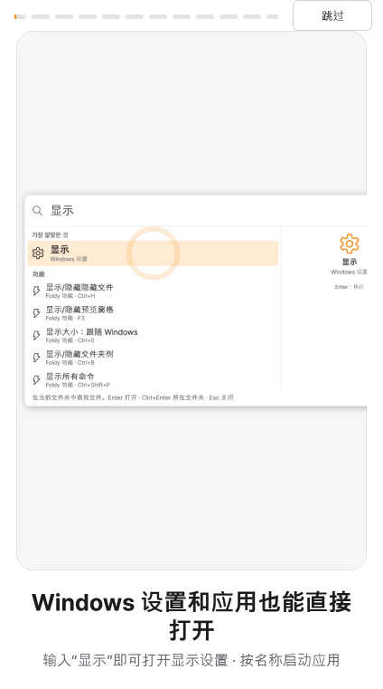
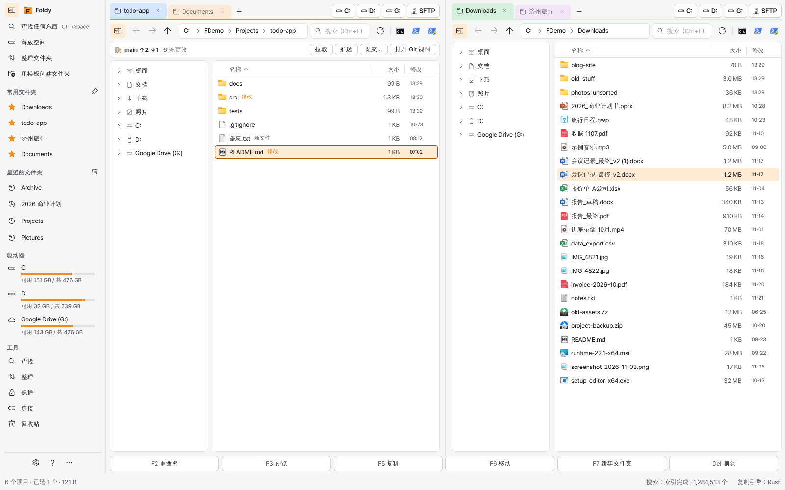
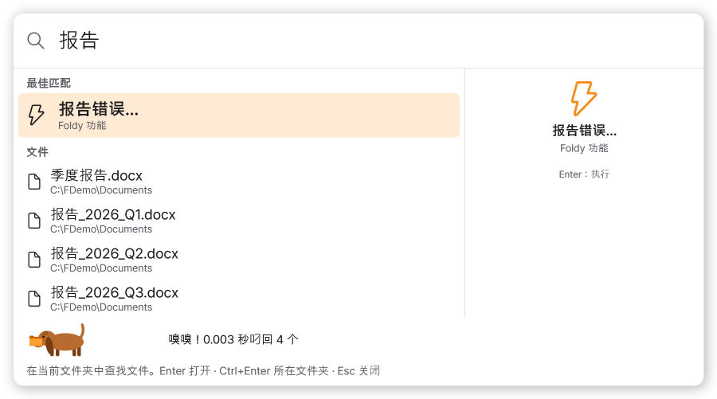
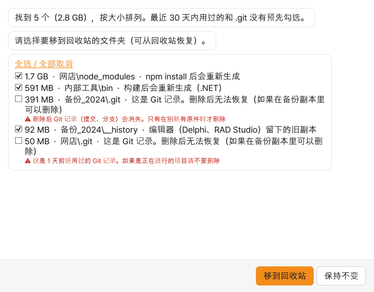
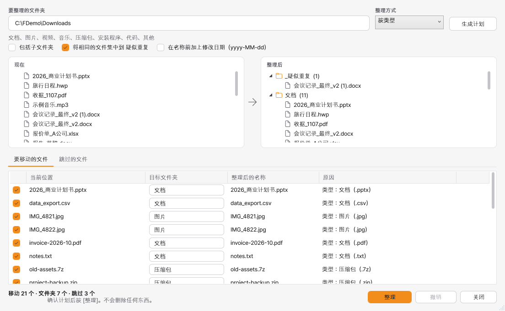
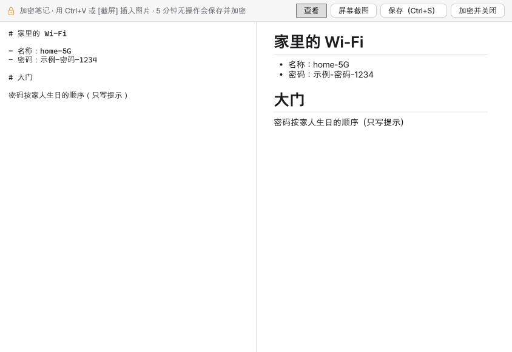
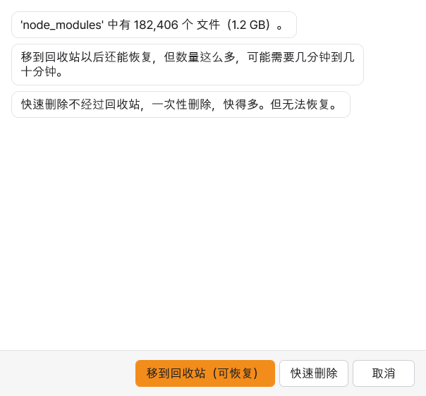
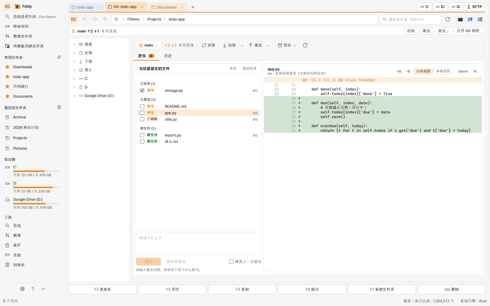
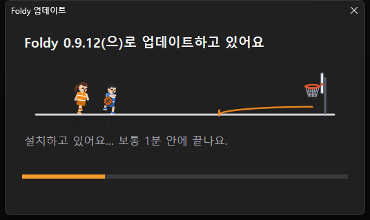

# Foldy 使用指南

**快速又聪明的文件管理器，离线也好用。** <small>连接 AI 会更方便。</small>

Foldy 是一款快速、不卡顿的 Windows 双窗格文件管理器。随时可以按 **F1** 或侧边栏底部的 **? 帮助** 按钮打开本指南。

| | |
| --- | --- |
| 版本 | {{version}} |
| 开发者 | David CHA |
| 仓库 | https://github.com/chadolkr/Foldy |
| 许可证 | GPL-3.0-or-later（自由软件） |

- [人人都能轻松上手](#人人都能轻松上手)
- [第一次启动](#第一次启动)
- [界面导览](#界面导览)
- [侧边栏](#侧边栏)
- [标签页](#标签页)
- [孩子们在打篮球](#孩子们在打篮球)
- [文件操作](#文件操作)
- [预览](#预览)
- [Markdown 查看器](#markdown-查看器)
- [慢速驱动器](#慢速驱动器)
- [快捷键](#快捷键)
- **[🔍 查找](#-查找)**
  - [快速搜索（Ctrl+Space）](#快速搜索ctrlspace)
  - [搜索](#搜索)
  - [文件夹分析](#文件夹分析)
  - [仅显示图片](#仅显示图片)
- **[🧹 整理](#-整理)**
  - [整理工具](#整理工具)
  - [网上看到的那种整理法，一键搞定](#网上看到的那种整理法一键搞定)
  - [文件夹模板、向导与整理](#文件夹模板向导与整理)
- **[🔒 保护](#-保护)**
  - [删除文件特别多的文件夹](#删除文件特别多的文件夹快速删除)
  - [回收站](#回收站)
- **[🔗 连接](#-连接)**
  - [SFTP 和 SSH](#sftp-和-ssh)
  - [Git](#git)
  - [终端](#终端)
- [设置与主题](#设置与主题)
- [更新](#更新)
- [报告错误](#报告错误)
- [常见问题](#常见问题)

## 人人都能轻松上手

Foldy 的目标是让爷爷奶奶不看说明书也能用。按钮大到鼠标一次就能点中；开关总在同一个位置、用同一个按钮；同类按钮使用同一个图标。删除默认进入回收站，无法撤销的操作会事先明确提醒。字太小的话，按 **Ctrl+=** 放大。

## 第一次启动

第一次打开时，Foldy 会先帮你调到看着舒服。

1. **文字大小**：用真实的文件列表展示标准、大、较大、最大。按下立即生效，可以边看边选。
2. **屏幕亮度**：浅色、深色或跟随 Windows。
3. **快速搜索快捷键**：检查 Ctrl+Space 是否与其他程序冲突，冲突的话当场选择其他按键。
4. **简短介绍**：像竖屏短视频一样，真实的 Foldy 界面一边动一边逐行介绍主要功能（Ctrl+Space 快速搜索——文件、Windows 设置、计算和按名称调用功能；拖放复制；文件夹分析；整理桌面；整理文件夹；加密笔记；文件夹结构模板；Git）。会自动翻页，点右侧下一页、点左侧上一页，随时可以按 [跳过]。重新安装或更新后首次启动时也会播放一次，之后可随时通过侧边栏底部的 **?** 按钮 →“简短介绍”重新观看。

   

更新时设置保持不变，所以不会再问，只用一行提示“已更新”。

## 界面导览

最左边是 **侧边栏**（常用文件夹、驱动器、工具、设置），右边是 **左右两个窗格**。当前操作的窗格（活动窗格）在标签页下方显示一条强调色线条。按 **Tab** 键切换到另一个窗格。

每个窗格从上到下依次是：

1. **标签栏**：每个文件夹一个标签，颜色各不相同（类似 OneNote）。右端是驱动器快捷按钮（C: D: …）和 **SFTP** 按钮（选择已保存的服务器或新建连接）。鼠标停在驱动器上可看到名称和剩余空间。
2. **路径栏**：点击路径中的某一段即可前往该文件夹；点击空白处或按 **Ctrl+L** 可直接输入路径。在 Git 仓库中会显示分支标签（`main ↑2 ↓1`）。
3. **搜索框**：按文件名搜索（**Ctrl+F**）。
4. **工具按钮**：最左侧的文件夹树显示/隐藏（**Ctrl+B**）、后退、前进、向上、路径、搜索、刷新、终端。
5. **树 | 列表**：两个窗格的左侧都是文件夹树，右侧是树中所选文件夹的文件列表。拖动两者之间的分隔线可改变树的宽度；用工具栏最左侧的树按钮（或 **Ctrl+B**）在原位置隐藏或显示（宽度下次也会记住）。树会跟随你正在查看的文件夹：无论是输入地址、用 Ctrl+Space 跳转还是切换标签页，都会展开到该文件夹并高亮显示。点击列标题可排序。

底部依次是 **任务窗格**（复制、移动的进度）、**文件操作按钮**（F2、F3、F5、F6、F7、Del）和 **状态栏**。状态栏中间会大字显示刚刚发生的事（例如“已复制 3 个”），新消息会短暂以强调色闪亮。左侧是项目数和所选大小，右侧是搜索方式、复制引擎和更新提示。

Foldy 同一时间只运行一个。在已运行时再次启动（快捷方式、用 Foldy 打开文件夹等），不会打开新窗口，而是 **把已打开的窗口调到前面**；如果传入了文件夹，会在新标签页中打开。

## 侧边栏

最左边的竖条汇集了两个窗格都会用到的功能。用顶部的窗格按钮（或 **Ctrl+Shift+B**）折叠后只剩图标，再按一次即可展开。它和文件夹树按钮外观相同，展开时显示为按下状态。也可以拖动右边缘调整宽度（很窄时只显示图标）。

- **顶部的四大功能**（一键直达）：
  1. 🔎 **查找任何东西**（任何地方按 **Ctrl+Space**）：文件、应用、Windows 设置、Foldy 功能、计算，一个框全搞定
  2. 📊 **释放空间**：用文件夹分析查看什么占用了空间，只清理可以删除的部分
  3. 🧹 **整理文件夹**：整理助手逐一询问“整理哪里？”“怎么整理？”（按类型、按日期、PARA），并先展示整理后的样子。不会删除，可以撤销
  4. 🗂️ **用模板建文件夹**（**Ctrl+Shift+N**）：预览 PARA 或各行业项目阶段之类的文件夹结构，一次建好
- **常用文件夹**：按标题旁的 **图钉** 按钮即可固定当前文件夹。点击在活动窗格中打开；右键可以在新标签页或另一窗格中打开、调整顺序、取消固定。
- **最近的文件夹**：自动记录最近打开的 5 个文件夹（已固定的除外）。用标题旁的垃圾桶按钮清除。
- **驱动器**：每个驱动器显示名称、使用量条和剩余空间。超过 90% 时条会变红。右键可立即开始文件夹分析。
- **工具**：其余功能分为四组。点击某组会打开它的菜单。
  - 🔍 **查找**：文件搜索、文件夹分析、仅显示图片
  - 🧹 **整理**：整理此文件夹、用模板新建文件夹、文件夹向导、设置管理方式、整理桌面/下载/日志
  - 🔒 **保护**：新建笔记、加密笔记、加密、保险箱、以前的版本（右键）、回收站
  - 🔗 **连接**：SFTP、Git 视图、终端
- **回收站**：显示积攒的容量，按 **清空** 可立即清空。
- **最底部**：设置（**Ctrl+,**）、帮助（**F1**）、更多（全部命令 **Ctrl+Shift+P**、主题、隐藏文件、列表间距、更新、报告错误、导览、关于 Foldy）。

## 标签页

| 想做的事 | 方法 |
| --- | --- |
| 新建标签页 | **Ctrl+T** 或标签栏上的 **+** |
| 关闭标签页 | **Ctrl+W**、鼠标中键点击或标签上的 ✕ |
| 下一个/上一个标签页 | **Ctrl+Tab** / **Ctrl+Shift+Tab** |
| 调整顺序 | 把标签拖到另一个标签上 |
| 移到另一窗格 | 把标签拖到另一窗格的标签上 |
| 在新标签页打开同一文件夹 | 双击标签 |

标签页、路径、排序和窗口位置会自动保存，下次启动时原样恢复。即使突然关闭，也会恢复到最后的状态（最多 2 秒前）。

## 孩子们在打篮球

耗时超过 1.5 秒的任务，任务窗格里会出现两个打篮球的孩子。

他们会 15 种动作：交叉运球、背后运球、胯下运球、转身、欧洲步、犹豫步、后撤步、投篮假动作、变向、传切、击地传球、不看人传球、空中接力、挡拆、空切。每种动作都出现一次后才会重复。

- 复制、移动：一个传球，另一个随着进度运球前进，完成时 **投进三分球**，然后击掌！
- 删除：把球扔进垃圾桶。永久删除时球会飞出球场。
- 搜索、等待网络：两人四处张望找球。
- 建立索引、分析：一个练运球，另一个做记录。
- 暂停、名称冲突：孩子抱着球等待。如果失败，球会打在篮筐上弹出去。

可在 设置 → 常规 的“使用动画”中关闭；窗口最小化或被遮挡时会停止，不占用 CPU。

## 文件操作

| 操作 | 按键 | 说明 |
| --- | --- | --- |
| 重命名 | **F2** | 打开输入框并选中不含扩展名的名称。Enter 确认，Esc 取消 |
| 复制 | **F5** | 把所选项目复制到另一窗格的文件夹 |
| 移动 | **F6** | 移到另一窗格的文件夹 |
| 新建文件夹 | **F7** | 创建后可立即输入名称 |
| 删除到回收站 | **Delete** | |
| 永久删除 | **Shift+Delete** | 会弹出确认。文件超过 5,000 个时还可以选择 [快速删除](#删除文件特别多的文件夹快速删除) |
| 复制、剪切、粘贴 | **Ctrl+C / X / V** | 也能与文件资源管理器互通 |
| 向上 | **Backspace**、**Alt+↑** | 焦点会落在刚才所在的文件夹 |
| 后退/前进 | **Alt+← / →**、鼠标的后退/前进键 | |

- **右键** 显示与文件资源管理器相同的菜单（打开方式、发送到、压缩等）。**Shift+右键** 是扩展菜单。
- **拖放**：可以从资源管理器拖进来，也可以拖到资源管理器。同一驱动器默认移动，不同驱动器默认复制；按 **Shift** 移动，按 **Ctrl** 复制。
- 复制和移动由 **并行复制引擎** 负责。遇到同名文件会询问“保留两者 / 覆盖 / 跳过”（可对其余冲突同样处理）。进度显示在下方的任务窗格和任务栏，复制时也可以随意浏览其他文件夹。
- 输入字母会立即跳到以这些字母开头的文件。连续按同一个字母会跳到下一个匹配项。

**是谁在使用这个文件？** 复制、移动或删除失败时，会在任务窗格和状态栏中告诉你是哪个程序在使用该文件（例如“Microsoft Excel 正在使用。请关闭该程序后重试”）。只是询问 Windows，不会强制关闭程序。

## 预览

按 **F3**（或底部的 **F3 预览**）会在文件列表上方打开预览窗格，立即显示列表中所选文件的内容。支持 Markdown、图片、文本与代码（语法高亮），以及 PDF、Office 等有 Windows 预览处理程序的格式。拖动分隔线可以调整预览窗格的高度。

前往其他文件夹、驱动器或标签页时，预览窗格会自动关闭（按 F3 重新打开）。什么都没选时显示“预览窗格”。

- 仅在云端的文件不会读取内容，以免触发下载。
- 网络驱动器和 SFTP 为了不变慢不会自动读取，只有按 **[预览]** 时才读取。
- Google 云端硬盘桌面版的驱动器（通常是 G:）也一样。它在侧边栏显示为云图标和“Google Drive”，缩略图、图标和预览都不会自动下载仅在线的文件。只有在打开或复制文件时才下载。

## Markdown 查看器

打开 `.md` 文件时，Foldy 会直接在应用内显示，而不是用记事本（这是默认设置；也可以在 设置 → 常规 → 打开 Markdown 文件 中选择已注册的应用）。按铅笔按钮（**编辑**）即可在笔记窗口中修改。支持表格、复选框、代码（语法高亮和复制按钮）、相对路径图片、目录和 **Ctrl+F** 文档内查找。指向其他 `.md` 的链接在同一标签页打开（可后退/前进），指向文件夹的链接以文件夹标签页打开。网络图片只有按 [加载图片] 后才会获取。

## 慢速驱动器

像公司安全驱动器这样打开文件夹很慢的驱动器，Foldy 会根据打开所用时间 **自动** 识别。无需任何设置。

- 路径栏旁会出现 **慢速驱动器** 标记，第一次识别时会在状态栏提示一次。
- 先显示列表，文件夹大小之类的信息稍后补上。转到其他文件夹时会取消未完成的工作。
- 跳过 Git 检测、图片缩略图和逐个文件的图标，预览（F3）只有按 **[预览]** 时才打开。
- 文件夹的变化改为定期检查而不是实时监视。复制照常自动调整。

## 快捷键

| 按键 | 动作 |
| --- | --- |
| **F1** | 本指南 |
| **Ctrl+Shift+P** | 全部命令（按名称查找并执行） |
| **Ctrl+Space** | 快速搜索：文件、应用、设置、功能、计算（在其他程序中也可以） |
| **Tab** | 切换到另一窗格 |
| **Ctrl+L** | 直接输入路径 |
| **Ctrl+F** | 按文件名搜索 |
| **Ctrl+R** | 刷新 |
| **Ctrl+H** | 显示/隐藏隐藏文件 |
| **F3** | 显示/隐藏预览窗格 |
| **Ctrl+,** | 设置 |
| **Ctrl+B** | 显示/隐藏文件夹树 |
| **Ctrl+Shift+B** | 折叠/展开侧边栏 |
| **Ctrl+Shift+I** | 仅显示图片 |
| **Ctrl+Shift+N** | 用模板新建文件夹 |
| **Ctrl+Shift+O** | 连接到 SFTP 服务器 |
| **Ctrl+`** | 终端（在 SFTP 标签页中为 SSH） |
| **Ctrl+Shift+`** | 管理员终端 |

## 🔍 查找

用来查找文件、查看什么占用了空间的功能，集中在侧边栏的 **查找** 中。

### 快速搜索（Ctrl+Space）

无论正在使用哪个程序，按 **Ctrl+Space** 都会在屏幕中央弹出一个大搜索框（类似 macOS 的 Spotlight）。一个框就能找到所有东西。

- **文件和文件夹**：装有索引服务时在所有驱动器中查找，没有时在当前文件夹中查找。右侧显示预览（图片、文字开头、大小、日期）。
- **应用**：按名称查找开始菜单中的程序并直接运行。
- **Windows 设置**：输入“显示”“WLAN”“文本大小”“打印机”等，会直接打开对应的设置页面。
- **常用和最近的文件夹** 优先显示在上方。
- **Foldy 功能**：用“设置”“文件夹分析”等功能名称来执行。
- **自然语言（韩语）**：Foldy 能理解“다운로드 정리해줘”（帮我整理下载）这样的韩语说法。使用其他语言时，请输入功能名称。
- **计算与单位换算**：输入 `12*3+4`、`200*15%`、`5 km to mi`、`100F`、`2 GB MB` 等会立即给出答案，按 Enter 复制结果。

最上方大字显示 **最匹配的一项**，下方按类别分组。**Enter** 打开或运行，**Ctrl+Enter** 在 Foldy 中查看所在文件夹，**Esc** 或点击外部关闭。不会进行网络搜索（不向外发送任何内容）。

找到文件时，**嗅觉灵敏的寻血猎犬** 会把鼻子贴着地面嗅一嗅，耳朵扑扇着跑去把文件叼回来：“嗅嗅！0.03 秒叼回 1,284 个”。找不到时它会歪着头。在设置中关闭“使用动画”就只显示文字。

**能找到多远？** 索引建立在这台电脑的 NTFS 驱动器（C: 等）上。侧边栏的驱动器下方会显示“索引完成”“正在索引 62%”之类的状态。没有索引的驱动器（公司驱动器、Google 云端硬盘、U 盘、SD 卡等）会在 Foldy 运行期间于后台 **慢慢收集**：一次一个，驱动器变慢时多休息，复制等任务进行时暂停。驱动器旁显示“正在索引 · 12,345 个”，收集完成后变为“索引完成”。在收集其他驱动器时，会显示在等待什么，例如“排队等待 · 在 G: 之后”。再次收集时只读取有变化的文件夹，新建或删除的文件会立即反映。收集过程中也能搜索已收集的部分，当前打开的文件夹总是直接扫描。可在 设置 → 常规 → 快速查找 中关闭。

**快捷键冲突怎么办？** 如果其他程序已经在用 Ctrl+Space，或者安装了中文/日文输入法（Ctrl+Space 是切换输入的按键），首次设置时会提醒你，可以选择空闲的其他按键（例如 Ctrl+Shift+Space）或自己按键设置。也可以选择“仅在 Foldy 内使用”。更新后不会再问，只有注册失败时才提醒。之后随时可以在 设置 → 快捷键 中更改。

### 搜索

按 **Ctrl+F**，在搜索框中输入名称的一部分并按 Enter，会打开搜索结果标签页。

- 装有 **索引服务** 时，所有驱动器即时搜索（即使上百万个文件也只需几毫秒）。状态栏显示“搜索：索引完成”。
- 没有服务时，直接扫描当前文件夹及其下级（最多 2 万个）。
- 在结果中打开文件夹会新开一个文件夹标签页，文件则直接打开。Esc 取消搜索。

### 文件夹分析

点击 **文件夹分析**（查找菜单、在 Ctrl+Space 中输入“文件夹分析”或命令列表），**会先问你要分析哪里。** 每个磁盘都有一个带剩余空间的按钮，还有当前文件夹和 [选择其他文件夹…]。选择后会打开分析标签页。在侧边栏右键驱动器 → 分析，会直接打开该驱动器。

- **树状图**：文件夹越大，方块越大。点击方块进入内部；Backspace、右键或鼠标后退键返回上一级。
- **列表**：最大文件夹和文件排行，以及比上次分析增长最多的文件夹。
- **清理候选**：node_modules、构建结果、临时文件、缓存这类删除后可以重新生成的东西。系统文件夹绝不会列为候选。
- **[移到回收站]**：确认后只会移到回收站（不会永久删除）。
- **F5** 重新分析，**Esc** 取消分析。双击列表项会在文件夹标签页中打开该位置。

**可建议清理的全部对象** —— 条件：其中最近一次修改早于所示期限，且大小不小于所示值时才建议。

| 对象 | 位置与名称 | 条件 |
| --- | --- | --- |
| Node.js 包 | `node_modules`（旁边有 `package.json`） | 30 天，10MB |
| .NET 构建输出 | `bin`、`obj`（旁边有 `*.csproj` 等） | 14 天，10MB |
| Rust 构建输出 | `target`（旁边有 `Cargo.toml`） | 14 天，50MB |
| Gradle 构建输出 | `build`、`.gradle`（旁边有 `build.gradle` 等） | 14 天，10MB |
| 前端构建缓存 | `.next`、`.nuxt`、`.parcel-cache`、`.turbo`、`.angular`、`.svelte-kit`（旁边有 `package.json`） | 14 天，10MB |
| Python 缓存 | `__pycache__`、`.pytest_cache`、`.mypy_cache`、`.ruff_cache`、`.tox` | 30 天，1MB |
| Visual Studio 缓存 | `.vs` | 30 天，100MB |
| 用户临时文件夹 | `%LOCALAPPDATA%\Temp` | 7 天，50MB |
| 名为 temp/tmp 的文件夹 | `temp`、`tmp` | 30 天，100MB |
| 浏览器缓存 | Chrome、Edge 配置文件中的 `Cache`、`Code Cache` | 100MB |
| 包管理器缓存 | `npm-cache`、`pip\cache`、`Yarn\Cache`、`%USERPROFILE%\.gradle\caches` | 30 天，500MB |
| NuGet 包缓存 | `%USERPROFILE%\.nuget\packages` | 60 天，1GB |
| 崩溃转储文件 | `*.dmp`、`*.hdmp`、`*.mdmp` | 14 天，10MB |
| 崩溃转储文件夹 | `%LOCALAPPDATA%\CrashDumps`（Windows 错误报告的默认转储文件夹） | 14 天，10MB |
| 旧的安装文件 | 下载文件夹中的 `*.exe`、`*.msi`、`*.msix`、`*.iso` | 90 天，50MB |

`.git` 只显示不建议。Windows、Program Files、ProgramData 等系统文件夹无论规则如何都不会建议。

**特意没有列入的**
- Windows 更新文件、传递优化文件、缩略图缓存、以前的 Windows（Windows.old）：这些由系统使用，由 Windows 自己删除更安全。点击清理建议上方的 **[打开 Windows 清理建议]** 会打开 Windows 设置中的清理页面（Windows 10 为磁盘清理）。
- 杀毒软件的更新备份和隔离区文件：没有找到厂商关于可以删除的官方说明，而且隔离区是用来恢复误杀文件的地方，所以没有列入。请在杀毒软件自己的菜单中清理。

有索引服务时，无需重新读取磁盘，几秒钟就能完成分析。没有时以低优先级直接扫描。

### 比较并同步两个窗格

当你分不清复制到 U 盘的文件夹和电脑上的文件夹哪个更新时使用。在两个窗格中分别打开两个文件夹，点击 🔍 **查找 → 比较并同步两个窗格**，Foldy 会以对话方式告诉你。

- **哪里不同**：只在左边或只在右边的文件，以及哪一边更新（根据文件大小和修改时间，相差 2 秒视为相同）。并用一句话总结，例如“右边较新。有 12 个文件在右边被修改”。
- **按哪个方向**：在 [左 → 右] [右 → 左] [两边都同步为最新] 中选择后，会先展示要复制的列表，确认后才同步。
- **安全**：不会删除只在一边的文件。不会用旧文件覆盖较新的文件。被覆盖的文件会保留为以前的版本（U 盘和网络驱动器上放在旁边，名为 `.foldy-bak`），完成后按一次 **[撤销]** 即可恢复原样。
- **两边都改过的文件**：上次同步后两边都改过的文件不会自动选择，而是逐个询问。
- 不会比较 Git 仓库和开发项目文件夹的内部。

### 仅显示图片

按 **Ctrl+Shift+I** 或侧边栏 查找 → 仅显示图片，会以缩略图网格只显示当前文件夹中的图片。其他文件只是隐藏，不会移动。

开启期间，列表正上方会显示“正在仅显示图片 · 图片 N 张”（没有图片时显示“此文件夹没有图片”），用同一位置的 **[显示所有文件]** 即可立即关闭。

- **空格**：放大查看（← → 上一张/下一张，滚轮缩放，R 旋转，Esc 关闭）
- **Ctrl+滚轮**：缩略图大小
- 网络驱动器、Google 云端硬盘驱动器（G:）和仅在云端的文件不会读取内容（以免开始下载）。

## 🧹 整理

像打扫房间一样整理文件夹的功能，集中在侧边栏的 **整理** 中。不会自行丢弃，先给你看，并且可以撤销。

### 整理工具

像打扫房间一样整理电脑。点击侧边栏的 **整理** 可选择整理桌面、下载或日志（也能在命令列表中找到）。每个工具都由 Foldy 以对话方式一步一步询问：先说明找到了什么、为什么整理更好、按下后会怎样，再让你在 **[按此清理] [查看详情] [以后再说]** 中选择。慢慢看再决定。

三个承诺一定遵守：

- **不会自行丢弃。** 先展示要把什么移到哪里，按下之前什么都不做。
- **告诉你放在了哪里。** 可以立即打开目标位置查看。
- **可以撤销。** 删除总是只进回收站，整理桌面按一次 [撤销] 即可恢复原样。

#### 整理桌面

桌面上堆满了文件？不丢弃任何东西，按类型放进桌面上的 **“桌面归档”** 文件夹，并告诉你放在了哪里。不满意的话按一次 **[撤销]** 即可恢复原样！

- **会移动的**：直接放在桌面上、最近 7 天没用过的文件
- **保持不动的**：快捷方式（`.lnk`、`.url`）、最近 7 天内用过的文件、文件夹、隐藏和系统文件
- **移到哪里**：`桌面\桌面归档\年-月\类型`（类型：文档、图片、视频、音乐、压缩包、安装程序、代码、其他）
- 其他程序正在使用的文件会跳过。
- 如果已有旧版韩语版本创建的文件夹（바탕화면 보관），会继续使用它。
- **启动时一行建议**：桌面或下载文件夹中（不含快捷方式）的文件超过 20 个时，启动 Foldy 时窗口上方会出现“桌面上有 27 个文件。要按类型整理吗？”[整理] [以后再说] [不再询问]。不理会会自动消失；[以后再说] 7 天后再问；[不再询问] 可在 设置 → 常规 → 整理提醒 中恢复。

#### 整理下载

下载文件夹总是越堆越多。Foldy 会找出值得整理的文件，建议你 **放进回收站或归档**。

| 查找什么 | 标准 |
| --- | --- |
| 已安装程序的安装文件 | 仅当 `.exe` 的产品名与已安装程序列表确定一致时（不确定就不列入） |
| 重复文件 | 大小和内容（SHA-256）完全相同的文件。保留名称最短的一个（例如只选中 `报告 (1).pdf`） |
| 已解压的压缩包 | 旁边有同名文件夹的 `.zip` |
| 旧文件 | 超过 90 天没有打开或修改的文件（需要自己选择） |

- 只看下载文件夹第一层的文件。子文件夹视为已整理好，不会触碰。正在下载的文件（`.crdownload`、`.part`）也会排除。
- **[移到回收站]**：移到回收站，可从回收站恢复。
- **[归档]**：移到 `下载\归档\年-月` 文件夹。

#### 清理日志

程序留下的 `*.log` 文件常常不知不觉堆到好几 GB。Foldy 会把旧日志紧紧压进同一文件夹中的 **按月 zip**。文本日志通常能缩小 85% 以上。

- **对象**：超过 7 天未变动的 `*.log` 文件（当前整个驱动器；有索引服务时瞬间找到）
- **不会触碰的**：程序正在使用的日志、`Windows` 文件夹、回收站、System Volume Information
- **生成的文件**：在日志所在文件夹中生成 `logs-年-月.zip`
- 重新打开 zip 确认内容与原件完全一致（SHA-256）后，才把原件移到回收站。无法确认时原件保持不变。
- 也可以通过文件夹分析界面上方的 **[清理日志]**、**[整理下载]** 按钮打开。

#### 查找可删除的文件夹（开发残留）

项目文件夹里会堆积可以重新生成的文件夹，常常有好几 GB（node_modules、bin/obj、target、__pycache__、.venv、dist/build、Delphi 的 __history）。可以在 整理 → **查找可删除的文件夹**、文件夹分析中的 **[可删除的文件夹]** 或 Ctrl+Space 中找到。

- **只在当前查看的文件夹中** 查找，从大到小显示。有索引时大小立即可见。
- **只有旁边有项目文件时** 才选择：package.json 旁的 node_modules、.csproj 旁的 bin/obj、Cargo.toml 旁的 target。只是名为“build”的照片文件夹不会被碰。
- 最近 30 天内用过的不会预先勾选。
- **.git 默认不勾选。** 删除会丢失 Git 记录，所以会用红字提醒；如果是最近用过的 .git，会说“如果是正在进行的项目请不要删除”。如果是另有原始仓库的备份副本，可以自己选择删除（会再问一次）。
- 只有你选的才会 **移到回收站**，可从回收站恢复。
- 要增加查找的名称，在 设置 → 常规 → 查找可删除的文件夹 中用逗号分隔填写。

#### 清理开发缓存

清理 npm、NuGet、pip、Yarn、pnpm 下载的缓存和 Docker 构建缓存。整理 → **清理开发缓存**。

- 只显示这台电脑上已安装的工具，并附上大小和“需要时重新下载即可”的说明。
- 不直接删除文件夹，只运行 **各工具的官方命令**（`npm cache clean --force`、`dotnet nuget locals all --clear`、`py -m pip cache purge`、`yarn cache clean`、`pnpm store prune`、`docker builder prune --force`）。
- Docker **只清理构建缓存**：不会动镜像、容器和卷。
- 不经过回收站、无法恢复，所以会先显示大小并 **确认一次** 后再执行。需要的内容会在下次构建或安装时重新下载。

#### 工作标签（做到哪儿了？）

逐个处理很多文件时，容易忘记做到了哪里。给文件贴上 **已完成**、**已应用** 之类的小彩色标记吧。

- **贴标签**：选中文件按 **Ctrl+D** = 切换已完成。也可以在 🧹 整理 菜单（或命令列表）中贴上已应用、审阅中、已提交。可以一次选中多个文件。
- **显示位置**：以小彩色标签显示在文件名后面。名称太长没有空间时不显示标签（名称优先）。文件夹上方会显示“20 个文件中 已完成 7 · 已应用 3”和 **[下一个文件]**（跳到下一个尚未完成的文件）。
- **保存位置**：以人可阅读的形式写在该文件夹的隐藏文件 `.foldy.md` 中。所以把文件夹移到其他磁盘或电脑，标签也会跟着走。不会改动文件本身。在 Foldy 中重命名，标签也会跟着。
- **Git 文件夹**：会在 `.git/info/exclude` 中加一行，让 `.foldy.md` 不出现在 git status 中（.gitignore 不变）。要与协作者共享，请打开上方那一行的 **[在仓库中共享]**。
- **[清除所有标签]**：只清除该文件夹中文件的标签。

### 为每个文件夹设定管理方式

设定“这个文件夹用 PARA 管理”后，Foldy 会按这种方式不时查看，有需要整理的就提醒你。每个文件夹可以设定不同的方式。

- **设定方法**：右键文件夹 → **设置此文件夹的管理方式…**。Foldy 会说明每种方式做什么，选择后还会询问是否创建所需的文件夹。
- **可选方式**：PARA、Johnny.Decimal、加编号和日期、按日期
- **标记**：设定的文件夹（最上层的那一个）图标上会有一个小圆点，左侧树中显示一面小旗。进入后上方会显示一行“使用 PARA 管理中 · 3 项待整理”。在文件资源管理器中，该文件夹也会显示 Foldy 图标。
- **记忆位置**：文件夹中的一个隐藏文件 `.foldy.md`。这是人可阅读的备忘，所以文件夹移动后也会跟着；删除它只是关闭管理，文件保持不变。子文件夹遵循最近的 `.foldy.md`。

**会提醒你这些事**

| 方式 | 提醒的内容 | 执行的操作（确认后） |
| --- | --- | --- |
| 所有方式 | 顶层尚未分类的文件 | 先收进 `00_收件箱`（按日期方式则放进 年\年-月 文件夹） |
| PARA | 1_Projects 中 90 天没动的项目 | 移到 4_Archives |
| 加编号和日期 | 01_进行中 中 90 天没动的文件夹 | 移到 03_已完成 |
| Johnny.Decimal | 没有编号的文件夹 | 只提醒（名称请自己加） |

**不用担心**

- 不会自动移动。先展示要把什么移到哪里，只有按 **[按此清理]** 时才移动。完成后按一次 **[撤销]** 即可恢复原样。
- 不会移动可执行文件、设置文件和快捷方式（`.exe`、`.dll`、`.ini`、`.json`、`.lnk` 等），因为其他程序或快捷方式可能会失效。
- **Git 仓库和开发项目文件夹** 不能设定管理方式。存放这些仓库的上层文件夹可以管理，其中的仓库只会整个文件夹一起移动（不动内部）。
- 打开中的文件会跳过，并提示“已跳过：正在打开”。
- 在 OneDrive、Google 云端硬盘这类 **同步文件夹** 中，会先提示“这是同步文件夹”，因为移动也会同步到其他电脑。在这类文件夹以及网络驱动器和慢速驱动器上，不会创建资源管理器图标（desktop.ini）。
- 积攒得多时，和其他整理工具一样，每周最多用一行提醒一次（设置 → 整理提醒）。
- 文件夹名称使用创建时的应用语言（00_收件箱、01_进行中 …）。以前用韩语名称创建的文件夹（00_받은 파일 …）会继续使用。

#### 需要时用一行提示

为了不用到处找功能，Foldy 会在上方用一行提示适合当前文件夹的功能。一次只显示一条，按 **[关闭]** 后在该文件夹不再显示。在 设置 → 常规 中关闭 **整理提醒** 即不再出现。

- 下载文件夹中的文件超过 40 个 → [整理下载]
- 桌面上的文件超过 50 个 → [整理桌面]
- 日志文件（.log）超过 20 个的文件夹 → [清理日志]

### 积攒多了轻轻提醒

因为容易被忽略，Foldy 会不时轻量地查看，只有需要整理的东西很多时，才在窗口底部用一行提醒。每周最多提醒一次，不会自行整理。

- 日志：可节省的空间超过 1GB 或超过该驱动器剩余空间的 5% 时（仅在有索引服务时检查）
- 下载：值得整理的文件超过 1GB 时
- 桌面：可归档的文件超过 50 个时
- 关闭方法：设置 → 常规 → **整理提醒**

### 网上看到的那种整理法，一键搞定

想照着“听说 PARA 很好用…”试一试，却卡在建文件夹这一步？选择模板，文件夹一次建好，预览中还会在名称旁简短说明 **每个文件夹放什么**。

**PARA**（Tiago Forte）—— 按“什么时候结束？”分成四格。

| 文件夹 | 放什么 |
| --- | --- |
| 1_Projects | 正在做的事（有结束日期的事） |
| 2_Areas | 持续管理的领域（健康、钱、住房、团队） |
| 3_Resources | 参考资料（以后会用到的信息） |
| 4_Archives | 已结束的（别删除，移到这里） |

**Johnny.Decimal** —— 每个位置都有编号，说出“11.03”就能直接找到。

| 层级 | 示例 | 含义 |
| --- | --- | --- |
| 区域 | `10-19 生活` | 最多 10 个大组 |
| 类别 | `11 住房` | 每个区域最多 10 格 |
| 条目 | `11.01 搬家报价` | 类别中的实际文件夹 |

**加编号和日期** —— 最简单的方法。文件夹前的编号固定顺序，文件名以日期开头。

| 文件夹 | 放什么 |
| --- | --- |
| 00_收件箱 | 先放这里（收到的文件、尚未分类的）。在最上面，总是一眼可见 |
| 01_进行中 | 正在做的事 |
| 02_资料 | 常看的参考资料 |
| 03_已完成 | 已完成但偶尔会看的 |
| 99_归档 | 很旧、几乎不看的 |

文件按 **日期_内容** 命名，如 `2026-11-19_报告.docx`，按名称排序就是按日期排序。

> 💡 **收件箱小技巧**：无论用哪种方法，都在最上面放一个 `00_收件箱`。新文件先不加思考地放进去，每周清空一次时再分类，就不会越堆越多。

其他模板（客户项目、文档编写阶段、研究、生活文件、照片归档等）也同样为每个文件夹附有说明。

文件夹在创建时以应用语言命名。已经存在的文件夹保持原名。

### 文件夹模板、向导与整理

从侧边栏的工具或命令列表（**Ctrl+Shift+P**）中打开。

- **用模板新建文件夹**（**Ctrl+Shift+N**）：一次创建下面这些结构。在右侧预览将要创建的树，不需要的文件夹可以取消勾选。已存在的文件夹不会改动，只创建缺少的。还可以查看每种风格的 **使用方法**。
  - **个人与工作**：PARA、Johnny.Decimal、加编号和日期（含收件箱）、客户与项目工作、文档编写阶段（草稿 → 审阅 → 最终 → 分发）、研究与学习（文献、数据、分析、稿件、演示）、生活与家庭文件（财务、健康、住房、车辆、护照、保险）
  - **项目**（各行业国际标准阶段）：项目管理（PMBOK：启动、规划、执行、监控、收尾）、IT 系统开发文档（ISO/IEC/IEEE 12207：需求、分析、设计、实现、测试、移交、运维，代码放在 Git 中）、建设与设计信息管理（ISO 19650：进行中、共享、发布、归档）
  - **媒体与创作**：照片与视频归档、设计与创作素材（原件、工作、导出、参考）
  - **记录与归档**：按日期归档（年/年-月）
- 预览中会在文件夹名称旁简短显示 **放什么**。
- 代码项目（Java、Python 等）每种语言都有既定的文件夹结构，所以没有放入内置模板。需要的话可以做成自己的模板使用。
- **文件夹向导**：选择用途（个人、工作、媒体等）并回答几个问题，就会推荐合适的风格，并和你一起创建。
- **整理此文件夹**：把下载、桌面这类杂乱的普通文件夹按类型、按日期或按风格移动整理。执行前先展示“整理后的样子”，**不删除任何东西**，按一次 [撤销] 即可恢复原样。内容相同的文件会集中到“_疑似重复”。没有要移动的文件时，会立即显示原因（跳过的文件）。
  - **Git 仓库和开发项目文件夹**（含 .git、.sln、package.json 等的文件夹）特意不整理。移动文件可能破坏构建或 Git 记录，所以这类文件夹只显示红色提示，整理按钮不会启用。请在项目之外的普通文件夹中整理。普通文件夹中如果包含项目文件夹，该文件夹会整体保持不变。

- **编辑文件夹说明**：为文件夹添加说明。

## 🔒 保护

保护重要文件的功能，集中在侧边栏的 **保护** 中。

### 写笔记（.md · .textpack）

想到什么马上记下来。点击 🔒 **保护 → 新建笔记**，会在当前文件夹中创建 `新建笔记.md` 并打开笔记窗口。打开 `.md` 文件时用 Foldy 查看器显示，点击查看器的 **编辑**（铅笔）按钮即可在同一笔记窗口中修改。

- **[编辑 / 查看]**：编辑时左边是文字、右边是排版效果；查看时只显示排版效果。没有复杂的格式按钮，用 Markdown（# 标题、- 列表、**粗体**）书写。
- **插入图片**：用 **Ctrl+V** 粘贴、拖入图片文件，或点击 **[截屏]**。会打开 Windows 截图工具，截完图直接放进笔记（用 Win+Shift+S 截图后按 Ctrl+V 也可以）。
- **文件格式**：没有图片时就是普通的 `.md`；插入图片后会保存为同名的单个 **`.textpack`** 文件（TextBundle 格式：文字和图片放在一个 zip 中，图片保持原画质）。双击 `.textpack` 会以 [查看] 模式打开笔记窗口。
- **保存**：**Ctrl+S**，关闭时也会保存。像密码这样需要保密的内容，请使用 **新建加密笔记**（见下方“加密笔记”）。

### 以前的版本（覆盖恢复）

用 Foldy 复制或移动时 **覆盖** 了同名文件，原文件会被悄悄保留 7 天。不小心覆盖了也别担心。

- **恢复**：右键文件 → **查看以前的版本…** → 选择时间后按 **[恢复]**（当前文件也会保留，可以再换回来）或 **[在旁边另存一份]**（在旁边保存为“名称（以前的版本 日期）.扩展名”）。
- **保存位置**：同一驱动器上的隐藏文件夹（`X:\.foldy\이전 버전`，系统驱动器为 `%LOCALAPPDATA%\Foldy\이전 버전`）。因为在同一驱动器上，移动不花时间。只保存在这台电脑的磁盘上。U 盘和网络驱动器（如单位的共享驱动器）上不保存，因为别人可能看到。
- **上限**：超过 7 天，或每个驱动器超过 2GB（或驱动器的 5%，取较小者）时，从最旧的开始删除。超过上限的大文件不保留。
- Foldy 之外（其他程序）造成的覆盖不在此范围内。可在 设置 → 常规 → **以前的版本** 中关闭。

### 加密笔记

Wi-Fi 密码、门锁密码这类一定要记住、但随便写在哪里又不放心的东西，对吧？把它们写进 **加密笔记** 吧。每次打开都会询问密码，并且可以直接在 Foldy 中查看和修改。

- **创建**：侧边栏 **保护** → **新建加密笔记**。会在当前文件夹中创建 `新建笔记.memo.foldylock` 并立即打开编辑窗口。名称可以按 F2 修改。
- **打开**：双击后输入密码即打开编辑窗口。左边是文字，右边是预览（Markdown）。
- **图片**：截屏后按 **Ctrl+V** 粘贴，或拖入图片文件，就会一起保存在笔记里。

- **保存**：**Ctrl+S**。每次保存都会重新加密。5 分钟无操作会自动保存并锁定。
- 内容只在内存中解密。解密后的文字不会留在磁盘上（包括临时文件）。
- 💡 如果重要密码非常多，也可以同时使用 Bitwarden 或 KeePass 这样的密码管理器。

### 加密文件（单个文件）

可以给已有的文件（比如合同）加上密码。右键文件 → **🔒 加密…**。会在同一文件夹中生成 `合同.pdf.foldylock`，确认能正确解密后询问“要把原件移到回收站吗？”。

- 双击后输入密码，照片和文字会直接在 Foldy 中显示。其他文件会提示“请用原来的程序打开”，按 **[解密并打开]** 即可还原为原文件并打开。
- 原样还给你加密时放进去的内容，一个字节都不改。

### 保险箱

把重要的文件夹整个放进保险箱。右键文件夹 → **🔒 放入保险箱…**。会生成一个 `文件夹名.foldyvault` 文件，逐个解密确认后询问是否把原文件夹移到回收站。

- **没有大小限制。** 超过 4 GB 的文件也能放入和取出。不过完成前会保留原件，所以需要同样多的可用空间；旧 U 盘（FAT32）也无法存放超过 4 GB 的保险箱。Foldy 会在询问密码**之前**检查，空间不足时立即告诉你，并提供 [释放空间] 帮你清理。
- 双击后输入密码，会显示里面的文件列表。可以选中后 **预览**（仅在内存中）、**取出** 或 **全部取出**。

### 加密文件通用说明

- 显示为锁形（加密文件）或保险箱图标；安装后在文件资源管理器中双击也会用 Foldy 打开。
- **忘记密码的话，Foldy 也打不开。** 密码不会保存在任何地方，也不会写入记录（日志）。
- 如果是公司电脑，请先确认文件加密是否符合安全规定。
- 内部是用 AES-256 加密的 zip，密码经过 60 万次强化（PBKDF2-SHA256）后生成密钥。因此猜密码非常慢，没有密码连文件名都看不到。相应地，7-Zip 等工具无法打开，需要用 Foldy 打开（格式在源代码中公开）。0.3.18 及之前创建的保险箱仍然可以打开。
- 新密码至少 8 个字符。推荐用几个以空格分隔的词组成的句子。

### 删除文件特别多的文件夹（快速删除）

删除像 `node_modules` 这样包含 **超过 5,000 个** 文件的文件夹时，会先询问你。放进回收站可以恢复，但数量这么多，可能需要几分钟到几十分钟。

- **[移到回收站（可恢复）]**：默认选项。像平常一样进入回收站。
- **[快速删除]**：不经过回收站，一次性删除大量文件，快得多。但 **无法恢复。** 选择后会再次提醒“无法恢复，中途停止也找不回已删除的内容”，该确认窗口的默认按钮是 **[取消]**（误按 Enter 也不会删除）。
- 删除期间任务窗格显示已删除的数量，随时可以 **取消**。
- 只读文件和超长路径（超过 260 个字符）也会删除。文件夹内的 **链接（联接、符号链接）只删除链接本身，不会动链接指向的原文件夹。**
- 在网络驱动器上会慢慢删除（每次 4 个），以免给服务器造成负担。
- 驱动器根目录、Windows、Program Files 以及用户、桌面、文档文件夹本身不能使用快速删除（只能进回收站）。

### 回收站

左侧侧边栏的 **回收站** 一行显示当前积攒的容量（例如 回收站 · 38 GB）。点击打开 Windows 回收站，点击右侧的 **清空** 会在确认一次后清空所有驱动器的回收站（无法恢复）。

## 🔗 连接

连接服务器、Git 和终端的功能，集中在侧边栏的 **连接** 中。

### SFTP 和 SSH

通过标签栏右侧驱动器按钮末尾的 **SFTP** 按钮、**Ctrl+Shift+O** 或侧边栏 连接 → SFTP 之一连接服务器后，SFTP 文件夹会以标签页形式在该窗格中打开。左侧的树变为服务器树，首次打开的文件夹和服务器根目录（/）已展开一层，可以立即看到文件夹。

- 用密码或密钥文件认证。打开“保存此连接”后，密码会用 Windows DPAPI 加密保存。
- `~/.ssh/config` 中的 Host 条目也会出现在“已保存的连接”中。选择密钥文件时会自动填入 `~/.ssh/id_ed25519` 之类的默认密钥。
- 第一次连接的服务器会显示主机密钥指纹并询问（known_hosts 与 OpenSSH 共用）。如果密钥变了会发出警告。
- 在 SFTP 标签页中，终端按钮变为 **SSH**，以相同的服务器、账户和当前文件夹打开终端。

#### 本地与 SFTP 之间的复制和移动

- **复制（F5）、移动（F6）、拖放、Ctrl+C / Ctrl+V** 都支持本地 ↔ SFTP 双向。文件夹连同内部内容整体上传和下载。
- 同一服务器内的 **移动** 只是在服务器上重命名，不传输数据，所以很快。服务器之间的复制或同一服务器内的复制会经过临时文件。
- 移动会在复制 **全部成功之后** 才删除源文件。失败或取消时源文件保持不变，写到一半的文件会被删除。
- 遇到同名时会弹出与本地复制相同的窗口：保留两者（名称后加 `(2)`）、覆盖、跳过、对其余冲突同样处理。
- 进度在任务窗格中以字节为单位显示，可以 **取消**。
- 删除 SFTP 文件时 **没有回收站**，会立即消失，所以删除前会再问一次。也可以新建文件夹和重命名。
- 覆盖也很安全：先完整写入临时文件 `.名称.foldy-part` 再替换，所以即使取消或失败，原有文件也保持不变。
- 会跳过符号链接，完成后告诉你跳过了几个（包含链接的文件夹即使移动也不会删除源文件）。

### Git

进入 Git 仓库文件夹（该文件夹或上层文件夹中有 `.git` 的地方）时，Git 功能会自动开启。

- 路径栏中出现 **分支标签**。点击会打开 Git 视图。
- 文件列表上方出现细细的 **Git 栏**，显示分支、待推送/待拉取的提交数（↑↓）、更改数量以及 **拉取 / 推送 / 提交… / 打开 Git 视图** 按钮。拉取和推送不会切换界面，结果显示在下方的状态栏中。离开仓库后 Git 栏会消失。
- 列表中的更改标记：文件名旁用简单的词显示 **已修改**（上次提交后改过）、**已添加**（会包含在下次提交中）、**新文件**（Git 尚未跟踪）、**冲突**（无法合并），鼠标悬停会显示一行说明。被忽略的文件显示为灰色。名称太长没有空间时，标记会让开，不会盖住名称。
- **设置 → 常规 → Git**：“显示 Git 栏”（默认开启）。在 Git 栏上点击 [打开 Git 视图] 即可一键打开 Git 视图。

#### Git 视图

最上方一行：当前 **分支**（点击可切换或新建）、↑↓、更改数量、**获取**（只检查有无新动态）·**拉取**（合并远程提交）·**推送**（发送你的提交）·**储藏**（暂时收起正在修改的内容）。鼠标停在按钮上会显示说明。

**更改** 标签（创建提交）

1. 在左侧列表中勾选要提交的文件的 **复选框**（勾选 = 暂存）。用 **全选** 和 **取消选择** 一次切换。文件按已暂存 / 已更改 / 新文件分组，并带有已修改、已添加、已删除、新文件、冲突的徽标。
2. 点击文件，右侧显示改动内容。
3. 在下方的框中写下“改了什么？”，然后按 **提交** 或 **提交并推送**。没有勾选文件或说明为空时按钮不可用，鼠标悬停会显示原因。

**历史** 标签：分支图和提交列表（可按说明、作者、哈希搜索）。点击提交显示改动的文件，点击文件显示该提交中的改动内容。

**查看改动（diff）**：带新旧行号，新增的行为绿色，删除的行为红色，区块标题为橙色。用上方的 **合并视图 / 并排视图** 切换。非常大的改动最多显示 20,000 行，用 **显示更多** 继续查看。图片等二进制文件只显示“二进制文件”。

**Blame**（每一行是谁改的）：右键文件选择 **Blame 此文件**，或按 diff 标题中的 **Blame** 按钮。每一行显示短哈希、作者和日期，同一提交的连续行底纹交替变化。**点击哈希** 会在历史标签中选中该提交。也可以在文件夹列表中选中文件后执行 **全部命令（Ctrl+Shift+P）→“Git: Blame 此文件”**。

**提示界面**：没有更改时显示“没有更改。修改文件后会显示在这里”；在不是 Git 仓库的文件夹中打开 Git 视图时，会出现 **在此创建 Git 仓库（git init）** 按钮。没有安装 Git 时会显示安装页面（git-scm.com）的链接。推送或拉取时登录失败，会用简单的话告诉你需要检查什么。任务完成后会短暂显示“推送完成：3 个提交”之类的提示。

强制推送只使用 `--force-with-lease`，并会经过警告窗口。需要安装 Git for Windows。

### 终端

用本地文件夹标签页右上方的按钮 **在当前文件夹中** 打开终端。

- 命令提示符、PowerShell（有 7 则用 7）、管理员 PowerShell（盾牌图标）
- **Ctrl+点击** 按钮以管理员身份打开。以管理员身份运行总会经过 UAC，不保存凭据。
- 安装了 Windows 终端时会在其中打开。网络路径（UNC）和映射驱动器也会在正确的位置打开。

### AI 连接（MCP）

可以让 Claude 等 AI 应用通过 Foldy 查找你电脑上的文件（MCP 服务器）。打开 **更多（⋯）→ 连接 AI（MCP）…** 或在 Ctrl+Space 中输入“AI 连接”，按一次 **[连接到 AI]** 就完成了。只显示这台电脑上已安装的 AI 应用（Claude Desktop、Claude Code、Codex、Gemini CLI、Cursor、VS Code），点击后会把 Foldy 加入该应用的设置（原设置会备份）。重启该应用后试着说“帮我在 D 盘找提案”。

**连接后可以这样问**（在 AI 连接窗口中点击即可复制）：

- “帮我找去年的报价单”：按名称查找文件（包括公司驱动器和 Google 云端硬盘）
- “D 盘里哪些文件夹最占空间？”：从大文件夹开始看
- “整理一下下载文件夹里有什么告诉我”：查看文件夹内容
- “读一下这个项目文件夹的说明”：在 Foldy 中写下的文件夹说明
- “告诉我报告文件夹里还在审阅中的文件”：文件状态标签
- “告诉我驱动器的剩余空间和索引状态”：驱动器状态

如果这台电脑上装有 AI 应用但尚未连接，启动 Foldy 时会在窗口上方用一行提示。例如：对 Claude Desktop 说“帮我找去年的报价单”，Foldy 就会在你的电脑中找到 [连接] [以后再说] [不再询问]（示例每次启动都会变化）。不理会会自动消失；想再次看到，请在 设置 → 常规 → AI 连接 中打开。

- AI 可以使用的：查找文件（包括公司驱动器和 Google 云端硬盘）、查看文件夹内容、文件夹大小、文件夹说明、文件状态标签、驱动器和索引状态。**全部只读**，没有移动和删除。
- 只能看到你的账户能看到的内容。不对互联网开放，只在你的电脑内与 AI 应用对话（AI 应用如何使用收到的结果，以该应用的政策为准）。
- 默认关闭。可随时在该窗口中用“开启 AI 连接”关闭。工具列表（名称、说明、输入）也可以在该窗口中查看。
- 其他 AI 应用可以复制窗口下方“手动添加”中的设置（`Foldy.exe --mcp`）。ChatGPT 只能通过互联网连接，为了安全不提供支持。

## 设置与主题

**字太小就把界面放大。** 默认跟随 Windows 设置：在 Windows 设置 → 辅助功能 → **文本大小** 中调大，Foldy 也会随之变大（也跟随显示缩放比例）。只想放大 Foldy 的话，按 **Ctrl+=** 放大、**Ctrl+-** 缩小，**Ctrl+0** 恢复跟随 Windows。也可以在“更多”菜单的“显示大小”中选择。文字和按钮一起变大，对话窗口和笔记窗口也以相同大小打开。

按 **Ctrl+,** 或侧边栏的 **设置** 打开设置窗口。包括常规、外观、列表、终端、复制、更新、快捷键页面。

- **语言**：跟随 Windows，或在 设置 → 外观 → 语言 中选择 한국어、English、Español、日本語、简体中文。
- **强调色**：Foldy 橙色，或跟随 Windows 强调色
- **快捷键**：点击输入框后按下新的组合即可更改（Esc 取消，Backspace 清除）。冲突的快捷键会以警告提示。只把更改过的内容保存在 `%LOCALAPPDATA%\Foldy\keymap.json` 中。

常用的设置也可以直接在侧边栏的 **更多** 菜单中更改。

- **主题**：跟随系统（自动浅色/深色）· 浅色 · 深色 · 复古
- **列表间距**：紧凑 · 标准 · 宽松
- **显示隐藏文件**（**Ctrl+H**）
- **打开设置文件**：`%LOCALAPPDATA%\Foldy\settings.json`

## 更新

Foldy 会在启动 5 秒后以及每 6 小时在 GitHub Releases 检查新版本。新版本只有在验证签名（Ed25519）和哈希后才会安装，状态栏右侧会出现 **“Foldy x.y.z · 重启并更新”**。按下 [重启并更新] 后 Foldy 会关闭，一个小窗口显示“正在安装 → 正在重新打开”。安装期间两个孩子在球场上运球、互相传球，结束时一个接住传球上篮得 2 分，两人击掌（关闭动画则只显示文字）。新的 Foldy 打开后会自动关闭。如果还开着其他 Foldy 窗口，会请你关闭；如果失败会告诉你原因。即使有公司代理（PAC、无需认证的代理），也会直接使用 Windows 用户的代理设置。如果索引服务（以 SYSTEM 权限运行）无法检查，Foldy 会以用户权限直接检查，此时安装需要一次管理员确认。在复制、移动等任务进行中按“重启并更新”，不会中断任务，而是先预约，全部完成后自动安装并重新启动（预约中再按一次即取消）。点击侧边栏底部的 **…（更多）→ 检查更新…** 会立即检查，有新版本时会询问是否安装。检查失败时会显示原因。

## 报告错误

点击侧边栏底部的 **报告错误** 按钮（或 更多 → 报告错误…、关于 Foldy 窗口），会打开已填好应用和 Windows 版本及最近记录的 GitHub Issue 创建页面。

Foldy 会自动收集错误：不仅是异常退出，平时发生后被忽略的错误也会收集，同一种错误只记录一次。第一次会询问是否发送。

- **始终自动发送**：之后不再询问，在启动时和每 30 分钟悄悄发送。
- **仅本次发送** / **不发送**

报告中只包含应用和 Windows 版本、错误内容和最近的日志，文件路径和用户名会被删除。相同的错误会合并到一个 GitHub Issue 中，只增加发生次数。可随时在 设置 → 常规 中关闭。

### 错误诊断模式

只在特定情况下才出现的问题（例如网络驱动器显示为空白），可以通过侧边栏最底部的 **⋯（更多）→ 切换错误诊断模式**（或命令列表）留下详细记录。

1. 开启错误诊断模式后，状态栏右侧会显示 **诊断中**。
2. 重现问题。
3. 点击 **诊断中** 或从菜单中关闭，会询问是否把记录作为错误报告发送（会删除路径和用户名）。

24 小时后会自动关闭。打不开驱动器时，即使不在错误诊断模式下，也会记录原因信息（驱动器类型、连接目标、权限），如果你同意，会自动报告。记录文件可以在 **⋯（更多）→ 打开日志文件夹**（`%LOCALAPPDATA%\Foldy\logs`）中查看。

## 常见问题

**搜索只能找当前文件夹。**
没有安装索引服务，或者还在准备中。请点击侧边栏的 **更多** → **安装索引服务（管理员）…**。首次建立索引根据驱动器大小需要几十秒。

**网络驱动器断开时会变慢吗？**
不会。每个驱动器分开工作，即使有驱动器没有响应，其他标签页和窗格也照常运行。在该标签页按 **Esc** 可以取消加载。

**公司安全驱动器显示为空白。**
和文件资源管理器一样，只隐藏“隐藏”属性（从 0.3.5 起）。即使根文件夹是“系统”属性也会显示。如果仍是空白，请开启 **错误诊断模式**，重新打开后发送记录。这类慢速驱动器会像 [慢速驱动器](#慢速驱动器) 中说明的那样自动以轻量方式打开。

**再次启动 Foldy 会打开两个窗口吗？**
不会。如果已经在运行，会把那个窗口调到前面；如果传入了文件夹，会在新标签页中打开。

**无法更新（公司网络）。**
请点击侧边栏底部的 **…（更多）→ 检查更新**。即使服务无法连到外网，Foldy 也会通过用户代理再检查一次。如果仍然失败，会显示原因，请贴到 [报告错误](#报告错误) 中。

**设置和记录在哪里？**
`%LOCALAPPDATA%\Foldy`（settings.json、session.json、logs）。索引数据在 `%ProgramData%\Foldy`。

**源代码和许可证？**
Foldy 是采用 GPL-3.0-or-later 的自由软件。https://github.com/chadolkr/Foldy
